# SecureAuth Simulator — Codebase Guide

*A beginner-friendly tour of every file and every method in the app, written for the three team members who must explain the code in the viva. Course: Mobile Application Development (702AI0E002), NMIMS, Mini Project.*

> **How this guide was made.** It was written by reading the real source in this repository (`app/src/main/java`, `app/src/main/res`, `AndroidManifest.xml`, the Gradle files and the tests). Nothing is described that does not exist. **Every code block was copied by a script from the real source file** (the guide's text only names the method to copy), so the code you see is exactly what is in the repository. Two cosmetic changes are made to copied code: methods inside a class are shifted left so they are easier to read, and a line containing only `// ...` marks lines left out of a long method. In the *annotated copies* of the core files, lines that begin with `// ▶` are explanations added by this guide; every other line is the real source.
>
> **Snapshot.** The guide describes the project as it stands after **Phases 1–11** of `SECUREAUTH_PLAN.md` plus the **Phase 12 (trusted devices)** code, which is already in the repository even though the plan's progress tracker has not been updated for it yet. **Profile (camera/gallery), Settings, Help (WebView), the broadcast receivers and the release polish (Phases 13–16) are not built yet.** Their sections say so plainly and point to [Section 11](#11-not-implemented-and-known-issues).

## Contents

| # | Section | What you will find |
|---|---|---|
| 1 | [Overview](#1-overview) | What the app does, the tech stack, how to build and run it, the login handshake |
| 2 | [Architecture](#2-architecture) | The layers (diagram), why the code is split this way, the full project tree |
| 3 | [Database](#3-database) | The six SQLite tables, their DAOs and which screens read and write them |
| 4 | [Major components](#4-major-components) | Every class and every method, one sub-section per component (4.1 – 4.17) |
| 5 | [Workflows](#5-workflows) | Step-by-step data flow between files, with sequence diagrams |
| 6 | [Course policy coverage matrix](#6-course-policy-coverage-matrix) | Units 1–7, Labs 1–10, CO1–CO4: where each is covered, and what is not |
| 7 | [Rubric mapping](#7-rubric-mapping) | The five marking criteria (40 marks) and the evidence for each |
| 8 | [Security design](#8-security-design) | What is protected, how, and the known limitations |
| 9 | [Team guide](#9-team-guide) | Files and viva checklist for Member A, B and C; reading order for the beginner |
| 10 | [Glossary](#10-glossary) | Every technical term used in this guide |
| 11 | [Not implemented and known issues](#11-not-implemented-and-known-issues) | Missing features, TODOs and problems noticed while reading |

**Sub-sections of Section 4:**
[4.1 Crypto engine](#41-crypto-engine) ·
[4.2 Data layer](#42-data-layer) ·
[4.3 UI foundation and Splash](#43-ui-foundation-and-splash) ·
[4.4 Registration and Login](#44-registration-and-login) ·
[4.5 Enrollment and QR](#45-enrollment-and-qr) ·
[4.6 TOTP verification and Dashboard](#46-totp-verification-and-dashboard) ·
[4.7 Biometric and Sessions](#47-biometric-and-sessions) ·
[4.8 Backup codes and Recovery](#48-backup-codes-and-recovery) ·
[4.9 Login history and CSV](#49-login-history-and-csv) ·
[4.10 Location and Map](#410-location-and-map) ·
[4.11 Trusted devices](#411-trusted-devices) ·
[4.12 Profile (camera and gallery)](#412-profile-camera-and-gallery--not-built-yet) ·
[4.13 Settings](#413-settings--not-built-yet) ·
[4.14 Help (WebView)](#414-help-webview--not-built-yet) ·
[4.15 Broadcast receivers](#415-broadcast-receivers--not-built-yet) ·
[4.16 Build and release config](#416-build-and-release-config) ·
[4.17 Tests](#417-tests)

---

## 1. Overview

### 1.1 What the app does

1. **SecureAuth Simulator** is an Android multi-factor authentication (MFA) app: it protects its own screens with a password, a one-time code and a fingerprint, **and** it works as an authenticator that shows rotating 6-digit codes.
2. The one-time codes are made by a **TOTP engine written by hand** (RFC 6238 / RFC 4226): our own Base32 reader and our own HMAC-based code maker, with no OTP library. The codes match Google Authenticator for the same secret.
3. The secret behind the codes is **encrypted with a key that lives inside the Android Keystore**; passwords and backup codes are stored only as **salted PBKDF2 hashes**.
4. Every step of every login is written to an **audit log** in SQLite, shown as a filterable list, exportable to CSV, and drawn on a Google map; a login more than 100 km from the previous one is flagged as suspicious.
5. Extras that make it a complete app: 10 single-use backup codes, a lockout after 3 wrong attempts, trusted-device records, and an auto-lock that ends the session after a few minutes.

### 1.2 The login handshake in one line

> **Password → TOTP code → Biometric → Session**

Any failure stops the flow. Three failures in a row (counted across all steps) lock the account for 5 minutes. Each step writes an `audit_log` row. Only the last step creates the session that lets you into the Dashboard.

### 1.3 The screens and how you move between them

There are 12 screens (Activities). Arrows show which screen opens which (all are explicit Intents unless noted).

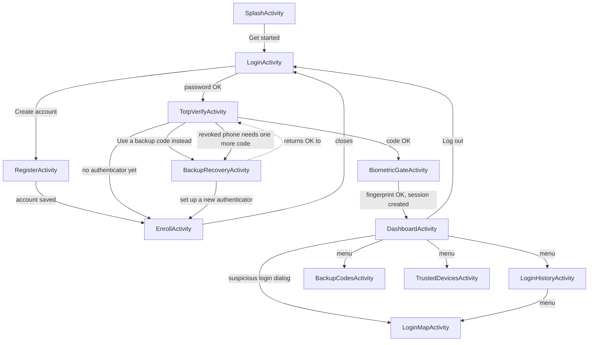

Profile, Settings and Help appear in the Dashboard menu but only show a "coming in a later phase" toast (see [Section 11](#11-not-implemented-and-known-issues)).

### 1.4 Technology stack

| Item | What this project uses | Where it is set |
|---|---|---|
| Language | **Java 11** only (no Kotlin, no Jetpack Compose, no Flutter/Dart) | `app/build.gradle.kts` (`compileOptions`) |
| UI | XML layouts + **Material Components** (Material 3, DayNight), **ViewBinding** instead of `findViewById` | `res/layout`, `res/values/themes.xml`, `buildFeatures` |
| Android versions | `minSdk 26`, `targetSdk 36`, `compileSdk 36` | `app/build.gradle.kts` |
| Build tools | Android Gradle Plugin 9.2.1, Gradle 9.4.1 | `gradle/libs.versions.toml`, `gradle/wrapper/gradle-wrapper.properties` |
| Storage | **SQLite only** through `SQLiteOpenHelper` (no Room, no Firebase, no server) | `data/DbHelper.java` |
| Crypto | `javax.crypto.Mac` (HMAC), PBKDF2WithHmacSHA256, AES-GCM in the Android Keystore | `crypto/` |
| Biometrics | `androidx.biometric` 1.1.0 (`BiometricPrompt`) | `BiometricGateActivity` |
| QR code | `com.journeyapps:zxing-android-embedded` 4.3.0 | `EnrollActivity` |
| Maps / location | `play-services-maps` 20.1.0, `play-services-location` 21.4.0 | `LoginMapActivity`, `LocationHelper` |
| Pull to refresh | `swiperefreshlayout` 1.2.0 | Dashboard |
| Other libraries | AppCompat 1.8.0, Material 1.14.0, ConstraintLayout 2.2.2 | `gradle/libs.versions.toml` |
| Tests | JUnit 4.13.2 (local), AndroidX Test JUnit 1.3.0 + Espresso 3.7.0 (on a device) | `app/src/test`, `app/src/androidTest` |

### 1.5 How to build and run

1. **Open** the folder `SecureAuthSimulator` in Android Studio (a version recent enough for Android Gradle Plugin 9.2.1) and let Gradle sync.
2. **Create an emulator**: a Pixel device with a recent *Google Play* system image. Inside the emulator set a **screen-lock PIN**, then add a fingerprint (*Settings → Security*, and *Extended controls → Fingerprint* to "touch" the sensor). Without a PIN or fingerprint the biometric step cannot finish.
3. **(Optional) Maps key** — to see map tiles, create `local.properties` in the project root with the line `MAPS_API_KEY=your_key_here`. The file is never committed. Without it the app still builds and runs; the map is simply blank (see [4.16](#416-build-and-release-config)).
4. **Run** the `app` configuration, or from a terminal in the project folder:

   | Task | Command (use `gradlew.bat` on Windows cmd/PowerShell) |
   |---|---|
   | Build a debug APK | `./gradlew assembleDebug` |
   | Local unit tests (no device) | `./gradlew test` |
   | Tests on a device or emulator | `./gradlew connectedAndroidTest` |

5. **Try the handshake**: *Get started → Create account* (tick "Trust this device") → scan the QR with Google Authenticator (or type the secret) → type the code to confirm → log in with the password → type the 6-digit code → confirm fingerprint/PIN → Dashboard.
6. **Fake a location** on the emulator with *Extended controls → Location* to see a login placed on the map.

### 1.6 Key numbers (counted from the repository)

| What | Count |
|---|---|
| Screens (Activities in `AndroidManifest.xml`) | 12 |
| Java source files in `app/src/main/java` (plus 6 `package-info.java` files) | 48 |
| Lines of Java in the app (all `main` files) | about 5,800 |
| XML layouts / menus / drawables | 16 / 4 / 4 (plus launcher icons) |
| SQLite tables | 6 |
| Local unit test files / `@Test` methods (`src/test`) | 15 / about 120 |
| Device test files / `@Test` methods (`src/androidTest`) | about 29 / about 200 |

*Test counts grow as phases are added; the exact list of test files is in [4.17](#417-tests).*

### 1.7 How to read the rest of this guide

- **New to Android?** Read [Section 10 (Glossary)](#10-glossary) first, then follow the beginner reading order in [Section 9.4](#94-reading-order-for-member-c-the-beginner).
- **Every method** in Section 4 has the same layout: *Signature → What it does → Inputs → output → Called by → Calls next → the real code.*
- **"Course components used here"**, **"Explain it simply"** and **"Viva questions"** close each component.
- **Workflows** (Section 5) are the best place to see how the files work *together*.

---

## 2. Architecture

### 2.1 The layers

The app is split into three layers plus a few pieces that belong to Android or Google rather than to us. The rule is: **a screen may call down, but lower layers never call up** (a DAO does not know which screen is using it).

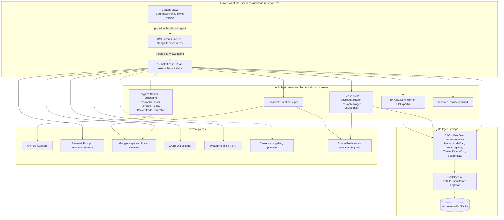

*Solid arrows exist in the code today. Dotted arrows are planned (Phases 13 and 14).*

### 2.2 The layers in plain English

**UI layer — "what you touch".** On Android every screen is an **Activity**. In this project each screen is two files: a Java class in `ui/` (what happens when you tap) and an XML layout in `res/layout/` (where the buttons and text boxes sit). The Java class never builds the layout by hand; it asks **ViewBinding** for a generated class (for example `ActivityLoginBinding`) that has one typed field per view. The only hand-made view is `CountdownRingView` in `views/`, which draws the shrinking ring with a `Canvas`. All screens extend `BaseActivity`, which holds the code every screen needs (session check, background thread, toast, clipboard, location prompt).

**Logic layer — "the rules".** This is code that makes decisions but does not draw anything: *crypto* (making and checking codes and hashes), *location* (finding where a login happened and how far it is from the last one), *io* (reading and writing CSV and text files) and the small rule classes in `data/` (`LockoutManager`, `SessionManager`, `DeviceTrust`). Because they have no screens, most of them can be tested on a plain computer with JUnit — the TOTP engine is tested against the official RFC 6238 test vectors without any phone.

**Data layer — "the memory".** Each of the six SQLite tables has one **DAO** (*Data Access Object*) class with methods such as `insert`, `getById` and `listForUser`. A DAO talks to the database through the single `DbHelper`. All SQL lives here, and every value goes through a `?` placeholder (never glued into the SQL text), which blocks SQL injection.

**External pieces.** The Android Keystore keeps the encryption key where our code cannot read it. `BiometricPrompt` is the system fingerprint dialog. Google Maps and the Fused Location Provider come from Google Play services. ZXing turns text into a QR image. The Storage Access Framework (SAF) is the system file picker that lets the user choose where a file is saved without the app asking for storage permission.

**Why split it like this?**

- **Beginner-friendly:** to understand "how is the code made?" you open one file (`TotpEngine`) instead of searching through screens.
- **Testable:** logic with no screens runs in milliseconds on a computer (`./gradlew test`).
- **Safe to change:** switching a screen's look never touches the database code, and changing a table touches only its DAO.
- **Security:** secrets are handled in a few small, reviewable classes instead of being scattered.

### 2.3 Two habits you will see in every screen

1. **Slow work goes off the screen thread.** Hashing a password with PBKDF2 (120,000 rounds) and reading SQLite take noticeable time; doing that on the UI thread would freeze the app. `BaseActivity.runInBackground(work, onDone)` runs `work` on a helper thread and then calls `onDone` back on the UI thread.
2. **Who is logged in is never read from an Intent extra on protected screens.** The early screens (Login → TOTP → Biometric) pass a `userId` extra because no session exists yet. Once the session exists, every protected screen calls `SessionManager.getInstance().getUserId()` — an extra "could name any user".

### 2.4 The complete project tree

Every file in the repository (generated folders such as `build/`, `.gradle/` and `.idea/` are not listed because Git ignores them). The text after `#` is the one-line purpose.

```text
SecureAuthSimulator/
├── CLAUDE.md                       # Tells Claude Code to read SECUREAUTH_PLAN.md first; no Flutter/Dart/Kotlin/Compose
├── SECUREAUTH_PLAN.md              # Master plan: rules, 16 phases, progress tracker, demo checklist
├── README.md                       # Project summary, feature table, build steps, team placeholders
├── .gitignore                      # Keeps build outputs, local.properties, keystores and APK/AAB files out of Git
├── build.gradle.kts                # Top-level Gradle file: declares the Android application plugin (not applied here)
├── settings.gradle.kts             # Repositories (Google, Maven Central), project name, includes the :app module
├── gradle.properties               # Gradle JVM memory, UTF-8, configuration cache switched on
├── gradlew / gradlew.bat           # Gradle wrapper launch scripts (Linux/macOS and Windows)
├── local.properties                # This PC's SDK path and optional MAPS_API_KEY (never committed)
├── gradle/
│   ├── libs.versions.toml          # Version catalog: every library and plugin version in one place
│   ├── gradle-daemon-jvm.properties# Which JDK (21) Gradle's daemon needs and where to download it
│   └── wrapper/
│       ├── gradle-wrapper.jar      # The small program that downloads the right Gradle
│       └── gradle-wrapper.properties# Pins Gradle 9.4.1
├── docs/
│   ├── CODEBASE_GUIDE.md           # This guide
│   ├── CONTRIBUTIONS.md            # Table of who built what, problems met and how they were solved (rubric 4)
│   ├── GENAI_USAGE.md              # Log template for AI assistance
│   └── VIVA_NOTES.md               # Per-phase viva bullets and examiner questions
└── app/
    ├── .gitignore                  # Ignores app/build
    ├── build.gradle.kts            # Module build: SDK levels, Maps key placeholder, ViewBinding, dependencies
    └── src/
        ├── main/
        │   ├── AndroidManifest.xml # Declares permissions, 12 screens, the Maps key, FileProvider
        │   ├── keepRules/rules.keep# Template R8 keep-rules file (nothing active in it yet)
        │   ├── java/com/secureauth/simulator/
        │   │   ├── crypto/
        │   │   │   ├── Base32.java            # Hand-written RFC 4648 Base32 encode/decode
        │   │   │   ├── TotpEngine.java        # Hand-written HOTP/TOTP (RFC 4226/6238), verify, otpauth link
        │   │   │   ├── PasswordHasher.java    # Salted PBKDF2-HMAC-SHA256 hashing and constant-time verify
        │   │   │   ├── KeystoreHelper.java    # AES-256-GCM encrypt/decrypt with a key inside the Android Keystore
        │   │   │   ├── BackupCodeGenerator.java# Makes/normalises/checks the 10 XXXX-XXXX backup codes
        │   │   │   └── package-info.java      # Package description comment
        │   │   ├── data/
        │   │   │   ├── DbHelper.java          # Creates secureauth.db and its 6 tables (SQLiteOpenHelper singleton)
        │   │   │   ├── User.java              # Model: one row of users
        │   │   │   ├── TotpAccount.java       # Model: one row of totp_accounts
        │   │   │   ├── BackupCode.java        # Model: one row of backup_codes
        │   │   │   ├── AuditLog.java          # Model: one row of audit_log
        │   │   │   ├── TrustedDevice.java     # Model: one row of trusted_devices
        │   │   │   ├── Session.java           # Model: one row of sessions
        │   │   │   ├── UserDao.java           # SQL for users (CRUD, failed-attempt counters, lock time)
        │   │   │   ├── TotpAccountDao.java    # SQL for totp_accounts (incl. atomic replaceForUser)
        │   │   │   ├── BackupCodeDao.java     # SQL for backup_codes (unused list, atomic markUsed, replaceForUser)
        │   │   │   ├── AuditLogDao.java       # SQL for audit_log (log, date-range list, bulk insert, last located login)
        │   │   │   ├── TrustedDeviceDao.java  # SQL for trusted_devices (list, rename/revoke via update)
        │   │   │   ├── SessionDao.java        # SQL for sessions (findValid, deleteExpired, deleteForUser)
        │   │   │   ├── AuditEvent.java        # Constants: event and result names written to audit_log
        │   │   │   ├── LockoutManager.java    # 3 strikes -> 5-minute lock, shared by every handshake step
        │   │   │   ├── SessionManager.java    # In-memory session token + its SHA-256 hash in the database
        │   │   │   ├── DeviceTrust.java       # Which row is "this phone"; trust, revoked check, name rules
        │   │   │   └── package-info.java      # Package description comment
        │   │   ├── io/
        │   │   │   ├── Csv.java               # Minimal RFC 4180 CSV writer/reader plus formula-injection guard
        │   │   │   ├── CsvImporter.java       # Validates and imports an audit-log CSV into the history
        │   │   │   ├── FileExporter.java      # Writes .txt/.csv through SAF; builds the CSV and backup-code text
        │   │   │   └── package-info.java      # Package description comment
        │   │   ├── location/
        │   │   │   ├── LocationHelper.java    # Optional one-shot location lookup, haversine distance, 100 km rule
        │   │   │   └── package-info.java      # Package description comment
        │   │   ├── receiver/
        │   │   │   └── package-info.java      # Only a comment: broadcast receivers are planned for Phase 14
        │   │   ├── views/
        │   │   │   ├── CountdownRingView.java # Custom View: Canvas ring that shrinks and turns red in the last 5 s
        │   │   │   └── package-info.java      # Package description comment
        │   │   └── ui/
        │   │       ├── BaseActivity.java      # Parent of every screen: session guard, background thread, toast, clipboard, location prompt
        │   │       ├── SplashActivity.java    # Launcher screen with the "Get started" button
        │   │       ├── RegisterActivity.java  # Create account: validation, strength hint, trust-device check box
        │   │       ├── LoginActivity.java     # Handshake step 1: username + password, lockout, audit, location
        │   │       ├── EnrollActivity.java    # QR + secret display, confirm with a live code, Keystore save, share
        │   │       ├── EnrollViewModel.java   # Keeps the new secret alive across rotation; wipes it when cleared
        │   │       ├── TotpVerifyActivity.java# Handshake step 2: 6-digit code, revoked-phone extra check
        │   │       ├── BackupRecoveryActivity.java # Spend a backup code to log in or to re-enroll
        │   │       ├── BiometricGateActivity.java  # Handshake step 3: BiometricPrompt, session creation, suspicious check
        │   │       ├── BiometricSupport.java  # Pure logic: which authenticators to ask for, what a result means
        │   │       ├── DashboardActivity.java # Live code, ring, tap-to-copy, swipe refresh, options menu, logout
        │   │       ├── BackupCodesActivity.java    # Generate 10 codes, show once, save .txt, share, remaining count
        │   │       ├── BackupCodesViewModel.java   # Holds generated codes and the slow generation across rotation
        │   │       ├── LoginHistoryActivity.java   # ListView + SimpleAdapter, date filter, CSV export/import
        │   │       ├── LoginMapActivity.java  # Google Map with green/red markers for located entries
        │   │       ├── TrustedDevicesActivity.java # ListView of phones, long-press Rename / Revoke
        │   │       ├── InputRules.java        # Username/password rules and password-strength hint
        │   │       ├── AfterTextChangedListener.java # One-method TextWatcher helper
        │   │       ├── DateRange.java         # Turns picked days into start/end-of-day millisecond values
        │   │       ├── HistoryFormat.java     # Wording of a history row: "lat, lng" text and failure test
        │   │       └── MapMarkers.java        # Decides which entries become which marker (pure logic)
        │   └── res/
        │       ├── layout/
        │       │   ├── activity_splash.xml          # Splash: logo text, tagline, button
        │       │   ├── activity_login.xml           # Login form (two text fields, two buttons)
        │       │   ├── activity_register.xml        # Register form (3 fields, strength text, check box)
        │       │   ├── activity_enroll.xml          # QR image, grouped secret, Copy, confirm section
        │       │   ├── activity_totp_verify.xml     # Big 6-digit field and "Use a backup code" link
        │       │   ├── activity_biometric_gate.xml  # Status text, Try again, Back to log in
        │       │   ├── activity_dashboard.xml       # Toolbar, SwipeRefreshLayout, ring + code + issuer
        │       │   ├── activity_backup_codes.xml    # Remaining count and "Generate new codes" button
        │       │   ├── activity_backup_recovery.xml # RadioGroup (two options), code field, Continue
        │       │   ├── activity_login_history.xml   # Toolbar, filter button + chip, ListView, empty text
        │       │   ├── activity_login_map.xml       # Toolbar, map fragment, empty text, legend
        │       │   ├── activity_trusted_devices.xml # Toolbar, ListView, empty text
        │       │   ├── dialog_backup_codes.xml      # Content of the "show codes once" dialog
        │       │   ├── dialog_rename_device.xml     # Content of the rename dialog (one text field)
        │       │   ├── item_history.xml             # One row of the history list
        │       │   └── item_trusted_device.xml      # One row of the trusted-devices list
        │       ├── menu/
        │       │   ├── menu_dashboard.xml           # Options menu: history, codes, devices, profile, settings, help, logout
        │       │   ├── menu_login_history.xml       # Options menu: login map, export CSV, import CSV
        │       │   ├── context_enroll_qr.xml        # Long-press menu on the QR: copy secret, share image
        │       │   └── context_trusted_device.xml   # Long-press menu on a device: rename, revoke
        │       ├── values/
        │       │   ├── strings.xml                  # Every piece of user-visible text (no hard-coded text in layouts)
        │       │   ├── colors.xml                   # Light palette: navy primary, teal secondary
        │       │   └── themes.xml                   # Material 3 DayNight theme and four text appearances
        │       ├── values-night/colors.xml          # Dark-mode versions of the same colour names
        │       ├── drawable/
        │       │   ├── ic_status_ok.xml             # Check-mark vector used for success rows
        │       │   ├── ic_status_fail.xml           # Cross vector used for failure rows
        │       │   ├── ic_launcher_background.xml   # Launcher icon background (Android Studio default template)
        │       │   └── ic_launcher_foreground.xml   # Launcher icon foreground (Android Studio default template)
        │       ├── mipmap-anydpi/ic_launcher.xml, ic_launcher_round.xml  # Adaptive launcher icon definitions
        │       ├── mipmap-mdpi|hdpi|xhdpi|xxhdpi|xxxhdpi/ic_launcher.webp, ic_launcher_round.webp  # Bitmap icons per density
        │       └── xml/
        │           ├── file_paths.xml               # FileProvider: only cache/qr may be shared
        │           ├── backup_rules.xml             # Auto-backup rules for Android 11 and older (template, no rules)
        │           └── data_extraction_rules.xml    # Cloud/device-transfer backup rules for Android 12+ (template, no rules)
        ├── test/java/com/secureauth/simulator/     # Local unit tests: run on the computer, no phone
        │   ├── ExampleUnitTest.java                # Android Studio template test (2 + 2 = 4)
        │   ├── crypto/Base32Test.java              # RFC 4648 vectors, round trips, rejection of bad input
        │   ├── crypto/TotpEngineTest.java          # RFC 6238 vectors (SHA-1/SHA-256), +-1 window, otpauth link
        │   ├── crypto/PasswordHasherTest.java      # Verify/reject, salts differ, matches an independent PBKDF2
        │   ├── crypto/BackupCodeGeneratorTest.java # 10 unique codes, alphabet, hashing, normalising
        │   ├── data/SessionTokenTest.java          # Token is 32 random bytes; hash is SHA-256 in Base64
        │   ├── data/DeviceNameTest.java            # Device-name joining, cleaning and 1-40 length rule
        │   ├── io/CsvTest.java                     # CSV escape/parse, line endings, BOM, formula guard
        │   ├── io/CsvImporterParseTest.java        # Header rules, bad rows counted, limits, export-import round trip
        │   ├── io/FileExporterTest.java            # Backup-code text and audit CSV format
        │   ├── location/LocationHelperTest.java    # Haversine distances and the 100 km threshold
        │   ├── ui/BiometricSupportTest.java        # Authenticator choice and result mapping
        │   ├── ui/HistoryHelpersTest.java          # Location text, failure test, date-range maths
        │   ├── ui/InputRulesTest.java              # Username/password rules and strength
        │   └── ui/MapMarkersTest.java              # Which entries get which marker colour
        └── androidTest/java/com/secureauth/simulator/  # Instrumented tests: run on an emulator/phone
            ├── ExampleInstrumentedTest.java        # Android Studio template test (package name)
            ├── crypto/KeystoreHelperTest.java      # Round trip, fresh IV, tamper rejection, key alias
            ├── crypto/TotpEngineDeviceTest.java    # RFC vector on Android's own crypto provider
            ├── data/UserDaoTest.java               # CRUD, unique name, injection text, counters, lock
            ├── data/AuditLogDaoTest.java           # Location null vs 0.0, ordering, inclusive date range
            ├── data/RelatedTablesDaoTest.java      # Foreign keys, cascade, replaceForUser, markUsed, sessions
            ├── data/LockoutManagerTest.java        # 3 strikes, 5 minutes, expiry, formatting
            ├── data/SessionManagerTest.java        # Session create/check/clear, auto-lock bounds
            ├── data/DeviceTrustTest.java           # Trust this phone once, revoked check, per-user separation
            ├── io/CsvImporterDeviceTest.java       # Import into a real DB, duplicates, size limit
            ├── io/FileExporterDeviceTest.java      # Writing through a ContentResolver
            ├── location/LocationHelperDeviceTest.java # Settings and permission state
            ├── views/CountdownRingViewTest.java    # Progress clamp, warning threshold, drawing, square size
            └── ui/                                 # Espresso screen tests
                ├── TestUtils.java                  # Shared helpers: create user, enroll, wait for a screen, current code
                ├── FakeLocationHelper.java         # Scripted LocationHelper ("user is in Mumbai" / "said no")
                ├── SplashActivityTest.java         # Splash shows logo and button
                ├── AuthFlowTest.java               # Register + password login, lockout, generic error
                ├── TotpVerifyFlowTest.java         # Auto-submit, shared counter, lock, backup link
                ├── EnrollFlowTest.java             # Grouped secret, QR content, confirm, Keystore storage, context menu
                ├── BiometricGateFlowTest.java      # Session creation, cancel, errors, suspicious login
                ├── DashboardFlowTest.java          # Live code, copy, menu, logout, session expiry
                ├── BackupCodesFlowTest.java        # Generate, show once, rotation, replace set
                ├── BackupRecoveryFlowTest.java     # Spend a code once, lock, re-enroll path
                ├── LoginHistoryFlowTest.java       # List, icons, date filter, export, import
                ├── LoginLocationFlowTest.java      # Location rationale, rows carry a place
                ├── LoginMapFlowTest.java           # One marker per located entry, legend
                ├── RegisterTrustFlowTest.java      # Check box adds this phone to trusted devices
                ├── RevokedDeviceLoginTest.java     # Revoked phone needs a backup code before the biometric step
                └── TrustedDevicesFlowTest.java     # List, rename, revoke, warnings
```

Build output (`app/build`, `build/`) and the Android Studio folder `.idea/` are generated and ignored. The folder `app/src/main/assets` does **not** exist: the planned Help page (`help.html`) has not been written.

---

## 3. Database

### 3.1 Overview

The app uses one SQLite file, **`secureauth.db`**, created by `DbHelper` the first time the app runs. It has **six tables**. All timestamps are **epoch milliseconds** (milliseconds since 1 January 1970). Foreign keys are switched on in `DbHelper.onConfigure`, and every child table uses `ON DELETE CASCADE`, so deleting a user removes all of their rows. The schema version is `1` and `onUpgrade` is empty (there is nothing to migrate yet).

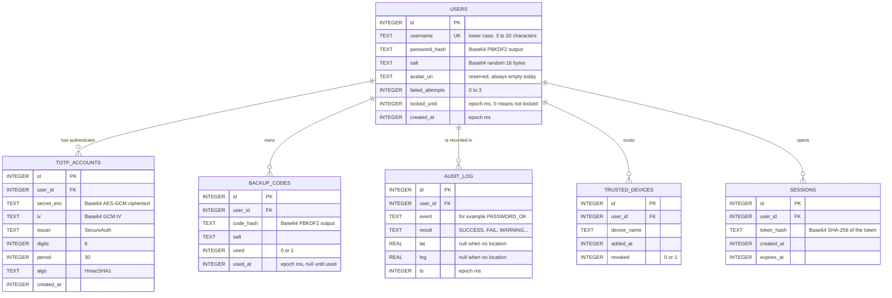

The real `CREATE TABLE` statements, copied from `DbHelper.onCreate` (the whole file is shown, line by line, in [4.2](#42-data-layer)):

```java
db.execSQL("CREATE TABLE " + TABLE_USERS + " ("
        + "id INTEGER PRIMARY KEY AUTOINCREMENT, "
        + "username TEXT NOT NULL UNIQUE, "
        + "password_hash TEXT NOT NULL, "
        + "salt TEXT NOT NULL, "
        + "avatar_uri TEXT, "
        + "failed_attempts INTEGER NOT NULL DEFAULT 0, "
        + "locked_until INTEGER NOT NULL DEFAULT 0, "
        + "created_at INTEGER NOT NULL)");
```

```java
db.execSQL("CREATE TABLE " + TABLE_TOTP_ACCOUNTS + " ("
        + "id INTEGER PRIMARY KEY AUTOINCREMENT, "
        + "user_id INTEGER NOT NULL REFERENCES users(id) ON DELETE CASCADE, "
        + "secret_enc TEXT NOT NULL, "
        + "iv TEXT NOT NULL, "
        + "issuer TEXT, "
        + "digits INTEGER NOT NULL DEFAULT 6, "
        + "period INTEGER NOT NULL DEFAULT 30, "
        + "algo TEXT NOT NULL DEFAULT 'HmacSHA1', "
        + "created_at INTEGER NOT NULL)");
```

```java
db.execSQL("CREATE TABLE " + TABLE_BACKUP_CODES + " ("
        + "id INTEGER PRIMARY KEY AUTOINCREMENT, "
        + "user_id INTEGER NOT NULL REFERENCES users(id) ON DELETE CASCADE, "
        + "code_hash TEXT NOT NULL, "
        + "salt TEXT NOT NULL, "
        + "used INTEGER NOT NULL DEFAULT 0, "
        + "used_at INTEGER)");
```

```java
db.execSQL("CREATE TABLE " + TABLE_AUDIT_LOG + " ("
        + "id INTEGER PRIMARY KEY AUTOINCREMENT, "
        + "user_id INTEGER NOT NULL REFERENCES users(id) ON DELETE CASCADE, "
        + "event TEXT NOT NULL, "
        + "result TEXT, "
        + "lat REAL, "
        + "lng REAL, "
        + "ts INTEGER NOT NULL)");
// History screens always filter by user and sort by time, so index exactly that
db.execSQL("CREATE INDEX idx_audit_log_user_ts ON " + TABLE_AUDIT_LOG + " (user_id, ts)");
```

```java
db.execSQL("CREATE TABLE " + TABLE_TRUSTED_DEVICES + " ("
        + "id INTEGER PRIMARY KEY AUTOINCREMENT, "
        + "user_id INTEGER NOT NULL REFERENCES users(id) ON DELETE CASCADE, "
        + "device_name TEXT NOT NULL, "
        + "added_at INTEGER NOT NULL, "
        + "revoked INTEGER NOT NULL DEFAULT 0)");
```

```java
db.execSQL("CREATE TABLE " + TABLE_SESSIONS + " ("
        + "id INTEGER PRIMARY KEY AUTOINCREMENT, "
        + "user_id INTEGER NOT NULL REFERENCES users(id) ON DELETE CASCADE, "
        + "token_hash TEXT NOT NULL, "
        + "created_at INTEGER NOT NULL, "
        + "expires_at INTEGER NOT NULL)");
```


Besides the database the app keeps a few small things elsewhere:

| Where | What | Written by | Read by |
|---|---|---|---|
| `SharedPreferences` file `secureauth_prefs` → `location_asked` | `true` once the location explanation was shown | `LocationHelper.markAsked` | `LocationHelper.wasAsked` |
| same file → `trusted_device_id_<userId>` | Row id of *this phone* in `trusted_devices` | `DeviceTrust.trustCurrentDevice` | `DeviceTrust.currentDeviceId`, `isCurrentDeviceRevoked` |
| same file → `auto_lock_ms` | Auto-lock time (1–30 min) | **nothing yet** (the Settings screen is not built) | `SessionManager.getAutoLockMs` (default 5 min) |
| same file → `record_location` | "Record login location" switch | **nothing yet** (Settings not built) | `LocationHelper.isRecordingEnabled` (default on) |
| App cache file `cache/qr/enroll_qr.png` | The QR image while sharing | `EnrollActivity.writeQrToCache` | other app via FileProvider; deleted in `EnrollActivity.onDestroy` |

### 3.2 Table `users`

| Column | Type | Meaning |
|---|---|---|
| `id` | INTEGER PK AUTOINCREMENT | The user's number; used as `userId` everywhere |
| `username` | TEXT NOT NULL UNIQUE | Lower-cased, trimmed name (3–20 chars); the UNIQUE rule is why `UserDao.insert` returns `-1` for a taken name |
| `password_hash` | TEXT NOT NULL | Base64 of the 32-byte PBKDF2-HMAC-SHA256 result |
| `salt` | TEXT NOT NULL | Base64 of the 16 random bytes mixed into that hash |
| `avatar_uri` | TEXT (nullable) | Reserved for the profile photo (Phase 13); nothing writes it today |
| `failed_attempts` | INTEGER DEFAULT 0 | Wrong steps in a row (password, TOTP, biometric, backup code share this one counter) |
| `locked_until` | INTEGER DEFAULT 0 | Epoch ms until which the account is locked; `0` = not locked |
| `created_at` | INTEGER NOT NULL | When the account was created |

| DAO method | Who calls it (screen → method) |
|---|---|
| `UserDao.insert` | Register → `RegisterActivity.createAccount` |
| `UserDao.findByUsername` | Register → `createAccount` (name free?); Login → `LoginActivity.checkPassword` |
| `UserDao.getById` | `LockoutManager.recordFailure`; TOTP → `loadScreenData`, `checkCode`; Backup recovery → `loadState`, `checkCode`; Enroll → `loadQrCode` (username for the QR); Dashboard → `loadData` (username); Backup codes → `generationWork` (username in the file text) |
| `UserDao.incrementFailedAttempts` / `resetFailedAttempts` / `setLockedUntil` | only through `LockoutManager` (used by Login, TOTP, Backup recovery, Biometric) |
| `UserDao.list`, `update`, `delete` | tests only (no screen uses them) |

### 3.3 Table `totp_accounts`

| Column | Meaning |
|---|---|
| `id`, `user_id` | Row id and owner (foreign key → `users.id`) |
| `secret_enc` | Base64 of the AES-GCM ciphertext of the 20-byte TOTP secret (the secret itself is never stored) |
| `iv` | Base64 of the GCM initialisation vector used for that encryption |
| `issuer` | Label shown in authenticator apps (`SecureAuth`) |
| `digits`, `period`, `algo` | 6, 30 and `HmacSHA1` by default (what Google Authenticator expects) |
| `created_at` | When the authenticator was confirmed |

| DAO method | Who calls it |
|---|---|
| `TotpAccountDao.replaceForUser` | Enroll → `EnrollActivity.saveAccount` (after the user typed a correct code) |
| `TotpAccountDao.listForUser` | TOTP → `loadScreenData`; Dashboard → `loadData` |
| `insert`, `getById`, `update`, `delete` | tests only |

### 3.4 Table `backup_codes`

| Column | Meaning |
|---|---|
| `id`, `user_id` | Row id and owner |
| `code_hash`, `salt` | Base64 PBKDF2 hash of the code `XXXX-XXXX` and its own random salt (the plain code exists only on screen once) |
| `used` | `0` = still usable, `1` = spent |
| `used_at` | Epoch ms when it was spent; `NULL` until then |

| DAO method | Who calls it |
|---|---|
| `BackupCodeDao.replaceForUser` | Backup codes → `BackupCodesActivity.generationWork` (swap the whole set in one transaction) |
| `BackupCodeDao.listForUser` | Backup codes → `refreshRemaining` ("7 of 10 codes remaining") |
| `BackupCodeDao.listUnused` | Backup recovery → `loadState`, `checkCode`; Trusted devices → `askToRevoke` (must have at least one) |
| `BackupCodeDao.markUsed` | Backup recovery → `checkCode` (atomic: `WHERE used = 0`) |
| `insert`, `getById`, `update`, `delete` | tests only |

### 3.5 Table `audit_log`

| Column | Meaning |
|---|---|
| `id`, `user_id` | Row id and owner |
| `event` | What happened, one of the constants in `AuditEvent` (`REGISTER`, `PASSWORD_OK`, `TOTP_FAIL`, `SESSION_START`, `DEVICE_REVOKED`, ...) |
| `result` | `SUCCESS`, `FAIL`, `WARNING`, `CANCELLED` or `ERROR` |
| `lat`, `lng` | Where it happened; `NULL` (not `0.0`) when there is no location. Only `PASSWORD_OK`, `PASSWORD_FAIL`, `SESSION_START` and `SUSPICIOUS_LOCATION` rows carry a place |
| `ts` | Epoch ms |

Index: `idx_audit_log_user_ts` on `(user_id, ts)`, because every history screen filters by user and sorts by time.

| DAO method | Who calls it |
|---|---|
| `AuditLogDao.log` (two overloads) | `RegisterActivity`, `LoginActivity`, `LockoutManager.recordFailure`, `EnrollActivity`, `TotpVerifyActivity`, `BackupRecoveryActivity`, `BackupCodesActivity`, `BiometricGateActivity`, `BaseActivity.endSession`, `DeviceTrust.trustCurrentDevice`, `TrustedDevicesActivity` |
| `AuditLogDao.findLastWithLocation` | Biometric → `completeLogin` (where was the previous `SESSION_START`?) |
| `AuditLogDao.listForUser` | History → `loadHistory`; Map → `onMapReady`; `CsvImporter.importInto` (duplicate check) |
| `AuditLogDao.listForUserBetween` | History → `loadHistory` when a date filter is on |
| `AuditLogDao.insertAll` | `CsvImporter.importInto` (History → Import CSV) |
| `insert`, `getById`, `update`, `delete` | `insert` is used inside `log`; the rest are tests only |

### 3.6 Table `trusted_devices`

| Column | Meaning |
|---|---|
| `id`, `user_id` | Row id and owner |
| `device_name` | Manufacturer + model (for example "Google Pixel 8") until the user renames it |
| `added_at` | When the phone was trusted |
| `revoked` | `0` = trusted, `1` = revoked (the row is kept so the list shows it) |

| DAO method | Who calls it |
|---|---|
| `TrustedDeviceDao.insert` | Register → `RegisterActivity.createAccount` → `DeviceTrust.trustCurrentDevice` (only if "Trust this device" was ticked) |
| `TrustedDeviceDao.getById` | `DeviceTrust.trustCurrentDevice`, `DeviceTrust.isCurrentDeviceRevoked` (called by TOTP → `continueAfterCodeStep`); Trusted devices → `rename`, `revoke` |
| `TrustedDeviceDao.listForUser` | Trusted devices → `loadDevices` |
| `TrustedDeviceDao.update` | Trusted devices → `rename` (changes the name) and `revoke` (sets `revoked`) |
| `TrustedDeviceDao.delete` | no screen (tests only) |

### 3.7 Table `sessions`

| Column | Meaning |
|---|---|
| `id`, `user_id` | Row id and owner |
| `token_hash` | Base64 SHA-256 of the 32-byte random session token (the raw token lives only in memory) |
| `created_at`, `expires_at` | Start and end of the session; `expires_at = created_at + auto-lock time` |

| DAO method | Who calls it |
|---|---|
| `SessionDao.deleteExpired`, `deleteForUser`, `insert` | `SessionManager.create` (Biometric → `completeLogin`) |
| `SessionDao.findValid` | `SessionManager.check` (every protected screen via `BaseActivity.enforceSession`) |
| `SessionDao.delete` | `BaseActivity.endSession` (logout, expiry) |
| `getById`, `listForUser`, `update` | tests only |

### 3.8 Which screen touches which table (summary)

| Screen | Reads | Writes |
|---|---|---|
| Register | users | users, audit_log, trusted_devices |
| Login | users | users (counters), audit_log |
| Enroll | users | totp_accounts, audit_log |
| TOTP verify | users, totp_accounts, trusted_devices | users (counters), audit_log |
| Backup recovery | users, backup_codes | users (counters), backup_codes (`used`), audit_log |
| Biometric gate | audit_log (last login place) | users (counters), sessions, audit_log |
| Dashboard | users, totp_accounts, sessions | sessions (logout), audit_log |
| Backup codes | users, backup_codes | backup_codes, audit_log |
| Login history | audit_log | audit_log (CSV import) |
| Login map | audit_log | — |
| Trusted devices | trusted_devices, backup_codes | trusted_devices, audit_log |

---

## 4. Major components

Section 4 has one sub-section for every component of the app. Each one follows the same pattern:

- **a. Purpose**, **b. Files involved** (Java, layouts, menus, resources),
- **c. Every class and every method** — *signature → what it does → inputs → output → called by → calls next → the real code*,
- **d. Full annotated code** for the core files (Base32, TOTP engine, password hashing, Keystore, database helper),
- **e. Course components used here** (table), **f. Explain it simply** (for the viva), **g. Three viva questions**.

| Sub-section | Component | Main files |
|---|---|---|
| 4.1 | Crypto engine | `crypto/*` |
| 4.2 | Data layer | `data/*` |
| 4.3 | UI foundation and Splash | `BaseActivity`, `SplashActivity`, small helpers, theme |
| 4.4 | Registration and Login | `RegisterActivity`, `LoginActivity`, `InputRules` |
| 4.5 | Enrollment and QR | `EnrollActivity`, `EnrollViewModel` |
| 4.6 | TOTP verification and Dashboard (with custom views) | `TotpVerifyActivity`, `DashboardActivity`, `CountdownRingView` |
| 4.7 | Biometric and Sessions | `BiometricGateActivity`, `BiometricSupport`, `SessionManager` |
| 4.8 | Backup codes and Recovery | `BackupCodesActivity`, `BackupCodesViewModel`, `BackupRecoveryActivity` |
| 4.9 | Login history and CSV | `LoginHistoryActivity`, `io/*`, `DateRange`, `HistoryFormat` |
| 4.10 | Location and Map | `LocationHelper`, `LoginMapActivity`, `MapMarkers` |
| 4.11 | Trusted devices | `TrustedDevicesActivity`, `DeviceTrust` |
| 4.12–4.15 | Profile, Settings, Help, Receivers | **not built yet** |
| 4.16 | Build and release config | Gradle files, manifest, `res/xml` |
| 4.17 | Tests | `src/test`, `src/androidTest` |

### 4.1 Crypto engine

#### a. Purpose

This package is the heart of the project and the main "self-learning" part. It turns a secret and the clock into the 6-digit code (`TotpEngine`, with its own `Base32`), protects passwords and backup codes with slow salted hashes (`PasswordHasher`, `BackupCodeGenerator`), and encrypts the TOTP secret with a key that never leaves the Android Keystore (`KeystoreHelper`). Only the HMAC primitive itself comes from Java (`javax.crypto.Mac`); everything around it is written in this repository.

#### b. Files involved

| Kind | Files |
|---|---|
| Java | `app/src/main/java/com/secureauth/simulator/crypto/Base32.java`, `TotpEngine.java`, `PasswordHasher.java`, `KeystoreHelper.java`, `BackupCodeGenerator.java` (and `package-info.java`) |
| XML layouts / menus | none (this package has no screens) |
| Resources | none |
| Used by | `RegisterActivity`, `LoginActivity` (passwords); `EnrollActivity`, `EnrollViewModel`, `TotpVerifyActivity`, `DashboardActivity` (codes and secret); `BackupCodesActivity`, `BackupRecoveryActivity` (backup codes) |

#### c. Classes and methods

##### Class `Base32`

**File:** `app/src/main/java/com/secureauth/simulator/crypto/Base32.java` (99 lines)

Purpose: authenticator apps exchange secrets as **Base32** text (letters `A–Z` and digits `2–7`, easy to read out and type). Every 5 bytes (40 bits) become 8 characters of 5 bits each. The class has a private empty constructor, so it is used only through its static methods.

**Signature:** `public static String encode(byte[] data)`

- **What it does:** Turns bytes into uppercase Base32 text without `=` padding. It keeps a small "bit bucket"; for every input byte it adds 8 bits, and while the bucket holds 5 or more bits it removes 5 and writes one symbol from `ALPHABET`. A short last group is padded with zero bits.
- **Inputs → output:** `byte[]` (the 20-byte secret) → `String` of 32 characters.
- **Called by:** `EnrollViewModel` (field `base32Secret`) when a new secret is made; the unit tests.
- **Calls next:** `StringBuilder`, `ALPHABET.charAt`; nothing else.

```java
/** Encodes bytes as uppercase Base32 without '=' padding. */
public static String encode(byte[] data) {
    StringBuilder out = new StringBuilder((data.length * 8 + 4) / 5);
    int buffer = 0;     // bits waiting to be written
    int bitsInBuffer = 0;

    for (byte b : data) {
        // Push 8 new bits in at the right-hand end
        buffer = (buffer << 8) | (b & 0xFF);
        bitsInBuffer += 8;
        // Take 5 bits at a time from the left-hand end
        while (bitsInBuffer >= 5) {
            int index = (buffer >> (bitsInBuffer - 5)) & 0x1F;
            out.append(ALPHABET.charAt(index));
            bitsInBuffer -= 5;
        }
        // Keep only the bits not yet written so the int cannot overflow
        buffer &= (1 << bitsInBuffer) - 1;
    }

    if (bitsInBuffer > 0) {
        // Last group is short: pad with zero bits on the right to make 5
        int index = (buffer << (5 - bitsInBuffer)) & 0x1F;
        out.append(ALPHABET.charAt(index));
    }
    return out.toString();
}
```


**Signature:** `public static byte[] decode(String text)`

- **What it does:** The reverse: Base32 text → original bytes. It accepts lower case, spaces and trailing `=`, and throws `IllegalArgumentException` for any other character or an impossible length (1, 3 or 6 symbols left over).
- **Inputs → output:** `String` → `byte[]` (or an exception).
- **Called by:** Only the unit tests today (`Base32Test`). The app never needs to decode because it keeps the raw secret bytes and encodes them only for display.
- **Calls next:** `stripSpacesAndPadding`, `ALPHABET.indexOf`, `ByteArrayOutputStream`.

```java
/**
 * Decodes Base32 text. Lower case, spaces and trailing '=' padding are accepted
 * (people copy secrets that way); any other character throws IllegalArgumentException.
 */
public static byte[] decode(String text) {
    if (text == null) {
        throw new IllegalArgumentException("Base32 text is null");
    }
    String clean = stripSpacesAndPadding(text).toUpperCase(java.util.Locale.ROOT);

    // Lengths 1, 3 and 6 (mod 8) can never come from whole bytes
    int rem = clean.length() % 8;
    if (rem == 1 || rem == 3 || rem == 6) {
        throw new IllegalArgumentException("Invalid Base32 length");
    }

    ByteArrayOutputStream out = new ByteArrayOutputStream(clean.length() * 5 / 8);
    int buffer = 0;
    int bitsInBuffer = 0;

    for (int i = 0; i < clean.length(); i++) {
        int value = ALPHABET.indexOf(clean.charAt(i));
        if (value < 0) {
            throw new IllegalArgumentException("Invalid Base32 character: '" + clean.charAt(i) + "'");
        }
        // Push 5 new bits in; whenever 8 are ready, write one byte
        buffer = (buffer << 5) | value;
        bitsInBuffer += 5;
        if (bitsInBuffer >= 8) {
            out.write((buffer >> (bitsInBuffer - 8)) & 0xFF);
            bitsInBuffer -= 8;
            buffer &= (1 << bitsInBuffer) - 1;
        }
    }
    // Any leftover bits (fewer than 8) are the zero padding added by encode, so drop them
    return out.toByteArray();
}
```


**Signature:** `private static String stripSpacesAndPadding(String text)`

- **What it does:** Removes all whitespace and any `=` at the end, so `"abcd efgh=="` becomes `"abcdefgh"`. An `=` in the middle is kept so that `decode` rejects it.
- **Inputs → output:** `String` → cleaned `String`.
- **Called by:** `Base32.decode`.
- **Calls next:** `Character.isWhitespace`.

```java
/** Removes whitespace everywhere and '=' only at the end; '=' in the middle stays and is rejected. */
private static String stripSpacesAndPadding(String text) {
    StringBuilder sb = new StringBuilder(text.length());
    for (int i = 0; i < text.length(); i++) {
        char c = text.charAt(i);
        if (!Character.isWhitespace(c)) {
            sb.append(c);
        }
    }
    int end = sb.length();
    while (end > 0 && sb.charAt(end - 1) == '=') {
        end--;
    }
    return sb.substring(0, end);
}
```


##### Class `TotpEngine`

**File:** `app/src/main/java/com/secureauth/simulator/crypto/TotpEngine.java` (195 lines)

Purpose: **HOTP** (RFC 4226) and **TOTP** (RFC 6238). Both phone and server know a *secret* and the *clock*. Time is cut into steps (30 s); the step number is run through **HMAC** with the secret and the result is squeezed down to 6 decimal digits.

**Signature:** `public static byte[] generateSecret()`

- **What it does:** Makes a new 20-byte (160-bit) secret from `SecureRandom`, the operating system's cryptographically secure generator.
- **Inputs → output:** nothing → `byte[20]`.
- **Called by:** `EnrollViewModel` (field `secret`).
- **Calls next:** `SecureRandom.nextBytes`.

```java
/** New random secret from the system's cryptographically secure generator. */
public static byte[] generateSecret() {
    byte[] secret = new byte[SECRET_BYTES];
    RANDOM.nextBytes(secret);
    return secret;
}
```


**Signature:** `public static String generate(byte[] secret, long unixTimeMillis, int digits, int periodSeconds, String algo)`

- **What it does:** Computes the code for the time step that contains `unixTimeMillis`, in 8 numbered steps (counter → 8 bytes → HMAC → offset → 4 bytes → clear top bit → modulo → zero-pad). The result is always exactly `digits` characters, e.g. `"007081"`.
- **Inputs → output:** secret bytes, time in ms, 6–8 digits, period in seconds, `"HmacSHA1"` or `"HmacSHA256"` → code `String`.
- **Called by:** `DashboardActivity.updateCode` every second; `TotpEngine.verify` (three times per check).
- **Calls next:** `checkParameters`, `hmac`.

```java
/**
 * Returns the code for the time step containing unixTimeMillis, e.g. "287082".
 * The result is left-padded with zeros to exactly {@code digits} characters.
 */
public static String generate(byte[] secret, long unixTimeMillis, int digits,
                              int periodSeconds, String algo) {
    checkParameters(secret, digits, periodSeconds, algo);

    // Step 1: which time step are we in? (whole seconds since 1970, divided by the period)
    long counter = Math.floorDiv(unixTimeMillis, 1000L * periodSeconds);

    // Step 2: write the counter as 8 bytes, most significant byte first (big-endian)
    byte[] message = new byte[8];
    for (int i = 7; i >= 0; i--) {
        message[i] = (byte) (counter & 0xFF);
        counter >>>= 8;
    }

    // Step 3: HMAC the counter with the secret (20 bytes for SHA-1, 32 for SHA-256)
    byte[] hash = hmac(secret, message, algo);

    // Step 4 (RFC 4226 section 5.3, dynamic truncation): the low 4 bits of the
    // LAST byte choose where to read from, so the 4 bytes taken vary from code to code
    int offset = hash[hash.length - 1] & 0x0F;

    // Step 5: read 4 bytes starting at offset and join them into one 32-bit number
    int fourBytes = ((hash[offset] & 0xFF) << 24)
            | ((hash[offset + 1] & 0xFF) << 16)
            | ((hash[offset + 2] & 0xFF) << 8)
            | (hash[offset + 3] & 0xFF);

    // Step 6: clear the top bit so the number is never negative in Java's signed int
    int binary = fourBytes & 0x7FFFFFFF;

    // Step 7: keep only the last `digits` decimal digits
    int modulus = 1;
    for (int i = 0; i < digits; i++) {
        modulus *= 10;
    }
    int otp = binary % modulus;

    // Step 8: add leading zeros back, because "007081" must stay 6 characters long
    StringBuilder code = new StringBuilder(Integer.toString(otp));
    while (code.length() < digits) {
        code.insert(0, '0');
    }
    return code.toString();
}
```


**Signature:** `public static boolean verify(byte[] secret, String code, long nowMillis, int digits, int periodSeconds, String algo)`

- **What it does:** Accepts the code if it is correct for the current time step **or one step before or after** (±30 s) to forgive clock drift and typing delay. Compares in constant time and does not stop at the first match, so timing does not leak which window matched.
- **Inputs → output:** secret, typed code, now, digits, period, algorithm → `boolean`.
- **Called by:** `EnrollActivity.onConfirmClicked` (enrollment check) and `TotpVerifyActivity.checkCode` (login step 2).
- **Calls next:** `checkParameters`, `generate` (for steps −1, 0, +1), `MessageDigest.isEqual`.

```java
/**
 * True if {@code code} is correct for the current step or one step before or after.
 * The +-1 window forgives small clock differences and typing delay.
 */
public static boolean verify(byte[] secret, String code, long nowMillis, int digits,
                             int periodSeconds, String algo) {
    checkParameters(secret, digits, periodSeconds, algo);
    if (code == null || code.length() != digits) {
        return false;
    }
    byte[] given = code.getBytes(StandardCharsets.UTF_8);

    boolean match = false;
    for (int step = -1; step <= 1; step++) {
        long time = nowMillis + (long) step * periodSeconds * 1000L;
        if (time < 0) {
            continue; // before 1970: no such time step
        }
        byte[] expected = generate(secret, time, digits, periodSeconds, algo)
                .getBytes(StandardCharsets.UTF_8);
        // Constant-time compare, and no early exit, so timing does not reveal
        // how many digits were right or which window matched
        match |= MessageDigest.isEqual(expected, given);
    }
    return match;
}
```


**Signature:** `public static String formatForDisplay(String code)`

- **What it does:** Inserts one space in the middle so the code is easier to read: `123456` → `123 456`.
- **Inputs → output:** `String` → `String`.
- **Called by:** `DashboardActivity.updateCode`.
- **Calls next:** `String.substring`.

```java
/** "123456" becomes "123 456" (and "12345678" becomes "1234 5678"): halves are easier to read. */
public static String formatForDisplay(String code) {
    int middle = code.length() / 2;
    return code.substring(0, middle) + " " + code.substring(middle);
}
```


**Signature:** `public static int secondsRemaining(long nowMillis, int periodSeconds)`

- **What it does:** Seconds until the current code changes, from `period` down to 1 (never 0).
- **Inputs → output:** now in ms, period → `int`.
- **Called by:** `DashboardActivity.updateCode` (the "New code in N s" text).
- **Calls next:** `Math.floorMod`, `Math.floorDiv`.

```java
/** Seconds until the current code changes: between 1 and periodSeconds. */
public static int secondsRemaining(long nowMillis, int periodSeconds) {
    long secondsIntoStep = Math.floorMod(Math.floorDiv(nowMillis, 1000L), (long) periodSeconds);
    return (int) (periodSeconds - secondsIntoStep);
}
```


**Signature:** `public static String buildOtpAuthUri(String issuer, String accountName, String base32Secret, int digits, int periodSeconds, String algo)`

- **What it does:** Builds the `otpauth://totp/...` link that authenticator apps read from a QR code, with the label and issuer URL-encoded.
- **Inputs → output:** issuer, account name, Base32 secret, digits, period, algorithm → link `String`.
- **Called by:** `EnrollActivity.loadQrCode`.
- **Calls next:** `urlEncode`, `algoName`.

```java
/**
 * Builds the otpauth:// link that authenticator apps read from a QR code:
 * otpauth://totp/Issuer:account?secret=...&issuer=Issuer&algorithm=SHA1&digits=6&period=30
 */
public static String buildOtpAuthUri(String issuer, String accountName, String base32Secret,
                                     int digits, int periodSeconds, String algo) {
    // The label and the issuer parameter must be URL-encoded: names may contain
    // spaces, '@', '&' or ':' which would otherwise break the link
    String encodedIssuer = urlEncode(issuer);
    String label = encodedIssuer + ":" + urlEncode(accountName);

    return "otpauth://totp/" + label
            + "?secret=" + base32Secret
            + "&issuer=" + encodedIssuer
            + "&algorithm=" + algoName(algo)
            + "&digits=" + digits
            + "&period=" + periodSeconds;
}
```


**Signature:** `private static String algoName(String algo)`

- **What it does:** Converts Java's `"HmacSHA256"` into the `"SHA256"` spelling used inside otpauth links; throws for any unsupported algorithm.
- **Inputs → output:** `String` → `String`.
- **Called by:** `buildOtpAuthUri`, `checkParameters`.
- **Calls next:** nothing.

```java
/** "HmacSHA256" -> "SHA256", the spelling used inside otpauth links. */
private static String algoName(String algo) {
    if (ALGO_SHA1.equals(algo)) {
        return "SHA1";
    }
    if (ALGO_SHA256.equals(algo)) {
        return "SHA256";
    }
    throw new IllegalArgumentException("Unsupported algorithm: " + algo);
}
```


**Signature:** `private static byte[] hmac(byte[] secret, byte[] message, String algo)`

- **What it does:** Runs HMAC with the secret as key over the message; this is the only crypto primitive borrowed from Java.
- **Inputs → output:** secret, 8-byte counter, algorithm name → 20 (SHA-1) or 32 (SHA-256) hash bytes.
- **Called by:** `generate`.
- **Calls next:** `Mac.getInstance`, `Mac.init`, `Mac.doFinal`.

```java
private static byte[] hmac(byte[] secret, byte[] message, String algo) {
    try {
        Mac mac = Mac.getInstance(algo);
        mac.init(new SecretKeySpec(secret, algo));
        return mac.doFinal(message);
    } catch (GeneralSecurityException e) {
        // Cannot happen for the two algorithms we allow; fail loudly rather than return a wrong code
        throw new IllegalStateException("HMAC failed", e);
    }
}
```


**Signature:** `private static void checkParameters(byte[] secret, int digits, int periodSeconds, String algo)`

- **What it does:** Rejects an empty secret, digits outside 6–8 (9+ would overflow the `int` arithmetic), a non-positive period and unknown algorithms.
- **Inputs → output:** the four parameters → nothing (throws `IllegalArgumentException`).
- **Called by:** `generate`, `verify`.
- **Calls next:** `algoName`.

```java
private static void checkParameters(byte[] secret, int digits, int periodSeconds, String algo) {
    if (secret == null || secret.length == 0) {
        throw new IllegalArgumentException("Secret must not be empty");
    }
    // 9+ digits would overflow the int arithmetic and RFC 6238 only defines 6-8
    if (digits < 6 || digits > 8) {
        throw new IllegalArgumentException("Digits must be 6, 7 or 8");
    }
    if (periodSeconds <= 0) {
        throw new IllegalArgumentException("Period must be positive");
    }
    algoName(algo); // throws if the algorithm is not one of the two supported
}
```


**Signature:** `private static String urlEncode(String text)`

- **What it does:** URL-encodes text, fixing three `URLEncoder` habits (`+` for space, unencoded `*`, encoded `~`) so spaces become `%20`.
- **Inputs → output:** `String` → `String`.
- **Called by:** `buildOtpAuthUri`.
- **Calls next:** `URLEncoder.encode`.

```java
/** URL-encodes text so spaces become %20 (URLEncoder alone would produce '+'). */
private static String urlEncode(String text) {
    try {
        return URLEncoder.encode(text, "UTF-8")
                .replace("+", "%20")
                .replace("*", "%2A")
                .replace("%7E", "~");
    } catch (UnsupportedEncodingException e) {
        throw new IllegalStateException("UTF-8 is always supported", e);
    }
}
```


##### Class `PasswordHasher`

**File:** `app/src/main/java/com/secureauth/simulator/crypto/PasswordHasher.java` (92 lines)

Purpose: store passwords (and backup codes) so that a stolen database is not enough. **PBKDF2-HMAC-SHA256** repeats the HMAC 120,000 times, making each guess slow, and a **random 16-byte salt** gives two users with the same password different hashes.

**Signature:** `public Result(String hash, String salt)`

- **What it does:** Constructor of the small result holder: a Base64 `hash` and the Base64 `salt` that produced it.
- **Inputs → output:** two `String`s → a `Result` object.
- **Called by:** `PasswordHasher.hash`.
- **Calls next:** nothing.

```java
public Result(String hash, String salt) {
    this.hash = hash;
    this.salt = salt;
}
```


**Signature:** `public static Result hash(char[] password)`

- **What it does:** Makes a new random salt, derives the hash, returns both as Base64 text, and **overwrites the password array with zeros** in a `finally` block.
- **Inputs → output:** `char[]` password → `Result(hash, salt)`.
- **Called by:** `RegisterActivity.createAccount`; `BackupCodeGenerator.generate` (once per backup code).
- **Calls next:** `SecureRandom.nextBytes`, `derive`, `toBase64`, `Arrays.fill`.

```java
/** Hashes the password with a new random salt, then wipes the char[]. */
public static Result hash(char[] password) {
    byte[] salt = new byte[SALT_BYTES];
    RANDOM.nextBytes(salt);
    try {
        byte[] hash = derive(password, salt);
        return new Result(toBase64(hash), toBase64(salt));
    } finally {
        Arrays.fill(password, '\0');
    }
}
```


**Signature:** `public static boolean verify(char[] password, String storedHash, String storedSalt)`

- **What it does:** Hashes the typed password with the stored salt and compares with the stored hash using `MessageDigest.isEqual` (constant time). Damaged Base64 gives `false`, not a crash. Wipes the password array.
- **Inputs → output:** password, stored hash, stored salt → `boolean`.
- **Called by:** `LoginActivity.checkPassword` (real hash, and a dummy hash for unknown users); `BackupCodeGenerator.matches`.
- **Calls next:** `Base64.getDecoder`, `derive`, `MessageDigest.isEqual`, `Arrays.fill`.

```java
/**
 * True if the password produces the stored hash with the stored salt.
 * Wipes the char[]. Bad Base64 in the stored values simply gives false.
 */
public static boolean verify(char[] password, String storedHash, String storedSalt) {
    try {
        byte[] salt = Base64.getDecoder().decode(storedSalt);
        byte[] expected = Base64.getDecoder().decode(storedHash);
        byte[] actual = derive(password, salt);
        // Constant-time comparison: takes the same time wherever the first difference is
        return MessageDigest.isEqual(expected, actual);
    } catch (IllegalArgumentException | NullPointerException e) {
        return false;
    } finally {
        Arrays.fill(password, '\0');
    }
}
```


**Signature:** `private static byte[] derive(char[] password, byte[] salt)`

- **What it does:** Runs PBKDF2: password + salt + 120,000 iterations → 256-bit key (the hash). Clears `PBEKeySpec`'s own copy of the password.
- **Inputs → output:** `char[]`, `byte[]` salt → `byte[32]`.
- **Called by:** `hash`, `verify`.
- **Calls next:** `PBEKeySpec`, `SecretKeyFactory.getInstance("PBKDF2WithHmacSHA256")`.

```java
/** Runs PBKDF2: the password and salt go in, a 256-bit key comes out. */
private static byte[] derive(char[] password, byte[] salt) {
    PBEKeySpec spec = new PBEKeySpec(password, salt, ITERATIONS, KEY_BITS);
    try {
        return SecretKeyFactory.getInstance(ALGORITHM).generateSecret(spec).getEncoded();
    } catch (GeneralSecurityException e) {
        // PBKDF2WithHmacSHA256 exists on every Android version from API 26 up
        throw new IllegalStateException("PBKDF2 unavailable", e);
    } finally {
        spec.clearPassword(); // PBEKeySpec keeps its own copy of the password
    }
}
```


**Signature:** `private static String toBase64(byte[] bytes)`

- **What it does:** Bytes → Base64 text so they fit in SQLite `TEXT` columns. Uses `java.util.Base64` (not `android.util.Base64`) so it also works in plain JVM unit tests.
- **Inputs → output:** `byte[]` → `String`.
- **Called by:** `hash`.
- **Calls next:** `Base64.getEncoder`.

```java
private static String toBase64(byte[] bytes) {
    return Base64.getEncoder().encodeToString(bytes);
}
```


##### Class `KeystoreHelper`

**File:** `app/src/main/java/com/secureauth/simulator/crypto/KeystoreHelper.java` (94 lines)

Purpose: encrypt the TOTP secret with **AES-256-GCM** using a key that lives **inside the Android Keystore**. Our code never sees the key bytes; it only asks the Keystore to encrypt or decrypt. GCM also authenticates, so a changed ciphertext makes `decrypt` throw.

**Signature:** `public Result(String ciphertext, String iv)`

- **What it does:** Constructor of the holder for the Base64 ciphertext and Base64 IV.
- **Inputs → output:** two `String`s → `Result`.
- **Called by:** `KeystoreHelper.encrypt`.
- **Calls next:** nothing.

```java
public Result(String ciphertext, String iv) {
    this.ciphertext = ciphertext;
    this.iv = iv;
}
```


**Signature:** `public static Result encrypt(byte[] plain) throws GeneralSecurityException`

- **What it does:** Encrypts with the Keystore key. The Keystore chooses a fresh random IV every time (re-using an IV would break GCM).
- **Inputs → output:** plain secret bytes → `Result(ciphertext, iv)` (Base64).
- **Called by:** `EnrollActivity.saveAccount`.
- **Calls next:** `Cipher.getInstance`, `getOrCreateKey`, `Cipher.getIV`, `Cipher.doFinal`, `toBase64`.

```java
/** Encrypts with the Keystore key; the Keystore picks a fresh random IV every time. */
public static Result encrypt(byte[] plain) throws GeneralSecurityException {
    Cipher cipher = Cipher.getInstance(TRANSFORMATION);
    cipher.init(Cipher.ENCRYPT_MODE, getOrCreateKey());
    // Reusing an IV with the same GCM key breaks its security, which is why we do not choose it
    byte[] iv = cipher.getIV();
    byte[] encrypted = cipher.doFinal(plain);
    return new Result(toBase64(encrypted), toBase64(iv));
}
```


**Signature:** `public static byte[] decrypt(String ciphertext, String iv) throws GeneralSecurityException`

- **What it does:** Decrypts what `encrypt` produced. Throws (for example `AEADBadTagException`) if the data or IV was changed or the key is gone, so every caller must handle the failure.
- **Inputs → output:** Base64 ciphertext + Base64 IV → plain secret `byte[]`.
- **Called by:** `TotpVerifyActivity.checkCode`, `DashboardActivity.loadData`.
- **Calls next:** `Cipher.getInstance`, `GCMParameterSpec`, `getOrCreateKey`, `Cipher.doFinal`.

```java
/**
 * Decrypts what encrypt() produced. Throws (e.g. AEADBadTagException) if the data or IV
 * was changed or the key is gone, so callers must handle the failure.
 */
public static byte[] decrypt(String ciphertext, String iv) throws GeneralSecurityException {
    Cipher cipher = Cipher.getInstance(TRANSFORMATION);
    GCMParameterSpec spec = new GCMParameterSpec(TAG_BITS, Base64.getDecoder().decode(iv));
    cipher.init(Cipher.DECRYPT_MODE, getOrCreateKey(), spec);
    return cipher.doFinal(Base64.getDecoder().decode(ciphertext));
}
```


**Signature:** `private static synchronized SecretKey getOrCreateKey() throws GeneralSecurityException`

- **What it does:** Opens the `AndroidKeyStore`, returns the key named `secureauth_totp_key` if it exists, otherwise creates it. `synchronized` stops two threads creating it at once.
- **Inputs → output:** nothing → a `SecretKey` handle.
- **Called by:** `encrypt`, `decrypt`.
- **Calls next:** `KeyStore.getInstance`, `containsAlias`, `getKey`, `createKey`.

```java
/** Loads the key from the Keystore, creating it on first use. */
private static synchronized SecretKey getOrCreateKey() throws GeneralSecurityException {
    try {
        KeyStore keyStore = KeyStore.getInstance(ANDROID_KEYSTORE);
        keyStore.load(null);
        if (keyStore.containsAlias(KEY_ALIAS)) {
            return (SecretKey) keyStore.getKey(KEY_ALIAS, null);
        }
    } catch (java.io.IOException e) {
        throw new java.security.KeyStoreException("Cannot open Android Keystore", e);
    }
    return createKey();
}
```


**Signature:** `private static SecretKey createKey() throws GeneralSecurityException`

- **What it does:** Asks the Keystore to generate a 256-bit AES key for GCM with no padding, usable only for encrypting and decrypting.
- **Inputs → output:** nothing → `SecretKey`.
- **Called by:** `getOrCreateKey`.
- **Calls next:** `KeyGenerator`, `KeyGenParameterSpec.Builder`.

```java
private static SecretKey createKey() throws GeneralSecurityException {
    KeyGenerator generator = KeyGenerator.getInstance(KeyProperties.KEY_ALGORITHM_AES, ANDROID_KEYSTORE);
    generator.init(new KeyGenParameterSpec.Builder(KEY_ALIAS,
            KeyProperties.PURPOSE_ENCRYPT | KeyProperties.PURPOSE_DECRYPT)
            .setBlockModes(KeyProperties.BLOCK_MODE_GCM)
            .setEncryptionPaddings(KeyProperties.ENCRYPTION_PADDING_NONE)
            .setKeySize(256)
            .build());
    return generator.generateKey();
}
```


**Signature:** `private static String toBase64(byte[] bytes)`

- **What it does:** Bytes → Base64 text.
- **Inputs → output:** `byte[]` → `String`.
- **Called by:** `encrypt`.
- **Calls next:** `Base64.getEncoder`.

```java
private static String toBase64(byte[] bytes) {
    return Base64.getEncoder().encodeToString(bytes);
}
```


##### Class `BackupCodeGenerator`

**File:** `app/src/main/java/com/secureauth/simulator/crypto/BackupCodeGenerator.java` (100 lines)

Purpose: make the 10 one-time recovery codes like `K7QM-X2PD`. The alphabet leaves out `0`, `O`, `1` and `I` (easy to confuse), leaving exactly 32 symbols = 5 bits per character, so a code carries 8 × 5 = 40 bits of randomness. Only salted hashes are stored.

**Signature:** `Generated(String plain, PasswordHasher.Result hashed)`

- **What it does:** Constructor of the holder pairing the plain code (shown to the user once) with its hash and salt (stored).
- **Inputs → output:** `String`, `PasswordHasher.Result` → `Generated`.
- **Called by:** `BackupCodeGenerator.generate`.
- **Calls next:** nothing.

```java
Generated(String plain, PasswordHasher.Result hashed) {
    this.plain = plain;
    this.hashed = hashed;
}
```


**Signature:** `public static List<Generated> generate()`

- **What it does:** Creates 10 *different* codes, hashing each with `PasswordHasher` (about 10 × a PBKDF2 run, so it must run on a background thread).
- **Inputs → output:** nothing → `List<Generated>` of 10.
- **Called by:** `BackupCodesActivity.generationWork`.
- **Calls next:** `randomCode`, `PasswordHasher.hash`.

```java
/**
 * Creates 10 different codes. Each hash costs a full PBKDF2 run (deliberately slow,
 * 120,000 rounds), so call this from a background thread, not the UI thread.
 */
public static List<Generated> generate() {
    Set<String> seen = new HashSet<>(); // two identical codes would be a (very unlikely) bug
    List<Generated> codes = new ArrayList<>(CODE_COUNT);
    while (codes.size() < CODE_COUNT) {
        String plain = randomCode();
        if (seen.add(plain)) {
            codes.add(new Generated(plain, PasswordHasher.hash(plain.toCharArray())));
        }
    }
    return codes;
}
```


**Signature:** `public static boolean matches(String typed, String storedHash, String storedSalt)`

- **What it does:** Checks typed text against one stored hash. Case, spaces and the hyphen are forgiven (`k7qm x2pd` works); a malformed code is simply `false`.
- **Inputs → output:** typed text, stored hash, stored salt → `boolean`.
- **Called by:** `BackupRecoveryActivity.checkCode` (once per unused code until one matches).
- **Calls next:** `normalize`, `PasswordHasher.verify`.

```java
/**
 * True if the text the user typed matches a stored hash. Case, spaces and the hyphen
 * are forgiven ("k7qm x2pd" works); a malformed code is just false.
 */
public static boolean matches(String typed, String storedHash, String storedSalt) {
    String canonical = normalize(typed);
    if (canonical == null) {
        return false;
    }
    return PasswordHasher.verify(canonical.toCharArray(), storedHash, storedSalt);
}
```


**Signature:** `public static boolean isWellFormed(String typed)`

- **What it does:** True if the text could be a backup code (right length and alphabet). Used to tell "obviously not a code" from "wrong code" so typos do not count as lockout failures.
- **Inputs → output:** `String` → `boolean`.
- **Called by:** `BackupRecoveryActivity.onContinueClicked`.
- **Calls next:** `normalize`.

```java
/** True if the text could be a backup code (right length and alphabet), ignoring case, spaces and hyphen. */
public static boolean isWellFormed(String typed) {
    return normalize(typed) != null;
}
```


**Signature:** `static String normalize(String typed)`

- **What it does:** Turns user input into the stored shape `XXXX-XXXX` (removes spaces/hyphens, upper-cases, checks 8 characters from the alphabet), or returns `null`.
- **Inputs → output:** `String` → `String` or `null`.
- **Called by:** `matches`, `isWellFormed`.
- **Calls next:** `String.replaceAll`, `ALPHABET.indexOf`.

```java
/** Turns user input into the stored shape "XXXX-XXXX", or null if it cannot be a code. */
static String normalize(String typed) {
    if (typed == null) {
        return null;
    }
    String letters = typed.replaceAll("[\\s-]", "").toUpperCase(Locale.ROOT);
    if (letters.length() != 2 * GROUP_LENGTH) {
        return null;
    }
    for (int i = 0; i < letters.length(); i++) {
        if (ALPHABET.indexOf(letters.charAt(i)) < 0) {
            return null;
        }
    }
    return letters.substring(0, GROUP_LENGTH) + "-" + letters.substring(GROUP_LENGTH);
}
```


**Signature:** `private static String randomCode()`

- **What it does:** Builds one random code of 8 characters with a hyphen after the fourth. `nextInt(bound)` is uniform, so no symbol is likelier than another.
- **Inputs → output:** nothing → `String` like `K7QM-X2PD`.
- **Called by:** `generate`.
- **Calls next:** `SecureRandom.nextInt`.

```java
private static String randomCode() {
    StringBuilder sb = new StringBuilder(2 * GROUP_LENGTH + 1);
    for (int i = 0; i < 2 * GROUP_LENGTH; i++) {
        if (i == GROUP_LENGTH) {
            sb.append('-');
        }
        // nextInt(bound) is uniform, so no symbol is more likely than another
        sb.append(ALPHABET.charAt(RANDOM.nextInt(ALPHABET.length())));
    }
    return sb.toString();
}
```


#### d. Full code with line-by-line comments

Lines starting with `// ▶` are explanations added by this guide; every other line is the real source file.

##### `Base32.java`, annotated

```java
// ▶ This file belongs to the package (folder) `crypto`.
package com.secureauth.simulator.crypto;

// ▶ A growable list of bytes; `decode` collects its output bytes in one.
import java.io.ByteArrayOutputStream;

/**
 * Hand-written Base32 (RFC 4648 section 6). Authenticator apps share secrets in this
 * format because it only uses letters and digits that are easy to read and type.
 *
 * Every 5 bytes (40 bits) become 8 characters of 5 bits each.
 */
// ▶ `final`: nobody can extend this class. It only holds static helper methods.
public final class Base32 {

    // ▶ The 32 symbols of Base32. A symbol's position in this string is its 5-bit value (A = 0, B = 1, ... 7 = 31).
    private static final String ALPHABET = "ABCDEFGHIJKLMNOPQRSTUVWXYZ234567";

    // ▶ Private constructor: nobody can write `new Base32()`, you just call `Base32.encode(...)`.
    private Base32() {
    }

    /** Encodes bytes as uppercase Base32 without '=' padding. */
    // ▶ Bytes in, Base32 text out.
    public static String encode(byte[] data) {
        // ▶ The output text; the capacity is the number of 5-bit groups needed, rounded up.
        StringBuilder out = new StringBuilder((data.length * 8 + 4) / 5);
        // ▶ A bit bucket: bits we have read but not yet turned into symbols.
        int buffer = 0;     // bits waiting to be written
        // ▶ How many bits are in the bucket right now.
        int bitsInBuffer = 0;

        // ▶ Take the input bytes one by one.
        for (byte b : data) {
            // Push 8 new bits in at the right-hand end
            // ▶ Make room for 8 bits (shift left) and drop the new byte in. `& 0xFF` turns Java's signed byte (-128..127) into 0..255.
            buffer = (buffer << 8) | (b & 0xFF);
            // ▶ The bucket holds 8 more bits.
            bitsInBuffer += 8;
            // Take 5 bits at a time from the left-hand end
            // ▶ While at least 5 bits are available, write one symbol.
            while (bitsInBuffer >= 5) {
                // ▶ Shift the top 5 bits down and keep only them (0x1F is binary 11111): a number from 0 to 31.
                int index = (buffer >> (bitsInBuffer - 5)) & 0x1F;
                // ▶ Look the number up in the alphabet and append that character.
                out.append(ALPHABET.charAt(index));
                // ▶ Those 5 bits are used up.
                bitsInBuffer -= 5;
            }
            // Keep only the bits not yet written so the int cannot overflow
            // ▶ Erase the used bits, keeping only the bits still waiting, so the int can never overflow.
            buffer &= (1 << bitsInBuffer) - 1;
        }

        // ▶ Leftover bits (fewer than 5) at the very end need one more, padded, symbol.
        if (bitsInBuffer > 0) {
            // Last group is short: pad with zero bits on the right to make 5
            // ▶ Shift left to fill the group with zero bits on the right, keep 5 bits.
            int index = (buffer << (5 - bitsInBuffer)) & 0x1F;
            // ▶ Append the last symbol. No `=` padding is added, which is what authenticator apps expect.
            out.append(ALPHABET.charAt(index));
        }
        // ▶ Return the finished Base32 text.
        return out.toString();
    }

    /**
     * Decodes Base32 text. Lower case, spaces and trailing '=' padding are accepted
     * (people copy secrets that way); any other character throws IllegalArgumentException.
     */
    // ▶ Base32 text in, original bytes out.
    public static byte[] decode(String text) {
        // ▶ Refuse `null` with a clear message.
        if (text == null) {
            throw new IllegalArgumentException("Base32 text is null");
        }
        // ▶ People paste secrets like `abcd efgh`: remove spaces and `=` and convert to upper case.
        String clean = stripSpacesAndPadding(text).toUpperCase(java.util.Locale.ROOT);

        // Lengths 1, 3 and 6 (mod 8) can never come from whole bytes
        // ▶ Base32 works in blocks of 8 symbols (= 5 bytes).
        int rem = clean.length() % 8;
        // ▶ Leftovers of 1, 3 or 6 symbols can never come from whole bytes, so the text is damaged.
        if (rem == 1 || rem == 3 || rem == 6) {
            throw new IllegalArgumentException("Invalid Base32 length");
        }

        // ▶ Where the decoded bytes are collected.
        ByteArrayOutputStream out = new ByteArrayOutputStream(clean.length() * 5 / 8);
        // ▶ The bit bucket again, now filled from symbols.
        int buffer = 0;
        // ▶ Bits currently in the bucket.
        int bitsInBuffer = 0;

        // ▶ Go through the symbols one by one.
        for (int i = 0; i < clean.length(); i++) {
            // ▶ The symbol's position in the alphabet is its 5-bit value; -1 means "not a Base32 symbol".
            int value = ALPHABET.indexOf(clean.charAt(i));
            // ▶ Stop with an error that names the bad character.
            if (value < 0) {
                throw new IllegalArgumentException("Invalid Base32 character: '" + clean.charAt(i) + "'");
            }
            // Push 5 new bits in; whenever 8 are ready, write one byte
            // ▶ Make room for 5 bits and add the new value.
            buffer = (buffer << 5) | value;
            // ▶ The bucket holds 5 more bits.
            bitsInBuffer += 5;
            // ▶ Once 8 bits are ready, one whole byte can be written.
            if (bitsInBuffer >= 8) {
                // ▶ Take the top 8 bits as a byte and write it.
                out.write((buffer >> (bitsInBuffer - 8)) & 0xFF);
                // ▶ Those 8 bits are used up.
                bitsInBuffer -= 8;
                // ▶ Keep only the bits still waiting.
                buffer &= (1 << bitsInBuffer) - 1;
            }
        }
        // Any leftover bits (fewer than 8) are the zero padding added by encode, so drop them
        // ▶ Any leftover bits (fewer than 8) are the zero padding `encode` added, so they are dropped. Return the bytes.
        return out.toByteArray();
    }

    /** Removes whitespace everywhere and '=' only at the end; '=' in the middle stays and is rejected. */
    // ▶ Helper that cleans the text before decoding.
    private static String stripSpacesAndPadding(String text) {
        // ▶ The cleaned text.
        StringBuilder sb = new StringBuilder(text.length());
        // ▶ Look at every character.
        for (int i = 0; i < text.length(); i++) {
            char c = text.charAt(i);
            // ▶ Keep everything that is not a space, tab or line break.
            if (!Character.isWhitespace(c)) {
                sb.append(c);
            }
        }
        // ▶ Now look for `=` padding at the very end.
        int end = sb.length();
        // ▶ Step back over every trailing `=`.
        while (end > 0 && sb.charAt(end - 1) == '=') {
            end--;
        }
        // ▶ Return the text without the trailing padding. An `=` in the middle stays, so `decode` rejects it.
        return sb.substring(0, end);
    }
}
```


##### `TotpEngine.java`, annotated

```java
package com.secureauth.simulator.crypto;

// ▶ `URLEncoder.encode` declares this checked exception.
import java.io.UnsupportedEncodingException;
// ▶ Converts text to URL-safe form for the otpauth link.
import java.net.URLEncoder;
// ▶ Names the UTF-8 character set so text-to-bytes conversion is explicit.
import java.nio.charset.StandardCharsets;
// ▶ Parent of all crypto exceptions (no such algorithm, invalid key ...).
import java.security.GeneralSecurityException;
// ▶ We only use `MessageDigest.isEqual`, a constant-time byte comparison.
import java.security.MessageDigest;
// ▶ Cryptographically secure random numbers, used for the secret.
import java.security.SecureRandom;

// ▶ Java's HMAC calculator: the one primitive borrowed from the library.
import javax.crypto.Mac;
// ▶ Wraps our secret bytes so `Mac` accepts them as a key.
import javax.crypto.spec.SecretKeySpec;

/**
 * Time-based One-Time Password (RFC 6238) built on HOTP (RFC 4226), written by hand.
 * Only the HMAC primitive comes from javax.crypto; everything else is in this file.
 *
 * Idea: both sides know a secret and the clock. Time is cut into steps (30 s by default),
 * the step number is run through HMAC with the secret, and the result is squeezed
 * down to a short decimal code.
 */
// ▶ Only static methods; cannot be extended or instantiated.
public final class TotpEngine {

    // ▶ The name Java's `Mac` uses for HMAC-SHA-1: the default, and what Google Authenticator uses.
    public static final String ALGO_SHA1 = "HmacSHA1";
    // ▶ HMAC-SHA-256 is supported too (many authenticator apps ignore it).
    public static final String ALGO_SHA256 = "HmacSHA256";

    /** 20 random bytes = 160 bits, the size RFC 4226 recommends for HMAC-SHA1. */
    // ▶ 20 bytes = 160 bits, the size RFC 4226 recommends for HMAC-SHA-1 (32 characters in Base32).
    private static final int SECRET_BYTES = 20;

    // ▶ One shared secure random generator.
    private static final SecureRandom RANDOM = new SecureRandom();

    // ▶ Private constructor: use the static methods directly.
    private TotpEngine() {
    }

    /** New random secret from the system's cryptographically secure generator. */
    // ▶ Makes a brand-new secret.
    public static byte[] generateSecret() {
        // ▶ An empty array of 20 bytes.
        byte[] secret = new byte[SECRET_BYTES];
        // ▶ Fill it with unpredictable bytes from the secure generator.
        RANDOM.nextBytes(secret);
        // ▶ Hand the secret back.
        return secret;
    }

    /**
     * Returns the code for the time step containing unixTimeMillis, e.g. "287082".
     * The result is left-padded with zeros to exactly {@code digits} characters.
     */
    // ▶ The core: secret + time in, code out.
    public static String generate(byte[] secret, long unixTimeMillis, int digits,
                                  int periodSeconds, String algo) {
        // ▶ Stop early on nonsense input (empty secret, 9 digits, zero period, unknown algorithm).
        checkParameters(secret, digits, periodSeconds, algo);

        // Step 1: which time step are we in? (whole seconds since 1970, divided by the period)
        // ▶ Step 1: which time step are we in? Milliseconds since 1970 divided by the step length. Example: 59,000 ms with a 30 s period gives counter 1.
        long counter = Math.floorDiv(unixTimeMillis, 1000L * periodSeconds);

        // Step 2: write the counter as 8 bytes, most significant byte first (big-endian)
        // ▶ Step 2: HOTP's message is the counter written as exactly 8 bytes.
        byte[] message = new byte[8];
        // ▶ Fill from the last byte backwards so the most significant byte comes first (big-endian).
        for (int i = 7; i >= 0; i--) {
            // ▶ Take the lowest 8 bits of the counter.
            message[i] = (byte) (counter & 0xFF);
            // ▶ Shift right by 8 bits (unsigned) so the next 8 bits become the lowest.
            counter >>>= 8;
        }

        // Step 3: HMAC the counter with the secret (20 bytes for SHA-1, 32 for SHA-256)
        // ▶ Step 3: HMAC(secret, counter) gives 20 bytes for SHA-1 (32 for SHA-256).
        byte[] hash = hmac(secret, message, algo);

        // Step 4 (RFC 4226 section 5.3, dynamic truncation): the low 4 bits of the
        // LAST byte choose where to read from, so the 4 bytes taken vary from code to code
        // ▶ Step 4, dynamic truncation: the low 4 bits of the LAST byte (0 to 15) say where to start reading.
        int offset = hash[hash.length - 1] & 0x0F;

        // Step 5: read 4 bytes starting at offset and join them into one 32-bit number
        // ▶ Step 5: read 4 bytes starting at `offset` and join them into one 32-bit number (first byte shifted 24 places, next 16, next 8, last 0).
        int fourBytes = ((hash[offset] & 0xFF) << 24)
                | ((hash[offset + 1] & 0xFF) << 16)
                | ((hash[offset + 2] & 0xFF) << 8)
                | (hash[offset + 3] & 0xFF);

        // Step 6: clear the top bit so the number is never negative in Java's signed int
        // ▶ Step 6: clear the top bit so the number can never be negative in Java's signed int.
        int binary = fourBytes & 0x7FFFFFFF;

        // Step 7: keep only the last `digits` decimal digits
        // ▶ Step 7: build 10 to the power `digits` (1,000,000 for 6 digits) ...
        int modulus = 1;
        // ▶ ... by multiplying by 10 `digits` times.
        for (int i = 0; i < digits; i++) {
            modulus *= 10;
        }
        // ▶ Keep only the last `digits` decimal digits.
        int otp = binary % modulus;

        // Step 8: add leading zeros back, because "007081" must stay 6 characters long
        // ▶ Step 8: turn the number into text ...
        StringBuilder code = new StringBuilder(Integer.toString(otp));
        // ▶ ... and add leading zeros back, because 7081 must become "007081" (always `digits` characters).
        while (code.length() < digits) {
            code.insert(0, '0');
        }
        // ▶ The finished code.
        return code.toString();
    }

    /**
     * True if {@code code} is correct for the current step or one step before or after.
     * The +-1 window forgives small clock differences and typing delay.
     */
    // ▶ Check a typed code against the clock.
    public static boolean verify(byte[] secret, String code, long nowMillis, int digits,
                                 int periodSeconds, String algo) {
        // ▶ Same parameter check as `generate`.
        checkParameters(secret, digits, periodSeconds, algo);
        // ▶ A missing or wrong-length code can never match; answer false at once (the length is not secret).
        if (code == null || code.length() != digits) {
            return false;
        }
        // ▶ The typed code as bytes, ready for comparison.
        byte[] given = code.getBytes(StandardCharsets.UTF_8);

        // ▶ Becomes true if any of the three windows matches; it is never reset to false.
        boolean match = false;
        // ▶ Try the previous (-1), current (0) and next (+1) time step.
        for (int step = -1; step <= 1; step++) {
            // ▶ Move the clock back or forward by one whole period.
            long time = nowMillis + (long) step * periodSeconds * 1000L;
            // ▶ Before 1970 there is no time step; skip it.
            if (time < 0) {
                continue; // before 1970: no such time step
            }
            // ▶ The code we expect for that step, as bytes.
            byte[] expected = generate(secret, time, digits, periodSeconds, algo)
                    .getBytes(StandardCharsets.UTF_8);
            // Constant-time compare, and no early exit, so timing does not reveal
            // how many digits were right or which window matched
            // ▶ Constant-time comparison and no early exit, so timing reveals neither how many digits were right nor which window matched.
            match |= MessageDigest.isEqual(expected, given);
        }
        // ▶ True if any window matched.
        return match;
    }

    /** "123456" becomes "123 456" (and "12345678" becomes "1234 5678"): halves are easier to read. */
    // ▶ Adds one space in the middle: 123456 becomes 123 456.
    public static String formatForDisplay(String code) {
        // ▶ Half the length: 3 for 6 digits, 4 for 8 digits.
        int middle = code.length() / 2;
        // ▶ First half + space + second half.
        return code.substring(0, middle) + " " + code.substring(middle);
    }

    /** Seconds until the current code changes: between 1 and periodSeconds. */
    // ▶ How long the current code stays valid.
    public static int secondsRemaining(long nowMillis, int periodSeconds) {
        // ▶ Whole seconds since 1970, remainder after dividing by the period = how far into the current step we are (0 to period-1).
        long secondsIntoStep = Math.floorMod(Math.floorDiv(nowMillis, 1000L), (long) periodSeconds);
        // ▶ Remaining = period minus elapsed, so it counts 30, 29 ... 1 and never shows 0.
        return (int) (periodSeconds - secondsIntoStep);
    }

    /**
     * Builds the otpauth:// link that authenticator apps read from a QR code:
     * otpauth://totp/Issuer:account?secret=...&issuer=Issuer&algorithm=SHA1&digits=6&period=30
     */
    // ▶ Builds the link a QR code contains.
    public static String buildOtpAuthUri(String issuer, String accountName, String base32Secret,
                                         int digits, int periodSeconds, String algo) {
        // The label and the issuer parameter must be URL-encoded: names may contain
        // spaces, '@', '&' or ':' which would otherwise break the link
        // ▶ Names may contain spaces, `@`, `&` or `:` which would break the link, so encode them.
        String encodedIssuer = urlEncode(issuer);
        // ▶ The label authenticator apps show: `Issuer:account`.
        String label = encodedIssuer + ":" + urlEncode(accountName);

        // ▶ Scheme `otpauth`, type `totp`, then the label ...
        return "otpauth://totp/" + label
                // ▶ ... the shared secret in Base32 ...
                + "?secret=" + base32Secret
                // ▶ ... the issuer again as a parameter ...
                + "&issuer=" + encodedIssuer
                // ▶ ... `SHA1` or `SHA256` ...
                + "&algorithm=" + algoName(algo)
                // ▶ ... how many digits ...
                + "&digits=" + digits
                // ▶ ... and the step length in seconds.
                + "&period=" + periodSeconds;
    }

    /** "HmacSHA256" -> "SHA256", the spelling used inside otpauth links. */
    // ▶ Translates Java's algorithm name into the spelling used in otpauth links.
    private static String algoName(String algo) {
        // ▶ HmacSHA1 ...
        if (ALGO_SHA1.equals(algo)) {
            // ▶ ... is written SHA1.
            return "SHA1";
        }
        // ▶ HmacSHA256 ...
        if (ALGO_SHA256.equals(algo)) {
            // ▶ ... is written SHA256.
            return "SHA256";
        }
        // ▶ Anything else is refused; this also validates the algorithm for `checkParameters`.
        throw new IllegalArgumentException("Unsupported algorithm: " + algo);
    }

    // ▶ Wrapper around Java's HMAC.
    private static byte[] hmac(byte[] secret, byte[] message, String algo) {
        try {
            // ▶ Ask Java for an HMAC calculator of the chosen kind.
            Mac mac = Mac.getInstance(algo);
            // ▶ Give it the secret as its key.
            mac.init(new SecretKeySpec(secret, algo));
            // ▶ Compute HMAC(secret, message) and return the hash bytes.
            return mac.doFinal(message);
        // ▶ Cannot happen for the two algorithms we allow ...
        } catch (GeneralSecurityException e) {
            // Cannot happen for the two algorithms we allow; fail loudly rather than return a wrong code
            // ▶ ... but fail loudly instead of returning a wrong code.
            throw new IllegalStateException("HMAC failed", e);
        }
    }

    // ▶ Central input validation.
    private static void checkParameters(byte[] secret, int digits, int periodSeconds, String algo) {
        // ▶ A secret must exist.
        if (secret == null || secret.length == 0) {
            throw new IllegalArgumentException("Secret must not be empty");
        }
        // 9+ digits would overflow the int arithmetic and RFC 6238 only defines 6-8
        // ▶ RFC 6238 defines 6 to 8 digits; 9+ would overflow the int arithmetic.
        if (digits < 6 || digits > 8) {
            throw new IllegalArgumentException("Digits must be 6, 7 or 8");
        }
        // ▶ A step length of zero or less is meaningless (and would divide by zero).
        if (periodSeconds <= 0) {
            throw new IllegalArgumentException("Period must be positive");
        }
        // ▶ Called only so it throws when the algorithm is not one of the two supported.
        algoName(algo); // throws if the algorithm is not one of the two supported
    }

    /** URL-encodes text so spaces become %20 (URLEncoder alone would produce '+'). */
    // ▶ Encodes text for use inside the link.
    private static String urlEncode(String text) {
        try {
            // ▶ Percent-encodes every unsafe character.
            return URLEncoder.encode(text, "UTF-8")
                    // ▶ `URLEncoder` writes a space as `+`, but otpauth labels need `%20`.
                    .replace("+", "%20")
                    // ▶ `URLEncoder` leaves `*` alone; encode it too.
                    .replace("*", "%2A")
                    // ▶ `~` is allowed as it is; undo `URLEncoder`'s over-encoding.
                    .replace("%7E", "~");
        // ▶ UTF-8 always exists, but the method forces us to catch this.
        } catch (UnsupportedEncodingException e) {
            // ▶ So turn it into an unchecked error that can never really happen.
            throw new IllegalStateException("UTF-8 is always supported", e);
        }
    }
}
```


###### Worked example of dynamic truncation (RFC 6238, secret `12345678901234567890`, time 59 s)

| Step | Value |
|---|---|
| 1. counter = 59 000 ms ÷ 30 000 ms | `1` |
| 2. counter as 8 bytes | `00 00 00 00 00 00 00 01` |
| 3. HMAC-SHA1(secret, counter) (20 bytes) | `75 a4 8a 19 d4 cb e1 00 64 4e 8a c1 39 7e ea 74 7a 2d 33 ab` |
| 4. offset = low 4 bits of the last byte `0xab` | `0xb` = **11** |
| 5. four bytes from index 11 | `c1 39 7e ea` = `0xc1397eea` |
| 6. clear the top bit (`& 0x7fffffff`) | `0x41397eea` = `1 094 287 082` |
| 7. modulo 10⁶ (6 digits) / 10⁸ (8 digits) | **`287082`** / `94287082` |

These are the official values from RFC 4226 and RFC 6238, and `TotpEngineTest.rfc6238VectorsForSha1` checks the 8-digit one.

##### `PasswordHasher.java`, annotated

```java
package com.secureauth.simulator.crypto;

// ▶ Parent type of the crypto exceptions that PBKDF2 can throw.
import java.security.GeneralSecurityException;
// ▶ Used for `isEqual`, a constant-time comparison.
import java.security.MessageDigest;
// ▶ Source of the random salt.
import java.security.SecureRandom;
// ▶ `Arrays.fill` is used to wipe the password from memory.
import java.util.Arrays;
// ▶ Bytes to text and back for the database (works in plain unit tests, unlike `android.util.Base64`).
import java.util.Base64;

// ▶ Java's factory for key-derivation functions such as PBKDF2.
import javax.crypto.SecretKeyFactory;
// ▶ Holds the four PBKDF2 inputs: password, salt, iterations, key length.
import javax.crypto.spec.PBEKeySpec;

/**
 * Salted password hashing with PBKDF2 (HMAC-SHA256).
 *
 * Why not plain SHA-256? It is built to be fast, so an attacker who steals the database
 * can try billions of guesses per second. PBKDF2 repeats the HMAC 120,000 times, which makes
 * every guess slow. The random salt makes two users with the same password get different hashes
 * and defeats pre-computed tables.
 *
 * The hash() and verify() methods overwrite the char[] you pass in, so the plain
 * password does not stay in memory. Copy it first if you still need it.
 */
// ▶ Static helpers only; cannot be extended.
public final class PasswordHasher {

    // ▶ PBKDF2 using HMAC-SHA-256 as its inner function.
    private static final String ALGORITHM = "PBKDF2WithHmacSHA256";
    // ▶ A 128-bit random salt per password.
    private static final int SALT_BYTES = 16;
    // ▶ The work factor: the HMAC is repeated 120,000 times so each guess is slow (the underscore is just for readability).
    private static final int ITERATIONS = 120_000;
    // ▶ The output is 256 bits = 32 bytes.
    private static final int KEY_BITS = 256;

    // ▶ Secure random generator for salts.
    private static final SecureRandom RANDOM = new SecureRandom();

    // ▶ No objects: use the static methods.
    private PasswordHasher() {
    }

    /** A hash and the salt that produced it, both Base64 text ready for the database. */
    // ▶ A tiny holder returned by `hash`: the hash and its salt.
    public static final class Result {
        // ▶ Base64 text of the 32 hash bytes.
        public final String hash;
        // ▶ Base64 text of the 16 salt bytes.
        public final String salt;

        // ▶ Fills both fields.
        public Result(String hash, String salt) {
            this.hash = hash;
            this.salt = salt;
        }
    }

    /** Hashes the password with a new random salt, then wipes the char[]. */
    // ▶ Hash a NEW password (registration, backup codes).
    public static Result hash(char[] password) {
        // ▶ Space for the salt.
        byte[] salt = new byte[SALT_BYTES];
        // ▶ A fresh random salt every time.
        RANDOM.nextBytes(salt);
        // ▶ `try ... finally` guarantees the wipe below happens even if something throws.
        try {
            // ▶ Run PBKDF2.
            byte[] hash = derive(password, salt);
            // ▶ Convert both to text so SQLite `TEXT` columns can store them.
            return new Result(toBase64(hash), toBase64(salt));
        // ▶ Always runs, success or error.
        } finally {
            // ▶ Overwrite the password characters with zeros so the plain password does not linger in memory.
            Arrays.fill(password, '\0');
        }
    }

    /**
     * True if the password produces the stored hash with the stored salt.
     * Wipes the char[]. Bad Base64 in the stored values simply gives false.
     */
    // ▶ Check a typed password against the stored values.
    public static boolean verify(char[] password, String storedHash, String storedSalt) {
        try {
            // ▶ Stored text back into bytes.
            byte[] salt = Base64.getDecoder().decode(storedSalt);
            // ▶ The hash that was stored at registration.
            byte[] expected = Base64.getDecoder().decode(storedHash);
            // ▶ Hash the typed password with the same salt.
            byte[] actual = derive(password, salt);
            // Constant-time comparison: takes the same time wherever the first difference is
            // ▶ Constant-time comparison: it takes the same time wherever the first difference is, so timing leaks nothing.
            return MessageDigest.isEqual(expected, actual);
        // ▶ Damaged or missing stored values ...
        } catch (IllegalArgumentException | NullPointerException e) {
            // ▶ ... mean "wrong password", not a crash.
            return false;
        // ▶ Always wipe, as in `hash`.
        } finally {
            // ▶ Overwrite the typed password.
            Arrays.fill(password, '\0');
        }
    }

    /** Runs PBKDF2: the password and salt go in, a 256-bit key comes out. */
    // ▶ The PBKDF2 step shared by `hash` and `verify`.
    private static byte[] derive(char[] password, byte[] salt) {
        // ▶ Package the four inputs (this copies the password).
        PBEKeySpec spec = new PBEKeySpec(password, salt, ITERATIONS, KEY_BITS);
        try {
            // ▶ Run PBKDF2 and return the 32 derived bytes: that is the hash.
            return SecretKeyFactory.getInstance(ALGORITHM).generateSecret(spec).getEncoded();
        // ▶ PBKDF2WithHmacSHA256 exists on every Android version from API 26, so this should never happen.
        } catch (GeneralSecurityException e) {
            // PBKDF2WithHmacSHA256 exists on every Android version from API 26 up
            // ▶ Fail loudly rather than continue unprotected.
            throw new IllegalStateException("PBKDF2 unavailable", e);
        // ▶ Always runs.
        } finally {
            // ▶ `PBEKeySpec` keeps its own copy of the password; wipe that one too.
            spec.clearPassword(); // PBEKeySpec keeps its own copy of the password
        }
    }

    // ▶ Small helper.
    private static String toBase64(byte[] bytes) {
        // ▶ Bytes to Base64 text.
        return Base64.getEncoder().encodeToString(bytes);
    }
}
```


##### `KeystoreHelper.java`, annotated

```java
package com.secureauth.simulator.crypto;

// ▶ Describes the key we want the Keystore to create.
import android.security.keystore.KeyGenParameterSpec;
// ▶ Named constants such as AES and GCM.
import android.security.keystore.KeyProperties;

// ▶ Parent of all the crypto exceptions thrown here.
import java.security.GeneralSecurityException;
// ▶ Access to a key container.
import java.security.KeyStore;
// ▶ Bytes to text and back.
import java.util.Base64;

// ▶ The encrypt/decrypt engine.
import javax.crypto.Cipher;
// ▶ Creates keys.
import javax.crypto.KeyGenerator;
// ▶ A symmetric key (the same key encrypts and decrypts).
import javax.crypto.SecretKey;
// ▶ The GCM settings (tag size and IV) needed for decrypting.
import javax.crypto.spec.GCMParameterSpec;

/**
 * Encrypts small secrets (the TOTP secret) with an AES-256-GCM key that lives inside the
 * Android Keystore. The key bytes never enter our app: we only ask the Keystore to
 * encrypt or decrypt, so a copy of the database file alone is useless to a thief.
 *
 * GCM both encrypts and authenticates: if the stored ciphertext is changed even by one bit,
 * decrypt() throws instead of returning garbage.
 */
// ▶ Static helpers only.
public final class KeystoreHelper {

    // ▶ The key's NAME inside the Keystore; this is how we find it again.
    public static final String KEY_ALIAS = "secureauth_totp_key";

    // ▶ The fixed name of Android's key container.
    private static final String ANDROID_KEYSTORE = "AndroidKeyStore";
    // ▶ Algorithm AES in GCM mode with no padding (GCM works like a stream cipher).
    private static final String TRANSFORMATION = "AES/GCM/NoPadding";
    // ▶ Length of the GCM authentication tag: it detects any change to the data.
    private static final int TAG_BITS = 128; // length of the GCM authentication tag

    // ▶ No objects.
    private KeystoreHelper() {
    }

    /** Ciphertext and the IV used to make it, both Base64 text ready for the database. */
    // ▶ Holder for what `encrypt` returns.
    public static final class Result {
        // ▶ Base64 of the encrypted bytes (including the tag).
        public final String ciphertext;
        // ▶ Base64 of the initialisation vector used.
        public final String iv;

        // ▶ Fills both fields.
        public Result(String ciphertext, String iv) {
            this.ciphertext = ciphertext;
            this.iv = iv;
        }
    }

    /** Encrypts with the Keystore key; the Keystore picks a fresh random IV every time. */
    // ▶ Encrypt a secret.
    public static Result encrypt(byte[] plain) throws GeneralSecurityException {
        // ▶ Create the AES-GCM engine.
        Cipher cipher = Cipher.getInstance(TRANSFORMATION);
        // ▶ Switch to encrypt mode with our Keystore key; the Keystore generates a fresh random IV.
        cipher.init(Cipher.ENCRYPT_MODE, getOrCreateKey());
        // Reusing an IV with the same GCM key breaks its security, which is why we do not choose it
        // ▶ Read the IV it chose: we must store it to decrypt later.
        byte[] iv = cipher.getIV();
        // ▶ Encrypt (the output also carries the authentication tag).
        byte[] encrypted = cipher.doFinal(plain);
        // ▶ Both as text, ready for the database.
        return new Result(toBase64(encrypted), toBase64(iv));
    }

    /**
     * Decrypts what encrypt() produced. Throws (e.g. AEADBadTagException) if the data or IV
     * was changed or the key is gone, so callers must handle the failure.
     */
    // ▶ Decrypt a stored secret.
    public static byte[] decrypt(String ciphertext, String iv) throws GeneralSecurityException {
        // ▶ Create the AES-GCM engine.
        Cipher cipher = Cipher.getInstance(TRANSFORMATION);
        // ▶ Tell GCM the tag size and the exact IV used when encrypting.
        GCMParameterSpec spec = new GCMParameterSpec(TAG_BITS, Base64.getDecoder().decode(iv));
        // ▶ Decrypt mode with the same Keystore key.
        cipher.init(Cipher.DECRYPT_MODE, getOrCreateKey(), spec);
        // ▶ Decrypt AND verify the tag; throws if the data was changed.
        return cipher.doFinal(Base64.getDecoder().decode(ciphertext));
    }

    /** Loads the key from the Keystore, creating it on first use. */
    // ▶ `synchronized`: two threads can never create the key at the same time.
    private static synchronized SecretKey getOrCreateKey() throws GeneralSecurityException {
        try {
            // ▶ Open Android's key container.
            KeyStore keyStore = KeyStore.getInstance(ANDROID_KEYSTORE);
            // ▶ Initialise it (there is no file or password to load).
            keyStore.load(null);
            // ▶ Was the key created on an earlier run?
            if (keyStore.containsAlias(KEY_ALIAS)) {
                // ▶ Return a handle to it. The key bytes stay inside the Keystore; our app only gets the right to use it.
                return (SecretKey) keyStore.getKey(KEY_ALIAS, null);
            }
        // ▶ Opening the container can fail with an I/O error ...
        } catch (java.io.IOException e) {
            // ▶ ... which is reported as a Keystore problem.
            throw new java.security.KeyStoreException("Cannot open Android Keystore", e);
        }
        // ▶ First use ever: create the key now.
        return createKey();
    }

    // ▶ Creates the AES key inside the Keystore.
    private static SecretKey createKey() throws GeneralSecurityException {
        // ▶ A key generator that builds AES keys inside the Keystore.
        KeyGenerator generator = KeyGenerator.getInstance(KeyProperties.KEY_ALGORITHM_AES, ANDROID_KEYSTORE);
        // ▶ Describe the key: its name ...
        generator.init(new KeyGenParameterSpec.Builder(KEY_ALIAS,
                // ▶ ... and that it may only be used to encrypt and decrypt.
                KeyProperties.PURPOSE_ENCRYPT | KeyProperties.PURPOSE_DECRYPT)
                // ▶ Only GCM mode is allowed.
                .setBlockModes(KeyProperties.BLOCK_MODE_GCM)
                // ▶ No padding (GCM needs none).
                .setEncryptionPaddings(KeyProperties.ENCRYPTION_PADDING_NONE)
                // ▶ AES-256.
                .setKeySize(256)
                // ▶ Finish the description and hand it to the generator.
                .build());
        // ▶ Create the key inside the Keystore and return a handle.
        return generator.generateKey();
    }

    // ▶ Small helper.
    private static String toBase64(byte[] bytes) {
        // ▶ Bytes to Base64 text.
        return Base64.getEncoder().encodeToString(bytes);
    }
}
```


*(The fifth core file, `DbHelper.java`, is annotated in [4.2](#42-data-layer).)*

#### e. Course components used here

| Course topic (Unit / Lab) | Android component | File + method | How it is used |
|---|---|---|---|
| Self-learning (rubric 2) — outside the syllabus | `javax.crypto.Mac`, hand-written HOTP/TOTP, Base32 | `TotpEngine.generate`, `Base32.encode` | Generates the one-time code from the secret and the clock |
| Self-learning (rubric 2) | PBKDF2 (`SecretKeyFactory`, `PBEKeySpec`) | `PasswordHasher.hash` / `verify` | Salted slow hashing of passwords and backup codes |
| Self-learning (rubric 2) | **Android Keystore** AES-GCM | `KeystoreHelper.encrypt` / `decrypt` | Encrypts the TOTP secret with a key the app cannot read |
| Unit 6 (SQLite) — storage side | Base64 text in `TEXT` columns | `PasswordHasher.toBase64`, `KeystoreHelper.toBase64` | Hash, salt, ciphertext and IV are saved as text in SQLite |
| Unit 2 (Java basics used everywhere) | `SecureRandom`, arrays, `StringBuilder`, bit operators | all five classes | Plain Java; this package contains no Android widgets except the Keystore classes |

#### f. Explain it simply

- A **secret** is a long random number that only your phone and the app know.
- Every 30 seconds the clock moves to a new "step number". We mix the secret and the step number with a scrambling machine called **HMAC**, and pick six digits out of the scrambled result. Anyone with the same secret and the same clock gets the same six digits, so the code never travels anywhere.
- **Base32** is just a way to write the secret with letters and digits so a person can type it.
- Passwords are never saved. We save a **hash**: a one-way scramble, made slow on purpose (**PBKDF2**) and mixed with a random **salt**, so two people with the same password still look different.
- The secret is locked in a box (**AES-GCM**) whose key sits in the phone's **Keystore**: the app can ask the Keystore to lock or unlock, but it can never read the key itself.

#### g. Likely viva questions

1. **Why did you write your own TOTP instead of using a library?** — To learn and to show we understand RFC 6238/4226: counter → HMAC → dynamic truncation → modulo. Only the HMAC primitive comes from Java; we proved correctness with the official RFC test vectors (`TotpEngineTest`) and a device test on Android's own crypto provider.
2. **Why PBKDF2 with 120,000 iterations and a salt instead of plain SHA-256?** — SHA-256 is fast, so an attacker with the database could test billions of guesses a second. PBKDF2 repeats the HMAC 120,000 times to slow every guess, and the random salt makes equal passwords differ and defeats pre-computed tables.
3. **Why is `verify` written with a constant-time compare and a loop with no early exit?** — A normal `equals` stops at the first different byte, so the time taken could reveal how many digits were right. `MessageDigest.isEqual` takes the same time anyway, and the loop checks all three windows even after a match, so the timing does not show which window matched.

---

### 4.2 Data layer

#### a. Purpose

The data layer stores everything the app remembers in one SQLite file. `DbHelper` creates the six tables; six small **DAO** classes (one per table) hold all the SQL; six **model** classes are plain Java objects that carry one row each; `AuditEvent` names the audit events; `LockoutManager` implements the 3-strikes rule on top of `users` and `audit_log`. Screens never write SQL: they call a DAO method and get Java objects back.

#### b. Files involved

| Kind | Files |
|---|---|
| Java | `app/src/main/java/com/secureauth/simulator/data/DbHelper.java`, models `User`, `TotpAccount`, `BackupCode`, `AuditLog`, `TrustedDevice`, `Session`; DAOs `UserDao`, `TotpAccountDao`, `BackupCodeDao`, `AuditLogDao`, `TrustedDeviceDao`, `SessionDao`; `AuditEvent`, `LockoutManager` (and `package-info.java`) |
| Layouts / menus | none |
| Resources | none; the file `secureauth.db` is created inside the app's private storage |
| Not covered here | `SessionManager` (see [4.7](#47-biometric-and-sessions)) and `DeviceTrust` (see [4.11](#411-trusted-devices)) are also in `data/` |

#### c. Classes and methods

##### Class `DbHelper`

**File:** `app/src/main/java/com/secureauth/simulator/data/DbHelper.java` (111 lines)

Purpose: extends Android's `SQLiteOpenHelper`, which creates the database file the first time and gives out readable/writable connections. It is a **singleton**: one shared object for the whole app, so two helpers never write to the same file.

**Signature:** `public static synchronized DbHelper getInstance(Context context)`

- **What it does:** Returns the one shared helper, creating it on first use. It stores the *application* context, not the Activity, so a closed screen is not kept alive.
- **Inputs → output:** any `Context` → the shared `DbHelper`.
- **Called by:** every screen and `BaseActivity` (`DbHelper.getInstance(this)`).
- **Calls next:** `new DbHelper(...)`.

```java
/** The app-wide helper. Uses the application context so no Activity is leaked. */
public static synchronized DbHelper getInstance(Context context) {
    if (instance == null) {
        instance = new DbHelper(context.getApplicationContext(), DB_NAME);
    }
    return instance;
}
```


**Signature:** `public DbHelper(Context context, String name)`

- **What it does:** Constructor. The file name is a parameter so tests can pass `null` and get an in-memory database that vanishes when closed.
- **Inputs → output:** `Context`, file name → `DbHelper`.
- **Called by:** `getInstance` (with `secureauth.db`); the instrumented tests.
- **Calls next:** `SQLiteOpenHelper` constructor with `DB_VERSION`.

```java
/**
 * Creates a helper for the given file name. Pass null as the name to get an
 * in-memory database that disappears when closed (used by the tests).
 */
public DbHelper(Context context, String name) {
    super(context, name, null, DB_VERSION);
}
```


**Signature:** `public void onConfigure(SQLiteDatabase db)`

- **What it does:** Runs every time the database is opened, before anything else. Turns on foreign-key checking, which SQLite ignores by default.
- **Inputs → output:** the open `SQLiteDatabase` → nothing.
- **Called by:** called by Android's `SQLiteOpenHelper` itself (not by our code).
- **Calls next:** `setForeignKeyConstraintsEnabled(true)`.

```java
@Override
public void onConfigure(SQLiteDatabase db) {
    super.onConfigure(db);
    // SQLite ignores FOREIGN KEY rules unless this is switched on for every connection
    db.setForeignKeyConstraintsEnabled(true);
}
```


**Signature:** `public void onCreate(SQLiteDatabase db)`

- **What it does:** Runs once, when the database file does not exist yet. Executes the six `CREATE TABLE` statements and the index on `audit_log (user_id, ts)`. Child tables are declared `ON DELETE CASCADE`.
- **Inputs → output:** the new `SQLiteDatabase` → nothing.
- **Called by:** called by Android's `SQLiteOpenHelper` the first time a DAO asks for a database.
- **Calls next:** `db.execSQL` seven times.

```java
db.execSQL("CREATE TABLE " + TABLE_USERS + " ("
        + "id INTEGER PRIMARY KEY AUTOINCREMENT, "
        + "username TEXT NOT NULL UNIQUE, "
        + "password_hash TEXT NOT NULL, "
        + "salt TEXT NOT NULL, "
        + "avatar_uri TEXT, "
        + "failed_attempts INTEGER NOT NULL DEFAULT 0, "
        + "locked_until INTEGER NOT NULL DEFAULT 0, "
        + "created_at INTEGER NOT NULL)");
// ...
db.execSQL("CREATE INDEX idx_audit_log_user_ts ON " + TABLE_AUDIT_LOG + " (user_id, ts)");
```

*Rest of the method (not shown):* the other five tables (`totp_accounts`, `backup_codes`, `audit_log`, `trusted_devices`, `sessions`) are created the same way; all are shown in the annotated listing below and in [Section 3](#3-database).


**Signature:** `public void onUpgrade(SQLiteDatabase db, int oldVersion, int newVersion)`

- **What it does:** Would run if `DB_VERSION` were raised. It is empty on purpose: version 1 is the first release, and tables must never be dropped because they hold encrypted TOTP secrets the user cannot recreate.
- **Inputs → output:** database and the two version numbers → nothing.
- **Called by:** called by Android's `SQLiteOpenHelper` (never so far).
- **Calls next:** nothing.

```java
@Override
public void onUpgrade(SQLiteDatabase db, int oldVersion, int newVersion) {
    // Version 1 is the first release, so there is nothing to migrate yet.
    // Never drop tables here: they hold encrypted TOTP secrets the user cannot recreate.
}
```


##### Model classes (one row each)

The six model classes have no methods, only public fields named after the columns (`avatarUri` ↔ `avatar_uri`). `null` in a `Double`/`Long` field means SQL `NULL`.

```java
package com.secureauth.simulator.data;

/** One row of the users table. Times are epoch milliseconds. */
public class User {
    public long id;
    public String username;
    public String passwordHash;
    public String salt;
    public String avatarUri;      // null until the user picks a photo
    public int failedAttempts;
    public long lockedUntil;      // 0 means not locked
    public long createdAt;
}
```

```java
package com.secureauth.simulator.data;

/** One row of the totp_accounts table. The secret is stored only in encrypted form. */
public class TotpAccount {
    public long id;
    public long userId;
    public String secretEnc;   // Base64 AES-GCM ciphertext
    public String iv;          // Base64 GCM initialisation vector
    public String issuer;
    public int digits = 6;
    public int period = 30;
    public String algo = "HmacSHA1";
    public long createdAt;
}
```

```java
package com.secureauth.simulator.data;

/** One row of the backup_codes table. Only a salted hash of the code is stored. */
public class BackupCode {
    public long id;
    public long userId;
    public String codeHash;
    public String salt;
    public boolean used;
    public Long usedAt;        // null until the code is used
}
```

```java
package com.secureauth.simulator.data;

/** One row of the audit_log table: something that happened during authentication. */
public class AuditLog {
    public long id;
    public long userId;
    public String event;       // e.g. PASSWORD_OK
    public String result;      // e.g. SUCCESS / FAIL
    public Double lat;         // null when no location was recorded
    public Double lng;
    public long ts;
}
```

```java
package com.secureauth.simulator.data;

/** One row of the trusted_devices table. */
public class TrustedDevice {
    public long id;
    public long userId;
    public String deviceName;
    public long addedAt;
    public boolean revoked;
}
```

```java
package com.secureauth.simulator.data;

/** One row of the sessions table. Only the SHA-256 hash of the session token is stored. */
public class Session {
    public long id;
    public long userId;
    public String tokenHash;
    public long createdAt;
    public long expiresAt;
}
```


##### Class `AuditEvent`

Constants only (no methods). They are the words written to `audit_log.event` and `.result`, so a typo cannot create a new event by accident.

```java
package com.secureauth.simulator.data;

/** Names written to audit_log.event and audit_log.result. Later phases add more events. */
public final class AuditEvent {

    public static final String REGISTER = "REGISTER";
    public static final String PASSWORD_OK = "PASSWORD_OK";
    public static final String PASSWORD_FAIL = "PASSWORD_FAIL";
    public static final String LOCKED_OUT = "LOCKED_OUT";

    public static final String TOTP_ENROLLED = "TOTP_ENROLLED";
    public static final String ENROLL_VERIFY_FAIL = "ENROLL_VERIFY_FAIL";

    public static final String TOTP_OK = "TOTP_OK";
    public static final String TOTP_FAIL = "TOTP_FAIL";

    public static final String SUSPICIOUS_LOCATION = "SUSPICIOUS_LOCATION";

    public static final String BACKUP_CODES_GENERATED = "BACKUP_CODES_GENERATED";
    public static final String BACKUP_CODE_USED = "BACKUP_CODE_USED";
    public static final String BACKUP_CODE_FAIL = "BACKUP_CODE_FAIL";

    public static final String BIOMETRIC_OK = "BIOMETRIC_OK";
    public static final String BIOMETRIC_FAIL = "BIOMETRIC_FAIL";
    public static final String SESSION_START = "SESSION_START";
    public static final String LOGOUT = "LOGOUT";
    public static final String SESSION_EXPIRED = "SESSION_EXPIRED";

    public static final String DEVICE_TRUSTED = "DEVICE_TRUSTED";
    public static final String DEVICE_RENAMED = "DEVICE_RENAMED";
    public static final String DEVICE_REVOKED = "DEVICE_REVOKED";

    public static final String RESULT_SUCCESS = "SUCCESS";
    public static final String RESULT_FAIL = "FAIL";
    public static final String RESULT_WARNING = "WARNING";
    public static final String RESULT_CANCELLED = "CANCELLED";
    public static final String RESULT_ERROR = "ERROR";

    private AuditEvent() {
    }
}
```


##### Class `UserDao` (table `users`)

**File:** `app/src/main/java/com/secureauth/simulator/data/UserDao.java` (108 lines)

The DAO pattern: every method opens a connection through the shared `DbHelper`, runs one parameterised query (`?` placeholders, never string concatenation of values) and converts rows to `User` objects.

**Signature:** `public UserDao(DbHelper helper)`

- **What it does:** Stores the shared `DbHelper`.
- **Inputs → output:** `DbHelper` → `UserDao`.
- **Called by:** every screen that needs users (`new UserDao(db)`).
- **Calls next:** nothing.

```java
public UserDao(DbHelper helper) {
    this.helper = helper;
}
```


**Signature:** `public long insert(User user)`

- **What it does:** Inserts a row. Returns the new id, or `-1` if the `UNIQUE` username already exists.
- **Inputs → output:** `User` → `long` id or −1.
- **Called by:** `RegisterActivity.createAccount`.
- **Calls next:** `toValues`, `SQLiteDatabase.insert`.

```java
/** Inserts the user and returns the new id, or -1 if the username is already taken. */
public long insert(User user) {
    return helper.getWritableDatabase().insert(DbHelper.TABLE_USERS, null, toValues(user));
}
```


**Signature:** `public User getById(long id)`

- **What it does:** Returns the user with that id, or `null`.
- **Inputs → output:** id → `User` or `null`.
- **Called by:** `LockoutManager.recordFailure`; `TotpVerifyActivity.loadScreenData` and `checkCode`; `BackupRecoveryActivity.loadState` and `checkCode`; `EnrollActivity.loadQrCode`; `DashboardActivity.loadData`; `BackupCodesActivity.generationWork`.
- **Calls next:** `queryOne`.

```java
public User getById(long id) {
    return queryOne("id = ?", new String[]{String.valueOf(id)});
}
```


**Signature:** `public User findByUsername(String username)`

- **What it does:** Looks a user up by (already lower-cased) name; `null` if none.
- **Inputs → output:** username → `User` or `null`.
- **Called by:** `RegisterActivity.createAccount` ("is the name free?"), `LoginActivity.checkPassword`.
- **Calls next:** `queryOne`.

```java
public User findByUsername(String username) {
    return queryOne("username = ?", new String[]{username});
}
```


**Signature:** `public List<User> list()`

- **What it does:** All users, oldest first.
- **Inputs → output:** nothing → `List<User>`.
- **Called by:** tests only.
- **Calls next:** `SQLiteDatabase.query`, `fromCursor`.

```java
public List<User> list() {
    List<User> result = new ArrayList<>();
    try (Cursor c = helper.getReadableDatabase().query(
            DbHelper.TABLE_USERS, null, null, null, null, null, "id ASC")) {
        while (c.moveToNext()) {
            result.add(fromCursor(c));
        }
    }
    return result;
}
```


**Signature:** `public int update(User user)`

- **What it does:** Overwrites every column of the row with the same id.
- **Inputs → output:** `User` → rows changed.
- **Called by:** tests only.
- **Calls next:** `toValues`, `SQLiteDatabase.update`.

```java
/** Overwrites every column of the row with the matching id. Returns rows changed. */
public int update(User user) {
    return helper.getWritableDatabase().update(
            DbHelper.TABLE_USERS, toValues(user), "id = ?", new String[]{String.valueOf(user.id)});
}
```


**Signature:** `public int delete(long id)`

- **What it does:** Deletes the user; the foreign keys cascade to all of their rows in the other tables.
- **Inputs → output:** id → rows deleted.
- **Called by:** tests only (the app has no "delete account" screen).
- **Calls next:** `SQLiteDatabase.delete`.

```java
public int delete(long id) {
    return helper.getWritableDatabase().delete(
            DbHelper.TABLE_USERS, "id = ?", new String[]{String.valueOf(id)});
}
```


**Signature:** `public void incrementFailedAttempts(long id)`

- **What it does:** Adds 1 to `failed_attempts` *inside SQL* (`failed_attempts + 1`), so two quick failures cannot overwrite each other the way read-then-write could.
- **Inputs → output:** id → nothing.
- **Called by:** `LockoutManager.recordFailure`.
- **Calls next:** `SQLiteDatabase.execSQL`.

```java
/** Adds 1 inside SQL so two quick failures cannot overwrite each other. */
public void incrementFailedAttempts(long id) {
    helper.getWritableDatabase().execSQL(
            "UPDATE users SET failed_attempts = failed_attempts + 1 WHERE id = ?",
            new Object[]{id});
}
```


**Signature:** `public void resetFailedAttempts(long id)`

- **What it does:** Sets `failed_attempts` back to 0.
- **Inputs → output:** id → nothing.
- **Called by:** `LockoutManager.clearExpiredLock`, `LockoutManager.recordSuccess`.
- **Calls next:** `updateLong`.

```java
public void resetFailedAttempts(long id) {
    updateLong(id, "failed_attempts", 0);
}
```


**Signature:** `public void setLockedUntil(long id, long lockedUntil)`

- **What it does:** Stores the lock end time in epoch ms; pass `0` to clear the lock.
- **Inputs → output:** id, time → nothing.
- **Called by:** `LockoutManager.recordFailure`, `clearExpiredLock`, `recordSuccess`.
- **Calls next:** `updateLong`.

```java
/** Pass 0 to clear the lock. */
public void setLockedUntil(long id, long lockedUntil) {
    updateLong(id, "locked_until", lockedUntil);
}
```


**Signature:** `private void updateLong(long id, String column, long value)`

- **What it does:** Helper: updates one numeric column of one user.
- **Inputs → output:** id, column name (from our own code, never from the user), value → nothing.
- **Called by:** `resetFailedAttempts`, `setLockedUntil`.
- **Calls next:** `ContentValues.put`, `SQLiteDatabase.update`.

```java
private void updateLong(long id, String column, long value) {
    ContentValues values = new ContentValues();
    values.put(column, value);
    helper.getWritableDatabase().update(
            DbHelper.TABLE_USERS, values, "id = ?", new String[]{String.valueOf(id)});
}
```


**Signature:** `private User queryOne(String where, String[] args)`

- **What it does:** Runs `SELECT ... LIMIT 1` with a `?` placeholder and returns the first row or `null`. The `Cursor` is closed automatically by try-with-resources.
- **Inputs → output:** WHERE text, args → `User` or `null`.
- **Called by:** `getById`, `findByUsername`.
- **Calls next:** `SQLiteDatabase.query`, `fromCursor`.

```java
private User queryOne(String where, String[] args) {
    SQLiteDatabase db = helper.getReadableDatabase();
    try (Cursor c = db.query(DbHelper.TABLE_USERS, null, where, args, null, null, null, "1")) {
        return c.moveToFirst() ? fromCursor(c) : null;
    }
}
```


**Signature:** `private ContentValues toValues(User user)`

- **What it does:** Java object → `ContentValues` (column name → value) for insert/update.
- **Inputs → output:** `User` → `ContentValues`.
- **Called by:** `insert`, `update`.
- **Calls next:** `ContentValues.put`.

```java
private ContentValues toValues(User user) {
    ContentValues v = new ContentValues();
    v.put("username", user.username);
    v.put("password_hash", user.passwordHash);
    v.put("salt", user.salt);
    v.put("avatar_uri", user.avatarUri);
    v.put("failed_attempts", user.failedAttempts);
    v.put("locked_until", user.lockedUntil);
    v.put("created_at", user.createdAt);
    return v;
}
```


**Signature:** `private User fromCursor(Cursor c)`

- **What it does:** Current cursor row → `User`, looking each column up by name.
- **Inputs → output:** `Cursor` → `User`.
- **Called by:** `queryOne`, `list`.
- **Calls next:** `Cursor.getLong/getString/getInt`.

```java
private User fromCursor(Cursor c) {
    User u = new User();
    u.id = c.getLong(c.getColumnIndexOrThrow("id"));
    u.username = c.getString(c.getColumnIndexOrThrow("username"));
    u.passwordHash = c.getString(c.getColumnIndexOrThrow("password_hash"));
    u.salt = c.getString(c.getColumnIndexOrThrow("salt"));
    u.avatarUri = c.getString(c.getColumnIndexOrThrow("avatar_uri"));
    u.failedAttempts = c.getInt(c.getColumnIndexOrThrow("failed_attempts"));
    u.lockedUntil = c.getLong(c.getColumnIndexOrThrow("locked_until"));
    u.createdAt = c.getLong(c.getColumnIndexOrThrow("created_at"));
    return u;
}
```


##### Class `TotpAccountDao` (table `totp_accounts`)

**File:** `app/src/main/java/com/secureauth/simulator/data/TotpAccountDao.java` (99 lines)


**Signature:** `public TotpAccountDao(DbHelper helper)`

- **What it does:** Stores the shared `DbHelper`.
- **Inputs → output:** `DbHelper` → `TotpAccountDao`.
- **Called by:** `EnrollActivity`, `TotpVerifyActivity`, `DashboardActivity`.
- **Calls next:** nothing.

```java
public TotpAccountDao(DbHelper helper) {
    this.helper = helper;
}
```


**Signature:** `public long insert(TotpAccount account)`

- **What it does:** Plain insert; returns the new id.
- **Inputs → output:** `TotpAccount` → id or −1.
- **Called by:** tests only (the app uses `replaceForUser`).
- **Calls next:** `toValues`.

```java
public long insert(TotpAccount account) {
    return helper.getWritableDatabase().insert(DbHelper.TABLE_TOTP_ACCOUNTS, null, toValues(account));
}
```


**Signature:** `public long replaceForUser(TotpAccount account)`

- **What it does:** Makes the account the user's **only** authenticator: deletes any old one and inserts the new one in a single **transaction**, so the user is never left with none (or two) if something fails.
- **Inputs → output:** `TotpAccount` → new id or −1.
- **Called by:** `EnrollActivity.saveAccount`.
- **Calls next:** `beginTransaction`, `delete`, `insert`, `setTransactionSuccessful`, `endTransaction`.

```java
/**
 * Makes {@code account} the user's only authenticator: removes any old one and inserts the
 * new one in a single transaction, so the user is never left with none (or two) if it fails.
 * Used when enrolling or re-enrolling. Returns the new id.
 */
public long replaceForUser(TotpAccount account) {
    SQLiteDatabase db = helper.getWritableDatabase();
    db.beginTransaction();
    try {
        db.delete(DbHelper.TABLE_TOTP_ACCOUNTS, "user_id = ?",
                new String[]{String.valueOf(account.userId)});
        long id = db.insert(DbHelper.TABLE_TOTP_ACCOUNTS, null, toValues(account));
        if (id < 0) {
            return -1; // transaction is rolled back below because we never mark it successful
        }
        db.setTransactionSuccessful();
        return id;
    } finally {
        db.endTransaction();
    }
}
```


**Signature:** `public TotpAccount getById(long id)`

- **What it does:** One account by id, or `null`.
- **Inputs → output:** id → `TotpAccount` or `null`.
- **Called by:** tests only.
- **Calls next:** `fromCursor`.

```java
public TotpAccount getById(long id) {
    try (Cursor c = helper.getReadableDatabase().query(DbHelper.TABLE_TOTP_ACCOUNTS, null,
            "id = ?", new String[]{String.valueOf(id)}, null, null, null, "1")) {
        return c.moveToFirst() ? fromCursor(c) : null;
    }
}
```


**Signature:** `public List<TotpAccount> listForUser(long userId)`

- **What it does:** All of the user's authenticators, oldest first (the app uses the first).
- **Inputs → output:** userId → `List<TotpAccount>`.
- **Called by:** `TotpVerifyActivity.loadScreenData`, `DashboardActivity.loadData`.
- **Calls next:** `fromCursor`.

```java
public List<TotpAccount> listForUser(long userId) {
    List<TotpAccount> result = new ArrayList<>();
    try (Cursor c = helper.getReadableDatabase().query(DbHelper.TABLE_TOTP_ACCOUNTS, null,
            "user_id = ?", new String[]{String.valueOf(userId)}, null, null, "id ASC")) {
        while (c.moveToNext()) {
            result.add(fromCursor(c));
        }
    }
    return result;
}
```


**Signature:** `public int update(TotpAccount account)`

- **What it does:** Overwrites a row.
- **Inputs → output:** `TotpAccount` → rows changed.
- **Called by:** tests only.
- **Calls next:** `toValues`.

```java
public int update(TotpAccount account) {
    return helper.getWritableDatabase().update(DbHelper.TABLE_TOTP_ACCOUNTS, toValues(account),
            "id = ?", new String[]{String.valueOf(account.id)});
}
```


**Signature:** `public int delete(long id)`

- **What it does:** Deletes one account.
- **Inputs → output:** id → rows deleted.
- **Called by:** tests only.
- **Calls next:** `SQLiteDatabase.delete`.

```java
public int delete(long id) {
    return helper.getWritableDatabase().delete(DbHelper.TABLE_TOTP_ACCOUNTS,
            "id = ?", new String[]{String.valueOf(id)});
}
```


**Signature:** `private ContentValues toValues(TotpAccount a)`

- **What it does:** Object → column map.
- **Inputs → output:** `TotpAccount` → `ContentValues`.
- **Called by:** `insert`, `replaceForUser`, `update`.
- **Calls next:** `ContentValues.put`.

```java
private ContentValues toValues(TotpAccount a) {
    ContentValues v = new ContentValues();
    v.put("user_id", a.userId);
    v.put("secret_enc", a.secretEnc);
    v.put("iv", a.iv);
    v.put("issuer", a.issuer);
    v.put("digits", a.digits);
    v.put("period", a.period);
    v.put("algo", a.algo);
    v.put("created_at", a.createdAt);
    return v;
}
```


**Signature:** `private TotpAccount fromCursor(Cursor c)`

- **What it does:** Row → object.
- **Inputs → output:** `Cursor` → `TotpAccount`.
- **Called by:** `getById`, `listForUser`.
- **Calls next:** `Cursor.get*`.

```java
private TotpAccount fromCursor(Cursor c) {
    TotpAccount a = new TotpAccount();
    a.id = c.getLong(c.getColumnIndexOrThrow("id"));
    a.userId = c.getLong(c.getColumnIndexOrThrow("user_id"));
    a.secretEnc = c.getString(c.getColumnIndexOrThrow("secret_enc"));
    a.iv = c.getString(c.getColumnIndexOrThrow("iv"));
    a.issuer = c.getString(c.getColumnIndexOrThrow("issuer"));
    a.digits = c.getInt(c.getColumnIndexOrThrow("digits"));
    a.period = c.getInt(c.getColumnIndexOrThrow("period"));
    a.algo = c.getString(c.getColumnIndexOrThrow("algo"));
    a.createdAt = c.getLong(c.getColumnIndexOrThrow("created_at"));
    return a;
}
```


##### Class `BackupCodeDao` (table `backup_codes`)

**File:** `app/src/main/java/com/secureauth/simulator/data/BackupCodeDao.java` (117 lines)


**Signature:** `public BackupCodeDao(DbHelper helper)`

- **What it does:** Stores the shared `DbHelper`.
- **Inputs → output:** `DbHelper` → `BackupCodeDao`.
- **Called by:** `BackupCodesActivity`, `BackupRecoveryActivity`, `TrustedDevicesActivity`.
- **Calls next:** nothing.

```java
public BackupCodeDao(DbHelper helper) {
    this.helper = helper;
}
```


**Signature:** `public long insert(BackupCode code)`

- **What it does:** Plain insert.
- **Inputs → output:** `BackupCode` → id or −1.
- **Called by:** tests only (the app uses `replaceForUser`).
- **Calls next:** `toValues`.

```java
public long insert(BackupCode code) {
    return helper.getWritableDatabase().insert(DbHelper.TABLE_BACKUP_CODES, null, toValues(code));
}
```


**Signature:** `public BackupCode getById(long id)`

- **What it does:** One code row by id, or `null`.
- **Inputs → output:** id → `BackupCode` or `null`.
- **Called by:** tests only.
- **Calls next:** `fromCursor`.

```java
public BackupCode getById(long id) {
    try (Cursor c = helper.getReadableDatabase().query(DbHelper.TABLE_BACKUP_CODES, null,
            "id = ?", new String[]{String.valueOf(id)}, null, null, null, "1")) {
        return c.moveToFirst() ? fromCursor(c) : null;
    }
}
```


**Signature:** `public List<BackupCode> listForUser(long userId)`

- **What it does:** All codes of the user, used or not.
- **Inputs → output:** userId → list.
- **Called by:** `BackupCodesActivity.refreshRemaining`.
- **Calls next:** `query`.

```java
/** All codes for the user, used or not. */
public List<BackupCode> listForUser(long userId) {
    return query("user_id = ?", new String[]{String.valueOf(userId)});
}
```


**Signature:** `public List<BackupCode> listUnused(long userId)`

- **What it does:** Only codes that can still be used (`used = 0`).
- **Inputs → output:** userId → list.
- **Called by:** `BackupRecoveryActivity.loadState` and `checkCode`; `TrustedDevicesActivity.askToRevoke`.
- **Calls next:** `query`.

```java
/** Codes that can still be used; the recovery screen checks the entered code against these. */
public List<BackupCode> listUnused(long userId) {
    return query("user_id = ? AND used = 0", new String[]{String.valueOf(userId)});
}
```


**Signature:** `public int markUsed(long id)`

- **What it does:** Flags a code as spent and records the time. The `WHERE used = 0` makes this **atomic**: if two attempts race, only one changes the row (returns 1), the other gets 0.
- **Inputs → output:** id → 1 if this call spent it, 0 if it was already spent.
- **Called by:** `BackupRecoveryActivity.checkCode`.
- **Calls next:** `SQLiteDatabase.update`.

```java
/**
 * Flags the code as spent so it can never be accepted twice. The "used = 0" condition makes
 * this atomic: if two attempts race, only one of them changes the row (returns 1), so the
 * other can tell the code was already gone (returns 0).
 */
public int markUsed(long id) {
    ContentValues v = new ContentValues();
    v.put("used", 1);
    v.put("used_at", System.currentTimeMillis());
    return helper.getWritableDatabase().update(DbHelper.TABLE_BACKUP_CODES, v,
            "id = ? AND used = 0", new String[]{String.valueOf(id)});
}
```


**Signature:** `public boolean replaceForUser(long userId, List<BackupCode> fresh)`

- **What it does:** Deletes all the user's codes and stores the new set in one transaction: the user ends up with exactly the new set, or nothing changes.
- **Inputs → output:** userId, new rows → `true` on success.
- **Called by:** `BackupCodesActivity.generationWork`.
- **Calls next:** transaction methods, `delete`, `insert`.

```java
/**
 * Throws away all of the user's backup codes (used or not) and stores {@code fresh} instead,
 * in one transaction: either the user ends up with exactly the new set, or nothing changes.
 * Returns true on success.
 */
public boolean replaceForUser(long userId, List<BackupCode> fresh) {
    SQLiteDatabase db = helper.getWritableDatabase();
    db.beginTransaction();
    try {
        db.delete(DbHelper.TABLE_BACKUP_CODES, "user_id = ?", new String[]{String.valueOf(userId)});
        for (BackupCode code : fresh) {
            if (db.insert(DbHelper.TABLE_BACKUP_CODES, null, toValues(code)) < 0) {
                return false; // never marked successful, so the delete is rolled back too
            }
        }
        db.setTransactionSuccessful();
        return true;
    } finally {
        db.endTransaction();
    }
}
```


**Signature:** `public int update(BackupCode code)`

- **What it does:** Overwrites a row.
- **Inputs → output:** `BackupCode` → rows changed.
- **Called by:** tests only.
- **Calls next:** `toValues`.

```java
public int update(BackupCode code) {
    return helper.getWritableDatabase().update(DbHelper.TABLE_BACKUP_CODES, toValues(code),
            "id = ?", new String[]{String.valueOf(code.id)});
}
```


**Signature:** `public int delete(long id)`

- **What it does:** Deletes one code.
- **Inputs → output:** id → rows deleted.
- **Called by:** tests only.
- **Calls next:** `SQLiteDatabase.delete`.

```java
public int delete(long id) {
    return helper.getWritableDatabase().delete(DbHelper.TABLE_BACKUP_CODES,
            "id = ?", new String[]{String.valueOf(id)});
}
```


**Signature:** `private List<BackupCode> query(String where, String[] args)`

- **What it does:** Shared `SELECT` ordered by id, returning all matching rows.
- **Inputs → output:** WHERE text, args → list.
- **Called by:** `listForUser`, `listUnused`.
- **Calls next:** `fromCursor`.

```java
private List<BackupCode> query(String where, String[] args) {
    List<BackupCode> result = new ArrayList<>();
    try (Cursor c = helper.getReadableDatabase().query(
            DbHelper.TABLE_BACKUP_CODES, null, where, args, null, null, "id ASC")) {
        while (c.moveToNext()) {
            result.add(fromCursor(c));
        }
    }
    return result;
}
```


**Signature:** `private ContentValues toValues(BackupCode b)`

- **What it does:** Object → column map (`boolean used` becomes 0/1).
- **Inputs → output:** `BackupCode` → `ContentValues`.
- **Called by:** `insert`, `replaceForUser`, `update`.
- **Calls next:** `ContentValues.put`.

```java
private ContentValues toValues(BackupCode b) {
    ContentValues v = new ContentValues();
    v.put("user_id", b.userId);
    v.put("code_hash", b.codeHash);
    v.put("salt", b.salt);
    v.put("used", b.used ? 1 : 0);
    v.put("used_at", b.usedAt);
    return v;
}
```


**Signature:** `private BackupCode fromCursor(Cursor c)`

- **What it does:** Row → object; `used_at` stays `null` when SQL `NULL`.
- **Inputs → output:** `Cursor` → `BackupCode`.
- **Called by:** `getById`, `query`.
- **Calls next:** `Cursor.isNull`, `get*`.

```java
private BackupCode fromCursor(Cursor c) {
    BackupCode b = new BackupCode();
    b.id = c.getLong(c.getColumnIndexOrThrow("id"));
    b.userId = c.getLong(c.getColumnIndexOrThrow("user_id"));
    b.codeHash = c.getString(c.getColumnIndexOrThrow("code_hash"));
    b.salt = c.getString(c.getColumnIndexOrThrow("salt"));
    b.used = c.getInt(c.getColumnIndexOrThrow("used")) == 1;
    int usedAtCol = c.getColumnIndexOrThrow("used_at");
    b.usedAt = c.isNull(usedAtCol) ? null : c.getLong(usedAtCol);
    return b;
}
```


##### Class `AuditLogDao` (table `audit_log`)

**File:** `app/src/main/java/com/secureauth/simulator/data/AuditLogDao.java` (136 lines)


**Signature:** `public AuditLogDao(DbHelper helper)`

- **What it does:** Stores the shared `DbHelper`.
- **Inputs → output:** `DbHelper` → `AuditLogDao`.
- **Called by:** almost every screen, `BaseActivity.endSession`, `LockoutManager`.
- **Calls next:** nothing.

```java
public AuditLogDao(DbHelper helper) {
    this.helper = helper;
}
```


**Signature:** `public long insert(AuditLog log)`

- **What it does:** Inserts one row.
- **Inputs → output:** `AuditLog` → id or −1.
- **Called by:** `log`.
- **Calls next:** `toValues`.

```java
public long insert(AuditLog log) {
    return helper.getWritableDatabase().insert(DbHelper.TABLE_AUDIT_LOG, null, toValues(log));
}
```


**Signature:** `public int insertAll(List<AuditLog> rows)`

- **What it does:** Inserts many rows in one transaction (all-or-nothing, and much faster than one by one).
- **Inputs → output:** rows → number stored, or −1 if one failed and nothing was kept.
- **Called by:** `CsvImporter.importInto`.
- **Calls next:** transaction methods, `toValues`.

```java
/**
 * Inserts many rows in one transaction (much faster than one by one, and all-or-nothing).
 * Returns how many were stored, or -1 if something failed and nothing was kept.
 */
public int insertAll(List<AuditLog> rows) {
    SQLiteDatabase db = helper.getWritableDatabase();
    db.beginTransaction();
    try {
        for (AuditLog row : rows) {
            if (db.insert(DbHelper.TABLE_AUDIT_LOG, null, toValues(row)) < 0) {
                return -1;
            }
        }
        db.setTransactionSuccessful();
        return rows.size();
    } finally {
        db.endTransaction();
    }
}
```


**Signature:** `public long log(long userId, String event, String result)`

- **What it does:** Shortcut for "an event happened now, with no location".
- **Inputs → output:** userId, event name, result → id.
- **Called by:** `RegisterActivity`, `EnrollActivity`, `TotpVerifyActivity`, `BackupRecoveryActivity`, `BackupCodesActivity`, `BiometricGateActivity`, `BaseActivity.endSession`, `LockoutManager.recordFailure`, `DeviceTrust.trustCurrentDevice`, `TrustedDevicesActivity`.
- **Calls next:** the longer `log`.

```java
/** Shortcut for the common case: "now", no location. */
public long log(long userId, String event, String result) {
    return log(userId, event, result, null, null);
}
```


**Signature:** `public long log(long userId, String event, String result, Double lat, Double lng)`

- **What it does:** Writes an entry stamped with `System.currentTimeMillis()` and, optionally, the place (both `null` for "no location").
- **Inputs → output:** userId, event, result, lat, lng → id.
- **Called by:** `LoginActivity.checkPassword` (PASSWORD_OK/FAIL); `BiometricGateActivity.completeLogin` (SESSION_START, SUSPICIOUS_LOCATION); the shorter `log`.
- **Calls next:** `insert`.

```java
/** "Now", with the place where it happened (both null when there is no location). */
public long log(long userId, String event, String result, Double lat, Double lng) {
    AuditLog row = new AuditLog();
    row.userId = userId;
    row.event = event;
    row.result = result;
    row.lat = lat;
    row.lng = lng;
    row.ts = System.currentTimeMillis();
    return insert(row);
}
```


**Signature:** `public AuditLog findLastWithLocation(long userId, String event)`

- **What it does:** The newest entry of that kind that has a location, or `null`. Used to find where the user last logged in.
- **Inputs → output:** userId, event name → `AuditLog` or `null`.
- **Called by:** `BiometricGateActivity.completeLogin` (event `SESSION_START`).
- **Calls next:** `SQLiteDatabase.query`, `fromCursor`.

```java
/**
 * The newest entry of this kind that has a location, or null. Used to find where the user
 * last logged in (event SESSION_START) when judging whether a new login is far away.
 */
public AuditLog findLastWithLocation(long userId, String event) {
    try (Cursor c = helper.getReadableDatabase().query(DbHelper.TABLE_AUDIT_LOG, null,
            "user_id = ? AND event = ? AND lat IS NOT NULL AND lng IS NOT NULL",
            new String[]{String.valueOf(userId), event}, null, null, "ts DESC, id DESC", "1")) {
        return c.moveToFirst() ? fromCursor(c) : null;
    }
}
```


**Signature:** `public AuditLog getById(long id)`

- **What it does:** One entry by id.
- **Inputs → output:** id → `AuditLog` or `null`.
- **Called by:** tests only.
- **Calls next:** `fromCursor`.

```java
public AuditLog getById(long id) {
    try (Cursor c = helper.getReadableDatabase().query(DbHelper.TABLE_AUDIT_LOG, null,
            "id = ?", new String[]{String.valueOf(id)}, null, null, null, "1")) {
        return c.moveToFirst() ? fromCursor(c) : null;
    }
}
```


**Signature:** `public List<AuditLog> listForUser(long userId)`

- **What it does:** Every entry of the user, newest first.
- **Inputs → output:** userId → list.
- **Called by:** `LoginHistoryActivity.loadHistory`, `LoginMapActivity.onMapReady`, `CsvImporter.importInto`.
- **Calls next:** `query`.

```java
public List<AuditLog> listForUser(long userId) {
    return query("user_id = ?", new String[]{String.valueOf(userId)});
}
```


**Signature:** `public List<AuditLog> listForUserBetween(long userId, long fromTs, long toTs)`

- **What it does:** Entries with `fromTs <= ts <= toTs` (inclusive, epoch ms), newest first.
- **Inputs → output:** userId, two timestamps → list.
- **Called by:** `LoginHistoryActivity.loadHistory` when a date filter is active.
- **Calls next:** `query`.

```java
/** Rows with fromTs <= ts <= toTs (both epoch milliseconds, inclusive). */
public List<AuditLog> listForUserBetween(long userId, long fromTs, long toTs) {
    return query("user_id = ? AND ts >= ? AND ts <= ?",
            new String[]{String.valueOf(userId), String.valueOf(fromTs), String.valueOf(toTs)});
}
```


**Signature:** `public int update(AuditLog log)`

- **What it does:** Overwrites a row.
- **Inputs → output:** `AuditLog` → rows changed.
- **Called by:** tests only.
- **Calls next:** `toValues`.

```java
public int update(AuditLog log) {
    return helper.getWritableDatabase().update(DbHelper.TABLE_AUDIT_LOG, toValues(log),
            "id = ?", new String[]{String.valueOf(log.id)});
}
```


**Signature:** `public int delete(long id)`

- **What it does:** Deletes one entry.
- **Inputs → output:** id → rows deleted.
- **Called by:** tests only (the app never deletes history).
- **Calls next:** `SQLiteDatabase.delete`.

```java
public int delete(long id) {
    return helper.getWritableDatabase().delete(DbHelper.TABLE_AUDIT_LOG,
            "id = ?", new String[]{String.valueOf(id)});
}
```


**Signature:** `private List<AuditLog> query(String where, String[] args)`

- **What it does:** Shared `SELECT ... ORDER BY ts DESC, id DESC` (uses the `(user_id, ts)` index).
- **Inputs → output:** WHERE, args → list.
- **Called by:** `listForUser`, `listForUserBetween`.
- **Calls next:** `fromCursor`.

```java
private List<AuditLog> query(String where, String[] args) {
    List<AuditLog> result = new ArrayList<>();
    // ORDER BY ts DESC uses the (user_id, ts) index
    try (Cursor c = helper.getReadableDatabase().query(
            DbHelper.TABLE_AUDIT_LOG, null, where, args, null, null, "ts DESC, id DESC")) {
        while (c.moveToNext()) {
            result.add(fromCursor(c));
        }
    }
    return result;
}
```


**Signature:** `private ContentValues toValues(AuditLog a)`

- **What it does:** Object → column map; a `null` `Double` is stored as SQL `NULL`.
- **Inputs → output:** `AuditLog` → `ContentValues`.
- **Called by:** `insert`, `insertAll`, `update`.
- **Calls next:** `ContentValues.put`.

```java
private ContentValues toValues(AuditLog a) {
    ContentValues v = new ContentValues();
    v.put("user_id", a.userId);
    v.put("event", a.event);
    v.put("result", a.result);
    v.put("lat", a.lat);   // a null Double is stored as SQL NULL
    v.put("lng", a.lng);
    v.put("ts", a.ts);
    return v;
}
```


**Signature:** `private AuditLog fromCursor(Cursor c)`

- **What it does:** Row → object. It checks `isNull` *before* `getDouble`, because `getDouble` returns `0.0` for `NULL` and "no location" must not become "latitude 0, longitude 0".
- **Inputs → output:** `Cursor` → `AuditLog`.
- **Called by:** `getById`, `findLastWithLocation`, `query`.
- **Calls next:** `Cursor.isNull`, `get*`.

```java
private AuditLog fromCursor(Cursor c) {
    AuditLog a = new AuditLog();
    a.id = c.getLong(c.getColumnIndexOrThrow("id"));
    a.userId = c.getLong(c.getColumnIndexOrThrow("user_id"));
    a.event = c.getString(c.getColumnIndexOrThrow("event"));
    a.result = c.getString(c.getColumnIndexOrThrow("result"));
    int latCol = c.getColumnIndexOrThrow("lat");
    int lngCol = c.getColumnIndexOrThrow("lng");
    // getDouble returns 0.0 for NULL, so check for NULL first to keep "no location" distinct
    a.lat = c.isNull(latCol) ? null : c.getDouble(latCol);
    a.lng = c.isNull(lngCol) ? null : c.getDouble(lngCol);
    a.ts = c.getLong(c.getColumnIndexOrThrow("ts"));
    return a;
}
```


##### Class `TrustedDeviceDao` (table `trusted_devices`)

**File:** `app/src/main/java/com/secureauth/simulator/data/TrustedDeviceDao.java` (69 lines)


**Signature:** `public TrustedDeviceDao(DbHelper helper)`

- **What it does:** Stores the shared `DbHelper`.
- **Inputs → output:** `DbHelper` → `TrustedDeviceDao`.
- **Called by:** `RegisterActivity`, `TotpVerifyActivity`, `TrustedDevicesActivity`.
- **Calls next:** nothing.

```java
public TrustedDeviceDao(DbHelper helper) {
    this.helper = helper;
}
```


**Signature:** `public long insert(TrustedDevice device)`

- **What it does:** Inserts a device row.
- **Inputs → output:** `TrustedDevice` → id or −1.
- **Called by:** `DeviceTrust.trustCurrentDevice`.
- **Calls next:** `toValues`.

```java
public long insert(TrustedDevice device) {
    return helper.getWritableDatabase().insert(DbHelper.TABLE_TRUSTED_DEVICES, null, toValues(device));
}
```


**Signature:** `public TrustedDevice getById(long id)`

- **What it does:** One device by id.
- **Inputs → output:** id → `TrustedDevice` or `null`.
- **Called by:** `DeviceTrust.trustCurrentDevice` and `isCurrentDeviceRevoked`; `TrustedDevicesActivity.rename` and `revoke`.
- **Calls next:** `fromCursor`.

```java
public TrustedDevice getById(long id) {
    try (Cursor c = helper.getReadableDatabase().query(DbHelper.TABLE_TRUSTED_DEVICES, null,
            "id = ?", new String[]{String.valueOf(id)}, null, null, null, "1")) {
        return c.moveToFirst() ? fromCursor(c) : null;
    }
}
```


**Signature:** `public List<TrustedDevice> listForUser(long userId)`

- **What it does:** All devices of the user, oldest first.
- **Inputs → output:** userId → list.
- **Called by:** `TrustedDevicesActivity.loadDevices`.
- **Calls next:** `fromCursor`.

```java
public List<TrustedDevice> listForUser(long userId) {
    List<TrustedDevice> result = new ArrayList<>();
    try (Cursor c = helper.getReadableDatabase().query(DbHelper.TABLE_TRUSTED_DEVICES, null,
            "user_id = ?", new String[]{String.valueOf(userId)}, null, null, "id ASC")) {
        while (c.moveToNext()) {
            result.add(fromCursor(c));
        }
    }
    return result;
}
```


**Signature:** `public int update(TrustedDevice device)`

- **What it does:** Overwrites a row. Used both for **rename** (change `deviceName`) and **revoke** (set `revoked = true`).
- **Inputs → output:** `TrustedDevice` → rows changed.
- **Called by:** `TrustedDevicesActivity.rename`, `revoke`.
- **Calls next:** `toValues`.

```java
/** Used for both rename (change deviceName) and revoke (set revoked = true). */
public int update(TrustedDevice device) {
    return helper.getWritableDatabase().update(DbHelper.TABLE_TRUSTED_DEVICES, toValues(device),
            "id = ?", new String[]{String.valueOf(device.id)});
}
```


**Signature:** `public int delete(long id)`

- **What it does:** Deletes a device row.
- **Inputs → output:** id → rows deleted.
- **Called by:** no screen (tests only); revoking keeps the row.
- **Calls next:** `SQLiteDatabase.delete`.

```java
public int delete(long id) {
    return helper.getWritableDatabase().delete(DbHelper.TABLE_TRUSTED_DEVICES,
            "id = ?", new String[]{String.valueOf(id)});
}
```


**Signature:** `private ContentValues toValues(TrustedDevice d)`

- **What it does:** Object → column map (`revoked` becomes 0/1).
- **Inputs → output:** `TrustedDevice` → `ContentValues`.
- **Called by:** `insert`, `update`.
- **Calls next:** `ContentValues.put`.

```java
private ContentValues toValues(TrustedDevice d) {
    ContentValues v = new ContentValues();
    v.put("user_id", d.userId);
    v.put("device_name", d.deviceName);
    v.put("added_at", d.addedAt);
    v.put("revoked", d.revoked ? 1 : 0);
    return v;
}
```


**Signature:** `private TrustedDevice fromCursor(Cursor c)`

- **What it does:** Row → object.
- **Inputs → output:** `Cursor` → `TrustedDevice`.
- **Called by:** `getById`, `listForUser`.
- **Calls next:** `Cursor.get*`.

```java
private TrustedDevice fromCursor(Cursor c) {
    TrustedDevice d = new TrustedDevice();
    d.id = c.getLong(c.getColumnIndexOrThrow("id"));
    d.userId = c.getLong(c.getColumnIndexOrThrow("user_id"));
    d.deviceName = c.getString(c.getColumnIndexOrThrow("device_name"));
    d.addedAt = c.getLong(c.getColumnIndexOrThrow("added_at"));
    d.revoked = c.getInt(c.getColumnIndexOrThrow("revoked")) == 1;
    return d;
}
```


##### Class `SessionDao` (table `sessions`)

**File:** `app/src/main/java/com/secureauth/simulator/data/SessionDao.java` (90 lines)

Only token **hashes** are stored here, never the raw token.

**Signature:** `public SessionDao(DbHelper helper)`

- **What it does:** Stores the shared `DbHelper`.
- **Inputs → output:** `DbHelper` → `SessionDao`.
- **Called by:** `BaseActivity.enforceSession`/`endSession`, `BiometricGateActivity`.
- **Calls next:** nothing.

```java
public SessionDao(DbHelper helper) {
    this.helper = helper;
}
```


**Signature:** `public long insert(Session session)`

- **What it does:** Stores a new session row.
- **Inputs → output:** `Session` → id or −1.
- **Called by:** `SessionManager.create`.
- **Calls next:** `toValues`.

```java
public long insert(Session session) {
    return helper.getWritableDatabase().insert(DbHelper.TABLE_SESSIONS, null, toValues(session));
}
```


**Signature:** `public Session getById(long id)`

- **What it does:** One session by id.
- **Inputs → output:** id → `Session` or `null`.
- **Called by:** tests only.
- **Calls next:** `fromCursor`.

```java
public Session getById(long id) {
    try (Cursor c = helper.getReadableDatabase().query(DbHelper.TABLE_SESSIONS, null,
            "id = ?", new String[]{String.valueOf(id)}, null, null, null, "1")) {
        return c.moveToFirst() ? fromCursor(c) : null;
    }
}
```


**Signature:** `public List<Session> listForUser(long userId)`

- **What it does:** A user's sessions, oldest first.
- **Inputs → output:** userId → list.
- **Called by:** tests only.
- **Calls next:** `fromCursor`.

```java
public List<Session> listForUser(long userId) {
    List<Session> result = new ArrayList<>();
    try (Cursor c = helper.getReadableDatabase().query(DbHelper.TABLE_SESSIONS, null,
            "user_id = ?", new String[]{String.valueOf(userId)}, null, null, "id ASC")) {
        while (c.moveToNext()) {
            result.add(fromCursor(c));
        }
    }
    return result;
}
```


**Signature:** `public Session findValid(long userId, String tokenHash, long now)`

- **What it does:** Returns the session only if the user, the token hash and `expires_at > now` all match.
- **Inputs → output:** userId, token hash, now → `Session` or `null`.
- **Called by:** `SessionManager.check` (via `BaseActivity.enforceSession` on every protected screen).
- **Calls next:** `SQLiteDatabase.query`, `fromCursor`.

```java
/** Returns the session only if the hash matches and it has not expired at time `now`. */
public Session findValid(long userId, String tokenHash, long now) {
    try (Cursor c = helper.getReadableDatabase().query(DbHelper.TABLE_SESSIONS, null,
            "user_id = ? AND token_hash = ? AND expires_at > ?",
            new String[]{String.valueOf(userId), tokenHash, String.valueOf(now)},
            null, null, null, "1")) {
        return c.moveToFirst() ? fromCursor(c) : null;
    }
}
```


**Signature:** `public int update(Session session)`

- **What it does:** Overwrites a session row.
- **Inputs → output:** `Session` → rows changed.
- **Called by:** tests only.
- **Calls next:** `toValues`.

```java
public int update(Session session) {
    return helper.getWritableDatabase().update(DbHelper.TABLE_SESSIONS, toValues(session),
            "id = ?", new String[]{String.valueOf(session.id)});
}
```


**Signature:** `public int delete(long id)`

- **What it does:** Deletes one session row.
- **Inputs → output:** id → rows deleted.
- **Called by:** `BaseActivity.endSession` (logout, expiry).
- **Calls next:** `SQLiteDatabase.delete`.

```java
public int delete(long id) {
    return helper.getWritableDatabase().delete(DbHelper.TABLE_SESSIONS,
            "id = ?", new String[]{String.valueOf(id)});
}
```


**Signature:** `public int deleteForUser(long userId)`

- **What it does:** Removes all of one user's sessions (a new login replaces any older one).
- **Inputs → output:** userId → rows deleted.
- **Called by:** `SessionManager.create`.
- **Calls next:** `SQLiteDatabase.delete`.

```java
/** Removes all of one user's sessions (a new login replaces any older one). */
public int deleteForUser(long userId) {
    return helper.getWritableDatabase().delete(DbHelper.TABLE_SESSIONS,
            "user_id = ?", new String[]{String.valueOf(userId)});
}
```


**Signature:** `public int deleteExpired(long now)`

- **What it does:** Removes every session that ended at or before `now`.
- **Inputs → output:** now → rows deleted.
- **Called by:** `SessionManager.create`.
- **Calls next:** `SQLiteDatabase.delete`.

```java
/** Removes every session that ended at or before `now`. Returns how many were removed. */
public int deleteExpired(long now) {
    return helper.getWritableDatabase().delete(DbHelper.TABLE_SESSIONS,
            "expires_at <= ?", new String[]{String.valueOf(now)});
}
```


**Signature:** `private ContentValues toValues(Session s)`

- **What it does:** Object → column map.
- **Inputs → output:** `Session` → `ContentValues`.
- **Called by:** `insert`, `update`.
- **Calls next:** `ContentValues.put`.

```java
private ContentValues toValues(Session s) {
    ContentValues v = new ContentValues();
    v.put("user_id", s.userId);
    v.put("token_hash", s.tokenHash);
    v.put("created_at", s.createdAt);
    v.put("expires_at", s.expiresAt);
    return v;
}
```


**Signature:** `private Session fromCursor(Cursor c)`

- **What it does:** Row → object.
- **Inputs → output:** `Cursor` → `Session`.
- **Called by:** `getById`, `listForUser`, `findValid`.
- **Calls next:** `Cursor.get*`.

```java
private Session fromCursor(Cursor c) {
    Session s = new Session();
    s.id = c.getLong(c.getColumnIndexOrThrow("id"));
    s.userId = c.getLong(c.getColumnIndexOrThrow("user_id"));
    s.tokenHash = c.getString(c.getColumnIndexOrThrow("token_hash"));
    s.createdAt = c.getLong(c.getColumnIndexOrThrow("created_at"));
    s.expiresAt = c.getLong(c.getColumnIndexOrThrow("expires_at"));
    return s;
}
```


##### Class `LockoutManager` (brute-force protection)

**File:** `app/src/main/java/com/secureauth/simulator/data/LockoutManager.java` (65 lines)

Purpose: **3 failures in a row lock the account for 5 minutes.** The counters live in the `users` table (`failed_attempts`, `locked_until`), so the lock survives closing the app. The *same* counter is shared by wrong passwords, wrong TOTP codes, wrong backup codes and wrong fingerprints, so an attacker cannot get three tries at each step.

**Signature:** `public LockoutManager(UserDao users, AuditLogDao audit)`

- **What it does:** Keeps the two DAOs it needs.
- **Inputs → output:** `UserDao`, `AuditLogDao` → `LockoutManager`.
- **Called by:** `LoginActivity`, `TotpVerifyActivity`, `BackupRecoveryActivity`, `BiometricGateActivity` (each `new LockoutManager(...)`).
- **Calls next:** nothing.

```java
public LockoutManager(UserDao users, AuditLogDao audit) {
    this.users = users;
    this.audit = audit;
}
```


**Signature:** `public long remainingLockMs(User user, long now)`

- **What it does:** Milliseconds the user is still locked out at time `now`; `0` if not locked.
- **Inputs → output:** `User`, now → ms.
- **Called by:** `LoginActivity.checkPassword`; `TotpVerifyActivity.onLoaded` and `checkCode`; `BackupRecoveryActivity.loadState` and `checkCode`.
- **Calls next:** `Math.max`.

```java
/** Milliseconds the user is still locked out at time {@code now}; 0 if not locked. */
public long remainingLockMs(User user, long now) {
    return Math.max(0L, user.lockedUntil - now);
}
```


**Signature:** `public void clearExpiredLock(User user, long now)`

- **What it does:** If an earlier lock has run out, starts fresh with 0 failures. Without it the user would be locked again by their very next mistake, because the old count of 3 was kept.
- **Inputs → output:** `User`, now → nothing (writes to the database).
- **Called by:** `LoginActivity.checkPassword`; `TotpVerifyActivity.loadScreenData`, `checkCode`; `BackupRecoveryActivity.loadState`, `checkCode`.
- **Calls next:** `UserDao.resetFailedAttempts`, `setLockedUntil`.

```java
/**
 * If an earlier lock has run out, start fresh with 0 failures. Without this the user
 * would be locked again by their very next mistake, because the old count of 3 was kept.
 */
public void clearExpiredLock(User user, long now) {
    if (user.lockedUntil != 0L && user.lockedUntil <= now) {
        users.resetFailedAttempts(user.id);
        users.setLockedUntil(user.id, 0L);
    }
}
```


**Signature:** `public boolean recordFailure(long userId, long now)`

- **What it does:** Counts one more failure. On the third, sets the lock (`now + 5 min`) and writes a `LOCKED_OUT` audit row.
- **Inputs → output:** userId, now → `true` if the account is now locked.
- **Called by:** `LoginActivity.checkPassword`, `TotpVerifyActivity.checkCode`, `BackupRecoveryActivity.checkCode`, `BiometricGateActivity.handleFailedAttempt`.
- **Calls next:** `UserDao.incrementFailedAttempts`, `getById`, `setLockedUntil`, `AuditLogDao.log`.

```java
/**
 * Counts one more failure. On the 3rd it sets the lock and writes a LOCKED_OUT audit row.
 * Returns true if the account is now locked.
 */
public boolean recordFailure(long userId, long now) {
    users.incrementFailedAttempts(userId);
    User fresh = users.getById(userId);
    if (fresh.failedAttempts < MAX_FAILED_ATTEMPTS) {
        return false;
    }
    users.setLockedUntil(userId, now + LOCK_DURATION_MS);
    audit.log(userId, AuditEvent.LOCKED_OUT, AuditEvent.RESULT_FAIL);
    return true;
}
```


**Signature:** `public void recordSuccess(long userId)`

- **What it does:** A correct step clears the failure counter and any lock.
- **Inputs → output:** userId → nothing.
- **Called by:** `TotpVerifyActivity.checkCode` (correct code), `BackupRecoveryActivity.checkCode` (correct backup code), `BiometricGateActivity.completeLogin` (whole handshake passed).
- **Calls next:** `UserDao.resetFailedAttempts`, `setLockedUntil`.

```java
/** A correct step clears the failure counter and any lock. */
public void recordSuccess(long userId) {
    users.resetFailedAttempts(userId);
    users.setLockedUntil(userId, 0L);
}
```


**Signature:** `public static String formatRemaining(long ms)`

- **What it does:** Formats a wait as `m:ss`, rounding **up** (299.5 s shows as `5:00`).
- **Inputs → output:** ms → `String`.
- **Called by:** `BaseActivity.showLockDialog`.
- **Calls next:** `String.format`.

```java
/** Formats a wait as m:ss for the lock dialog, rounding up (299.5 s shows as 5:00). */
public static String formatRemaining(long ms) {
    long totalSeconds = (ms + 999) / 1000;
    return String.format(Locale.ROOT, "%d:%02d", totalSeconds / 60, totalSeconds % 60);
}
```


#### d. Full code with line-by-line comments — `DbHelper.java`

Lines starting with `// ▶` are explanations added by this guide.

```java
package com.secureauth.simulator.data;

// ▶ `Context` gives access to the app's private storage and resources.
import android.content.Context;
// ▶ One open database: `execSQL`, `insert`, `query`, `update`, `delete`.
import android.database.sqlite.SQLiteDatabase;
// ▶ Android's base class that creates and upgrades the database file for us.
import android.database.sqlite.SQLiteOpenHelper;

/**
 * Creates and opens the app database (secureauth.db). One shared instance is used
 * by every DAO so the app never has two helpers writing to the same file.
 */
// ▶ Our helper IS a `SQLiteOpenHelper`; we only add the table definitions.
public class DbHelper extends SQLiteOpenHelper {

    // ▶ File name of the database inside the app's private folder.
    public static final String DB_NAME = "secureauth.db";
    // ▶ Schema version. Raise it when the tables change so `onUpgrade` runs on existing phones.
    public static final int DB_VERSION = 1;

    // ▶ Table names as constants, so a typo is a compile error and not a runtime error.
    public static final String TABLE_USERS = "users";
    // ▶ One row per authenticator.
    public static final String TABLE_TOTP_ACCOUNTS = "totp_accounts";
    // ▶ One row per backup code.
    public static final String TABLE_BACKUP_CODES = "backup_codes";
    // ▶ One row per security event.
    public static final String TABLE_AUDIT_LOG = "audit_log";
    // ▶ One row per trusted phone.
    public static final String TABLE_TRUSTED_DEVICES = "trusted_devices";
    // ▶ One row per login session.
    public static final String TABLE_SESSIONS = "sessions";

    // ▶ The single shared helper (the singleton).
    private static DbHelper instance;

    /** The app-wide helper. Uses the application context so no Activity is leaked. */
    // ▶ `synchronized`: two threads cannot both create it.
    public static synchronized DbHelper getInstance(Context context) {
        // ▶ Not created yet?
        if (instance == null) {
            // ▶ Use the APPLICATION context, so a closed Activity is not kept alive in memory (a leak).
            instance = new DbHelper(context.getApplicationContext(), DB_NAME);
        }
        // ▶ Everyone gets the same object.
        return instance;
    }

    /**
     * Creates a helper for the given file name. Pass null as the name to get an
     * in-memory database that disappears when closed (used by the tests).
     */
    // ▶ Public so tests can build their own; a `null` name gives an in-memory database.
    public DbHelper(Context context, String name) {
        // ▶ Tell the parent: the context, the file name, no custom cursor factory, and the version.
        super(context, name, null, DB_VERSION);
    }

    // ▶ Android calls this every time the database is opened.
    @Override
    public void onConfigure(SQLiteDatabase db) {
        // ▶ Let the parent do its own set-up first.
        super.onConfigure(db);
        // SQLite ignores FOREIGN KEY rules unless this is switched on for every connection
        // ▶ SQLite ignores FOREIGN KEY rules unless this is switched on for every connection.
        db.setForeignKeyConstraintsEnabled(true);
    }

    // ▶ Android calls this ONCE, when the database file does not exist yet.
    @Override
    public void onCreate(SQLiteDatabase db) {
        // Child tables use ON DELETE CASCADE so deleting a user removes all of their rows
        // ▶ Create the `users` table.
        db.execSQL("CREATE TABLE " + TABLE_USERS + " ("
                // ▶ A unique row number that SQLite fills in by itself.
                + "id INTEGER PRIMARY KEY AUTOINCREMENT, "
                // ▶ Required, and no two users may share a name.
                + "username TEXT NOT NULL UNIQUE, "
                // ▶ Base64 PBKDF2 hash, never the password.
                + "password_hash TEXT NOT NULL, "
                // ▶ Base64 salt for that hash.
                + "salt TEXT NOT NULL, "
                // ▶ Optional (can be NULL): reserved for the profile photo.
                + "avatar_uri TEXT, "
                // ▶ Wrong steps in a row; starts at 0.
                + "failed_attempts INTEGER NOT NULL DEFAULT 0, "
                // ▶ Epoch ms when the lock ends; 0 = not locked.
                + "locked_until INTEGER NOT NULL DEFAULT 0, "
                // ▶ Registration time in epoch ms.
                + "created_at INTEGER NOT NULL)");

        // ▶ Create the `totp_accounts` table.
        db.execSQL("CREATE TABLE " + TABLE_TOTP_ACCOUNTS + " ("
                + "id INTEGER PRIMARY KEY AUTOINCREMENT, "
                // ▶ Foreign key: must be an existing user; deleting the user deletes this row too.
                + "user_id INTEGER NOT NULL REFERENCES users(id) ON DELETE CASCADE, "
                // ▶ The encrypted TOTP secret (Base64 ciphertext).
                + "secret_enc TEXT NOT NULL, "
                // ▶ The IV needed to decrypt it.
                + "iv TEXT NOT NULL, "
                // ▶ Name shown in authenticator apps.
                + "issuer TEXT, "
                // ▶ Code length.
                + "digits INTEGER NOT NULL DEFAULT 6, "
                // ▶ Seconds per code.
                + "period INTEGER NOT NULL DEFAULT 30, "
                // ▶ HMAC algorithm name.
                + "algo TEXT NOT NULL DEFAULT 'HmacSHA1', "
                // ▶ When the authenticator was confirmed.
                + "created_at INTEGER NOT NULL)");

        // ▶ Create the `backup_codes` table.
        db.execSQL("CREATE TABLE " + TABLE_BACKUP_CODES + " ("
                + "id INTEGER PRIMARY KEY AUTOINCREMENT, "
                // ▶ Owner (cascade delete).
                + "user_id INTEGER NOT NULL REFERENCES users(id) ON DELETE CASCADE, "
                // ▶ Hash of the code, never the code.
                + "code_hash TEXT NOT NULL, "
                // ▶ Each code has its own salt.
                + "salt TEXT NOT NULL, "
                // ▶ 0 = still usable, 1 = spent.
                + "used INTEGER NOT NULL DEFAULT 0, "
                // ▶ When it was spent; NULL until then.
                + "used_at INTEGER)");

        // ▶ Create the `audit_log` table.
        db.execSQL("CREATE TABLE " + TABLE_AUDIT_LOG + " ("
                + "id INTEGER PRIMARY KEY AUTOINCREMENT, "
                // ▶ Owner (cascade delete).
                + "user_id INTEGER NOT NULL REFERENCES users(id) ON DELETE CASCADE, "
                // ▶ What happened, e.g. PASSWORD_OK.
                + "event TEXT NOT NULL, "
                // ▶ SUCCESS, FAIL, ...
                + "result TEXT, "
                // ▶ Latitude as a decimal number; NULL when there is no location.
                + "lat REAL, "
                // ▶ Longitude; NULL when there is no location.
                + "lng REAL, "
                // ▶ When it happened (epoch ms).
                + "ts INTEGER NOT NULL)");
        // History screens always filter by user and sort by time, so index exactly that
        // ▶ An index makes "this user's entries sorted by time" fast, which is what every history screen asks.
        db.execSQL("CREATE INDEX idx_audit_log_user_ts ON " + TABLE_AUDIT_LOG + " (user_id, ts)");

        // ▶ Create the `trusted_devices` table.
        db.execSQL("CREATE TABLE " + TABLE_TRUSTED_DEVICES + " ("
                + "id INTEGER PRIMARY KEY AUTOINCREMENT, "
                // ▶ Owner (cascade delete).
                + "user_id INTEGER NOT NULL REFERENCES users(id) ON DELETE CASCADE, "
                // ▶ Display name, editable by the user.
                + "device_name TEXT NOT NULL, "
                // ▶ When it was trusted.
                + "added_at INTEGER NOT NULL, "
                // ▶ 0 = trusted, 1 = revoked.
                + "revoked INTEGER NOT NULL DEFAULT 0)");

        // ▶ Create the `sessions` table.
        db.execSQL("CREATE TABLE " + TABLE_SESSIONS + " ("
                + "id INTEGER PRIMARY KEY AUTOINCREMENT, "
                // ▶ Owner (cascade delete).
                + "user_id INTEGER NOT NULL REFERENCES users(id) ON DELETE CASCADE, "
                // ▶ SHA-256 hash of the session token; the raw token is never stored.
                + "token_hash TEXT NOT NULL, "
                // ▶ Session start.
                + "created_at INTEGER NOT NULL, "
                // ▶ Session end; after this the session is invalid.
                + "expires_at INTEGER NOT NULL)");
    }

    // ▶ Android calls this when `DB_VERSION` is higher than the version on the phone; nothing to do yet.
    @Override
    public void onUpgrade(SQLiteDatabase db, int oldVersion, int newVersion) {
        // Version 1 is the first release, so there is nothing to migrate yet.
        // Never drop tables here: they hold encrypted TOTP secrets the user cannot recreate.
    }
}
```


#### e. Course components used here

| Course topic (Unit / Lab) | Android component | File + method | How it is used |
|---|---|---|---|
| Unit 6 SQLite · Lab 7 database CRUD · CO3 | `SQLiteOpenHelper` | `DbHelper.onCreate`, `onUpgrade`, `getInstance` | Creates and versions the database; one shared helper |
| Unit 6 / Lab 7 (**C**reate) | `SQLiteDatabase.insert` with `ContentValues` | `UserDao.insert`, `TrustedDeviceDao.insert`, `AuditLogDao.log` | New users, devices and audit rows |
| Unit 6 / Lab 7 (**R**ead) | `SQLiteDatabase.query` + `Cursor` | `UserDao.queryOne`, `AuditLogDao.query`, `BackupCodeDao.listUnused` | Reads rows with `?` placeholders; `Cursor` closed by try-with-resources |
| Unit 6 / Lab 7 (**U**pdate) | `SQLiteDatabase.update`, `execSQL` | `TrustedDeviceDao.update`, `UserDao.incrementFailedAttempts`, `BackupCodeDao.markUsed` | Rename/revoke a device, count failures, spend a code |
| Unit 6 / Lab 7 (**D**elete) | `SQLiteDatabase.delete` | `SessionDao.delete`, `TotpAccountDao.replaceForUser` | End a session, replace an authenticator |
| Unit 6 | Transactions | `TotpAccountDao.replaceForUser`, `BackupCodeDao.replaceForUser`, `AuditLogDao.insertAll` | All-or-nothing multi-row changes |
| Unit 6 | Foreign keys, `UNIQUE`, index | `DbHelper.onConfigure`, `onCreate` | Data integrity and speed |

#### f. Explain it simply

- SQLite is a small database that lives in one file on the phone. `DbHelper` builds that file the first time the app starts and defines six tables, like six spreadsheets.
- A **DAO** is a "librarian" for one table: you ask `UserDao` for a user and it does the searching; you never write SQL in a screen.
- Values are passed as `?` slots, so even if someone types SQL as their username it is treated as plain text.
- Some changes must happen together or not at all (replace all 10 backup codes), so they are wrapped in a **transaction**.
- `LockoutManager` just counts mistakes in the `users` table; at 3 it writes a time 5 minutes ahead and refuses until that time has passed.

#### g. Likely viva questions

1. **Why do you turn foreign keys on in `onConfigure`, and what does `ON DELETE CASCADE` do?** — SQLite does not enforce foreign keys unless asked, for every connection. With them on, a child row cannot point to a missing user, and deleting a user automatically deletes their codes, log, devices and sessions.
2. **How do you stop SQL injection?** — Every query uses `?` placeholders with a `String[]` of arguments (or `ContentValues`), so user text is data and never part of the SQL. A test (`sqlInjectionTextIsStoredAsPlainValue`) stores `'; DROP TABLE users;--` as a username.
3. **Why does `markUsed` say `WHERE id = ? AND used = 0`, and why is `replaceForUser` a transaction?** — The condition makes spending a code atomic: if two attempts race only one updates the row, so a code can never be accepted twice. The transaction makes "delete old set + insert new set" all-or-nothing, so the user never ends up with no codes or a mixed set.

---

### 4.3 UI foundation and Splash

#### a. Purpose

Every screen in the app extends one parent class, `BaseActivity`, which holds the behaviour all screens share: drawing edge to edge, protecting screens that need a login session, running slow work on a background thread, showing toasts and the "account locked" dialog, copying to the clipboard, and the optional location prompt. `SplashActivity` is the launcher screen. The theme (navy and teal, Material 3, light and dark) lives in `res/values`.

#### b. Files involved

| Kind | Files |
|---|---|
| Java | `app/src/main/java/com/secureauth/simulator/ui/BaseActivity.java`, `SplashActivity.java`, `AfterTextChangedListener.java` |
| Layout | `app/src/main/res/layout/activity_splash.xml` |
| Resources | `app/src/main/res/values/themes.xml`, `values/colors.xml`, `values-night/colors.xml`, `values/strings.xml` (Splash strings), `drawable/ic_status_ok.xml`, `ic_status_fail.xml`, launcher icons (`drawable/ic_launcher_*.xml`, `mipmap-*`) |
| Manifest | `SplashActivity` is the only `exported="true"` Activity with the `MAIN`/`LAUNCHER` intent filter |

> **Android in five lines (for the beginner).** An **Activity** is one screen. Android calls its methods as it moves through a *lifecycle*: `onCreate` (screen is being built — set up the layout here), `onStart` (becoming visible), `onResume` (user can touch it), then `onStop` / `onDestroy` when it goes away. You never call these yourself; you *override* them and Android calls them. `super.onCreate(...)` means "let the parent class do its part first".

#### c. Classes and methods

##### Class `BaseActivity` (abstract; parent of every screen)

**File:** `app/src/main/java/com/secureauth/simulator/ui/BaseActivity.java` (278 lines)

Three fields do most of the work:

```java
// One worker thread: database and PBKDF2 work run here so the UI never freezes
private final ExecutorService executor = Executors.newSingleThreadExecutor();
// ...
// Where the logged-in action happens. Package-private so tests can swap in a fixed place.
LocationHelper locationHelper;
// ...
// The system "allow location?" dialog. Registered here once so every screen can use it.
private final ActivityResultLauncher<String[]> locationPermissionLauncher = registerForActivityResult(
        new ActivityResultContracts.RequestMultiplePermissions(), result -> continueAfterLocationPermission());
private Runnable afterLocationPermission;
```


**Signature:** `protected void onCreate(@Nullable Bundle savedInstanceState)`

- **What it does:** Calls the parent, then `EdgeToEdge.enable(this)` so the content is drawn behind the status and navigation bars (the default look on Android 15+).
- **Inputs → output:** saved state `Bundle` → nothing.
- **Called by:** Android, when any screen is created (each subclass calls `super.onCreate` first).
- **Calls next:** `AppCompatActivity.onCreate`, `EdgeToEdge.enable`.

```java
@Override
protected void onCreate(@Nullable Bundle savedInstanceState) {
    super.onCreate(savedInstanceState);
    // Draw behind the status/navigation bars (this is the default look on Android 15+)
    EdgeToEdge.enable(this);
}
```


**Signature:** `protected void onResume()`

- **What it does:** Every time the screen returns to the foreground it re-checks the session. This is what catches "the app sat in the background longer than the auto-lock time".
- **Inputs → output:** nothing.
- **Called by:** Android.
- **Calls next:** `enforceSession`.

```java
@Override
protected void onResume() {
    super.onResume();
    // Coming back to a protected screen (for example after the app was in the background
    // longer than the auto-lock time) must prove the session is still valid
    enforceSession();
}
```


**Signature:** `protected void onDestroy()`

- **What it does:** Shuts down this screen's background thread when the screen is destroyed.
- **Inputs → output:** nothing.
- **Called by:** Android.
- **Calls next:** `ExecutorService.shutdown`.

```java
@Override
protected void onDestroy() {
    super.onDestroy();
    executor.shutdown();
}
```


**Signature:** `protected boolean requiresSession()`

- **What it does:** Says whether this screen needs a logged-in session. The default is `false`; screens that show codes or secrets override it to return `true`.
- **Inputs → output:** nothing → `boolean`.
- **Called by:** `enforceSession`. Overridden in `DashboardActivity`, `BackupCodesActivity`, `LoginHistoryActivity`, `LoginMapActivity`, `TrustedDevicesActivity`.
- **Calls next:** nothing.

```java
/** Screens that show codes or secrets override this to return true. */
protected boolean requiresSession() {
    return false;
}
```


**Signature:** `protected boolean enforceSession()`

- **What it does:** For protected screens: asks `SessionManager.check` whether the session is active. If not, ends it (writing `SESSION_EXPIRED` when it simply timed out), shows a "session expired" toast and sends the user to Login. Returns whether the screen may stay open.
- **Inputs → output:** nothing → `true` if allowed, `false` if the user was sent to Login.
- **Called by:** `onResume`; the `onCreate` of `DashboardActivity`, `BackupCodesActivity`, `LoginHistoryActivity`, `LoginMapActivity`, `TrustedDevicesActivity` (they stop if it returns `false`); `DashboardActivity.onStart` and its once-a-second `tick`.
- **Calls next:** `requiresSession`, `SessionManager.check`, `endSession`, `showToast`, `goToLogin`.

```java
/**
 * For protected screens: checks that a valid session exists. If not, ends it (writing
 * SESSION_EXPIRED when it simply timed out) and sends the user to Login.
 * Protected screens call this at the top of onCreate and must stop if it returns false.
 */
protected boolean enforceSession() {
    if (!requiresSession()) {
        return true;
    }
    SessionDao sessions = new SessionDao(DbHelper.getInstance(this));
    SessionManager.State state = SessionManager.getInstance()
            .check(sessions, System.currentTimeMillis());
    if (state == SessionManager.State.ACTIVE) {
        return true;
    }

    boolean timedOut = state == SessionManager.State.EXPIRED;
    endSession(timedOut ? AuditEvent.SESSION_EXPIRED : null);
    if (timedOut) {
        showToast(R.string.session_expired);
    }
    goToLogin();
    return false;
}
```


**Signature:** `protected void endSession(@Nullable String auditEvent)`

- **What it does:** Ends the session: clears the token in memory straight away, then (in the background) deletes the database row and writes the audit entry (`LOGOUT` or `SESSION_EXPIRED`) if one was given.
- **Inputs → output:** audit event name or `null` → nothing.
- **Called by:** `enforceSession`; `DashboardActivity.logout`.
- **Calls next:** `SessionManager.clear`, `runInBackground`, `SessionDao.delete`, `AuditLogDao.log`.

```java
/**
 * Ends the current session: forgets the token in memory straight away, then (in the
 * background) deletes its database row and writes the audit entry, if one is given.
 */
protected void endSession(@Nullable String auditEvent) {
    SessionManager.Snapshot ended = SessionManager.getInstance().clear();
    if (ended == null) {
        return;
    }
    DbHelper db = DbHelper.getInstance(this);
    runInBackground(() -> {
        new SessionDao(db).delete(ended.sessionId);
        if (auditEvent != null) {
            new AuditLogDao(db).log(ended.userId, auditEvent, AuditEvent.RESULT_SUCCESS);
        }
        return null;
    }, ignored -> { });
}
```


**Signature:** `LocationHelper locationHelper()`

- **What it does:** Creates the `LocationHelper` on first use. It is package-private and the field can be replaced, so tests can swap in a fake that returns a fixed place.
- **Inputs → output:** nothing → `LocationHelper`.
- **Called by:** `ensureLocationPermission`, `withCurrentLocation`.
- **Calls next:** `new LocationHelper`.

```java
LocationHelper locationHelper() {
    if (locationHelper == null) {
        locationHelper = new LocationHelper(getApplicationContext());
    }
    return locationHelper;
}
```


**Signature:** `protected void ensureLocationPermission(Runnable proceed)`

- **What it does:** Makes sure the user has been asked about location **once**, then runs `proceed` either way. The first time, a dialog explains *why* before the system permission dialog appears. A "no" is respected: the login simply continues without a place.
- **Inputs → output:** a `Runnable` to run next → nothing.
- **Called by:** `LoginActivity.onLoginClicked`.
- **Calls next:** `LocationHelper.isRecordingEnabled`, `hasPermission`, `wasAsked`, `markAsked`; `MaterialAlertDialogBuilder`; `locationPermissionLauncher.launch`.

```java
/**
 * Makes sure the user has been asked about location, then runs {@code proceed} either way.
 * The first time, a dialog explains why location is wanted BEFORE the system permission
 * dialog appears. Afterwards the user is never asked again here: a "no" is respected and
 * the login simply carries on without a location.
 */
protected void ensureLocationPermission(Runnable proceed) {
    LocationHelper helper = locationHelper();
    if (!helper.isRecordingEnabled() || helper.hasPermission() || helper.wasAsked()) {
        proceed.run();
        return;
    }
    new MaterialAlertDialogBuilder(this)
            .setTitle(R.string.location_rationale_title)
            .setMessage(R.string.location_rationale_message)
            .setCancelable(false)
            .setPositiveButton(R.string.button_allow, (d, w) -> {
                helper.markAsked();
                afterLocationPermission = proceed;
                locationPermissionLauncher.launch(LocationHelper.PERMISSIONS);
            })
            .setNegativeButton(R.string.button_not_now, (d, w) -> {
                helper.markAsked();
                proceed.run();
            })
            .show();
}
```


**Signature:** `private void continueAfterLocationPermission()`

- **What it does:** Runs when the system permission dialog closes; it runs the saved `proceed` whether the user allowed or denied.
- **Inputs → output:** nothing.
- **Called by:** the `locationPermissionLauncher` result callback (Android).
- **Calls next:** the saved `Runnable`.

```java
private void continueAfterLocationPermission() {
    Runnable next = afterLocationPermission;
    afterLocationPermission = null;
    if (next != null) {
        next.run(); // allowed or denied, the login goes on
    }
}
```


**Signature:** `protected void withCurrentLocation(Consumer<Location> next)`

- **What it does:** Looks up the position (if allowed) and passes it to `next`, or passes `null`. If the screen was closed while waiting, nothing happens.
- **Inputs → output:** a `Consumer<Location>` → nothing (calls it later, on the UI thread).
- **Called by:** `LoginActivity.onLoginClicked`; `BiometricGateActivity.handleSuccess`.
- **Calls next:** `LocationHelper.requestCurrentLocation`.

```java
/**
 * Looks up the position (if allowed) and passes it on, or passes null. If this screen was
 * closed while waiting, nothing happens: its background thread is already gone.
 */
protected void withCurrentLocation(Consumer<Location> next) {
    locationHelper().requestCurrentLocation(location -> {
        if (!isFinishing() && !isDestroyed()) {
            next.accept(location);
        }
    });
}
```


**Signature:** `protected void goToLogin()`

- **What it does:** Opens Login on a cleared back stack (`NEW_TASK | CLEAR_TASK`), so Back cannot return to a protected screen, and finishes this screen.
- **Inputs → output:** nothing.
- **Called by:** `enforceSession`; `DashboardActivity.logout`.
- **Calls next:** `startActivity` (explicit Intent to `LoginActivity`), `finish`.

```java
/** Opens Login on an empty back stack, so Back cannot return to a protected screen. */
protected void goToLogin() {
    startActivity(new Intent(this, LoginActivity.class)
            .addFlags(Intent.FLAG_ACTIVITY_NEW_TASK | Intent.FLAG_ACTIVITY_CLEAR_TASK));
    finish();
}
```


**Signature:** `protected void applySystemBarPadding(View root)`

- **What it does:** Adds padding equal to the status bar, navigation bar and **keyboard**, on top of the padding already in the layout, so content is not hidden and forms scroll above the keyboard.
- **Inputs → output:** the layout's root `View` → nothing.
- **Called by:** every screen's `onCreate` after `setContentView`.
- **Calls next:** `ViewCompat.setOnApplyWindowInsetsListener`, `WindowInsetsCompat`.

```java
/**
 * Adds padding equal to the system bars (and the keyboard) so content is not hidden.
 * Call this after setContentView, passing the layout's root view.
 */
protected void applySystemBarPadding(View root) {
    final int left = root.getPaddingLeft();
    final int top = root.getPaddingTop();
    final int right = root.getPaddingRight();
    final int bottom = root.getPaddingBottom();
    ViewCompat.setOnApplyWindowInsetsListener(root, (view, insets) -> {
        // Including the keyboard (ime) lets the form scroll above it instead of hiding behind it
        Insets bars = insets.getInsets(
                WindowInsetsCompat.Type.systemBars() | WindowInsetsCompat.Type.ime());
        // Add to the padding already set in the layout instead of replacing it
        view.setPadding(left + bars.left, top + bars.top, right + bars.right, bottom + bars.bottom);
        return insets;
    });
}
```


**Signature:** `protected <T> void runInBackground(Supplier<T> work, Consumer<T> onDone)`

- **What it does:** Runs `work` on this screen's single background thread, then hands its result to `onDone` **on the UI thread**. If the screen was closed meanwhile, the result is dropped. This keeps PBKDF2 and database work off the UI thread so the app never freezes.
- **Inputs → output:** a `Supplier<T>` (the slow job) and a `Consumer<T>` (what to do with the answer) → nothing.
- **Called by:** nearly every screen (Register, Login, Enroll, TOTP, Backup*, Biometric, Dashboard, History, Map, Trusted devices).
- **Calls next:** `ExecutorService.execute`, `runOnUiThread`.

```java
/**
 * Runs {@code work} on the background thread, then hands its result to {@code onDone}
 * on the UI thread. If the screen was closed meanwhile, the result is dropped.
 */
protected <T> void runInBackground(Supplier<T> work, Consumer<T> onDone) {
    executor.execute(() -> {
        T result = work.get();
        runOnUiThread(() -> {
            if (!isFinishing() && !isDestroyed()) {
                onDone.accept(result);
            }
        });
    });
}
```


**Signature:** `protected static char[] readChars(EditText field)`

- **What it does:** Copies what is typed in a field into a new `char[]`. Passwords are kept as `char[]` instead of `String` because a `char[]` can be overwritten with zeros after use, while a `String` stays in memory.
- **Inputs → output:** an `EditText` → `char[]`.
- **Called by:** `RegisterActivity` (`showStrengthHint`, `onRegisterClicked`), `LoginActivity` (`onLoginClicked`, `startPasswordCheck`).
- **Calls next:** `Editable.getChars`.

```java
/**
 * Copies what is typed in a field into a new char[]. Passwords are kept as char[] rather
 * than String because a char[] can be overwritten after use; a String stays in memory.
 */
protected static char[] readChars(EditText field) {
    Editable text = field.getText();
    char[] chars = new char[text.length()];
    text.getChars(0, chars.length, chars, 0);
    return chars;
}
```


**Signature:** `protected void copyToClipboard(String label, String text)`

- **What it does:** Copies text to the clipboard and, on Android 13+, marks it **sensitive** so the system hides it from the on-screen clipboard preview.
- **Inputs → output:** label, text → nothing.
- **Called by:** `DashboardActivity.setUpTapToCopy` (the code); `EnrollActivity.copySecret` (the secret).
- **Calls next:** `ClipboardManager.setPrimaryClip`, `ClipDescription.EXTRA_IS_SENSITIVE`.

```java
/**
 * Copies text to the clipboard. Marked "sensitive" (Android 13+) so the system hides it
 * from the on-screen clipboard preview; use it for secrets and one-time codes.
 */
protected void copyToClipboard(String label, String text) {
    ClipboardManager clipboard = getSystemService(ClipboardManager.class);
    ClipData clip = ClipData.newPlainText(label, text);
    if (Build.VERSION.SDK_INT >= Build.VERSION_CODES.TIRAMISU) {
        PersistableBundle extras = new PersistableBundle();
        extras.putBoolean(ClipDescription.EXTRA_IS_SENSITIVE, true);
        clip.getDescription().setExtras(extras);
    }
    clipboard.setPrimaryClip(clip);
}
```


**Signature:** `protected void showLockDialog(long remainingMs, @Nullable Runnable onClosed)`

- **What it does:** Shows the "Account locked — try again in m:ss" dialog; `onClosed` (may be `null`) runs when the user dismisses it, for example to leave the screen.
- **Inputs → output:** remaining ms, optional `Runnable` → nothing.
- **Called by:** `LoginActivity.onCheckFinished`; `TotpVerifyActivity.onLoaded`, `onChecked`; `BackupRecoveryActivity.finishLocked`; `BiometricGateActivity.handleFailedAttempt`.
- **Calls next:** `MaterialAlertDialogBuilder`, `LockoutManager.formatRemaining`.

```java
/**
 * "Account locked" dialog with the wait shown as m:ss. {@code onClosed} (may be null) runs
 * when the user dismisses it, e.g. to leave the screen.
 */
protected void showLockDialog(long remainingMs, @Nullable Runnable onClosed) {
    MaterialAlertDialogBuilder builder = new MaterialAlertDialogBuilder(this)
            .setTitle(R.string.lock_title)
            .setMessage(getString(R.string.lock_message, LockoutManager.formatRemaining(remainingMs)))
            .setPositiveButton(R.string.button_ok, null);
    if (onClosed != null) {
        builder.setOnDismissListener(dialog -> onClosed.run());
    }
    builder.show();
}
```


**Signature:** `protected void showToast(@StringRes int messageRes)`

- **What it does:** Short `Toast` from a string resource (feedback used by all screens).
- **Inputs → output:** string resource id → nothing.
- **Called by:** almost every screen.
- **Calls next:** `Toast.makeText(...).show()`.

```java
/** Short feedback message used by all screens. */
protected void showToast(@StringRes int messageRes) {
    Toast.makeText(this, messageRes, Toast.LENGTH_SHORT).show();
}
```


**Signature:** `protected void showToast(String message)`

- **What it does:** Same, for text built at run time (for example with a name inserted).
- **Inputs → output:** `String` → nothing.
- **Called by:** `DashboardActivity.onOptionsItemSelected`, `LoginHistoryActivity`, `TrustedDevicesActivity`.
- **Calls next:** `Toast.makeText(...).show()`.

```java
/** Same, for text built at run time (for example with a name inserted). */
protected void showToast(String message) {
    Toast.makeText(this, message, Toast.LENGTH_SHORT).show();
}
```


##### Class `SplashActivity`

**File:** `app/src/main/java/com/secureauth/simulator/ui/SplashActivity.java` (28 lines)


**Signature:** `protected void onCreate(@Nullable Bundle savedInstanceState)`

- **What it does:** Inflates `activity_splash.xml` through ViewBinding, pads for the system bars, and makes **Get started** open `LoginActivity` with an **explicit Intent** and then `finish()` so Back cannot return to the splash.
- **Inputs → output:** saved state → nothing.
- **Called by:** Android (this is the launcher screen).
- **Calls next:** `ActivitySplashBinding.inflate`, `applySystemBarPadding`, `startActivity(new Intent(this, LoginActivity.class))`, `finish`.

```java
@Override
protected void onCreate(@Nullable Bundle savedInstanceState) {
    super.onCreate(savedInstanceState);
    binding = ActivitySplashBinding.inflate(getLayoutInflater());
    setContentView(binding.getRoot());
    applySystemBarPadding(binding.splashRoot);

    binding.buttonGetStarted.setOnClickListener(v -> {
        // Explicit Intent: we name the exact Activity to open
        startActivity(new Intent(this, LoginActivity.class));
        finish(); // the splash should not be reachable with the Back button
    });
}
```


##### Class `AfterTextChangedListener`

**File:** `app/src/main/java/com/secureauth/simulator/ui/AfterTextChangedListener.java` (19 lines)

`TextWatcher` is an Android interface with three methods; usually only "text changed" matters. This abstract class implements the other two as empty methods so each call site is one short override.

**Signature:** `public void beforeTextChanged(CharSequence s, int start, int count, int after)`

- **What it does:** Intentionally empty.
- **Inputs → output:** text change details → nothing.
- **Called by:** the `EditText` (Android).
- **Calls next:** nothing.

```java
@Override
public void beforeTextChanged(CharSequence s, int start, int count, int after) {
}
```


**Signature:** `public void onTextChanged(CharSequence s, int start, int before, int count)`

- **What it does:** Intentionally empty.
- **Inputs → output:** text change details → nothing.
- **Called by:** the `EditText` (Android).
- **Calls next:** nothing.

```java
@Override
public void onTextChanged(CharSequence s, int start, int before, int count) {
}
```


**Signature:** `public abstract void afterTextChanged(Editable s);`

- **What it does:** Abstract: every user of the class writes this one method (typically "clear the error on the field").
- **Inputs → output:** `Editable` → nothing.
- **Called by:** the `EditText` (Android) after each edit; implemented in `RegisterActivity`, `LoginActivity`, `EnrollActivity`, `TotpVerifyActivity`, `BackupRecoveryActivity`.
- **Calls next:** whatever the subclass does.

```java
@Override
public abstract void afterTextChanged(Editable s);
```


##### The Splash layout and the theme

```xml
<?xml version="1.0" encoding="utf-8"?>
<androidx.constraintlayout.widget.ConstraintLayout xmlns:android="http://schemas.android.com/apk/res/android"
    xmlns:app="http://schemas.android.com/apk/res-auto"
    xmlns:tools="http://schemas.android.com/tools"
    android:id="@+id/splash_root"
    android:layout_width="match_parent"
    android:layout_height="match_parent"
    android:padding="24dp"
    tools:context=".ui.SplashActivity">

    <TextView
        android:id="@+id/text_logo"
        android:layout_width="wrap_content"
        android:layout_height="wrap_content"
        android:text="@string/splash_logo"
        android:textAppearance="@style/TextAppearance.SecureAuth.Display"
        app:layout_constraintBottom_toTopOf="@id/text_tagline"
        app:layout_constraintEnd_toEndOf="parent"
        app:layout_constraintStart_toStartOf="parent"
        app:layout_constraintTop_toTopOf="parent"
        app:layout_constraintVertical_chainStyle="packed" />

    <TextView
        android:id="@+id/text_tagline"
        android:layout_width="0dp"
        android:layout_height="wrap_content"
        android:layout_marginTop="12dp"
        android:gravity="center"
        android:text="@string/splash_tagline"
        android:textAppearance="@style/TextAppearance.SecureAuth.Body"
        app:layout_constraintBottom_toTopOf="@id/button_get_started"
        app:layout_constraintEnd_toEndOf="parent"
        app:layout_constraintStart_toStartOf="parent"
        app:layout_constraintTop_toBottomOf="@id/text_logo" />

    <com.google.android.material.button.MaterialButton
        android:id="@+id/button_get_started"
        android:layout_width="0dp"
        android:layout_height="wrap_content"
        android:minHeight="56dp"
        android:text="@string/get_started"
        app:layout_constraintBottom_toBottomOf="parent"
        app:layout_constraintEnd_toEndOf="parent"
        app:layout_constraintStart_toStartOf="parent" />

</androidx.constraintlayout.widget.ConstraintLayout>
```


`ConstraintLayout` positions each view relative to others or to the parent: the logo is centred above the tagline (a "packed" vertical chain), and the button is pinned to the bottom. `TextAppearance.SecureAuth.*` are our own text styles from `themes.xml`.

```xml
<resources xmlns:tools="http://schemas.android.com/tools">
    <!-- Base application theme: Material 3 DayNight. Colors switch automatically
         because values-night/colors.xml redefines the same color names. -->
    <style name="Base.Theme.SecureAuthSimulator" parent="Theme.Material3.DayNight.NoActionBar">
        <item name="colorPrimary">@color/navy_primary</item>
        <item name="colorOnPrimary">@color/navy_on_primary</item>
        <item name="colorPrimaryContainer">@color/navy_primary_container</item>
        <item name="colorOnPrimaryContainer">@color/navy_on_primary_container</item>
        <item name="colorSecondary">@color/teal_secondary</item>
        <item name="colorOnSecondary">@color/teal_on_secondary</item>
        <item name="colorSecondaryContainer">@color/teal_secondary_container</item>
        <item name="colorOnSecondaryContainer">@color/teal_on_secondary_container</item>
        <item name="colorSurface">@color/surface_base</item>
        <item name="colorOnSurface">@color/on_surface_base</item>
        <item name="android:colorBackground">@color/surface_base</item>
        <item name="colorOnBackground">@color/on_surface_base</item>
        <item name="colorError">@color/error_base</item>
    </style>

    <style name="Theme.SecureAuthSimulator" parent="Base.Theme.SecureAuthSimulator" />

    <!-- Consistent text appearances used by every screen -->
    <style name="TextAppearance.SecureAuth.Display" parent="TextAppearance.Material3.DisplaySmall">
        <item name="android:textColor">?attr/colorPrimary</item>
        <item name="android:textStyle">bold</item>
    </style>

    <style name="TextAppearance.SecureAuth.Headline" parent="TextAppearance.Material3.HeadlineSmall">
        <item name="android:textColor">?attr/colorOnSurface</item>
    </style>

    <style name="TextAppearance.SecureAuth.Body" parent="TextAppearance.Material3.BodyLarge">
        <item name="android:textColor">?attr/colorOnSurface</item>
    </style>

    <!-- Monospace style reserved for OTP codes and secrets -->
    <style name="TextAppearance.SecureAuth.Code" parent="TextAppearance.Material3.DisplayMedium">
        <item name="android:fontFamily">monospace</item>
        <item name="android:textColor">?attr/colorSecondary</item>
    </style>
</resources>
```


The theme parent `Theme.Material3.DayNight.NoActionBar` switches between light and dark automatically. Both palettes use the **same color names**; `values/colors.xml` has the light values (deep navy `#0B2A4A`, teal `#00796B`) and `values-night/colors.xml` redefines them for dark mode (for example `navy_primary` becomes `#A6C8FF`).

#### e. Course components used here

| Course topic (Unit / Lab) | Android component | File + method | How it is used |
|---|---|---|---|
| Unit 1 — Android Studio setup, emulator · Lab 1 | Project, Gradle, emulator, launcher Activity | `AndroidManifest.xml` (`SplashActivity` intent filter), `app/build.gradle.kts` | The app starts from Splash on the emulator |
| Unit 2 — screen layout | `ConstraintLayout`, `LinearLayout`, `ScrollView`, `FrameLayout` | `activity_splash.xml` and the other layouts | Arranging views for different screen sizes |
| Unit 2 — simple controls | `TextView`, `MaterialButton` | `activity_splash.xml`, `SplashActivity.onCreate` | Logo text and the Get started button |
| Unit 2 — toasts | `Toast` | `BaseActivity.showToast` | Short feedback messages used by all screens |
| Unit 2 — pop-up dialogs | `MaterialAlertDialogBuilder` (AlertDialog) | `BaseActivity.showLockDialog`, `ensureLocationPermission` | "Account locked" and the location explanation |
| Unit 2 — multiscreen apps · Lab 3 explicit Intent · CO1 | Explicit `Intent` | `SplashActivity.onCreate`, `BaseActivity.goToLogin` | Splash → Login; any protected screen → Login |
| Rubric 3 — Material Design | Material 3 DayNight theme, dark mode | `themes.xml`, `colors.xml`, `values-night/colors.xml` | Consistent look in light and dark mode |

#### f. Explain it simply

- Every screen in the app is a child of `BaseActivity`, like children sharing house rules.
- One rule is: "if this screen needs a login and you do not have a valid one, go back to Login" — so we write it once, not twelve times.
- Another is: "slow jobs (hashing, database) must run on a helper thread, then hand the answer back to the screen", which stops the app freezing.
- Another is "show short messages with a Toast and important warnings with a dialog".
- The Splash screen is just a title and one button that opens Login.

#### g. Likely viva questions

1. **What is `BaseActivity` for and what does `enforceSession` do?** — It is the parent of all screens so shared behaviour is written once. `enforceSession` runs on protected screens: if the in-memory token is missing or expired, or its hash is gone from the `sessions` table, it clears the session and sends the user to Login on an empty back stack.
2. **Why `runInBackground` instead of doing the work in the click handler?** — The click handler runs on the UI thread; PBKDF2 with 120,000 rounds and database access take noticeable time and would freeze the screen (and Android may show "not responding"). The helper runs the job on another thread and posts the result back to the UI thread; if the screen was closed meanwhile the result is dropped to avoid a crash.
3. **Why are passwords read into a `char[]` and not a `String`?** — A `String` is immutable and stays in memory until garbage collection; a `char[]` can be overwritten with zeros right after use (`Arrays.fill`), which `PasswordHasher` does.

---

### 4.4 Registration and Login

#### a. Purpose

`RegisterActivity` creates an account (unique username, password of at least 8 characters with a live strength hint, and an optional "Trust this device" check box). `LoginActivity` is **step 1 of the handshake**: it checks the password, counts failures toward the 3-strike lockout, optionally records where the login happened, and then opens the TOTP screen. Passwords are never stored — only salted PBKDF2 hashes.

#### b. Files involved

| Kind | Files |
|---|---|
| Java | `app/src/main/java/com/secureauth/simulator/ui/RegisterActivity.java`, `app/src/main/java/com/secureauth/simulator/ui/LoginActivity.java`, `app/src/main/java/com/secureauth/simulator/ui/InputRules.java` (uses `AfterTextChangedListener`, `BaseActivity`) |
| Layouts | `app/src/main/res/layout/activity_register.xml`, `app/src/main/res/layout/activity_login.xml` |
| Resources | `strings.xml` (Login, Register, Shared form fields groups), `themes.xml` text appearances |
| Uses | `PasswordHasher`, `UserDao`, `AuditLogDao`, `LockoutManager`, `DeviceTrust`, `TrustedDeviceDao` |

#### c. Classes and methods

##### Class `InputRules` (pure validation, no views)

**File:** `app/src/main/java/com/secureauth/simulator/ui/InputRules.java` (72 lines)

Kept free of views so it is easy to unit test (`InputRulesTest`). The error methods return a **string resource id**, or `0` when the input is fine.

**Signature:** `public static String normalizeUsername(String raw)`

- **What it does:** Trims spaces and lower-cases, so `Alice ` and `alice` are the same account. SQLite's `UNIQUE` is case-sensitive, so the name is normalised before saving and before every lookup.
- **Inputs → output:** raw text → normalised `String` (`""` for `null`).
- **Called by:** `RegisterActivity.onRegisterClicked`, `onRegisterFinished`; `LoginActivity.onLoginClicked`.
- **Calls next:** `String.trim`, `toLowerCase(Locale.ROOT)`.

```java
/**
 * Trims spaces and lower-cases, so "Alice " and "alice" are the same account.
 * SQLite's UNIQUE is case-sensitive, so we normalise before saving and before looking up.
 */
public static String normalizeUsername(String raw) {
    return raw == null ? "" : raw.trim().toLowerCase(Locale.ROOT);
}
```


**Signature:** `public static int usernameError(String username)`

- **What it does:** Checks the 3–20 character rule on an already normalised name.
- **Inputs → output:** username → `R.string.error_username_length` or `0`.
- **Called by:** `RegisterActivity.onRegisterClicked`.
- **Calls next:** nothing.

```java
/** Expects an already normalised username. */
public static int usernameError(String username) {
    if (username.length() < MIN_USERNAME || username.length() > MAX_USERNAME) {
        return R.string.error_username_length;
    }
    return 0;
}
```


**Signature:** `public static int passwordError(char[] password)`

- **What it does:** Requires at least 8 characters.
- **Inputs → output:** password `char[]` → `R.string.error_password_short` or `0`.
- **Called by:** `RegisterActivity.onRegisterClicked`.
- **Calls next:** nothing.

```java
public static int passwordError(char[] password) {
    return password.length < MIN_PASSWORD ? R.string.error_password_short : 0;
}
```


**Signature:** `public static Strength strength(char[] password)`

- **What it does:** A rough hint, not a guarantee: counts character types (lower, upper, digit, other) plus one point for 12+ characters; ≤1 is weak, 2 is fair, more is strong. Only the 8-character minimum is enforced.
- **Inputs → output:** password → `Strength` (`WEAK`, `FAIR`, `STRONG`).
- **Called by:** `RegisterActivity.showStrengthHint`.
- **Calls next:** `Character.isLowerCase`, `isUpperCase`, `isDigit`.

```java
/**
 * Rough hint, not a guarantee: counts character types (a-z, A-Z, 0-9, symbols) and
 * adds one point for 12+ characters. Only the 8-character minimum is enforced.
 */
public static Strength strength(char[] password) {
    if (password.length < MIN_PASSWORD) {
        return Strength.WEAK;
    }
    boolean lower = false;
    boolean upper = false;
    boolean digit = false;
    boolean other = false;
    for (char c : password) {
        if (Character.isLowerCase(c)) {
            lower = true;
        } else if (Character.isUpperCase(c)) {
            upper = true;
        } else if (Character.isDigit(c)) {
            digit = true;
        } else {
            other = true;
        }
    }
    int score = (lower ? 1 : 0) + (upper ? 1 : 0) + (digit ? 1 : 0) + (other ? 1 : 0)
            + (password.length >= 12 ? 1 : 0);
    if (score <= 1) {
        return Strength.WEAK;
    }
    return score == 2 ? Strength.FAIR : Strength.STRONG;
}
```


##### Class `RegisterActivity`

**File:** `app/src/main/java/com/secureauth/simulator/ui/RegisterActivity.java` (190 lines)


**Signature:** `protected void onCreate(@Nullable Bundle savedInstanceState)`

- **What it does:** Builds the screen with ViewBinding, creates the three DAOs, attaches three `TextWatcher`s (each clears its field's error as soon as the user edits; the password one also updates the strength hint) and wires **Register** and **I already have an account**.
- **Inputs → output:** saved state → nothing.
- **Called by:** Android, after `LoginActivity.registerLauncher` launches this screen.
- **Calls next:** `ActivityRegisterBinding.inflate`, `applySystemBarPadding`, `DbHelper.getInstance`, `showStrengthHint`, `onRegisterClicked`, `finish`.

```java
@Override
protected void onCreate(@Nullable Bundle savedInstanceState) {
    super.onCreate(savedInstanceState);
    binding = ActivityRegisterBinding.inflate(getLayoutInflater());
    setContentView(binding.getRoot());
    applySystemBarPadding(binding.registerRoot);

    DbHelper db = DbHelper.getInstance(this);
    userDao = new UserDao(db);
    auditDao = new AuditLogDao(db);
    deviceDao = new TrustedDeviceDao(db);

    // Clear an error as soon as the user starts fixing it
    binding.inputUsername.addTextChangedListener(new AfterTextChangedListener() {
        @Override
        public void afterTextChanged(Editable s) {
            binding.layoutUsername.setError(null);
        }
    });
    binding.inputPassword.addTextChangedListener(new AfterTextChangedListener() {
        @Override
        public void afterTextChanged(Editable s) {
            binding.layoutPassword.setError(null);
            showStrengthHint();
        }
    });
    binding.inputConfirm.addTextChangedListener(new AfterTextChangedListener() {
        @Override
        public void afterTextChanged(Editable s) {
            binding.layoutConfirm.setError(null);
        }
    });

    binding.buttonRegister.setOnClickListener(v -> onRegisterClicked());
    binding.buttonHaveAccount.setOnClickListener(v -> finish());
}
```


**Signature:** `private void showStrengthHint()`

- **What it does:** Shows "Password strength: weak / fair / strong" under the password field in a matching colour taken from the current theme; hides it when the field is empty. The temporary `char[]` copy is wiped immediately.
- **Inputs → output:** nothing (reads the password field) → updates `textStrength`.
- **Called by:** the password field's `TextWatcher` in `onCreate`.
- **Calls next:** `readChars`, `InputRules.strength`, `MaterialColors.getColor`.

```java
/** Shows weak / fair / strong under the password field while typing. */
private void showStrengthHint() {
    char[] password = readChars(binding.inputPassword);
    if (password.length == 0) {
        binding.textStrength.setVisibility(android.view.View.GONE);
        return;
    }
    InputRules.Strength strength = InputRules.strength(password);
    Arrays.fill(password, '\0');

    int textRes;
    int colorAttr;
    switch (strength) {
        case STRONG:
            textRes = R.string.strength_strong;
            colorAttr = com.google.android.material.R.attr.colorSecondary;
            break;
        case FAIR:
            textRes = R.string.strength_fair;
            colorAttr = com.google.android.material.R.attr.colorOnSurfaceVariant;
            break;
        default:
            textRes = R.string.strength_weak;
            colorAttr = androidx.appcompat.R.attr.colorError;
            break;
    }
    binding.textStrength.setText(textRes);
    binding.textStrength.setTextColor(MaterialColors.getColor(binding.textStrength, colorAttr));
    binding.textStrength.setVisibility(android.view.View.VISIBLE);
}
```


**Signature:** `private void onRegisterClicked()`

- **What it does:** Validates on the UI thread (username length, password length, password = confirmation) and shows **inline errors** on the fields. If all is well it disables the button and starts the slow work (`createAccount`) on the background thread. The check-box value is read here, on the UI thread.
- **Inputs → output:** nothing (reads the fields) → starts background work.
- **Called by:** the Register button's click listener.
- **Calls next:** `InputRules.normalizeUsername/usernameError/passwordError`, `readChars`, `setBusy`, `runInBackground(createAccount, onRegisterFinished)`.

```java
private void onRegisterClicked() {
    String username = InputRules.normalizeUsername(String.valueOf(binding.inputUsername.getText()));
    char[] password = readChars(binding.inputPassword);
    char[] confirm = readChars(binding.inputConfirm);

    // Inline errors on the fields (short feedback elsewhere uses Toasts)
    int usernameError = InputRules.usernameError(username);
    int passwordError = InputRules.passwordError(password);
    boolean mismatch = !Arrays.equals(password, confirm);
    Arrays.fill(confirm, '\0'); // only needed for the comparison

    binding.layoutUsername.setError(usernameError == 0 ? null : getString(usernameError));
    binding.layoutPassword.setError(passwordError == 0 ? null : getString(passwordError));
    // Only complain about a mismatch once the password itself is acceptable
    binding.layoutConfirm.setError(passwordError == 0 && mismatch
            ? getString(R.string.error_confirm_mismatch) : null);

    if (usernameError != 0 || passwordError != 0 || mismatch) {
        Arrays.fill(password, '\0');
        return;
    }

    setBusy(true);
    // The box is read here, on the UI thread; the background thread only gets the answer
    final boolean trustThisDevice = binding.checkboxTrust.isChecked();
    // Hashing takes a noticeable moment on purpose, so it must not run on the UI thread
    runInBackground(() -> createAccount(username, password, trustThisDevice), this::onRegisterFinished);
}
```


**Signature:** `private long createAccount(String username, char[] password, boolean trustThisDevice)`

- **What it does:** **Background thread.** Checks the name is free, hashes the password (PBKDF2, also wiping the array), inserts the user, writes a `REGISTER` audit row and, if the box was ticked, adds this phone to the trusted devices. Returns the new id, or `-1` if the name was taken.
- **Inputs → output:** username, password `char[]`, check-box value → new user id or `USERNAME_TAKEN` (−1).
- **Called by:** `onRegisterClicked` (through `runInBackground`).
- **Calls next:** `UserDao.findByUsername`, `PasswordHasher.hash`, `UserDao.insert`, `AuditLogDao.log`, `DeviceTrust.trustCurrentDevice`.

```java
/**
 * Background thread: checks the name is free, hashes the password, saves the user and, if the
 * box was ticked, adds this phone to their trusted devices. Returns the new id, or -1.
 */
private long createAccount(String username, char[] password, boolean trustThisDevice) {
    if (userDao.findByUsername(username) != null) {
        Arrays.fill(password, '\0');
        return USERNAME_TAKEN;
    }

    PasswordHasher.Result hashed = PasswordHasher.hash(password); // also wipes the password
    User user = new User();
    user.username = username;
    user.passwordHash = hashed.hash;
    user.salt = hashed.salt;
    user.createdAt = System.currentTimeMillis();

    long userId = userDao.insert(user);
    if (userId < 0) {
        return USERNAME_TAKEN; // someone took it between the check and the insert
    }
    auditDao.log(userId, AuditEvent.REGISTER, AuditEvent.RESULT_SUCCESS);
    if (trustThisDevice) {
        DeviceTrust.trustCurrentDevice(getApplicationContext(), deviceDao, auditDao, userId);
    }
    return userId;
}
```


**Signature:** `private void onRegisterFinished(long userId)`

- **What it does:** **UI thread.** If the name was taken, shows an error on the username field. Otherwise shows a toast, returns the username to Login (`setResult(RESULT_OK, ...)`), opens `EnrollActivity` (explicit Intent with `EXTRA_USER_ID`) and finishes, so after enrollment the user lands on Login with the name pre-filled.
- **Inputs → output:** user id → nothing.
- **Called by:** `runInBackground` (after `createAccount`).
- **Calls next:** `setBusy`, `showToast`, `setResult`, `startActivity(EnrollActivity)`, `finish`.

```java
private void onRegisterFinished(long userId) {
    setBusy(false);
    if (userId == USERNAME_TAKEN) {
        binding.layoutUsername.setError(getString(R.string.error_username_taken));
        return;
    }
    showToast(R.string.register_success);
    // Hand the username back to LoginActivity, which opened this screen for a result.
    Intent result = new Intent().putExtra(EXTRA_USERNAME,
            InputRules.normalizeUsername(String.valueOf(binding.inputUsername.getText())));
    setResult(RESULT_OK, result);

    // Next step is linking an authenticator app. Enroll opens on top of Login, so when it
    // closes the user lands on Login with the username already filled in.
    Intent enroll = new Intent(this, EnrollActivity.class);
    enroll.putExtra(EnrollActivity.EXTRA_USER_ID, userId);
    startActivity(enroll);
    finish();
}
```


**Signature:** `private void setBusy(boolean busy)`

- **What it does:** Disables the button and shows "Please wait…" while the account is being created, so a double tap cannot register twice.
- **Inputs → output:** `boolean` → nothing.
- **Called by:** `onRegisterClicked`, `onRegisterFinished`.
- **Calls next:** `setEnabled`, `setText`.

```java
private void setBusy(boolean busy) {
    binding.buttonRegister.setEnabled(!busy);
    @StringRes int label = busy ? R.string.please_wait : R.string.button_register;
    binding.buttonRegister.setText(label);
}
```


##### Class `LoginActivity`

**File:** `app/src/main/java/com/secureauth/simulator/ui/LoginActivity.java` (190 lines)

The activity-result launcher that opens Register and receives the new username (the modern replacement for `startActivityForResult`):

```java
// Opens Register and gets the new username back (replaces startActivityForResult)
private final ActivityResultLauncher<Intent> registerLauncher = registerForActivityResult(
        new ActivityResultContracts.StartActivityForResult(), result -> {
            Intent data = result.getData();
            if (result.getResultCode() == RESULT_OK && data != null) {
                binding.inputUsername.setText(data.getStringExtra(RegisterActivity.EXTRA_USERNAME));
                binding.inputPassword.requestFocus();
            }
        });
// ...
private static final String DUMMY_HASH = Base64.getEncoder().encodeToString(new byte[32]);
private static final String DUMMY_SALT = Base64.getEncoder().encodeToString(new byte[16]);
```


**Signature:** `Outcome(Status status, long userId, long remainingMs)`

- **What it does:** Constructor of the small holder `Outcome` that carries the result of the background password check (`OK`, `BAD_CREDENTIALS` or `LOCKED`, the user id and the remaining lock time) back to the UI thread.
- **Inputs → output:** three values → `Outcome`.
- **Called by:** `LoginActivity.checkPassword`.
- **Calls next:** nothing.

```java
Outcome(Status status, long userId, long remainingMs) {
    this.status = status;
    this.userId = userId;
    this.remainingMs = remainingMs;
}
```


**Signature:** `protected void onCreate(@Nullable Bundle savedInstanceState)`

- **What it does:** Builds the screen, creates `UserDao`, `AuditLogDao` and `LockoutManager`, clears field errors when the user types, and wires **Log in** and **Create account** (which launches `RegisterActivity` through `registerLauncher`).
- **Inputs → output:** saved state → nothing.
- **Called by:** Android (after Splash, after Register/Enroll, and from `BaseActivity.goToLogin`).
- **Calls next:** `ActivityLoginBinding.inflate`, `applySystemBarPadding`, `onLoginClicked`, `registerLauncher.launch`.

```java
@Override
protected void onCreate(@Nullable Bundle savedInstanceState) {
    super.onCreate(savedInstanceState);
    binding = ActivityLoginBinding.inflate(getLayoutInflater());
    setContentView(binding.getRoot());
    applySystemBarPadding(binding.loginRoot);

    DbHelper db = DbHelper.getInstance(this);
    userDao = new UserDao(db);
    auditDao = new AuditLogDao(db);
    lockout = new LockoutManager(userDao, auditDao);

    binding.inputUsername.addTextChangedListener(new AfterTextChangedListener() {
        @Override
        public void afterTextChanged(Editable s) {
            binding.layoutUsername.setError(null);
        }
    });
    binding.inputPassword.addTextChangedListener(new AfterTextChangedListener() {
        @Override
        public void afterTextChanged(Editable s) {
            binding.layoutPassword.setError(null);
        }
    });

    binding.buttonLogin.setOnClickListener(v -> onLoginClicked());
    binding.buttonCreateAccount.setOnClickListener(
            v -> registerLauncher.launch(new Intent(this, RegisterActivity.class)));
}
```


**Signature:** `private void onLoginClicked()`

- **What it does:** Checks both fields are non-empty (inline errors), wipes that temporary password copy, disables the button, then — first time only — explains and asks about location, looks up the place if allowed, and starts the password check.
- **Inputs → output:** nothing (reads the fields) → continues asynchronously.
- **Called by:** the Log in button's click listener.
- **Calls next:** `InputRules.normalizeUsername`, `readChars`, `setBusy`, `ensureLocationPermission`, `withCurrentLocation`, `startPasswordCheck`.

```java
private void onLoginClicked() {
    String username = InputRules.normalizeUsername(String.valueOf(binding.inputUsername.getText()));
    char[] password = readChars(binding.inputPassword);

    boolean usernameMissing = username.isEmpty();
    boolean passwordMissing = password.length == 0;
    binding.layoutUsername.setError(usernameMissing ? getString(R.string.error_username_required) : null);
    binding.layoutPassword.setError(passwordMissing ? getString(R.string.error_password_required) : null);
    if (usernameMissing || passwordMissing) {
        Arrays.fill(password, '\0');
        return;
    }

    // These checks only needed the length. The password is read again below, right before it
    // is used, so it is not kept in memory while a location dialog is open.
    Arrays.fill(password, '\0');

    setBusy(true);
    // First time only: explain and ask about location. Then find the place (if allowed) and
    // check the password. A "no" or a timeout just means "no location"; the login goes on.
    ensureLocationPermission(() -> withCurrentLocation(
            location -> startPasswordCheck(username, location)));
}
```


**Signature:** `private void startPasswordCheck(String username, @Nullable Location location)`

- **What it does:** Reads the password again (only now, so it is not kept in memory while a location dialog is open) and runs the check on the background thread together with the latitude/longitude (or `null`).
- **Inputs → output:** username, `Location` or `null` → starts background work.
- **Called by:** the lambda passed to `withCurrentLocation` in `onLoginClicked`.
- **Calls next:** `readChars`, `runInBackground(checkPassword, onCheckFinished)`.

```java
private void startPasswordCheck(String username, @Nullable Location location) {
    char[] password = readChars(binding.inputPassword);
    final Double lat = location == null ? null : location.getLatitude();
    final Double lng = location == null ? null : location.getLongitude();
    runInBackground(() -> checkPassword(username, password, lat, lng), this::onCheckFinished);
}
```


**Signature:** `private Outcome checkPassword(String username, char[] password, Double lat, Double lng)`

- **What it does:** **Background thread — the whole password step.** Unknown user: still hashes a dummy password so the time is the same. Locked user: returns `LOCKED` without even looking at the password. Correct password: writes `PASSWORD_OK` (with the place) and returns `OK` — **without resetting the failure counter**. Wrong password: writes `PASSWORD_FAIL`, counts the failure, and returns `LOCKED` on the third.
- **Inputs → output:** username, password, lat, lng → `Outcome`.
- **Called by:** `startPasswordCheck` (through `runInBackground`).
- **Calls next:** `UserDao.findByUsername`, `PasswordHasher.verify`, `LockoutManager.clearExpiredLock/remainingLockMs/recordFailure`, `AuditLogDao.log(..., lat, lng)`.

```java
/** Background thread: the whole password step, including lockout and audit rows. */
private Outcome checkPassword(String username, char[] password, Double lat, Double lng) {
    User user = userDao.findByUsername(username);
    long now = System.currentTimeMillis();

    if (user == null) {
        PasswordHasher.verify(password, DUMMY_HASH, DUMMY_SALT); // timing cover, result ignored
        return new Outcome(Status.BAD_CREDENTIALS, -1, 0);
    }

    lockout.clearExpiredLock(user, now);
    long remaining = lockout.remainingLockMs(user, now);
    if (remaining > 0) {
        // Locked: do not even look at the password, so guessing during a lock gets nowhere
        Arrays.fill(password, '\0');
        return new Outcome(Status.LOCKED, user.id, remaining);
    }

    if (PasswordHasher.verify(password, user.passwordHash, user.salt)) {
        // The failure counter is NOT reset here. It is reset only after the TOTP code is
        // accepted; otherwise someone who knows the password could log in again to get fresh
        // attempts at the 6-digit code every time.
        auditDao.log(user.id, AuditEvent.PASSWORD_OK, AuditEvent.RESULT_SUCCESS, lat, lng);
        return new Outcome(Status.OK, user.id, 0);
    }

    // Failures carry the place too, so a failed attempt from somewhere odd shows up on the map
    auditDao.log(user.id, AuditEvent.PASSWORD_FAIL, AuditEvent.RESULT_FAIL, lat, lng);
    if (lockout.recordFailure(user.id, now)) {
        return new Outcome(Status.LOCKED, user.id, LockoutManager.LOCK_DURATION_MS);
    }
    return new Outcome(Status.BAD_CREDENTIALS, user.id, 0);
}
```


**Signature:** `private void onCheckFinished(Outcome outcome)`

- **What it does:** **UI thread.** `OK`: clears the password field and opens `TotpVerifyActivity` with `EXTRA_USER_ID`. `LOCKED`: shows the lock dialog with the remaining time. Otherwise: one generic toast and field error ("Invalid username or password") that does not say which part was wrong.
- **Inputs → output:** `Outcome` → nothing.
- **Called by:** `runInBackground` (after `checkPassword`).
- **Calls next:** `setBusy`, `startActivity(TotpVerifyActivity)`, `showLockDialog`, `showToast`.

```java
private void onCheckFinished(Outcome outcome) {
    setBusy(false);
    switch (outcome.status) {
        case OK:
            binding.inputPassword.setText("");
            Intent next = new Intent(this, TotpVerifyActivity.class);
            next.putExtra(TotpVerifyActivity.EXTRA_USER_ID, outcome.userId);
            startActivity(next);
            break;
        case LOCKED:
            binding.inputPassword.setText("");
            showLockDialog(outcome.remainingMs, null);
            break;
        default:
            // Same message whether the username or the password was wrong. The wrong password
            // is cleared first (changing the text also clears any error, so set the error after).
            binding.inputPassword.setText("");
            showToast(R.string.login_failed);
            binding.layoutPassword.setError(getString(R.string.login_failed));
            break;
    }
}
```


**Signature:** `private void setBusy(boolean busy)`

- **What it does:** Disables the Log in button and shows "Please wait…" during the check.
- **Inputs → output:** `boolean` → nothing.
- **Called by:** `onLoginClicked`, `onCheckFinished`.
- **Calls next:** `setEnabled`, `setText`.

```java
private void setBusy(boolean busy) {
    binding.buttonLogin.setEnabled(!busy);
    binding.buttonLogin.setText(busy ? R.string.please_wait : R.string.button_login);
}
```


##### The two layouts (key parts)

A text field in Material Design is a `TextInputLayout` (the box, hint, helper text and error line) wrapping a `TextInputEditText` (what you type into). The eye icon on the password field is `app:endIconMode="password_toggle"`.

```xml
<com.google.android.material.textfield.TextInputLayout
    android:id="@+id/layout_username"
    style="@style/Widget.Material3.TextInputLayout.OutlinedBox"
    android:layout_width="match_parent"
    android:layout_height="wrap_content"
    android:hint="@string/hint_username"
    app:helperText="@string/helper_username">

    <com.google.android.material.textfield.TextInputEditText
        android:id="@+id/input_username"
        android:layout_width="match_parent"
        android:layout_height="wrap_content"
        android:autofillHints="newUsername"
        android:imeOptions="actionNext"
        android:inputType="text"
        android:singleLine="true" />
</com.google.android.material.textfield.TextInputLayout>
<!-- ... -->
<com.google.android.material.checkbox.MaterialCheckBox
    android:id="@+id/checkbox_trust"
    android:layout_width="match_parent"
    android:layout_height="wrap_content"
    android:layout_marginTop="8dp"
    android:minHeight="48dp"
    android:text="@string/checkbox_trust_device" />
```

```xml
<?xml version="1.0" encoding="utf-8"?>
<ScrollView xmlns:android="http://schemas.android.com/apk/res/android"
    xmlns:app="http://schemas.android.com/apk/res-auto"
    xmlns:tools="http://schemas.android.com/tools"
    android:id="@+id/login_root"
    android:layout_width="match_parent"
    android:layout_height="match_parent"
    android:clipToPadding="false"
    android:fillViewport="true"
    tools:context=".ui.LoginActivity">

    <LinearLayout
        android:layout_width="match_parent"
        android:layout_height="wrap_content"
        android:gravity="center_vertical"
        android:orientation="vertical"
        android:padding="24dp">

        <TextView
            android:layout_width="match_parent"
            android:layout_height="wrap_content"
            android:text="@string/login_title"
            android:textAppearance="@style/TextAppearance.SecureAuth.Headline" />

        <TextView
            android:layout_width="match_parent"
            android:layout_height="wrap_content"
            android:layout_marginTop="4dp"
            android:layout_marginBottom="24dp"
            android:text="@string/login_subtitle"
            android:textAppearance="@style/TextAppearance.SecureAuth.Body" />

        <com.google.android.material.textfield.TextInputLayout
            android:id="@+id/layout_username"
            style="@style/Widget.Material3.TextInputLayout.OutlinedBox"
            android:layout_width="match_parent"
            android:layout_height="wrap_content"
            android:hint="@string/hint_username">

            <com.google.android.material.textfield.TextInputEditText
                android:id="@+id/input_username"
                android:layout_width="match_parent"
                android:layout_height="wrap_content"
                android:autofillHints="username"
                android:imeOptions="actionNext"
                android:inputType="text"
                android:singleLine="true" />
        </com.google.android.material.textfield.TextInputLayout>

        <com.google.android.material.textfield.TextInputLayout
            android:id="@+id/layout_password"
            style="@style/Widget.Material3.TextInputLayout.OutlinedBox"
            android:layout_width="match_parent"
            android:layout_height="wrap_content"
            android:layout_marginTop="16dp"
            android:hint="@string/hint_password"
            app:endIconMode="password_toggle">

            <com.google.android.material.textfield.TextInputEditText
                android:id="@+id/input_password"
                android:layout_width="match_parent"
                android:layout_height="wrap_content"
                android:autofillHints="password"
                android:imeOptions="actionDone"
                android:inputType="textPassword"
                android:singleLine="true" />
        </com.google.android.material.textfield.TextInputLayout>

        <com.google.android.material.button.MaterialButton
            android:id="@+id/button_login"
            android:layout_width="match_parent"
            android:layout_height="wrap_content"
            android:layout_marginTop="24dp"
            android:minHeight="56dp"
            android:text="@string/button_login" />

        <com.google.android.material.button.MaterialButton
            android:id="@+id/button_create_account"
            style="@style/Widget.Material3.Button.TextButton"
            android:layout_width="match_parent"
            android:layout_height="wrap_content"
            android:layout_marginTop="8dp"
            android:minHeight="48dp"
            android:text="@string/link_create_account" />
    </LinearLayout>
</ScrollView>
```


The root of both screens is a `ScrollView` (so the form scrolls above the keyboard) holding a vertical `LinearLayout`.

#### e. Course components used here

| Course topic (Unit / Lab) | Android component | File + method | How it is used |
|---|---|---|---|
| Unit 2 — simple controls · CO1 | `TextInputLayout` / `TextInputEditText`, `Button`, `TextView` | `activity_register.xml`, `activity_login.xml` | Username, password and confirm fields; buttons; strength text |
| Unit 2 — **check boxes** | `MaterialCheckBox` | `activity_register.xml` (`checkbox_trust`), `RegisterActivity.onRegisterClicked` (`isChecked`) | "Trust this device" decides whether this phone is added to `trusted_devices` |
| Unit 2 — screen layout | `ScrollView` + `LinearLayout` | both layouts | A form that scrolls above the keyboard |
| Unit 2 — toasts | `Toast` | `RegisterActivity.onRegisterFinished`, `LoginActivity.onCheckFinished` | "Account created", "Invalid username or password" |
| Unit 2 — pop-up dialogs | `AlertDialog` (`MaterialAlertDialogBuilder`) | `BaseActivity.showLockDialog`, `ensureLocationPermission` | Lockout dialog and location explanation |
| Unit 2 — multiscreen apps · Lab 3 explicit Intents · CO1 | Explicit `Intent` with extras | `RegisterActivity.onRegisterFinished` (`EXTRA_USER_ID`), `LoginActivity.onCheckFinished` (`EXTRA_USER_ID`) | Passing the user id from one screen to the next |
| Lab 3 / modern API | Activity Result API (`registerForActivityResult`) | `LoginActivity.registerLauncher` | Gets the new username back from Register |
| Unit 6 SQLite · Lab 7 · CO3 | `UserDao.insert`, `findByUsername` | `RegisterActivity.createAccount`, `LoginActivity.checkPassword` | Create and read users |

#### f. Explain it simply

- Registering: you pick a name and a password; the app never saves the password — it saves a scrambled fingerprint of it (a hash) and a random "pinch of salt".
- Logging in: the app scrambles what you typed the same way and compares. Wrong? It counts a mistake. Three mistakes and the account is locked for five minutes.
- The message for "no such user" and "wrong password" is identical on purpose, and for an unknown name the app does the same slow scrambling anyway, so an attacker cannot tell which usernames exist.
- The slow scrambling runs on a helper thread so the screen does not freeze.
- A correct password does not log you in; it only opens the next door (the code check).

#### g. Likely viva questions

1. **Why is the failure counter not reset after a correct password?** — Otherwise someone who knows the password could log in again and again to get three fresh tries at the 6-digit code each time. The counter is cleared only after the TOTP code (and finally the biometric) is accepted.
2. **Why hash a dummy password for an unknown username, and why the same error text?** — A quick "no such user" answer would reveal which usernames exist (timing and message). Spending the same time and showing the same message gives an attacker nothing.
3. **Why does `LoginActivity` check the lock before it verifies the password?** — While locked, guessing must get nowhere: the password is not even looked at, so a correct guess during a lock is still refused and the lock cannot be used as a guessing oracle.

---

### 4.5 Enrollment and QR

#### a. Purpose

Enrollment links an authenticator app (such as Google Authenticator) to the account. `EnrollActivity` makes a fresh random secret, shows it as a **QR code** and as grouped Base32 text, and asks the user to type the code their authenticator shows. Only when `TotpEngine.verify` accepts that code is the secret **encrypted with the Android Keystore and saved**. A long-press on the QR offers *Copy secret* and *Share QR image* (an implicit Intent through a `FileProvider`).

#### b. Files involved

| Kind | Files |
|---|---|
| Java | `app/src/main/java/com/secureauth/simulator/ui/EnrollActivity.java`, `app/src/main/java/com/secureauth/simulator/ui/EnrollViewModel.java` |
| Layout | `app/src/main/res/layout/activity_enroll.xml` |
| Menu | `app/src/main/res/menu/context_enroll_qr.xml` (long-press menu on the QR) |
| Resources | `app/src/main/res/xml/file_paths.xml` (what the FileProvider may share), `strings.xml` (Enroll group); `AndroidManifest.xml` `<provider>` for `androidx.core.content.FileProvider` |
| Libraries | ZXing (`BarcodeEncoder`), AndroidX `FileProvider`, `ViewModel` |
| Uses | `TotpEngine`, `Base32`, `KeystoreHelper`, `TotpAccountDao`, `UserDao`, `AuditLogDao` |
| Opened by | `RegisterActivity.onRegisterFinished`; `TotpVerifyActivity.onLoaded` (user has no authenticator yet); `BackupRecoveryActivity.onChecked` (re-enroll path) |

#### c. Classes and methods

##### Class `EnrollViewModel`

**File:** `app/src/main/java/com/secureauth/simulator/ui/EnrollViewModel.java` (36 lines)

Purpose: a **ViewModel** survives screen rotation. The new secret is created *once*, here, so rotating the phone does not change the QR code under the user's feet; it is thrown away (and wiped) when the screen is left. The secret is **not** in the database until the user proves it works.

**Signature:** `String getBase32Secret()`

- **What it does:** Returns the secret as Base32 text (computed once when the ViewModel is created from `TotpEngine.generateSecret()` and `Base32.encode`).
- **Inputs → output:** nothing → `String`.
- **Called by:** `EnrollActivity.onCreate`, `loadQrCode`, `copySecret`.
- **Calls next:** nothing.

```java
String getBase32Secret() {
    return base32Secret;
}
```


**Signature:** `byte[] copySecret()`

- **What it does:** Returns a **copy** of the raw secret bytes so callers can wipe theirs without damaging ours.
- **Inputs → output:** nothing → `byte[20]`.
- **Called by:** `EnrollActivity.onConfirmClicked`.
- **Calls next:** `byte[].clone`.

```java
/** A copy, so callers can wipe theirs without damaging ours. */
byte[] copySecret() {
    return secret.clone();
}
```


**Signature:** `protected void onCleared()`

- **What it does:** Called when the screen is finished for good; overwrites the secret with zeros.
- **Inputs → output:** nothing.
- **Called by:** Android's `ViewModelProvider`.
- **Calls next:** `Arrays.fill`.

```java
@Override
protected void onCleared() {
    Arrays.fill(secret, (byte) 0); // do not leave the secret in memory after the screen is gone
}
```


The two field initialisers that create the secret (they run when the ViewModel is first built):

```java
private final byte[] secret = TotpEngine.generateSecret();
private final String base32Secret = Base32.encode(secret);
// ...
boolean confirming;
```


##### Class `EnrollActivity`

**File:** `app/src/main/java/com/secureauth/simulator/ui/EnrollActivity.java` (289 lines)


**Signature:** `protected void onCreate(@Nullable Bundle savedInstanceState)`

- **What it does:** Reads `EXTRA_USER_ID` (finishes if missing), builds the screen, gets the `EnrollViewModel`, shows the secret in groups of four, restores the "confirm" section after a rotation, starts drawing the QR, wires the buttons and registers the QR image for a **context menu**.
- **Inputs → output:** saved state → nothing.
- **Called by:** Android, after one of the three callers above starts this screen with `EXTRA_USER_ID`.
- **Calls next:** `groupInFours`, `showConfirmSection`, `loadQrCode`, `copySecret`, `onConfirmClicked`, `registerForContextMenu`.

```java
@Override
protected void onCreate(@Nullable Bundle savedInstanceState) {
    super.onCreate(savedInstanceState);
    userId = getIntent().getLongExtra(EXTRA_USER_ID, -1L);
    if (userId < 0) {
        finish(); // started without a user: nothing to enroll
        return;
    }

    binding = ActivityEnrollBinding.inflate(getLayoutInflater());
    setContentView(binding.getRoot());
    applySystemBarPadding(binding.enrollRoot);

    DbHelper db = DbHelper.getInstance(this);
    userDao = new UserDao(db);
    accountDao = new TotpAccountDao(db);
    auditDao = new AuditLogDao(db);
    model = new ViewModelProvider(this).get(EnrollViewModel.class);

    binding.textSecret.setText(groupInFours(model.getBase32Secret()));
    showConfirmSection(model.confirming);
    loadQrCode();

    binding.buttonCopy.setOnClickListener(v -> copySecret());
    binding.buttonScanned.setOnClickListener(v -> {
        model.confirming = true;
        showConfirmSection(true);
    });
    binding.buttonConfirm.setOnClickListener(v -> onConfirmClicked());
    binding.inputCode.addTextChangedListener(new AfterTextChangedListener() {
        @Override
        public void afterTextChanged(Editable s) {
            binding.layoutCode.setError(null);
        }
    });

    // Long-press on the QR opens the context menu (Copy secret / Share QR image)
    registerForContextMenu(binding.imageQr);
}
```


**Signature:** `protected void onDestroy()`

- **What it does:** When the screen is really finishing, deletes the cached QR PNG (the image *is* the secret).
- **Inputs → output:** nothing.
- **Called by:** Android.
- **Calls next:** `File.delete`.

```java
@Override
protected void onDestroy() {
    super.onDestroy();
    if (isFinishing()) {
        new File(new File(getCacheDir(), QR_DIR), QR_FILE).delete(); // the QR image is the secret
    }
}
```


**Signature:** `private void loadQrCode()`

- **What it does:** In the background: reads the username, builds the `otpauth://` link, and draws it as an 800×800 QR `Bitmap` with ZXing; then shows it in the `ImageView`. If anything fails the screen closes.
- **Inputs → output:** nothing → sets `imageQr`.
- **Called by:** `onCreate`.
- **Calls next:** `UserDao.getById`, `TotpEngine.buildOtpAuthUri`, `BarcodeEncoder.encodeBitmap`.

```java
/** Builds the otpauth:// link and draws it as a QR code, off the UI thread. */
private void loadQrCode() {
    runInBackground(() -> {
        User user = userDao.getById(userId);
        if (user == null) {
            return null;
        }
        String uri = TotpEngine.buildOtpAuthUri(ISSUER, user.username, model.getBase32Secret(),
                settings.digits, settings.period, settings.algo);
        try {
            return new BarcodeEncoder().encodeBitmap(uri, BarcodeFormat.QR_CODE, QR_SIZE_PX, QR_SIZE_PX);
        } catch (WriterException e) {
            return null;
        }
    }, bitmap -> {
        if (bitmap == null) {
            finish();
            return;
        }
        qrBitmap = bitmap;
        binding.imageQr.setImageBitmap(bitmap);
    });
}
```


**Signature:** `private static String groupInFours(String text)`

- **What it does:** `ABCDEFGH…` → `ABCD EFGH …` with a line break after every fourth group, so it is easy to read and type.
- **Inputs → output:** Base32 text → grouped text.
- **Called by:** `onCreate`.
- **Calls next:** `StringBuilder`.

```java
/**
 * "ABCDEFGH..." becomes "ABCD EFGH ..." so it is easier to read and type. A line break after
 * every 4th group keeps the lines even instead of leaving one group alone on the last line.
 */
private static String groupInFours(String text) {
    StringBuilder sb = new StringBuilder();
    for (int i = 0; i < text.length(); i += 4) {
        if (i > 0) {
            sb.append(i % 16 == 0 ? '\n' : ' ');
        }
        sb.append(text, i, Math.min(i + 4, text.length()));
    }
    return sb.toString();
}
```


**Signature:** `private void copySecret()`

- **What it does:** Copies the raw Base32 (without spaces) to the clipboard, marked sensitive, and shows a toast.
- **Inputs → output:** nothing.
- **Called by:** the **Copy** button; `onContextItemSelected` (*Copy secret*).
- **Calls next:** `copyToClipboard`, `showToast`.

```java
private void copySecret() {
    // Copy without the spaces: authenticator apps accept the raw Base32 text
    copyToClipboard(getString(R.string.enroll_secret_label), model.getBase32Secret());
    showToast(R.string.secret_copied);
}
```


**Signature:** `public void onCreateContextMenu(ContextMenu menu, View v, ContextMenu.ContextMenuInfo menuInfo)`

- **What it does:** Fills the long-press menu from `menu/context_enroll_qr.xml` (*Copy secret*, *Share QR image*).
- **Inputs → output:** menu, the pressed view, extra info → nothing.
- **Called by:** Android, after a long press on the QR (because of `registerForContextMenu`).
- **Calls next:** `getMenuInflater().inflate`.

```java
@Override
public void onCreateContextMenu(ContextMenu menu, View v, ContextMenu.ContextMenuInfo menuInfo) {
    super.onCreateContextMenu(menu, v, menuInfo);
    getMenuInflater().inflate(R.menu.context_enroll_qr, menu);
}
```


**Signature:** `public boolean onContextItemSelected(MenuItem item)`

- **What it does:** Handles the menu choice: copy the secret, or ask before sharing the QR.
- **Inputs → output:** chosen `MenuItem` → `true` if handled.
- **Called by:** Android.
- **Calls next:** `copySecret`, `confirmShareQr`.

```java
@Override
public boolean onContextItemSelected(MenuItem item) {
    int id = item.getItemId();
    if (id == R.id.action_copy_secret) {
        copySecret();
        return true;
    }
    if (id == R.id.action_share_qr) {
        confirmShareQr();
        return true;
    }
    return super.onContextItemSelected(item);
}
```


**Signature:** `private void confirmShareQr()`

- **What it does:** Shows a warning dialog ("anyone who gets this image can generate your login codes") before the image may leave the app.
- **Inputs → output:** nothing.
- **Called by:** `onContextItemSelected`.
- **Calls next:** `MaterialAlertDialogBuilder`, `shareQrImage`.

```java
/** The QR image contains the secret, so make the user confirm before it leaves the app. */
private void confirmShareQr() {
    if (qrBitmap == null) {
        return;
    }
    new MaterialAlertDialogBuilder(this)
            .setTitle(R.string.share_warning_title)
            .setMessage(R.string.share_warning_message)
            .setPositiveButton(R.string.button_share, (dialog, which) -> shareQrImage())
            .setNegativeButton(R.string.button_cancel, null)
            .show();
}
```


**Signature:** `private void shareQrImage()`

- **What it does:** Writes the QR to the cache in the background, then starts an **implicit Intent** `ACTION_SEND` (`image/png`) with a read permission for the receiving app, wrapped in a chooser. The user picks which app receives it.
- **Inputs → output:** nothing.
- **Called by:** the *Share* button of the warning dialog.
- **Calls next:** `writeQrToCache`, `Intent.createChooser`, `startActivity`.

```java
private void shareQrImage() {
    runInBackground(this::writeQrToCache, uri -> {
        if (uri == null) {
            showToast(R.string.share_failed);
            return;
        }
        // Implicit Intent: we only say "send an image"; the user picks which app handles it
        Intent send = new Intent(Intent.ACTION_SEND)
                .setType("image/png")
                .putExtra(Intent.EXTRA_STREAM, uri)
                .addFlags(Intent.FLAG_GRANT_READ_URI_PERMISSION);
        startActivity(Intent.createChooser(send, getString(R.string.share_chooser_title)));
    });
}
```


**Signature:** `private Uri writeQrToCache()`

- **What it does:** Saves the bitmap as `cache/qr/enroll_qr.png` and returns a **FileProvider** `content://` link to it (never a raw file path).
- **Inputs → output:** nothing → `Uri` or `null`.
- **Called by:** `shareQrImage` (background thread).
- **Calls next:** `Bitmap.compress`, `FileProvider.getUriForFile`.

```java
/** Saves the QR as a PNG in cache/qr and returns a FileProvider link other apps may read. */
private Uri writeQrToCache() {
    File dir = new File(getCacheDir(), QR_DIR);
    if (!dir.exists() && !dir.mkdirs()) {
        return null;
    }
    File file = new File(dir, QR_FILE);
    try (OutputStream out = new FileOutputStream(file)) {
        qrBitmap.compress(Bitmap.CompressFormat.PNG, 100, out);
    } catch (IOException e) {
        return null;
    }
    return FileProvider.getUriForFile(this, getPackageName() + ".fileprovider", file);
}
```


**Signature:** `private void showConfirmSection(boolean visible)`

- **What it does:** Shows the code box and Confirm button, and hides the "I've scanned it" button (or the reverse).
- **Inputs → output:** `boolean` → nothing.
- **Called by:** `onCreate`, the *I've scanned it* click.
- **Calls next:** `setVisibility`.

```java
private void showConfirmSection(boolean visible) {
    binding.sectionConfirm.setVisibility(visible ? View.VISIBLE : View.GONE);
    binding.buttonScanned.setVisibility(visible ? View.GONE : View.VISIBLE);
}
```


**Signature:** `private void onConfirmClicked()`

- **What it does:** Checks the typed text is exactly 6 digits, then asks `TotpEngine.verify` (±1 window). A wrong code shows an error and writes `ENROLL_VERIFY_FAIL`. A correct one starts saving.
- **Inputs → output:** nothing (reads `inputCode`) → continues or shows an error.
- **Called by:** the **Confirm** button.
- **Calls next:** `EnrollViewModel.copySecret`, `TotpEngine.verify`, `AuditLogDao.log`, `runInBackground(saveAccount, onSaveFinished)`.

```java
private void onConfirmClicked() {
    String code = String.valueOf(binding.inputCode.getText()).trim();
    if (!code.matches("\\d{" + settings.digits + "}")) {
        binding.layoutCode.setError(getString(R.string.error_code_length));
        return;
    }

    byte[] secret = model.copySecret();
    boolean correct = TotpEngine.verify(secret, code, System.currentTimeMillis(),
            settings.digits, settings.period, settings.algo);
    if (!correct) {
        Arrays.fill(secret, (byte) 0);
        binding.layoutCode.setError(getString(R.string.error_code_wrong));
        runInBackground(() -> auditDao.log(userId, AuditEvent.ENROLL_VERIFY_FAIL,
                AuditEvent.RESULT_FAIL), id -> { });
        return;
    }

    binding.buttonConfirm.setEnabled(false);
    runInBackground(() -> saveAccount(secret), this::onSaveFinished);
}
```


**Signature:** `private boolean saveAccount(byte[] secret)`

- **What it does:** **Background thread.** Encrypts the secret with the Keystore, builds the `TotpAccount` (issuer `SecureAuth`, 6 digits, 30 s, `HmacSHA1`), replaces any older account in one transaction and writes `TOTP_ENROLLED`. Always wipes the secret copy.
- **Inputs → output:** secret bytes → `true` if saved.
- **Called by:** `onConfirmClicked`.
- **Calls next:** `KeystoreHelper.encrypt`, `TotpAccountDao.replaceForUser`, `AuditLogDao.log`.

```java
/** Background thread: encrypt with the Keystore, then replace any older account. */
private boolean saveAccount(byte[] secret) {
    try {
        KeystoreHelper.Result encrypted = KeystoreHelper.encrypt(secret);
        TotpAccount account = new TotpAccount();
        account.userId = userId;
        account.secretEnc = encrypted.ciphertext;
        account.iv = encrypted.iv;
        account.issuer = ISSUER;
        account.digits = settings.digits;
        account.period = settings.period;
        account.algo = settings.algo;
        account.createdAt = System.currentTimeMillis();

        if (accountDao.replaceForUser(account) < 0) {
            return false;
        }
        auditDao.log(userId, AuditEvent.TOTP_ENROLLED, AuditEvent.RESULT_SUCCESS);
        return true;
    } catch (GeneralSecurityException e) {
        return false;
    } finally {
        Arrays.fill(secret, (byte) 0);
    }
}
```


**Signature:** `private void onSaveFinished(boolean saved)`

- **What it does:** **UI thread.** On failure re-enables the button and shows a toast. On success shows a toast, sets `RESULT_OK` (so the caller can carry on) and finishes.
- **Inputs → output:** `boolean` → nothing.
- **Called by:** `runInBackground` (after `saveAccount`).
- **Calls next:** `showToast`, `setResult`, `finish`.

```java
private void onSaveFinished(boolean saved) {
    if (!saved) {
        binding.buttonConfirm.setEnabled(true);
        showToast(R.string.enroll_save_failed);
        return;
    }
    showToast(R.string.enroll_success);
    setResult(RESULT_OK); // lets TotpVerifyActivity carry on after a first-time enrollment
    finish();
}
```


##### Layout, menu and FileProvider files

```xml
<?xml version="1.0" encoding="utf-8"?>
<menu xmlns:android="http://schemas.android.com/apk/res/android">
    <item
        android:id="@+id/action_copy_secret"
        android:title="@string/menu_copy_secret" />
    <item
        android:id="@+id/action_share_qr"
        android:title="@string/menu_share_qr" />
</menu>
```

```xml
<?xml version="1.0" encoding="utf-8"?>
<!-- Only the cache/qr folder can be shared through FileProvider, nothing else in app storage -->
<paths>
    <cache-path
        name="qr"
        path="qr/" />
</paths>
```


`file_paths.xml` says that **only** the folder `cache/qr/` may be shared. The manifest entry that uses it:

```xml
<!-- Lets other apps read the QR image we share, for that one share only -->
<provider
    android:name="androidx.core.content.FileProvider"
    android:authorities="${applicationId}.fileprovider"
    android:exported="false"
    android:grantUriPermissions="true">
    <meta-data
        android:name="android.support.FILE_PROVIDER_PATHS"
        android:resource="@xml/file_paths" />
</provider>
```


Key parts of `activity_enroll.xml` — the QR `ImageView` sits on a white background so it still scans in dark mode, and the confirm section starts hidden (`visibility="gone"`):

```xml
<!-- White card behind the QR so it also scans in dark mode (QR needs a light background) -->
<ImageView
    android:id="@+id/image_qr"
    android:layout_width="260dp"
    android:layout_height="260dp"
    android:background="@color/white"
    android:contentDescription="@string/cd_qr_code"
    android:padding="8dp"
    android:scaleType="fitCenter" />
<!-- ... -->
<!-- Shown after "I've scanned it" -->
<LinearLayout
    android:id="@+id/section_confirm"
    android:layout_width="match_parent"
    android:layout_height="wrap_content"
    android:orientation="vertical"
    android:visibility="gone">
```


#### e. Course components used here

| Course topic (Unit / Lab) | Android component | File + method | How it is used |
|---|---|---|---|
| Unit 3 — displaying images · CO2 | `ImageView` + `Bitmap` (ZXing `BarcodeEncoder`) | `EnrollActivity.loadQrCode`; `activity_enroll.xml` (`image_qr`) | The QR code is drawn into an `ImageView` |
| Unit 3 — images stored on the device | Internal cache file + `FileOutputStream` | `EnrollActivity.writeQrToCache` | The QR is saved as a PNG in the app's cache folder for sharing |
| Unit 2 — menus (**context menu**) | `registerForContextMenu`, `onCreateContextMenu`, `onContextItemSelected`, menu XML | `EnrollActivity`; `menu/context_enroll_qr.xml` | Long-press on the QR → *Copy secret* / *Share QR image* |
| Unit 2 / Lab 3 — **implicit Intent** | `Intent.ACTION_SEND` + chooser | `EnrollActivity.shareQrImage` | "Send an image"; Android shows the apps that can handle it |
| Unit 2 — pop-up dialogs | `AlertDialog` | `EnrollActivity.confirmShareQr` | Warning before sharing the secret |
| Unit 2 — toasts | `Toast` | `copySecret`, `onSaveFinished` | "Secret copied", "Authenticator set up" |
| Unit 2 — simple controls | `TextInputEditText`, `MaterialButton`, `TextView` | `activity_enroll.xml` | Confirm-code box, Copy, "I've scanned it" |
| Self-learning (rubric 2) | ZXing QR, Android Keystore, `ViewModel`, `FileProvider` | `loadQrCode`, `saveAccount`, `EnrollViewModel` | New concepts beyond the syllabus |
| Unit 6 SQLite · CO3 | `TotpAccountDao.replaceForUser` | `EnrollActivity.saveAccount` | Saves the encrypted secret |

#### f. Explain it simply

- When you register, the phone invents a long random **secret** and draws it as a QR code. Your authenticator app scans it and now knows the same secret.
- To prove it really worked, you type the code your authenticator shows. Only if our own engine produces the same code do we save anything.
- The secret is locked with a key from the phone's Keystore before it is saved. The database never contains the readable secret.
- If you long-press the QR you can copy the secret or send the picture to another app — but the app warns you first, because whoever has the picture can make your codes.
- A ViewModel keeps the same secret alive if you rotate the phone, so the QR does not change halfway.

#### g. Likely viva questions

1. **Why is the secret saved only after the user types a correct code?** — The database has no "confirmed" flag, so saving first would leave unverified secrets behind. Verifying first proves the authenticator really has the same secret, and if the user leaves, nothing was stored.
2. **Why a ViewModel for the secret?** — A rotation destroys and recreates the Activity; without a ViewModel a new secret would be generated and the QR already scanned would no longer match. The ViewModel lives through rotation and is wiped in `onCleared`.
3. **How does sharing the QR work, and why a FileProvider?** — An implicit `ACTION_SEND` Intent asks Android to find an app that can receive an image. Other apps cannot read our private cache, so we give them a temporary `content://` URI from `FileProvider` with `FLAG_GRANT_READ_URI_PERMISSION`; `file_paths.xml` limits it to `cache/qr/`, and the file is deleted when the screen finishes.

---

### 4.6 TOTP verification and Dashboard

#### a. Purpose

`TotpVerifyActivity` is **step 2 of the handshake**: the user types the 6-digit code from their authenticator; the screen decrypts the stored secret, asks `TotpEngine.verify`, and counts wrong codes toward the same 3-strike lockout. `DashboardActivity` is the home screen after a full login: it shows the **live code** for the user's own secret, a **ring that counts down** to the next code (the custom `CountdownRingView`), tap-to-copy, pull-to-refresh and the options menu.

#### b. Files involved

| Kind | Files |
|---|---|
| Java | `app/src/main/java/com/secureauth/simulator/ui/TotpVerifyActivity.java`, `app/src/main/java/com/secureauth/simulator/ui/DashboardActivity.java`, `app/src/main/java/com/secureauth/simulator/views/CountdownRingView.java` |
| Layouts | `app/src/main/res/layout/activity_totp_verify.xml`, `app/src/main/res/layout/activity_dashboard.xml` |
| Menu | `app/src/main/res/menu/menu_dashboard.xml` (options menu) |
| Resources | `strings.xml` (TOTP verify, Dashboard groups); `themes.xml` (`TextAppearance.SecureAuth.Code` monospace style) |
| Uses | `KeystoreHelper`, `TotpEngine`, `LockoutManager`, `DeviceTrust`, `SessionManager`, DAOs |
| Opened by | `TotpVerifyActivity` ← `LoginActivity.onCheckFinished`; `DashboardActivity` ← `BiometricGateActivity.completeLogin` |

#### c. Classes and methods

##### Class `TotpVerifyActivity`

**File:** `app/src/main/java/com/secureauth/simulator/ui/TotpVerifyActivity.java` (277 lines)

Three activity-result launchers let this screen open other screens and wait for their answer:

```java
// First-time users have no authenticator yet: Enroll runs first, then we carry on
private final ActivityResultLauncher<Intent> enrollLauncher = registerForActivityResult(
        new ActivityResultContracts.StartActivityForResult(), result -> {
            if (result.getResultCode() == RESULT_OK) {
                loadScreenData();
            } else {
                finish(); // the user left enrollment, so they cannot pass this step
            }
        });
// ...
// "Use a backup code instead": a good backup code stands in for the 6-digit code
private final ActivityResultLauncher<Intent> recoveryLauncher = registerForActivityResult(
        new ActivityResultContracts.StartActivityForResult(), result -> {
            if (result.getResultCode() == RESULT_OK) {
                continueAfterCodeStep();
            } else if (result.getResultCode() == BackupRecoveryActivity.RESULT_LOCKED) {
                finish(); // the account is locked, so back to Login
            }
            // otherwise the user backed out: stay here and let them type a code
        });
// ...
// A revoked phone must also hand over a backup code before the biometric step. If that
// screen ends in anything but success (wrong codes, lock, Back), the login stops here.
private final ActivityResultLauncher<Intent> revokedDeviceLauncher = registerForActivityResult(
        new ActivityResultContracts.StartActivityForResult(), result -> {
            if (result.getResultCode() == RESULT_OK) {
                goToBiometricGate();
            } else {
                finish();
            }
        });
```


**Signature:** `Outcome(Status status, int attemptsLeft, long remainingMs)`

- **What it does:** Constructor of the holder that carries a background check's result (`OK`, `WRONG`, `LOCKED`, `SECRET_ERROR`, attempts left, remaining lock time) to the UI thread.
- **Inputs → output:** three values → `Outcome`.
- **Called by:** `checkCode`.
- **Calls next:** nothing.

```java
Outcome(Status status, int attemptsLeft, long remainingMs) {
    this.status = status;
    this.attemptsLeft = attemptsLeft;
    this.remainingMs = remainingMs;
}
```


**Signature:** `Loaded(User user, TotpAccount account)`

- **What it does:** Constructor of the holder for what the screen needs when it opens: the user and their authenticator (`null` if enrollment was never finished).
- **Inputs → output:** user, account → `Loaded`.
- **Called by:** `loadScreenData`.
- **Calls next:** nothing.

```java
Loaded(User user, TotpAccount account) {
    this.user = user;
    this.account = account;
}
```


**Signature:** `protected void onCreate(@Nullable Bundle savedInstanceState)`

- **What it does:** Reads `EXTRA_USER_ID` (finishes if missing), builds the screen and DAOs, and adds a text watcher: **the moment the last digit is typed the code is submitted automatically**. Wires the *Use a backup code instead* button to open `BackupRecoveryActivity` (with the user id) and loads the data.
- **Inputs → output:** saved state → nothing.
- **Called by:** Android, after `LoginActivity.onCheckFinished` starts it with `EXTRA_USER_ID`.
- **Calls next:** `ActivityTotpVerifyBinding.inflate`, `submit`, `recoveryLauncher.launch`, `loadScreenData`.

```java
@Override
protected void onCreate(@Nullable Bundle savedInstanceState) {
    super.onCreate(savedInstanceState);
    userId = getIntent().getLongExtra(EXTRA_USER_ID, -1L);
    if (userId < 0) {
        finish();
        return;
    }

    binding = ActivityTotpVerifyBinding.inflate(getLayoutInflater());
    setContentView(binding.getRoot());
    applySystemBarPadding(binding.totpRoot);

    DbHelper db = DbHelper.getInstance(this);
    userDao = new UserDao(db);
    accountDao = new TotpAccountDao(db);
    deviceDao = new TrustedDeviceDao(db);
    auditDao = new AuditLogDao(db);
    lockout = new LockoutManager(userDao, auditDao);

    binding.inputCode.addTextChangedListener(new AfterTextChangedListener() {
        @Override
        public void afterTextChanged(Editable s) {
            binding.layoutCode.setError(null);
            // Auto-submit the moment the last digit is typed
            if (account != null && !checking && s.length() == account.digits) {
                submit(s.toString());
            }
        }
    });
    binding.buttonBackupCode.setOnClickListener(v -> recoveryLauncher.launch(
            new Intent(this, BackupRecoveryActivity.class)
                    .putExtra(BackupRecoveryActivity.EXTRA_USER_ID, userId)));

    loadScreenData();
}
```


**Signature:** `private void loadScreenData()`

- **What it does:** In the background: loads the user, clears an expired lock, and loads the user's first authenticator account (or `null`).
- **Inputs → output:** nothing → `Loaded` handed to `onLoaded`.
- **Called by:** `onCreate`; `enrollLauncher` callback after a first-time enrollment.
- **Calls next:** `UserDao.getById`, `LockoutManager.clearExpiredLock`, `TotpAccountDao.listForUser`.

```java
/** Loads the user and their authenticator, then decides what to show. */
private void loadScreenData() {
    runInBackground(() -> {
        User user = userDao.getById(userId);
        if (user == null) {
            return null;
        }
        long now = System.currentTimeMillis();
        lockout.clearExpiredLock(user, now);
        // Re-read so a cleared lock is reflected in what we check below
        user = userDao.getById(userId);
        List<TotpAccount> accounts = accountDao.listForUser(userId);
        return new Loaded(user, accounts.isEmpty() ? null : accounts.get(0));
    }, this::onLoaded);
}
```


**Signature:** `private void onLoaded(@Nullable Loaded loaded)`

- **What it does:** Decides what to show. Still locked → lock dialog, then close. No authenticator yet → toast and open `EnrollActivity` (result expected). Otherwise limits the input to `digits` characters and enables the field.
- **Inputs → output:** `Loaded` or `null` → nothing.
- **Called by:** `runInBackground` (after `loadScreenData`).
- **Calls next:** `LockoutManager.remainingLockMs`, `showLockDialog`, `enrollLauncher.launch`, `setFilters`.

```java
private void onLoaded(@Nullable Loaded loaded) {
    if (loaded == null) {
        finish();
        return;
    }
    long remaining = lockout.remainingLockMs(loaded.user, System.currentTimeMillis());
    if (remaining > 0) {
        showLockDialog(remaining, this::finish); // still locked from earlier attempts
        return;
    }
    if (loaded.account == null) {
        showToast(R.string.enroll_first);
        enrollLauncher.launch(new Intent(this, EnrollActivity.class)
                .putExtra(EnrollActivity.EXTRA_USER_ID, userId));
        return;
    }
    account = loaded.account;
    binding.inputCode.setFilters(new android.text.InputFilter[]{
            new android.text.InputFilter.LengthFilter(account.digits)});
    binding.inputCode.setEnabled(true);
    binding.inputCode.requestFocus();
}
```


**Signature:** `private void submit(String code)`

- **What it does:** Locks the input (`checking = true`, field disabled) so a double submit is impossible, and runs the check in the background.
- **Inputs → output:** the typed code → nothing.
- **Called by:** the text watcher in `onCreate` when the length reaches `account.digits`.
- **Calls next:** `runInBackground(checkCode, onChecked)`.

```java
private void submit(String code) {
    checking = true;
    binding.inputCode.setEnabled(false);
    final TotpAccount toCheck = account;
    runInBackground(() -> checkCode(toCheck, code), this::onChecked);
}
```


**Signature:** `private Outcome checkCode(TotpAccount toCheck, String code)`

- **What it does:** **Background thread.** Re-checks the lock, decrypts the secret with the Keystore, verifies the code (then wipes the secret), and: on success writes `TOTP_OK` and **resets the failure counter**; on failure writes `TOTP_FAIL` and counts it, returning `LOCKED` on the third.
- **Inputs → output:** the account and typed code → `Outcome`.
- **Called by:** `submit`.
- **Calls next:** `UserDao.getById`, `LockoutManager.*`, `KeystoreHelper.decrypt`, `TotpEngine.verify`, `AuditLogDao.log`.

```java
/** Background thread: lock check, decrypt the secret, verify, audit, count failures. */
private Outcome checkCode(TotpAccount toCheck, String code) {
    long now = System.currentTimeMillis();
    User user = userDao.getById(userId);
    lockout.clearExpiredLock(user, now);
    user = userDao.getById(userId);
    long remaining = lockout.remainingLockMs(user, now);
    if (remaining > 0) {
        return new Outcome(Status.LOCKED, 0, remaining);
    }

    byte[] secret;
    try {
        secret = KeystoreHelper.decrypt(toCheck.secretEnc, toCheck.iv);
    } catch (GeneralSecurityException e) {
        return new Outcome(Status.SECRET_ERROR, 0, 0);
    }
    boolean correct;
    try {
        correct = TotpEngine.verify(secret, code, now, toCheck.digits, toCheck.period, toCheck.algo);
    } finally {
        Arrays.fill(secret, (byte) 0);
    }

    if (correct) {
        auditDao.log(userId, AuditEvent.TOTP_OK, AuditEvent.RESULT_SUCCESS);
        lockout.recordSuccess(userId); // the handshake is past password AND code: fresh start
        return new Outcome(Status.OK, 0, 0);
    }

    auditDao.log(userId, AuditEvent.TOTP_FAIL, AuditEvent.RESULT_FAIL);
    if (lockout.recordFailure(userId, now)) {
        return new Outcome(Status.LOCKED, 0, LockoutManager.LOCK_DURATION_MS);
    }
    int left = LockoutManager.MAX_FAILED_ATTEMPTS - userDao.getById(userId).failedAttempts;
    return new Outcome(Status.WRONG, left, 0);
}
```


**Signature:** `private void continueAfterCodeStep()`

- **What it does:** Step 2 is done (by the 6-digit code or by a backup code). It asks, off the UI thread, whether this phone was **revoked** in the trusted devices list. If yes, one more backup code is needed first (`BackupRecoveryActivity` with `EXTRA_REVOKED_DEVICE`); if not, on to the biometric step.
- **Inputs → output:** nothing.
- **Called by:** `onChecked` (`OK`); the `recoveryLauncher` callback (`RESULT_OK`).
- **Calls next:** `DeviceTrust.isCurrentDeviceRevoked`, `revokedDeviceLauncher.launch`, `goToBiometricGate`.

```java
/**
 * Step 2 is done (by the 6-digit code or by a backup code). If this phone was revoked in the
 * trusted devices list, one more backup code is needed first; otherwise on to step 3.
 */
private void continueAfterCodeStep() {
    final android.content.Context appContext = getApplicationContext();
    runInBackground(() -> DeviceTrust.isCurrentDeviceRevoked(appContext, deviceDao, userId), revoked -> {
        if (revoked) {
            revokedDeviceLauncher.launch(new Intent(this, BackupRecoveryActivity.class)
                    .putExtra(BackupRecoveryActivity.EXTRA_USER_ID, userId)
                    .putExtra(BackupRecoveryActivity.EXTRA_REVOKED_DEVICE, true));
        } else {
            goToBiometricGate();
        }
    });
}
```


**Signature:** `private void goToBiometricGate()`

- **What it does:** Step 3 (explicit Intent with `EXTRA_USER_ID`) and finishes this screen so Back cannot return to it.
- **Inputs → output:** nothing.
- **Called by:** `continueAfterCodeStep`; the `revokedDeviceLauncher` callback (`RESULT_OK`).
- **Calls next:** `startActivity(BiometricGateActivity)`, `finish`.

```java
/** Step 3 of the handshake (explicit Intent). This screen is finished, so Back cannot return here. */
private void goToBiometricGate() {
    startActivity(new Intent(this, BiometricGateActivity.class)
            .putExtra(BiometricGateActivity.EXTRA_USER_ID, userId));
    finish();
}
```


**Signature:** `private void onChecked(Outcome outcome)`

- **What it does:** **UI thread.** `OK` → `continueAfterCodeStep`. `LOCKED` → lock dialog then close. `SECRET_ERROR` → toast and close. Otherwise re-enables the field and shows "Incorrect code. N attempts left" (or "One attempt left").
- **Inputs → output:** `Outcome` → nothing.
- **Called by:** `runInBackground` (after `checkCode`).
- **Calls next:** `continueAfterCodeStep`, `showLockDialog`, `showToast`.

```java
private void onChecked(Outcome outcome) {
    checking = false;
    switch (outcome.status) {
        case OK:
            continueAfterCodeStep();
            break;
        case LOCKED:
            binding.inputCode.setText("");
            showLockDialog(outcome.remainingMs, this::finish); // back to Login
            break;
        case SECRET_ERROR:
            showToast(R.string.totp_secret_error);
            finish();
            break;
        default:
            binding.inputCode.setEnabled(true);
            binding.inputCode.setText("");
            binding.inputCode.requestFocus();
            binding.layoutCode.setError(outcome.attemptsLeft == 1
                    ? getString(R.string.totp_wrong_code_last)
                    : getString(R.string.totp_wrong_code, outcome.attemptsLeft));
            break;
    }
}
```


##### Class `DashboardActivity`

**File:** `app/src/main/java/com/secureauth/simulator/ui/DashboardActivity.java` (285 lines)

The once-a-second timer (`tick`) is a `Runnable` that posts itself again to a `Handler`:

**Signature:** `public void run()`

- **What it does:** Each tick first asks `SessionManager.isActive` (cheap, no database): if the auto-lock time ran out while the screen was open, it calls `enforceSession` and stops. Otherwise it calls `updateCode` and schedules itself for **just after the next full second** (`1000 - (now % 1000) + 5` ms), so the display never drifts.
- **Inputs → output:** nothing.
- **Called by:** `Handler.post` / `postDelayed` (started in `onDataLoaded`, stopped in `onStop`).
- **Calls next:** `SessionManager.isActive`, `enforceSession`, `updateCode`, `Handler.postDelayed`.

```java
@Override
public void run() {
    // The auto-lock time can run out while the screen is open and nobody touches it
    if (!SessionManager.getInstance().isActive(System.currentTimeMillis())) {
        enforceSession();
        return;
    }
    updateCode();
    // Wake up again right after the next full second so the display never lags behind
    long now = System.currentTimeMillis();
    handler.postDelayed(this, 1000 - (now % 1000) + 5);
}
```


**Signature:** `Data(User user, TotpAccount account, byte[] secret)`

- **What it does:** Constructor of the holder for the user, the authenticator and its **decrypted** secret.
- **Inputs → output:** three values → `Data`.
- **Called by:** `loadData`.
- **Calls next:** nothing.

```java
Data(User user, TotpAccount account, byte[] secret) {
    this.user = user;
    this.account = account;
    this.secret = secret;
}
```


**Signature:** `protected void onCreate(@Nullable Bundle savedInstanceState)`

- **What it does:** Refuses to open without a valid session (`enforceSession`). The user id comes from the **session**, never from an Intent extra. Then builds the screen, sets the toolbar as the action bar, makes pull-to-refresh reload the data, sets up tap-to-copy, and — only on a fresh start (not after rotation) — shows the *unusual login location* dialog if the login step passed `EXTRA_SUSPICIOUS_KM`.
- **Inputs → output:** saved state → nothing.
- **Called by:** Android, after `BiometricGateActivity.completeLogin` (new task, cleared back stack).
- **Calls next:** `enforceSession`, `SessionManager.getUserId`, `ActivityDashboardBinding.inflate`, `setSupportActionBar`, `loadData`, `setUpTapToCopy`, `showSuspiciousLoginDialog`.

```java
@Override
protected void onCreate(@Nullable Bundle savedInstanceState) {
    super.onCreate(savedInstanceState);
    // No valid session means no Dashboard. The user comes from the session itself, never
    // from an Intent extra, because an extra could name any user.
    if (!enforceSession()) {
        return;
    }
    userId = SessionManager.getInstance().getUserId();

    binding = ActivityDashboardBinding.inflate(getLayoutInflater());
    setContentView(binding.getRoot());
    applySystemBarPadding(binding.dashboardRoot);
    setSupportActionBar(binding.toolbar);

    DbHelper db = DbHelper.getInstance(this);
    userDao = new UserDao(db);
    accountDao = new TotpAccountDao(db);

    binding.swipeRefresh.setOnRefreshListener(this::loadData);
    setUpTapToCopy();

    // Only on a fresh start: a rotation must not show the warning a second time
    double suspiciousKm = getIntent().getDoubleExtra(EXTRA_SUSPICIOUS_KM, -1.0);
    if (savedInstanceState == null && suspiciousKm > 0) {
        showSuspiciousLoginDialog(suspiciousKm);
    }
}
```


**Signature:** `private void showSuspiciousLoginDialog(double km)`

- **What it does:** Dialog "This login came from about N km away from your previous login" with **View map** (opens `LoginMapActivity`) and **OK**.
- **Inputs → output:** distance in km → nothing.
- **Called by:** `onCreate`.
- **Calls next:** `MaterialAlertDialogBuilder`, `startActivity(LoginMapActivity)`.

```java
/** "This login was far from your last one": a warning after login, with a shortcut to the map. */
private void showSuspiciousLoginDialog(double km) {
    new MaterialAlertDialogBuilder(this)
            .setTitle(R.string.suspicious_title)
            .setMessage(getString(R.string.suspicious_message, Math.round(km)))
            .setPositiveButton(R.string.button_view_map,
                    (d, w) -> startActivity(new Intent(this, LoginMapActivity.class)))
            .setNegativeButton(R.string.button_ok, null)
            .show();
}
```


**Signature:** `private void setUpTapToCopy()`

- **What it does:** Pressing the code dims it (an **OnTouchListener** gives instant feedback on `ACTION_DOWN` and restores it on `ACTION_UP`/`ACTION_CANCEL`). The listener returns `false`, so the normal click still happens; the click copies the plain code (no space) to the clipboard and shows a toast.
- **Inputs → output:** nothing.
- **Called by:** `onCreate`.
- **Calls next:** `setOnTouchListener`, `setOnClickListener`, `copyToClipboard`, `showToast`.

```java
/**
 * Pressing the code dims it (OnTouchListener gives instant feedback); lifting the finger
 * inside it counts as a click, which copies the code.
 */
private void setUpTapToCopy() {
    binding.textCode.setOnTouchListener((view, event) -> {
        switch (event.getActionMasked()) {
            case MotionEvent.ACTION_DOWN:
                view.setAlpha(0.5f);
                break;
            case MotionEvent.ACTION_UP:
            case MotionEvent.ACTION_CANCEL:
                view.setAlpha(1f);
                break;
            default:
                break;
        }
        return false; // not consumed, so the normal click still happens
    });
    binding.textCode.setOnClickListener(v -> {
        if (lastCode.isEmpty()) {
            return;
        }
        copyToClipboard(getString(R.string.app_name), lastCode);
        showToast(R.string.code_copied);
    });
}
```


**Signature:** `protected boolean requiresSession()`

- **What it does:** Marks this screen as protected.
- **Inputs → output:** nothing → `true`.
- **Called by:** `BaseActivity.enforceSession`.
- **Calls next:** nothing.

```java
@Override
protected boolean requiresSession() {
    return true;
}
```


**Signature:** `protected void onStart()`

- **What it does:** Re-checks the session *before* decrypting anything, marks the screen visible and loads the data.
- **Inputs → output:** nothing.
- **Called by:** Android.
- **Calls next:** `enforceSession`, `loadData`.

```java
@Override
protected void onStart() {
    super.onStart();
    // Check before decrypting anything: onStart runs before onResume's own check
    if (userId < 0 || !enforceSession()) {
        return;
    }
    visible = true;
    loadData();
}
```


**Signature:** `protected void onStop()`

- **What it does:** Marks the screen hidden, stops the ticker and **wipes the secret from memory** so it is not kept while the screen is hidden.
- **Inputs → output:** nothing.
- **Called by:** Android.
- **Calls next:** `Handler.removeCallbacks`, `wipeSecret`.

```java
@Override
protected void onStop() {
    super.onStop();
    visible = false;
    handler.removeCallbacks(tick);
    wipeSecret(); // do not keep the secret in memory while the screen is hidden
}
```


**Signature:** `private void loadData()`

- **What it does:** In the background: loads the user and account and **decrypts** the secret with the Keystore. A missing account or a decryption error gives `null`.
- **Inputs → output:** nothing → `Data` or `null` to `onDataLoaded`.
- **Called by:** `onStart`; the swipe-refresh listener.
- **Calls next:** `UserDao.getById`, `TotpAccountDao.listForUser`, `KeystoreHelper.decrypt`.

```java
/** Loads the account and decrypts the secret off the UI thread. */
private void loadData() {
    runInBackground(() -> {
        User user = userDao.getById(userId);
        List<TotpAccount> accounts = accountDao.listForUser(userId);
        if (user == null || accounts.isEmpty()) {
            return null;
        }
        TotpAccount found = accounts.get(0);
        try {
            return new Data(user, found, KeystoreHelper.decrypt(found.secretEnc, found.iv));
        } catch (GeneralSecurityException e) {
            return null;
        }
    }, this::onDataLoaded);
}
```


**Signature:** `private void onDataLoaded(@Nullable Data data)`

- **What it does:** Stops the refresh spinner. No data → toast and close. If the screen was hidden meanwhile, wipes and drops the secret. Otherwise keeps the secret, shows issuer and username, tells the ring the period, and (re)starts the ticker.
- **Inputs → output:** `Data` or `null` → nothing.
- **Called by:** `runInBackground` (after `loadData`).
- **Calls next:** `wipeSecret`, `CountdownRingView.setPeriodSeconds`, `Handler.post(tick)`.

```java
private void onDataLoaded(@Nullable Data data) {
    binding.swipeRefresh.setRefreshing(false);
    if (data == null) {
        showToast(R.string.totp_secret_error);
        finish();
        return;
    }
    if (!visible) {
        Arrays.fill(data.secret, (byte) 0); // the screen was hidden while we were decrypting
        return;
    }

    wipeSecret();
    secret = data.secret;
    account = data.account;
    binding.textIssuer.setText(account.issuer);
    binding.textAccount.setText(data.user.username);
    binding.ring.setPeriodSeconds(account.period);

    lastCode = ""; // forces the display to redraw even if the code did not change
    handler.removeCallbacks(tick);
    handler.post(tick);
}
```


**Signature:** `private void wipeSecret()`

- **What it does:** Overwrites the secret bytes with zeros and drops the reference.
- **Inputs → output:** nothing.
- **Called by:** `onStop`, `onDataLoaded`.
- **Calls next:** `Arrays.fill`.

```java
private void wipeSecret() {
    if (secret != null) {
        Arrays.fill(secret, (byte) 0);
        secret = null;
    }
}
```


**Signature:** `private void updateCode()`

- **What it does:** Runs every second. Generates the code for *now*; **only when the string changed** (a new 30-second window) it redraws the code text. Always updates the ring (`progress = 1 − elapsed/period`), the "New code in N s" text and the ring's accessibility description.
- **Inputs → output:** nothing.
- **Called by:** `tick`.
- **Calls next:** `TotpEngine.generate`, `formatForDisplay`, `secondsRemaining`, `CountdownRingView.setProgress`.

```java
/** Runs every second: refreshes the code when its window has rolled over, and the ring. */
private void updateCode() {
    if (secret == null || account == null) {
        return;
    }
    long now = System.currentTimeMillis();
    String code = TotpEngine.generate(secret, now, account.digits, account.period, account.algo);
    if (!code.equals(lastCode)) {
        lastCode = code;
        binding.textCode.setText(TotpEngine.formatForDisplay(code));
    }

    int secondsLeft = TotpEngine.secondsRemaining(now, account.period);
    long periodMs = account.period * 1000L;
    // How far we are through this window, so the ring shrinks from full to empty
    float progress = 1f - (float) Math.floorMod(now, periodMs) / periodMs;
    binding.ring.setProgress(progress);
    binding.textSeconds.setText(getString(R.string.dashboard_refreshes_in, secondsLeft));
    binding.ring.setContentDescription(getString(R.string.cd_countdown_ring, secondsLeft));
}
```


**Signature:** `public boolean onCreateOptionsMenu(Menu menu)`

- **What it does:** Fills the toolbar's overflow menu from `menu_dashboard.xml`.
- **Inputs → output:** `Menu` → `true`.
- **Called by:** Android.
- **Calls next:** `getMenuInflater().inflate`.

```java
@Override
public boolean onCreateOptionsMenu(Menu menu) {
    getMenuInflater().inflate(R.menu.menu_dashboard, menu);
    return true;
}
```


**Signature:** `public boolean onOptionsItemSelected(MenuItem item)`

- **What it does:** Opens Backup codes, Login history or Trusted devices with explicit Intents, logs out, and shows a "coming in a later phase" toast for Profile, Settings and Help (not built yet).
- **Inputs → output:** chosen `MenuItem` → `true` if handled.
- **Called by:** Android, when a menu item is tapped.
- **Calls next:** `logout`, `startActivity(...)`, `showToast`.

```java
@Override
public boolean onOptionsItemSelected(MenuItem item) {
    if (item.getItemId() == R.id.action_logout) {
        logout();
        return true;
    }
    if (item.getItemId() == R.id.action_backup_codes) {
        startActivity(new Intent(this, BackupCodesActivity.class)); // explicit Intent
        return true;
    }
    if (item.getItemId() == R.id.action_login_history) {
        startActivity(new Intent(this, LoginHistoryActivity.class)); // explicit Intent
        return true;
    }
    if (item.getItemId() == R.id.action_trusted_devices) {
        startActivity(new Intent(this, TrustedDevicesActivity.class)); // explicit Intent
        return true;
    }
    if (item.getItemId() == R.id.action_profile
            || item.getItemId() == R.id.action_settings
            || item.getItemId() == R.id.action_help) {
        // These screens are built in later phases
        showToast(getString(R.string.coming_later, item.getTitle()));
        return true;
    }
    return super.onOptionsItemSelected(item);
}
```


**Signature:** `private void logout()`

- **What it does:** Ends the session (memory + database row + `LOGOUT` audit row) and returns to Login with an empty back stack.
- **Inputs → output:** nothing.
- **Called by:** `onOptionsItemSelected`.
- **Calls next:** `endSession(AuditEvent.LOGOUT)`, `goToLogin`.

```java
/** Ends the session (memory + database row + LOGOUT audit) and returns to Login. */
private void logout() {
    endSession(AuditEvent.LOGOUT);
    goToLogin();
}
```


##### Class `CountdownRingView` (custom view drawn with Canvas)

**File:** `app/src/main/java/com/secureauth/simulator/views/CountdownRingView.java` (109 lines)

A **custom View** extends `View` and draws itself. Full ring = a new code just started; empty = it is about to change; in the last 5 seconds it turns red. The colours come from the theme, so it follows light/dark mode.

**Signature:** `public CountdownRingView(Context context)`

- **What it does:** Constructor used when the view is created in code; forwards to the next one.
- **Inputs → output:** `Context` → view.
- **Called by:** tests or code that builds the view by hand.
- **Calls next:** the two-argument constructor.

```java
public CountdownRingView(Context context) {
    this(context, null);
}
```


**Signature:** `public CountdownRingView(Context context, @Nullable AttributeSet attrs)`

- **What it does:** Constructor used when the view is inflated from XML (`<com.secureauth.simulator.views.CountdownRingView>`).
- **Inputs → output:** `Context`, XML attributes → view.
- **Called by:** the layout inflater (`activity_dashboard.xml`).
- **Calls next:** the three-argument constructor.

```java
public CountdownRingView(Context context, @Nullable AttributeSet attrs) {
    this(context, attrs, 0);
}
```


**Signature:** `public CountdownRingView(Context context, @Nullable AttributeSet attrs, int defStyleAttr)`

- **What it does:** The real constructor. Converts 12 dp to pixels, reads three **theme colours** (`colorSecondary`, `colorError`, `colorOnSurface`), and prepares two `Paint`s: a faint full circle (the track) and the arc with rounded ends.
- **Inputs → output:** `Context`, attributes, style → view.
- **Called by:** the other constructors.
- **Calls next:** `MaterialColors.getColor`, `Paint.setStyle/setStrokeWidth/setColor`.

```java
public CountdownRingView(Context context, @Nullable AttributeSet attrs, int defStyleAttr) {
    super(context, attrs, defStyleAttr);
    float strokePx = STROKE_DP * getResources().getDisplayMetrics().density;

    // Theme colours, so the ring follows light/dark mode automatically
    normalColor = MaterialColors.getColor(context,
            com.google.android.material.R.attr.colorSecondary, 0xFF00796B);
    warningColor = MaterialColors.getColor(context,
            androidx.appcompat.R.attr.colorError, 0xFFBA1A1A);
    int trackColor = MaterialColors.getColor(context,
            com.google.android.material.R.attr.colorOnSurface, 0xFF000000);

    trackPaint.setStyle(Paint.Style.STROKE);
    trackPaint.setStrokeWidth(strokePx);
    trackPaint.setColor(trackColor);
    trackPaint.setAlpha(TRACK_ALPHA);

    arcPaint.setStyle(Paint.Style.STROKE);
    arcPaint.setStrokeWidth(strokePx);
    arcPaint.setStrokeCap(Paint.Cap.ROUND);
}
```


**Signature:** `public void setProgress(float progress)`

- **What it does:** Sets the fraction of the period still left (1.0 full, 0.0 empty), clamped to 0–1, and asks Android to redraw (`invalidate`).
- **Inputs → output:** `float` → nothing.
- **Called by:** `DashboardActivity.updateCode`.
- **Calls next:** `invalidate`.

```java
/** Fraction of the period still left: 1.0 = full ring, 0.0 = empty. Values are clamped. */
public void setProgress(float progress) {
    this.progress = Math.max(0f, Math.min(1f, progress));
    invalidate();
}
```


**Signature:** `public float getProgress()`

- **What it does:** Returns the current fraction.
- **Inputs → output:** nothing → `float`.
- **Called by:** tests.
- **Calls next:** nothing.

```java
public float getProgress() {
    return progress;
}
```


**Signature:** `public void setPeriodSeconds(int periodSeconds)`

- **What it does:** Tells the ring how long a period is, so it can tell when "5 seconds left" is reached (30 s and 60 s periods differ).
- **Inputs → output:** seconds → nothing.
- **Called by:** `DashboardActivity.onDataLoaded`.
- **Calls next:** `invalidate`.

```java
/** Needed to know when "5 seconds left" is reached (30 s and 60 s periods differ). */
public void setPeriodSeconds(int periodSeconds) {
    this.periodSeconds = Math.max(1, periodSeconds);
    invalidate();
}
```


**Signature:** `public boolean isWarning()`

- **What it does:** True while 5 seconds or fewer are left (`progress × period ≤ 5`).
- **Inputs → output:** nothing → `boolean`.
- **Called by:** `onDraw`; tests.
- **Calls next:** nothing.

```java
/** True while the ring is in its red "about to expire" colour. */
public boolean isWarning() {
    return progress * periodSeconds <= WARNING_SECONDS;
}
```


**Signature:** `protected void onMeasure(int widthMeasureSpec, int heightMeasureSpec)`

- **What it does:** Android asks "how big do you want to be?". The view wants 200 dp, accepts what the layout allows, and always returns a **square** (the smaller side) so it is a circle, never an oval.
- **Inputs → output:** two measure specs → sets the measured size.
- **Called by:** Android (layout pass).
- **Calls next:** `resolveSize`, `setMeasuredDimension`.

```java
@Override
protected void onMeasure(int widthMeasureSpec, int heightMeasureSpec) {
    int desired = (int) (DEFAULT_SIZE_DP * getResources().getDisplayMetrics().density);
    int width = resolveSize(desired, widthMeasureSpec);
    int height = resolveSize(desired, heightMeasureSpec);
    int size = Math.min(width, height); // always a circle, never an oval
    setMeasuredDimension(size, size);
}
```


**Signature:** `protected void onDraw(Canvas canvas)`

- **What it does:** The drawing. Insets the oval by half the stroke width so the thick line stays inside the view, draws the faint track circle, picks the arc colour (red in the warning zone) and draws an arc that starts at 12 o'clock (−90°) and sweeps `360° × progress`.
- **Inputs → output:** the `Canvas` to draw on → nothing.
- **Called by:** Android whenever the view is invalidated.
- **Calls next:** `Canvas.drawOval`, `Canvas.drawArc`, `isWarning`.

```java
@Override
protected void onDraw(Canvas canvas) {
    super.onDraw(canvas);
    // Inset by half the stroke so the thick line stays inside the view's bounds
    float inset = arcPaint.getStrokeWidth() / 2f;
    oval.set(inset, inset, getWidth() - inset, getHeight() - inset);

    canvas.drawOval(oval, trackPaint);

    arcPaint.setColor(isWarning() ? warningColor : normalColor);
    // -90 degrees = start at 12 o'clock; the sweep shrinks as progress falls
    canvas.drawArc(oval, -90f, 360f * progress, false, arcPaint);
}
```


##### Layouts and menu (key parts)

```xml
<com.google.android.material.textfield.TextInputLayout
    android:id="@+id/layout_code"
    style="@style/Widget.Material3.TextInputLayout.OutlinedBox"
    android:layout_width="match_parent"
    android:layout_height="wrap_content"
    android:hint="@string/hint_totp_code">

    <com.google.android.material.textfield.TextInputEditText
        android:id="@+id/input_code"
        android:layout_width="match_parent"
        android:layout_height="wrap_content"
        android:enabled="false"
        android:gravity="center"
        android:imeOptions="actionDone"
        android:inputType="number"
        android:letterSpacing="0.3"
        android:maxLength="6"
        android:singleLine="true"
        android:textSize="28sp"
        android:typeface="monospace" />
</com.google.android.material.textfield.TextInputLayout>
```

```xml
<!-- The ring is drawn behind the code and the "new code in" text -->
<FrameLayout
    android:layout_width="wrap_content"
    android:layout_height="wrap_content">

    <com.secureauth.simulator.views.CountdownRingView
        android:id="@+id/ring"
        android:layout_width="260dp"
        android:layout_height="260dp" />

    <LinearLayout
        android:layout_width="wrap_content"
        android:layout_height="wrap_content"
        android:layout_gravity="center"
        android:gravity="center_horizontal"
        android:orientation="vertical">

        <TextView
            android:id="@+id/text_code"
            android:layout_width="wrap_content"
            android:layout_height="wrap_content"
            android:minHeight="48dp"
            android:gravity="center"
            android:text="@string/code_placeholder"
            android:textAppearance="@style/TextAppearance.SecureAuth.Code"
            android:textSize="34sp" />

        <TextView
            android:id="@+id/text_seconds"
            android:layout_width="wrap_content"
            android:layout_height="wrap_content"
            android:layout_marginTop="4dp"
            android:textAppearance="@style/TextAppearance.Material3.BodyMedium" />
    </LinearLayout>
</FrameLayout>
```

```xml
<?xml version="1.0" encoding="utf-8"?>
<menu xmlns:android="http://schemas.android.com/apk/res/android"
    xmlns:app="http://schemas.android.com/apk/res-auto">
    <item
        android:id="@+id/action_login_history"
        android:title="@string/menu_login_history"
        app:showAsAction="never" />
    <item
        android:id="@+id/action_backup_codes"
        android:title="@string/menu_backup_codes"
        app:showAsAction="never" />
    <item
        android:id="@+id/action_trusted_devices"
        android:title="@string/menu_trusted_devices"
        app:showAsAction="never" />
    <item
        android:id="@+id/action_profile"
        android:title="@string/menu_profile"
        app:showAsAction="never" />
    <item
        android:id="@+id/action_settings"
        android:title="@string/menu_settings"
        app:showAsAction="never" />
    <item
        android:id="@+id/action_help"
        android:title="@string/menu_help"
        app:showAsAction="never" />
    <item
        android:id="@+id/action_logout"
        android:title="@string/menu_logout"
        app:showAsAction="never" />
</menu>
```


The code field starts with `android:enabled="false"` and is switched on in `onLoaded`. The dashboard layers three views in a `FrameLayout`: the `CountdownRingView` at the back and, centred on top, the code and the "New code in N s" text.

#### e. Course components used here

| Course topic (Unit / Lab) | Android component | File + method | How it is used |
|---|---|---|---|
| Unit 2 — **graphics** · CO1 | Custom `View`, `Canvas`, `Paint`, `drawArc` | `CountdownRingView.onDraw`, `onMeasure` | Draws the shrinking countdown ring by hand |
| Unit 2 — **touch listener** | `View.OnTouchListener` | `DashboardActivity.setUpTapToCopy` | Dims the code while pressed, restores on release |
| Unit 2 — **menus** | Options menu (`onCreateOptionsMenu`, `onOptionsItemSelected`) | `DashboardActivity`; `menu_dashboard.xml` | Overflow menu: history, codes, devices, profile, settings, help, log out |
| Unit 2 — toasts | `Toast` | `DashboardActivity.setUpTapToCopy`, `onOptionsItemSelected` | "Code copied", "coming later" |
| Unit 2 — pop-up dialogs | `AlertDialog` | `DashboardActivity.showSuspiciousLoginDialog` | Unusual-location warning with a **View map** button |
| Unit 2 — simple controls | `TextInputEditText` (number keyboard), `TextView`, `SwipeRefreshLayout` | `activity_totp_verify.xml`, `activity_dashboard.xml` | 6-digit entry; pull down to reload |
| Unit 2 — multiscreen · Lab 3 explicit Intents | Explicit `Intent` + extras, Activity Result API | `TotpVerifyActivity.goToBiometricGate`, `recoveryLauncher`, `enrollLauncher`, `revokedDeviceLauncher` | Moves along the handshake and waits for sub-screens' answers |
| Timer | `Handler` + `Looper` + `postDelayed` | `DashboardActivity.tick` | One update per second without a thread |
| Unit 6 SQLite · CO3 | `TotpAccountDao`, `UserDao`, `LockoutManager` | `TotpVerifyActivity.checkCode`, `DashboardActivity.loadData` | Reads the account and writes audit/lock state |

#### f. Explain it simply

- After the password, the app asks for the 6-digit code. It decrypts the stored secret, makes its own code for "now" (plus one before and one after), and compares. If you type the sixth digit it submits by itself.
- Three mistakes in a row (counting every step) lock the account for five minutes.
- On the Dashboard the same engine runs once a second and shows today's code. The ring is drawn by us on a canvas: a thick circle outline whose length shrinks as the 30 seconds run out and turns red at 5.
- Touch the code and it dims; release and it is copied. Swipe down and it reloads.
- When you leave the screen, the readable secret is wiped from memory.

#### g. Likely viva questions

1. **How does the countdown ring work?** — `CountdownRingView` extends `View`. `onMeasure` makes it square; `onDraw` draws a faint full circle and then `canvas.drawArc` starting at −90° (12 o'clock) with sweep `360 × progress`. The Dashboard calls `setProgress(1 − elapsed/period)` every second; `invalidate()` makes Android redraw. In the last 5 seconds the arc paint changes to the theme's error colour.
2. **How is the code refreshed every second, and why is the timer scheduled at `1000 − (now % 1000) + 5`?** — A `Handler` re-posts the `tick` runnable. Scheduling to just after the next full second keeps the display aligned with the real clock instead of drifting by the time each tick takes. The code text is redrawn only when the new code differs; the ring updates every second.
3. **Why do wrong TOTP codes share the lockout counter with passwords, and why a wrong-length code is never counted?** — A separate counter per step would give an attacker three guesses at every step. The input is limited to `digits` characters and auto-submitted only when full, so a half-typed code is never sent.

---

### 4.7 Biometric and Sessions

#### a. Purpose

`BiometricGateActivity` is **step 3 of the handshake**. It shows the system fingerprint prompt (or the screen lock as a fallback). Only a successful check here creates the **session**, and nothing else does, so the Dashboard cannot be reached without passing the password, the code and this step. `SessionManager` keeps the raw session token **only in memory** and stores just its SHA-256 hash in the `sessions` table; every protected screen checks both.

#### b. Files involved

| Kind | Files |
|---|---|
| Java | `app/src/main/java/com/secureauth/simulator/ui/BiometricGateActivity.java`, `app/src/main/java/com/secureauth/simulator/ui/BiometricSupport.java`, `app/src/main/java/com/secureauth/simulator/data/SessionManager.java` (and `SessionDao`/`Session`, documented in [4.2](#42-data-layer); `BaseActivity.enforceSession`/`endSession` in [4.3](#43-ui-foundation-and-splash)) |
| Layout | `app/src/main/res/layout/activity_biometric_gate.xml` |
| Resources | `strings.xml` (Biometric gate group); the system prompt itself is drawn by Android |
| Manifest | `BiometricGateActivity` has `android:configChanges` (orientation, screenSize, screenLayout, keyboardHidden), so rotation does not rebuild it (finishing the login waits for a location lookup and the result must not be lost) |
| Library | `androidx.biometric` (`BiometricPrompt`, `BiometricManager`) |

#### c. Classes and methods

##### Class `BiometricSupport` (pure logic, unit-tested)

**File:** `app/src/main/java/com/secureauth/simulator/ui/BiometricSupport.java` (48 lines)


**Signature:** `static int authenticators(int sdkInt)`

- **What it does:** Chooses what to ask for: **strong biometrics with the screen lock (PIN/pattern) as fallback**. On Android 9 and 10 that exact combination is not supported by the system, so the slightly more permissive `BIOMETRIC_WEAK` is used there.
- **Inputs → output:** Android API level → bit-mask of allowed authenticators.
- **Called by:** `BiometricGateActivity.onCreate`.
- **Calls next:** constants of `BiometricManager.Authenticators`.

```java
/**
 * Strong biometrics with the screen lock (PIN/pattern) as fallback. On Android 9 and 10
 * (API 28-29) that exact combination is not supported by the system, so the slightly
 * more permissive BIOMETRIC_WEAK is used there.
 */
static int authenticators(int sdkInt) {
    int biometric = (sdkInt == Build.VERSION_CODES.P || sdkInt == Build.VERSION_CODES.Q)
            ? BiometricManager.Authenticators.BIOMETRIC_WEAK
            : BiometricManager.Authenticators.BIOMETRIC_STRONG;
    return biometric | BiometricManager.Authenticators.DEVICE_CREDENTIAL;
}
```


**Signature:** `static Availability fromCanAuthenticate(int result)`

- **What it does:** Translates `BiometricManager.canAuthenticate`'s number into `READY`, `NOT_ENROLLED` (hardware exists but no fingerprint or screen lock is set up) or `UNAVAILABLE`.
- **Inputs → output:** result code → `Availability` enum.
- **Called by:** `BiometricGateActivity.startAuthentication`.
- **Calls next:** nothing.

```java
static Availability fromCanAuthenticate(int result) {
    switch (result) {
        case BiometricManager.BIOMETRIC_SUCCESS:
            return Availability.READY;
        case BiometricManager.BIOMETRIC_ERROR_NONE_ENROLLED:
            return Availability.NOT_ENROLLED;
        default:
            return Availability.UNAVAILABLE;
    }
}
```


##### Class `SessionManager` (who is logged in)

**File:** `app/src/main/java/com/secureauth/simulator/data/SessionManager.java` (148 lines)

A singleton. The raw token lives only in this object's memory, so it disappears when the app process dies. A screen is allowed to open only if the token in memory has not expired **and** its hash is still in the database (so a logout elsewhere is respected).

**Signature:** `Snapshot(long userId, long sessionId)`

- **What it does:** Constructor of the small holder `Snapshot` — "who the ended session belonged to" — so the caller can delete the database row and write the audit entry.
- **Inputs → output:** two ids → `Snapshot`.
- **Called by:** `SessionManager.clear`.
- **Calls next:** nothing.

```java
Snapshot(long userId, long sessionId) {
    this.userId = userId;
    this.sessionId = sessionId;
}
```


**Signature:** `public static SessionManager getInstance()`

- **What it does:** Returns the one shared instance.
- **Inputs → output:** nothing → `SessionManager`.
- **Called by:** `BaseActivity.enforceSession/endSession`, `BiometricGateActivity.completeLogin`, and every protected screen that reads `getUserId()`.
- **Calls next:** nothing.

```java
public static SessionManager getInstance() {
    return INSTANCE;
}
```


**Signature:** `public static String generateToken()`

- **What it does:** 32 random bytes from `SecureRandom` as URL-safe Base64 text (43 characters), 256 bits of unguessable randomness.
- **Inputs → output:** nothing → token `String`.
- **Called by:** `create`; `SessionTokenTest`.
- **Calls next:** `SecureRandom.nextBytes`, `Base64.getUrlEncoder`.

```java
/** 32 random bytes from SecureRandom as URL-safe text (43 characters). */
public static String generateToken() {
    byte[] bytes = new byte[TOKEN_BYTES];
    RANDOM.nextBytes(bytes);
    return Base64.getUrlEncoder().withoutPadding().encodeToString(bytes);
}
```


**Signature:** `public static String hashToken(String token)`

- **What it does:** SHA-256 of the token, as Base64. A fast hash is enough here (unlike passwords): the token is 256 random bits, so it cannot be guessed, only stolen, and the hash just stops a copy of the database from containing a usable token.
- **Inputs → output:** token → hash `String`.
- **Called by:** `create`, `check`.
- **Calls next:** `MessageDigest.getInstance("SHA-256")`.

```java
/**
 * SHA-256 of the token, as Base64. A fast hash is enough here (unlike passwords): the token
 * is 256 random bits, so it cannot be guessed, only stolen, and the hash just stops a copy
 * of the database from containing a usable token.
 */
public static String hashToken(String token) {
    try {
        byte[] digest = MessageDigest.getInstance("SHA-256")
                .digest(token.getBytes(StandardCharsets.UTF_8));
        return Base64.getEncoder().encodeToString(digest);
    } catch (NoSuchAlgorithmException e) {
        throw new IllegalStateException("SHA-256 is always available", e);
    }
}
```


**Signature:** `public static long getAutoLockMs(Context context)`

- **What it does:** The auto-lock time from `SharedPreferences` (key `auto_lock_ms`), default 5 minutes, kept inside 1 to 30 minutes. No screen writes this key yet (Settings is not built), so it is always 5 minutes today.
- **Inputs → output:** `Context` → ms.
- **Called by:** `BiometricGateActivity.completeLogin`.
- **Calls next:** `SharedPreferences.getLong`, `Math.max/min`.

```java
/** The auto-lock time from Settings (default 5 minutes), kept inside 1 to 30 minutes. */
public static long getAutoLockMs(Context context) {
    long saved = context.getSharedPreferences(PREFS_NAME, Context.MODE_PRIVATE)
            .getLong(PREF_AUTO_LOCK_MS, DEFAULT_AUTO_LOCK_MS);
    return Math.max(MIN_AUTO_LOCK_MS, Math.min(MAX_AUTO_LOCK_MS, saved));
}
```


**Signature:** `public synchronized void create(SessionDao dao, long forUserId, long durationMs, long now)`

- **What it does:** Starts a session: deletes expired rows and the user's older sessions, generates a token, stores its **hash** with `expires_at = now + duration`, and keeps the raw token and expiry in memory. Throws `IllegalStateException` if the row cannot be stored.
- **Inputs → output:** DAO, user id, duration, now → nothing (state changes).
- **Called by:** `BiometricGateActivity.completeLogin` (background thread).
- **Calls next:** `SessionDao.deleteExpired`, `deleteForUser`, `insert`; `generateToken`, `hashToken`.

```java
/**
 * Starts a session for the user: clears out old rows, stores the token's hash with an
 * expiry time, and keeps the raw token in memory. Replaces any earlier session.
 */
public synchronized void create(SessionDao dao, long forUserId, long durationMs, long now) {
    dao.deleteExpired(now);
    dao.deleteForUser(forUserId);

    String rawToken = generateToken();
    Session row = new Session();
    row.userId = forUserId;
    row.tokenHash = hashToken(rawToken);
    row.createdAt = now;
    row.expiresAt = now + durationMs;
    long rowId = dao.insert(row);
    if (rowId < 0) {
        throw new IllegalStateException("Could not store the session");
    }

    this.token = rawToken;
    this.userId = forUserId;
    this.sessionId = rowId;
    this.expiresAt = row.expiresAt;
}
```


**Signature:** `public synchronized State check(SessionDao dao, long now)`

- **What it does:** The full check: no token → `NONE`; past the expiry → `EXPIRED`; token present but its hash no longer in the database (for example deleted by a logout) → `NONE`; else `ACTIVE`.
- **Inputs → output:** DAO, now → `State`.
- **Called by:** `BaseActivity.enforceSession` (every protected screen, on create, start and resume).
- **Calls next:** `hashToken`, `SessionDao.findValid`.

```java
/** Full check: token in memory, not expired, and its hash is still in the database. */
public synchronized State check(SessionDao dao, long now) {
    if (token == null) {
        return State.NONE;
    }
    if (now >= expiresAt) {
        return State.EXPIRED;
    }
    // If the row was deleted (for example by a logout), the memory copy is no longer trusted
    if (dao.findValid(userId, hashToken(token), now) == null) {
        return State.NONE;
    }
    return State.ACTIVE;
}
```


**Signature:** `public synchronized boolean isActive(long now)`

- **What it does:** A **cheap** check with no database access: token exists and not yet expired.
- **Inputs → output:** now → `boolean`.
- **Called by:** `DashboardActivity.tick` (once a second).
- **Calls next:** nothing.

```java
/** Cheap check with no database access, used once a second while a screen is open. */
public synchronized boolean isActive(long now) {
    return token != null && now < expiresAt;
}
```


**Signature:** `public synchronized long getUserId()`

- **What it does:** The logged-in user's id, or `-1`. Screens use this instead of an Intent extra, which anyone could fake.
- **Inputs → output:** nothing → user id.
- **Called by:** `DashboardActivity.onCreate`, `BackupCodesActivity`, `LoginHistoryActivity`, `LoginMapActivity`, `TrustedDevicesActivity` (each in `onCreate`).
- **Calls next:** nothing.

```java
/** The logged-in user, or -1. Screens use this instead of an Intent extra, which anyone could fake. */
public synchronized long getUserId() {
    return token == null ? -1 : userId;
}
```


**Signature:** `public synchronized long getExpiresAt()`

- **What it does:** When the session ends (epoch ms).
- **Inputs → output:** nothing → ms.
- **Called by:** tests only today.
- **Calls next:** nothing.

```java
public synchronized long getExpiresAt() {
    return expiresAt;
}
```


**Signature:** `public synchronized Snapshot clear()`

- **What it does:** Forgets the session: token, user, row id and expiry are reset. Returns who it was (`null` if there was none) so the caller can delete the row and write the audit entry.
- **Inputs → output:** nothing → `Snapshot` or `null`.
- **Called by:** `BaseActivity.endSession`.
- **Calls next:** `new Snapshot`.

```java
/** Forgets the session. Returns who it was (null if there was none) so the row can be deleted. */
public synchronized Snapshot clear() {
    Snapshot snapshot = token == null ? null : new Snapshot(userId, sessionId);
    token = null;
    userId = -1;
    sessionId = -1;
    expiresAt = 0;
    return snapshot;
}
```


##### Class `BiometricGateActivity`

**File:** `app/src/main/java/com/secureauth/simulator/ui/BiometricGateActivity.java` (282 lines)


**Signature:** `protected void onCreate(@Nullable Bundle savedInstanceState)`

- **What it does:** Reads `EXTRA_USER_ID` (finishes without it), builds the screen and DAOs, chooses the authenticators, creates the `BiometricPrompt` with our callback, and builds the `PromptInfo` (title, subtitle, **no negative button** because the screen lock is the fallback). Starts the prompt on a fresh start only (after a rotation the system keeps the open prompt and re-attaches the new callback).
- **Inputs → output:** saved state → nothing.
- **Called by:** Android, after `TotpVerifyActivity.goToBiometricGate` (explicit Intent with `EXTRA_USER_ID`).
- **Calls next:** `BiometricSupport.authenticators`, `new BiometricPrompt(...)`, `startAuthentication`.

```java
@Override
protected void onCreate(@Nullable Bundle savedInstanceState) {
    super.onCreate(savedInstanceState);
    userId = getIntent().getLongExtra(EXTRA_USER_ID, -1L);
    if (userId < 0) {
        finish();
        return;
    }

    binding = ActivityBiometricGateBinding.inflate(getLayoutInflater());
    setContentView(binding.getRoot());
    applySystemBarPadding(binding.biometricRoot);

    DbHelper db = DbHelper.getInstance(this);
    auditDao = new AuditLogDao(db);
    sessionDao = new SessionDao(db);
    lockout = new LockoutManager(new UserDao(db), auditDao);

    authenticators = BiometricSupport.authenticators(Build.VERSION.SDK_INT);
    // The prompt reports back through this callback, always on the main thread
    prompt = new BiometricPrompt(this, ContextCompat.getMainExecutor(this), new PromptCallback());
    promptInfo = new BiometricPrompt.PromptInfo.Builder()
            .setTitle(getString(R.string.biometric_prompt_title))
            .setSubtitle(getString(R.string.biometric_prompt_subtitle))
            .setAllowedAuthenticators(authenticators) // no negative button: the screen lock is the fallback
            .build();

    binding.buttonTryAgain.setOnClickListener(v -> startAuthentication());
    binding.buttonBackToLogin.setOnClickListener(v -> finish());

    // After a rotation the system keeps the open prompt and re-attaches our new callback
    if (savedInstanceState == null) {
        startAuthentication();
    }
}
```


**Signature:** `private void startAuthentication()`

- **What it does:** Asks `BiometricManager.canAuthenticate` and acts: `READY` → show the prompt; `NOT_ENROLLED` → explain how to set up a fingerprint/PIN; anything else → "check not possible".
- **Inputs → output:** nothing.
- **Called by:** `onCreate`, the **Try again** button.
- **Calls next:** `BiometricManager.canAuthenticate`, `BiometricSupport.fromCanAuthenticate`, `prompt.authenticate`, `showNotEnrolledDialog`, `showUnavailableDialog`.

```java
private void startAuthentication() {
    binding.buttonTryAgain.setVisibility(View.GONE);
    int canAuthenticate = BiometricManager.from(this).canAuthenticate(authenticators);
    switch (BiometricSupport.fromCanAuthenticate(canAuthenticate)) {
        case READY:
            binding.textStatus.setText(R.string.biometric_status_waiting);
            prompt.authenticate(promptInfo);
            break;
        case NOT_ENROLLED:
            showNotEnrolledDialog();
            break;
        default:
            showUnavailableDialog();
            break;
    }
}
```


**Signature:** `private void showNotEnrolledDialog()`

- **What it does:** Dialog explaining how to enrol a fingerprint or screen lock (including the emulator steps) with **Open settings** and **Back to log in**.
- **Inputs → output:** nothing.
- **Called by:** `startAuthentication`.
- **Calls next:** `MaterialAlertDialogBuilder`, `openEnrollmentSettings`, `finish`.

```java
/** The phone could check, but nothing is set up: explain how to fix it. */
private void showNotEnrolledDialog() {
    binding.textStatus.setText(R.string.biometric_not_enrolled_title);
    binding.buttonTryAgain.setVisibility(View.VISIBLE);
    new MaterialAlertDialogBuilder(this)
            .setTitle(R.string.biometric_not_enrolled_title)
            .setMessage(R.string.biometric_not_enrolled_message)
            .setPositiveButton(R.string.button_open_settings, (d, w) -> openEnrollmentSettings())
            .setNegativeButton(R.string.button_back_to_login, (d, w) -> finish())
            .show();
}
```


**Signature:** `private void showUnavailableDialog()`

- **What it does:** No usable sensor or screen lock: tells the user the login cannot be completed. **The step is never skipped.**
- **Inputs → output:** nothing.
- **Called by:** `startAuthentication`.
- **Calls next:** `MaterialAlertDialogBuilder`, `finish`.

```java
private void showUnavailableDialog() {
    binding.textStatus.setText(R.string.biometric_unavailable_title);
    // We never skip this step: without a working check the login cannot be completed
    new MaterialAlertDialogBuilder(this)
            .setTitle(R.string.biometric_unavailable_title)
            .setMessage(R.string.biometric_unavailable_message)
            .setPositiveButton(R.string.button_back_to_login, (d, w) -> finish())
            .setOnCancelListener(d -> finish())
            .show();
}
```


**Signature:** `private void openEnrollmentSettings()`

- **What it does:** An **implicit Intent** to the system screen where a fingerprint or lock is added (`Settings.ACTION_BIOMETRIC_ENROLL` on Android 11+, otherwise security settings, and general settings if even that screen is missing).
- **Inputs → output:** nothing.
- **Called by:** the **Open settings** button of `showNotEnrolledDialog`.
- **Calls next:** `startActivity(new Intent(Settings.ACTION_...))`.

```java
/** Implicit Intent to the system screen where a fingerprint or screen lock is added. */
private void openEnrollmentSettings() {
    Intent enroll;
    if (Build.VERSION.SDK_INT >= Build.VERSION_CODES.R) {
        enroll = new Intent(Settings.ACTION_BIOMETRIC_ENROLL)
                .putExtra(Settings.EXTRA_BIOMETRIC_AUTHENTICATORS_ALLOWED, authenticators);
    } else {
        enroll = new Intent(Settings.ACTION_SECURITY_SETTINGS);
    }
    try {
        startActivity(enroll);
    } catch (ActivityNotFoundException e) {
        startActivity(new Intent(Settings.ACTION_SETTINGS));
    }
}
```


**Signature:** `public void onAuthenticationSucceeded(@NonNull BiometricPrompt.AuthenticationResult result)`

- **What it does:** The prompt reports success (inner class `PromptCallback`).
- **Inputs → output:** result → nothing.
- **Called by:** `BiometricPrompt` (Android, on the main thread).
- **Calls next:** `handleSuccess`.

```java
@Override
public void onAuthenticationSucceeded(@NonNull BiometricPrompt.AuthenticationResult result) {
    handleSuccess();
}
```


**Signature:** `public void onAuthenticationFailed()`

- **What it does:** A finger that did not match; the prompt stays open.
- **Inputs → output:** nothing.
- **Called by:** `BiometricPrompt`.
- **Calls next:** `handleFailedAttempt`.

```java
@Override
public void onAuthenticationFailed() {
    handleFailedAttempt(); // a finger that did not match; the prompt stays open
}
```


**Signature:** `public void onAuthenticationError(int errorCode, @NonNull CharSequence errString)`

- **What it does:** The prompt ended with an error or was cancelled.
- **Inputs → output:** error code and text → nothing.
- **Called by:** `BiometricPrompt`.
- **Calls next:** `handleError`.

```java
@Override
public void onAuthenticationError(int errorCode, @NonNull CharSequence errString) {
    handleError(errorCode, errString);
}
```


**Signature:** `void handleSuccess()`

- **What it does:** First success only (`flowDone` guards against late repeats): looks up the place if allowed, then finishes the login with it.
- **Inputs → output:** nothing.
- **Called by:** `PromptCallback.onAuthenticationSucceeded`; tests (package-private so tests can call it like the callback).
- **Calls next:** `withCurrentLocation`, `completeLogin`.

```java
/** Check passed: find the place (if allowed), then finish the login with it. */
void handleSuccess() {
    if (flowDone) {
        return;
    }
    flowDone = true;
    withCurrentLocation(location -> completeLogin(
            location == null ? null : location.getLatitude(),
            location == null ? null : location.getLongitude()));
}
```


**Signature:** `void completeLogin(@Nullable Double lat, @Nullable Double lng)`

- **What it does:** **The most important method of the handshake.** In the background: clears the failure counter (`recordSuccess`), writes `BIOMETRIC_OK`, compares the place with the previous `SESSION_START` (**before** writing this one, or it would be compared with itself) and flags a distance over 100 km, **creates the session**, writes `SESSION_START` (with the place) and, if far away, `SUSPICIOUS_LOCATION`. Then opens `DashboardActivity` on an empty back stack, passing the distance if suspicious. If the session cannot be stored it shows an error and offers *Try again*.
- **Inputs → output:** latitude, longitude (or `null`) → opens the Dashboard.
- **Called by:** `handleSuccess`.
- **Calls next:** `SessionManager.getAutoLockMs`, `LockoutManager.recordSuccess`, `AuditLogDao.log/findLastWithLocation`, `LocationHelper.distanceKm/isSuspicious`, `SessionManager.create`, `startActivity(DashboardActivity)`.

```java
final long autoLockMs = SessionManager.getAutoLockMs(this);

runInBackground(() -> {
    long now = System.currentTimeMillis();
    try {
        lockout.recordSuccess(userId); // the whole handshake has now passed: fresh start
        auditDao.log(userId, AuditEvent.BIOMETRIC_OK, AuditEvent.RESULT_SUCCESS);

        // Compare with the previous login BEFORE this one is written, or it would be
        // compared with itself. No place now, or no earlier place, means nothing to compare.
        double suspiciousKm = NOT_SUSPICIOUS;
        if (lat != null && lng != null) {
            AuditLog previous = auditDao.findLastWithLocation(userId, AuditEvent.SESSION_START);
            if (previous != null) {
                double km = LocationHelper.distanceKm(previous.lat, previous.lng, lat, lng);
                if (LocationHelper.isSuspicious(km)) {
                    suspiciousKm = km;
                }
            }
        }

        SessionManager.getInstance().create(sessionDao, userId, autoLockMs, now);
        auditDao.log(userId, AuditEvent.SESSION_START, AuditEvent.RESULT_SUCCESS, lat, lng);
        if (suspiciousKm != NOT_SUSPICIOUS) {
            auditDao.log(userId, AuditEvent.SUSPICIOUS_LOCATION, AuditEvent.RESULT_WARNING, lat, lng);
        }
        return suspiciousKm;
    // ...
    Intent dashboard = new Intent(this, DashboardActivity.class)
            // Empty back stack: Back from the Dashboard leaves the app instead of
            // returning to a login screen
            .addFlags(Intent.FLAG_ACTIVITY_NEW_TASK | Intent.FLAG_ACTIVITY_CLEAR_TASK);
    if (suspiciousKm != NOT_SUSPICIOUS) {
        dashboard.putExtra(DashboardActivity.EXTRA_SUSPICIOUS_KM, suspiciousKm);
    }
    startActivity(dashboard);
    finish();
```

*Rest of the method (not shown):* the lines that report failure (`return null` when the session cannot be stored, which shows the error text and the *Try again* button) and the final `finish()`.


**Signature:** `void handleFailedAttempt()`

- **What it does:** One wrong attempt: shows "That did not match", writes `BIOMETRIC_FAIL` and counts it toward the lockout. On the third failure it cancels the system prompt and shows the lock dialog.
- **Inputs → output:** nothing.
- **Called by:** `PromptCallback.onAuthenticationFailed`.
- **Calls next:** `AuditLogDao.log`, `LockoutManager.recordFailure`, `prompt.cancelAuthentication`, `showLockDialog`.

```java
/** One wrong attempt: log it and count it toward the 3-strike lockout. */
void handleFailedAttempt() {
    if (flowDone) {
        return;
    }
    binding.textStatus.setText(R.string.biometric_status_wrong);
    runInBackground(() -> {
        auditDao.log(userId, AuditEvent.BIOMETRIC_FAIL, AuditEvent.RESULT_FAIL);
        return lockout.recordFailure(userId, System.currentTimeMillis());
    }, nowLocked -> {
        if (nowLocked && !flowDone) {
            flowDone = true;
            prompt.cancelAuthentication(); // close the system prompt before our dialog
            showLockDialog(LockoutManager.LOCK_DURATION_MS, this::finish);
        }
    });
}
```


**Signature:** `void handleCancelled()`

- **What it does:** The user backed out: writes `BIOMETRIC_FAIL` with result `CANCELLED` and leaves the screen (back to Login).
- **Inputs → output:** nothing.
- **Called by:** `handleError`.
- **Calls next:** `AuditLogDao.log`, `finish`.

```java
/** The user backed out: leave the handshake and return to Login. */
void handleCancelled() {
    if (flowDone) {
        return;
    }
    flowDone = true;
    runInBackground(() -> auditDao.log(userId, AuditEvent.BIOMETRIC_FAIL,
            AuditEvent.RESULT_CANCELLED), id -> finish());
}
```


**Signature:** `void handleError(int errorCode, CharSequence message)`

- **What it does:** Cancel-type errors go to `handleCancelled`. Any other error writes `BIOMETRIC_FAIL` with result `ERROR`, shows an explanation (or the device-lockout text) and offers *Try again*.
- **Inputs → output:** error code, message → nothing.
- **Called by:** `PromptCallback.onAuthenticationError`.
- **Calls next:** `handleCancelled`, `AuditLogDao.log`, `setText`.

```java
/** The prompt ended with an error (cancelled, too many tries, hardware problem...). */
void handleError(int errorCode, CharSequence message) {
    if (flowDone) {
        return;
    }
    if (errorCode == BiometricPrompt.ERROR_USER_CANCELED
            || errorCode == BiometricPrompt.ERROR_NEGATIVE_BUTTON
            || errorCode == BiometricPrompt.ERROR_CANCELED) {
        handleCancelled();
        return;
    }

    runInBackground(() -> auditDao.log(userId, AuditEvent.BIOMETRIC_FAIL,
            AuditEvent.RESULT_ERROR), id -> { });
    boolean lockedByDevice = errorCode == BiometricPrompt.ERROR_LOCKOUT
            || errorCode == BiometricPrompt.ERROR_LOCKOUT_PERMANENT;
    binding.textStatus.setText(lockedByDevice
            ? getString(R.string.biometric_status_lockout)
            : getString(R.string.biometric_status_error, message));
    binding.buttonTryAgain.setVisibility(View.VISIBLE);
}
```


##### Layout

```xml
<?xml version="1.0" encoding="utf-8"?>
<LinearLayout xmlns:android="http://schemas.android.com/apk/res/android"
    xmlns:tools="http://schemas.android.com/tools"
    android:id="@+id/biometric_root"
    android:layout_width="match_parent"
    android:layout_height="match_parent"
    android:gravity="center"
    android:orientation="vertical"
    android:padding="24dp"
    tools:context=".ui.BiometricGateActivity">

    <TextView
        android:layout_width="wrap_content"
        android:layout_height="wrap_content"
        android:text="@string/biometric_title"
        android:textAppearance="@style/TextAppearance.SecureAuth.Headline" />

    <TextView
        android:layout_width="match_parent"
        android:layout_height="wrap_content"
        android:layout_marginTop="8dp"
        android:gravity="center"
        android:text="@string/biometric_subtitle"
        android:textAppearance="@style/TextAppearance.SecureAuth.Body" />

    <!-- Changes with the state: waiting, wrong finger, locked out, error -->
    <TextView
        android:id="@+id/text_status"
        android:layout_width="match_parent"
        android:layout_height="wrap_content"
        android:layout_marginTop="24dp"
        android:gravity="center"
        android:text="@string/biometric_status_waiting"
        android:textAppearance="@style/TextAppearance.Material3.BodyMedium" />

    <com.google.android.material.button.MaterialButton
        android:id="@+id/button_try_again"
        android:layout_width="wrap_content"
        android:layout_height="wrap_content"
        android:layout_marginTop="24dp"
        android:minHeight="48dp"
        android:text="@string/button_try_again"
        android:visibility="gone" />

    <com.google.android.material.button.MaterialButton
        android:id="@+id/button_back_to_login"
        style="@style/Widget.Material3.Button.TextButton"
        android:layout_width="wrap_content"
        android:layout_height="wrap_content"
        android:layout_marginTop="8dp"
        android:minHeight="48dp"
        android:text="@string/button_back_to_login" />
</LinearLayout>
```


The `text_status` line changes with the state (waiting, wrong finger, locked out, error) and **Try again** appears only when needed.

#### e. Course components used here

| Course topic (Unit / Lab) | Android component | File + method | How it is used |
|---|---|---|---|
| Self-learning (rubric 2) | **`BiometricPrompt`**, `BiometricManager` | `BiometricGateActivity.onCreate`, `startAuthentication` | The system fingerprint dialog with screen-lock fallback |
| Unit 2 / Lab 3 — **implicit Intent** | `Settings.ACTION_BIOMETRIC_ENROLL` | `BiometricGateActivity.openEnrollmentSettings` | Opens the system screen to add a fingerprint |
| Unit 2 — pop-up dialogs | `AlertDialog` | `showNotEnrolledDialog`, `showUnavailableDialog`, `BaseActivity.showLockDialog` | Explains problems and the lockout |
| Unit 2 — multiscreen · Lab 3 explicit Intent · CO1 | Explicit `Intent` with `CLEAR_TASK` flags | `BiometricGateActivity.completeLogin` | Opens the Dashboard with an empty back stack |
| Unit 6 SQLite · CO3 | `SessionDao` | `SessionManager.create`, `check` | Stores the hash of the session token and checks it |
| Android lifecycle | `android:configChanges` | `AndroidManifest.xml` | The screen is not rebuilt on rotation |

#### f. Explain it simply

- After the password and the code, the app asks Android to confirm it is really you with your fingerprint (or your PIN). The pop-up is Android's own; our app only learns "yes" or "no".
- If it is a "yes", the app creates a long random **session token**, keeps it in memory, and saves only a scrambled copy (hash) in the database.
- Every protected screen asks "is my token still valid?" — checking both the memory and the database. When the time (5 minutes) is up, or you log out, the token is forgotten and you are sent to Login.
- If this login happened far (more than 100 km) from the last one, a warning is written and shown.
- If the phone has no fingerprint or PIN, the app explains how to add one; it never lets you skip this step.

#### g. Likely viva questions

1. **Why store only the hash of the session token, and why keep the raw token in memory?** — If someone copies the database they should not find a usable token. The raw token exists only in RAM, so it disappears when the process dies. A fast SHA-256 is enough because the token is 256 random bits (cannot be guessed; only stolen).
2. **How do you make sure the Dashboard cannot be opened without the full handshake?** — The only code that creates a session is `BiometricGateActivity.completeLogin`. `DashboardActivity.onCreate` calls `enforceSession`, which needs an active token in memory *and* a matching hash in `sessions`, and the user id is read from the session, not from an Intent extra. Without a session the Activity redirects to Login.
3. **What if the phone has no fingerprint or screen lock?** — `BiometricManager.canAuthenticate` tells us. If nothing is enrolled we show a dialog with an implicit Intent to the system settings to add one; if there is no usable hardware the login cannot be completed — the step is never skipped.

---

### 4.8 Backup codes and Recovery

#### a. Purpose

Backup codes are the way back in when the authenticator app is lost. `BackupCodesActivity` creates **10 single-use codes** (after a warning that old codes stop working), shows them **once** in a dialog with *Save as .txt* and *Share*, and shows "X of 10 codes remaining". `BackupRecoveryActivity` lets the user spend one code either to log in this once (it replaces the 6-digit step) or to set up a new authenticator; a revoked phone uses the same screen to hand over one extra code. Only salted hashes are stored.

#### b. Files involved

| Kind | Files |
|---|---|
| Java | `app/src/main/java/com/secureauth/simulator/ui/BackupCodesActivity.java`, `app/src/main/java/com/secureauth/simulator/ui/BackupCodesViewModel.java`, `app/src/main/java/com/secureauth/simulator/ui/BackupRecoveryActivity.java`, `app/src/main/java/com/secureauth/simulator/io/FileExporter.java` (`writeText`, `formatBackupCodes`), `app/src/main/java/com/secureauth/simulator/crypto/BackupCodeGenerator.java` ([4.1](#41-crypto-engine)), `app/src/main/java/com/secureauth/simulator/data/BackupCodeDao.java` ([4.2](#42-data-layer)) |
| Layouts | `app/src/main/res/layout/activity_backup_codes.xml`, `app/src/main/res/layout/dialog_backup_codes.xml`, `app/src/main/res/layout/activity_backup_recovery.xml` |
| Resources | `strings.xml` (Backup codes, Account recovery groups) |
| Manifest | `BackupRecoveryActivity` uses `android:configChanges` so a rotation cannot lose the result of spending a code |
| Opened by | `BackupCodesActivity` ← Dashboard menu; `BackupRecoveryActivity` ← `TotpVerifyActivity` (link, or revoked phone) |

#### c. Classes and methods

##### Class `BackupCodesViewModel`

**File:** `app/src/main/java/com/secureauth/simulator/ui/BackupCodesViewModel.java` (93 lines)

Purpose: the plain codes exist **only in memory** (the database keeps hashes), so if a rotation rebuilt the screen while the codes were showing, they would be lost for good. A `ViewModel` survives rotation. It also runs the slow generation itself so a rotation in the middle cannot throw the result away.

**Signature:** `Generation(List<String> codes, String username, long createdAt)`

- **What it does:** Constructor of the holder for a finished generation: the 10 plain codes, the username and the time (used for the .txt header).
- **Inputs → output:** three values → `Generation`.
- **Called by:** `BackupCodesActivity.generationWork`.
- **Calls next:** nothing.

```java
Generation(List<String> codes, String username, long createdAt) {
    this.codes = codes;
    this.username = username;
    this.createdAt = createdAt;
}
```


**Signature:** `void setOnChange(@Nullable Runnable listener)`

- **What it does:** The screen registers here to hear about changes (`null` to unregister) and is told the current state straight away.
- **Inputs → output:** a `Runnable` or `null` → nothing.
- **Called by:** `BackupCodesActivity.onStart` (register) and `onStop` (`null`).
- **Calls next:** `listener.run()`.

```java
/** The screen registers here to hear about changes (null to unregister). Runs on the UI thread. */
void setOnChange(@Nullable Runnable listener) {
    this.onChange = listener;
    if (listener != null) {
        listener.run();
    }
}
```


**Signature:** `void generate(Supplier<Generation> work)`

- **What it does:** Starts the slow work on the ViewModel's own thread (ignored if one is already running), then posts the result to the main thread: sets `pending` and `failed` and notifies the screen.
- **Inputs → output:** a `Supplier<Generation>` that must not capture the Activity → nothing.
- **Called by:** `BackupCodesActivity.confirmGenerate` (after the user confirms).
- **Calls next:** `executor.execute`, `Handler.post`, `notifyChanged`.

```java
/** Runs {@code work} off the UI thread. The work must not capture the Activity. */
void generate(Supplier<Generation> work) {
    if (generating) {
        return;
    }
    generating = true;
    failed = false;
    notifyChanged();
    executor.execute(() -> {
        Generation result = work.get();
        main.post(() -> {
            generating = false;
            pending = result;
            failed = result == null;
            notifyChanged();
        });
    });
}
```


**Signature:** `void clearPending()`

- **What it does:** The user is done with the codes: forgets them.
- **Inputs → output:** nothing.
- **Called by:** the **Done** button in `BackupCodesActivity.showCodesDialog`.
- **Calls next:** nothing.

```java
/** The user is done with the codes: forget them. */
void clearPending() {
    pending = null;
}
```


**Signature:** `private void notifyChanged()`

- **What it does:** Tells the registered screen, if any, to redraw.
- **Inputs → output:** nothing.
- **Called by:** `generate`.
- **Calls next:** `onChange.run()`.

```java
private void notifyChanged() {
    if (onChange != null) {
        onChange.run();
    }
}
```


**Signature:** `protected void onCleared()`

- **What it does:** When the screen is gone for good: forgets the codes and the listener and stops the thread.
- **Inputs → output:** nothing.
- **Called by:** Android's `ViewModelProvider`.
- **Calls next:** `executor.shutdown`.

```java
@Override
protected void onCleared() {
    pending = null;
    onChange = null;
    executor.shutdown();
}
```


##### Class `BackupCodesActivity`

**File:** `app/src/main/java/com/secureauth/simulator/ui/BackupCodesActivity.java` (232 lines)

The "Save as .txt" launcher uses the Storage Access Framework (system file picker), so no storage permission is needed:

```java
// "Save as .txt": the system file picker asks the user where to put the file (no storage permission)
private final ActivityResultLauncher<String> saveLauncher = registerForActivityResult(
        new ActivityResultContracts.CreateDocument(FileExporter.MIME_TEXT), this::onSaveLocationChosen);
```


**Signature:** `protected boolean requiresSession()`

- **What it does:** Marks the screen as protected.
- **Inputs → output:** nothing → `true`.
- **Called by:** `BaseActivity.enforceSession`.
- **Calls next:** nothing.

```java
@Override
protected boolean requiresSession() {
    return true;
}
```


**Signature:** `protected void onCreate(@Nullable Bundle savedInstanceState)`

- **What it does:** Requires a session (`enforceSession`), takes the user id from it, builds the screen, gets the ViewModel and wires the **Generate new codes** button.
- **Inputs → output:** saved state → nothing.
- **Called by:** Android, after `DashboardActivity.onOptionsItemSelected`.
- **Calls next:** `enforceSession`, `SessionManager.getUserId`, `ViewModelProvider.get`, `confirmGenerate`.

```java
@Override
protected void onCreate(@Nullable Bundle savedInstanceState) {
    super.onCreate(savedInstanceState);
    if (!enforceSession()) {
        return;
    }
    userId = SessionManager.getInstance().getUserId();

    binding = ActivityBackupCodesBinding.inflate(getLayoutInflater());
    setContentView(binding.getRoot());
    applySystemBarPadding(binding.backupCodesRoot);

    codeDao = new BackupCodeDao(DbHelper.getInstance(this));
    model = new ViewModelProvider(this).get(BackupCodesViewModel.class);

    binding.buttonGenerate.setOnClickListener(v -> confirmGenerate());
}
```


**Signature:** `protected void onStart()`

- **What it does:** Registers `render` with the ViewModel (which also draws the current state at once).
- **Inputs → output:** nothing.
- **Called by:** Android.
- **Calls next:** `BackupCodesViewModel.setOnChange`.

```java
@Override
protected void onStart() {
    super.onStart();
    if (model != null) {
        model.setOnChange(this::render); // also draws the current state right away
    }
}
```


**Signature:** `protected void onStop()`

- **What it does:** Unregisters so the ViewModel does not hold the Activity.
- **Inputs → output:** nothing.
- **Called by:** Android.
- **Calls next:** `setOnChange(null)`.

```java
@Override
protected void onStop() {
    super.onStop();
    if (model != null) {
        model.setOnChange(null);
    }
}
```


**Signature:** `protected void onDestroy()`

- **What it does:** Dismisses the codes dialog if it is open (the codes stay in the ViewModel; the rebuilt screen shows them again after a rotation).
- **Inputs → output:** nothing.
- **Called by:** Android.
- **Calls next:** `AlertDialog.dismiss`.

```java
@Override
protected void onDestroy() {
    super.onDestroy();
    if (codesDialog != null) {
        codesDialog.dismiss(); // the codes stay in the ViewModel; the new screen shows them again
    }
}
```


**Signature:** `private void render()`

- **What it does:** Redraws everything from the ViewModel: busy state of the button, a one-time failure toast, the codes dialog (if codes are pending) and the "remaining" text.
- **Inputs → output:** nothing.
- **Called by:** the ViewModel's change listener.
- **Calls next:** `showToast`, `showCodesDialog`, `refreshRemaining`.

```java
/** Redraws everything from the ViewModel: busy button, failure message, codes dialog, count. */
private void render() {
    binding.buttonGenerate.setEnabled(!model.generating);
    binding.buttonGenerate.setText(model.generating
            ? R.string.generating_codes : R.string.button_generate_codes);

    if (model.failed) {
        model.failed = false;
        showToast(R.string.codes_generate_failed);
    }
    if (model.pending != null && (codesDialog == null || !codesDialog.isShowing())) {
        showCodesDialog();
    }
    refreshRemaining();
}
```


**Signature:** `private void refreshRemaining()`

- **What it does:** In the background counts unused codes out of all codes and shows "7 of 10 codes remaining" (or "You have no backup codes yet").
- **Inputs → output:** nothing → updates `textRemaining`.
- **Called by:** `render`; the **Done** button.
- **Calls next:** `BackupCodeDao.listForUser`.

```java
/** "7 of 10 codes remaining": unused codes out of all codes stored for this user. */
private void refreshRemaining() {
    runInBackground(() -> {
        List<BackupCode> all = codeDao.listForUser(userId);
        int unused = 0;
        for (BackupCode code : all) {
            if (!code.used) {
                unused++;
            }
        }
        return new int[]{unused, all.size()};
    }, counts -> binding.textRemaining.setText(counts[1] == 0
            ? getString(R.string.backup_codes_none)
            : getString(R.string.backup_codes_remaining, counts[0], counts[1])));
}
```


**Signature:** `private void confirmGenerate()`

- **What it does:** Asks "Generate new codes? This replaces your current codes. Every older code stops working right away." and, if confirmed, starts the generation in the ViewModel.
- **Inputs → output:** nothing.
- **Called by:** the **Generate new codes** button.
- **Calls next:** `MaterialAlertDialogBuilder`, `BackupCodesViewModel.generate(generationWork())`.

```java
/** Making new codes kills the old ones, so ask first. */
private void confirmGenerate() {
    new MaterialAlertDialogBuilder(this)
            .setTitle(R.string.generate_confirm_title)
            .setMessage(R.string.generate_confirm_message)
            .setPositiveButton(R.string.button_generate, (d, w) -> model.generate(generationWork()))
            .setNegativeButton(R.string.button_cancel, null)
            .show();
}
```


**Signature:** `private java.util.function.Supplier<BackupCodesViewModel.Generation> generationWork()`

- **What it does:** Builds the slow job from **local variables only** (so it does not keep this Activity alive). The job: make 10 codes, hash each, swap them into the database in one transaction, write `BACKUP_CODES_GENERATED`, and return the plain codes with the username and time.
- **Inputs → output:** nothing → a `Supplier` that returns the `Generation` or `null` on failure.
- **Called by:** `confirmGenerate`.
- **Calls next:** `BackupCodeGenerator.generate`, `BackupCodeDao.replaceForUser`, `AuditLogDao.log`, `UserDao.getById`.

```java
/**
 * The slow part: create 10 codes, hash each one, swap them into the database in one
 * transaction and log it. Built from local variables only, so it does not hold on to this
 * Activity while it runs (the ViewModel may outlive the Activity).
 */
private java.util.function.Supplier<BackupCodesViewModel.Generation> generationWork() {
    final long forUser = userId;
    final BackupCodeDao codes = codeDao;
    final DbHelper db = DbHelper.getInstance(this);
    return () -> {
        List<BackupCodeGenerator.Generated> generated = BackupCodeGenerator.generate();
        List<BackupCode> rows = new ArrayList<>();
        List<String> plain = new ArrayList<>();
        for (BackupCodeGenerator.Generated g : generated) {
            BackupCode row = new BackupCode();
            row.userId = forUser;
            row.codeHash = g.hashed.hash;
            row.salt = g.hashed.salt;
            rows.add(row);
            plain.add(g.plain);
        }
        if (!codes.replaceForUser(forUser, rows)) {
            return null;
        }
        new AuditLogDao(db).log(forUser, AuditEvent.BACKUP_CODES_GENERATED, AuditEvent.RESULT_SUCCESS);
        User user = new UserDao(db).getById(forUser);
        return new BackupCodesViewModel.Generation(plain,
                user == null ? "" : user.username, System.currentTimeMillis());
    };
}
```


**Signature:** `private void showCodesDialog()`

- **What it does:** Inflates `dialog_backup_codes.xml`, writes the numbered codes into one monospace `TextView`, wires **Save as .txt** (opens the file picker with the suggested name `backup_codes.txt`) and **Share**, and shows a non-cancellable dialog (a stray tap must not throw the codes away). **Done** forgets the codes.
- **Inputs → output:** nothing.
- **Called by:** `render` (when `pending` is not `null`).
- **Calls next:** `DialogBackupCodesBinding.inflate`, `saveLauncher.launch`, `shareCodes`, `clearPending`.

```java
private void showCodesDialog() {
    DialogBackupCodesBinding dialogBinding = DialogBackupCodesBinding.inflate(getLayoutInflater());

    StringBuilder lines = new StringBuilder();
    List<String> codes = model.pending.codes;
    for (int i = 0; i < codes.size(); i++) {
        if (i > 0) {
            lines.append('\n');
        }
        lines.append(String.format(Locale.ROOT, "%2d.  %s", i + 1, codes.get(i)));
    }
    dialogBinding.textCodes.setText(lines);

    dialogBinding.buttonSaveTxt.setOnClickListener(v -> saveLauncher.launch(FileExporter.BACKUP_CODES_FILE_NAME));
    dialogBinding.buttonShareCodes.setOnClickListener(v -> shareCodes());

    codesDialog = new MaterialAlertDialogBuilder(this)
            .setTitle(R.string.codes_dialog_title)
            .setView(dialogBinding.getRoot())
            .setCancelable(false) // a stray tap outside must not throw the codes away
            .setPositiveButton(R.string.button_done, (d, w) -> {
                model.clearPending();
                refreshRemaining();
            })
            .create();
    codesDialog.show();
}
```


**Signature:** `private String codesText()`

- **What it does:** Builds the text for the file and the share message (header, account, creation time, numbered codes).
- **Inputs → output:** nothing → `String`.
- **Called by:** `onSaveLocationChosen`, `shareCodes`.
- **Calls next:** `FileExporter.formatBackupCodes`.

```java
/** The text that goes into the .txt file and the share message. */
private String codesText() {
    BackupCodesViewModel.Generation g = model.pending;
    String created = new SimpleDateFormat("yyyy-MM-dd HH:mm", Locale.ROOT).format(new Date(g.createdAt));
    return FileExporter.formatBackupCodes(g.codes, g.username, created);
}
```


**Signature:** `private void onSaveLocationChosen(@Nullable Uri destination)`

- **What it does:** The picker returned a location (`null` if the user closed it): writes the text to it in the background and shows "File saved" or "Could not save the file".
- **Inputs → output:** `Uri` or `null` → nothing.
- **Called by:** the `saveLauncher` result callback (Android).
- **Calls next:** `codesText`, `FileExporter.writeText`, `showToast`.

```java
private void onSaveLocationChosen(@Nullable Uri destination) {
    if (destination == null || model.pending == null) {
        return; // the user closed the picker
    }
    final String content = codesText();
    runInBackground(() -> FileExporter.writeText(getContentResolver(), destination, content),
            ok -> showToast(ok ? R.string.codes_saved : R.string.codes_save_failed));
}
```


**Signature:** `private void shareCodes()`

- **What it does:** An **implicit Intent** `ACTION_SEND` (`text/plain`, with a subject) inside a chooser: "send this text", and the user picks the receiving app.
- **Inputs → output:** nothing.
- **Called by:** the **Share** button of the codes dialog.
- **Calls next:** `codesText`, `Intent.createChooser`, `startActivity`.

```java
/** Implicit Intent: "send this text"; the user picks which app receives it. */
private void shareCodes() {
    if (model.pending == null) {
        return;
    }
    Intent send = new Intent(Intent.ACTION_SEND)
            .setType(FileExporter.MIME_TEXT)
            .putExtra(Intent.EXTRA_SUBJECT, getString(R.string.share_codes_subject))
            .putExtra(Intent.EXTRA_TEXT, codesText());
    startActivity(Intent.createChooser(send, getString(R.string.share_codes_chooser)));
}
```


##### Class `FileExporter` (text-file part)

**File:** `app/src/main/java/com/secureauth/simulator/io/FileExporter.java` (93 lines)

`FileExporter` writes files the user chooses through the **Storage Access Framework**: the user picks the place and the name, and Android hands us a `Uri` that may be written for that one file. The CSV methods of the same class are in [4.9](#49-login-history-and-csv).

**Signature:** `public static boolean writeText(ContentResolver resolver, Uri destination, String content)`

- **What it does:** Writes the text as UTF-8 to the chosen file. The mode `"wt"` (write + truncate) makes sure an existing longer file does not keep old text at the end. Returns `false` instead of crashing on any I/O or permission problem.
- **Inputs → output:** resolver, destination `Uri`, text → `true` on success.
- **Called by:** `BackupCodesActivity.onSaveLocationChosen`; `LoginHistoryActivity.exportTo`. (Call from a background thread.)
- **Calls next:** `ContentResolver.openOutputStream(uri, "wt")`, `OutputStream.write`.

```java
/**
 * Writes {@code content} to the file the user picked, replacing anything already in it.
 * Returns true on success. Call from a background thread.
 */
public static boolean writeText(ContentResolver resolver, Uri destination, String content) {
    // "wt" = write + truncate, so an existing longer file is not left with old text at the end
    try (OutputStream out = resolver.openOutputStream(destination, "wt")) {
        if (out == null) {
            return false;
        }
        out.write(content.getBytes(StandardCharsets.UTF_8));
        out.flush();
        return true;
    } catch (IOException | SecurityException | IllegalArgumentException e) {
        return false;
    }
}
```


**Signature:** `public static String formatBackupCodes(List<String> codes, String username, String createdText)`

- **What it does:** Builds the text of `backup_codes.txt` and of the share message: title, account, creation time, a warning that each code works once, and the numbered codes.
- **Inputs → output:** codes, username, time text → `String`.
- **Called by:** `BackupCodesActivity.codesText`.
- **Calls next:** `StringBuilder`.

```java
/** The text saved to backup_codes.txt and sent by "Share". */
public static String formatBackupCodes(List<String> codes, String username, String createdText) {
    StringBuilder sb = new StringBuilder();
    sb.append("SecureAuth backup codes\n");
    sb.append("Account: ").append(username).append('\n');
    sb.append("Created: ").append(createdText).append('\n');
    sb.append("Each code can be used once. Keep this file somewhere safe and private.\n");
    sb.append("Creating a new set makes all older codes stop working.\n\n");
    for (int i = 0; i < codes.size(); i++) {
        sb.append(i + 1).append(". ").append(codes.get(i)).append('\n');
    }
    return sb.toString();
}
```


##### Class `BackupRecoveryActivity`

**File:** `app/src/main/java/com/secureauth/simulator/ui/BackupRecoveryActivity.java` (231 lines)

Result for the caller (`TotpVerifyActivity`): `RESULT_OK` = the code step is done, `RESULT_LOCKED` (a custom code, `RESULT_FIRST_USER`) = the account got locked, `RESULT_CANCELED` = nothing was completed.

**Signature:** `Outcome(Status status, int attemptsLeft, long remainingMs)`

- **What it does:** Constructor of the holder for one check's result (`OK`, `WRONG`, `LOCKED`).
- **Inputs → output:** three values → `Outcome`.
- **Called by:** `checkCode`.
- **Calls next:** nothing.

```java
Outcome(Status status, int attemptsLeft, long remainingMs) {
    this.status = status;
    this.attemptsLeft = attemptsLeft;
    this.remainingMs = remainingMs;
}
```


**Signature:** `Loaded(long lockRemainingMs, int unusedCodes)`

- **What it does:** Constructor of the holder for the state when the screen opens.
- **Inputs → output:** two values → `Loaded`.
- **Called by:** `loadState`.
- **Calls next:** nothing.

```java
Loaded(long lockRemainingMs, int unusedCodes) {
    this.lockRemainingMs = lockRemainingMs;
    this.unusedCodes = unusedCodes;
}
```


**Signature:** `protected void onCreate(@Nullable Bundle savedInstanceState)`

- **What it does:** Reads `EXTRA_USER_ID` (and `EXTRA_REVOKED_DEVICE`), builds the screen and DAOs. In revoked-phone mode it hides the two radio options and changes the subtitle. Starts `loadState`.
- **Inputs → output:** saved state → nothing.
- **Called by:** Android, after `TotpVerifyActivity` launches it (link, or revoked phone).
- **Calls next:** `ActivityBackupRecoveryBinding.inflate`, `loadState`, `onContinueClicked`.

```java
@Override
protected void onCreate(@Nullable Bundle savedInstanceState) {
    super.onCreate(savedInstanceState);
    userId = getIntent().getLongExtra(EXTRA_USER_ID, -1L);
    if (userId < 0) {
        finish();
        return;
    }
    revokedDevice = getIntent().getBooleanExtra(EXTRA_REVOKED_DEVICE, false);

    binding = ActivityBackupRecoveryBinding.inflate(getLayoutInflater());
    setContentView(binding.getRoot());
    applySystemBarPadding(binding.recoveryRoot);

    DbHelper db = DbHelper.getInstance(this);
    userDao = new UserDao(db);
    codeDao = new BackupCodeDao(db);
    auditDao = new AuditLogDao(db);
    lockout = new LockoutManager(userDao, auditDao);

    binding.inputBackupCode.addTextChangedListener(new AfterTextChangedListener() {
        @Override
        public void afterTextChanged(Editable s) {
            binding.layoutBackupCode.setError(null);
        }
    });
    binding.buttonContinue.setOnClickListener(v -> onContinueClicked());

    if (revokedDevice) {
        // Only the "log in with a code" path makes sense here (it is the radio that stays ticked)
        binding.radioGroup.setVisibility(android.view.View.GONE);
        binding.textSubtitle.setText(R.string.recovery_subtitle_revoked);
        binding.textNoCodes.setText(R.string.recovery_revoked_no_codes);
    }

    loadState();
}
```


**Signature:** `private void loadState()`

- **What it does:** In the background: clears an expired lock, then reports whether the account is locked and how many unused codes exist. Locked → lock dialog and leave; no codes → shows the "no unused backup codes" text; otherwise enables the input.
- **Inputs → output:** nothing → `Loaded` to the UI thread.
- **Called by:** `onCreate`.
- **Calls next:** `UserDao.getById`, `LockoutManager.clearExpiredLock/remainingLockMs`, `BackupCodeDao.listUnused`, `finishLocked`, `setInputEnabled`.

```java
/** Is the account locked, and are there any unused codes at all? */
private void loadState() {
    runInBackground(() -> {
        long now = System.currentTimeMillis();
        User user = userDao.getById(userId);
        if (user == null) {
            return null;
        }
        lockout.clearExpiredLock(user, now);
        user = userDao.getById(userId);
        return new Loaded(lockout.remainingLockMs(user, now), codeDao.listUnused(userId).size());
    }, loaded -> {
        if (loaded == null) {
            finish();
        } else if (loaded.lockRemainingMs > 0) {
            finishLocked(loaded.lockRemainingMs);
        } else if (loaded.unusedCodes == 0) {
            binding.textNoCodes.setVisibility(android.view.View.VISIBLE); // nothing to try
        } else {
            setInputEnabled(true);
        }
    });
}
```


**Signature:** `private void onContinueClicked()`

- **What it does:** If the text is **obviously not a code** (wrong length or characters) it only shows a format error and does *not* count a failed attempt. Otherwise disables the input and checks the code in the background.
- **Inputs → output:** nothing (reads the field).
- **Called by:** the **Continue** button.
- **Calls next:** `BackupCodeGenerator.isWellFormed`, `runInBackground(checkCode, onChecked)`.

```java
private void onContinueClicked() {
    String typed = String.valueOf(binding.inputBackupCode.getText());
    if (!BackupCodeGenerator.isWellFormed(typed)) {
        // Obviously not a code: tell the user without counting it as a failed attempt
        binding.layoutBackupCode.setError(getString(R.string.error_backup_code_format));
        return;
    }
    setInputEnabled(false);
    binding.buttonContinue.setText(R.string.please_wait);
    runInBackground(() -> checkCode(typed), this::onChecked);
}
```


**Signature:** `private Outcome checkCode(String typed)`

- **What it does:** **Background thread.** Re-checks the lock, then hashes the typed code against each **unused** code (each has its own salt: slow by design, up to 10 hashes). On a match it spends the code with the atomic `markUsed`, writes `BACKUP_CODE_USED` and resets the failure counter. No match: writes `BACKUP_CODE_FAIL` and counts the failure (`LOCKED` on the third).
- **Inputs → output:** typed text → `Outcome`.
- **Called by:** `onContinueClicked`.
- **Calls next:** `LockoutManager.*`, `BackupCodeDao.listUnused`, `BackupCodeGenerator.matches`, `BackupCodeDao.markUsed`, `AuditLogDao.log`.

```java
/**
 * Background thread. Every stored code has its own salt, so the typed code is hashed once
 * per unused code until one matches (slow by design, up to 10 hashes).
 */
private Outcome checkCode(String typed) {
    long now = System.currentTimeMillis();
    User user = userDao.getById(userId);
    lockout.clearExpiredLock(user, now);
    user = userDao.getById(userId);
    long remaining = lockout.remainingLockMs(user, now);
    if (remaining > 0) {
        return new Outcome(Status.LOCKED, 0, remaining);
    }

    List<BackupCode> unused = codeDao.listUnused(userId);
    for (BackupCode candidate : unused) {
        if (BackupCodeGenerator.matches(typed, candidate.codeHash, candidate.salt)) {
            // markUsed only succeeds once per code, so two quick tries cannot both win
            if (codeDao.markUsed(candidate.id) == 1) {
                auditDao.log(userId, AuditEvent.BACKUP_CODE_USED, AuditEvent.RESULT_SUCCESS);
                lockout.recordSuccess(userId);
                return new Outcome(Status.OK, 0, 0);
            }
            break; // it was spent a moment ago: same as a wrong code
        }
    }

    auditDao.log(userId, AuditEvent.BACKUP_CODE_FAIL, AuditEvent.RESULT_FAIL);
    if (lockout.recordFailure(userId, now)) {
        return new Outcome(Status.LOCKED, 0, LockoutManager.LOCK_DURATION_MS);
    }
    int left = LockoutManager.MAX_FAILED_ATTEMPTS - userDao.getById(userId).failedAttempts;
    return new Outcome(Status.WRONG, left, 0);
}
```


**Signature:** `private void onChecked(Outcome outcome)`

- **What it does:** **UI thread.** `OK` with the *re-enroll* radio ticked → opens `EnrollActivity` (the code was only the key); otherwise `setResult(RESULT_OK)` and finish (the code replaces the 6-digit step). `LOCKED` → lock dialog. Otherwise shows "not valid, N attempts left".
- **Inputs → output:** `Outcome` → nothing.
- **Called by:** `runInBackground` (after `checkCode`).
- **Calls next:** `showToast`, `enrollLauncher.launch`, `setResult`, `finishLocked`.

```java
private void onChecked(Outcome outcome) {
    binding.buttonContinue.setText(R.string.button_continue);
    switch (outcome.status) {
        case OK:
            showToast(R.string.recovery_code_accepted);
            if (binding.radioReenroll.isChecked()) {
                // Path 2: the code was only the key; now link a new authenticator app
                enrollLauncher.launch(new Intent(this, EnrollActivity.class)
                        .putExtra(EnrollActivity.EXTRA_USER_ID, userId));
            } else {
                // Path 1: the code replaces the 6-digit step, so the caller moves on
                setResult(RESULT_OK);
                finish();
            }
            break;
        case LOCKED:
            binding.inputBackupCode.setText("");
            finishLocked(outcome.remainingMs);
            break;
        default:
            setInputEnabled(true);
            binding.inputBackupCode.setText("");
            binding.layoutBackupCode.setError(outcome.attemptsLeft == 1
                    ? getString(R.string.error_backup_code_wrong_last)
                    : getString(R.string.error_backup_code_wrong, outcome.attemptsLeft));
            break;
    }
}
```


**Signature:** `private void finishLocked(long remainingMs)`

- **What it does:** Shows the lock dialog, then returns `RESULT_LOCKED` to the caller and finishes (the caller sends the user back to Login).
- **Inputs → output:** remaining ms → nothing.
- **Called by:** `loadState`, `onChecked`.
- **Calls next:** `showLockDialog`, `setResult(RESULT_LOCKED)`, `finish`.

```java
/** Locked: say so, then leave (the caller sends the user back to Login). */
private void finishLocked(long remainingMs) {
    showLockDialog(remainingMs, () -> {
        setResult(RESULT_LOCKED);
        finish();
    });
}
```


**Signature:** `private void setInputEnabled(boolean enabled)`

- **What it does:** Enables or disables the code field and the Continue button together.
- **Inputs → output:** `boolean` → nothing.
- **Called by:** `loadState`, `onContinueClicked`, `onChecked`.
- **Calls next:** `setEnabled`.

```java
private void setInputEnabled(boolean enabled) {
    binding.inputBackupCode.setEnabled(enabled);
    binding.buttonContinue.setEnabled(enabled);
}
```


##### Layouts (key parts)

The radio buttons are two `MaterialRadioButton`s inside one `RadioGroup`, so only one can be ticked; "log in with a backup code" is ticked by default:

```xml
<RadioGroup
    android:id="@+id/radio_group"
    android:layout_width="match_parent"
    android:layout_height="wrap_content"
    android:orientation="vertical">

    <com.google.android.material.radiobutton.MaterialRadioButton
        android:id="@+id/radio_backup_login"
        android:layout_width="match_parent"
        android:layout_height="wrap_content"
        android:checked="true"
        android:minHeight="48dp"
        android:text="@string/recovery_option_login" />

    <com.google.android.material.radiobutton.MaterialRadioButton
        android:id="@+id/radio_reenroll"
        android:layout_width="match_parent"
        android:layout_height="wrap_content"
        android:minHeight="48dp"
        android:text="@string/recovery_option_reenroll" />
</RadioGroup>
```

```xml
<!-- The 10 codes, one per line, in a fixed-width font so they are easy to copy by eye -->
<TextView
    android:id="@+id/text_codes"
    android:layout_width="match_parent"
    android:layout_height="wrap_content"
    android:layout_marginTop="16dp"
    android:lineSpacingMultiplier="1.2"
    android:textAppearance="@style/TextAppearance.Material3.TitleMedium"
    android:typeface="monospace" />
```


#### e. Course components used here

| Course topic (Unit / Lab) | Android component | File + method | How it is used |
|---|---|---|---|
| Unit 3 — **.txt file handling** · CO2 | Storage Access Framework (`ActivityResultContracts.CreateDocument`), `ContentResolver.openOutputStream` | `BackupCodesActivity.saveLauncher`, `onSaveLocationChosen`; `FileExporter.writeText` | The user saves `backup_codes.txt` wherever they like — no storage permission |
| Unit 2 — **radio buttons** | `RadioGroup` + `MaterialRadioButton` | `activity_backup_recovery.xml`; `BackupRecoveryActivity.onChecked` (`radioReenroll.isChecked()`) | Choose "log in with a backup code" or "set up a new authenticator" |
| Unit 2 / Lab 3 — **implicit Intent** · CO2 | `Intent.ACTION_SEND` + chooser | `BackupCodesActivity.shareCodes` | Send the codes as text to any app the user picks |
| Unit 2 — pop-up dialogs | `AlertDialog` (confirmation) and a **custom-view** dialog | `confirmGenerate`, `showCodesDialog` (`dialog_backup_codes.xml`) | Warning before replacing codes; show the codes once |
| Unit 2 — toasts | `Toast` | `onSaveLocationChosen`, `onChecked` | "File saved", "Backup code accepted" |
| Unit 2 — multiscreen · Lab 3 explicit Intent | Explicit `Intent`, Activity Result API with custom result code | `BackupRecoveryActivity.RESULT_LOCKED`; `enrollLauncher` | Returns OK / locked / cancelled to the TOTP screen |
| Unit 6 SQLite · CO3 | Transactions, atomic `UPDATE ... WHERE used = 0` | `BackupCodeDao.replaceForUser`, `markUsed` | Swap the whole set; spend a code once |
| Self-learning | `ViewModel` with its own thread, salted hashing | `BackupCodesViewModel`, `BackupCodeGenerator` | Codes survive rotation; only hashes are stored |

#### f. Explain it simply

- Backup codes are ten emergency passwords. Each works **once**, and only a scrambled version of each is saved. The real codes appear on screen one time; you must save or copy them then.
- If you lose your phone's authenticator, you type one code instead of the 6-digit number. That code is then "burned" in the database so nobody can reuse it.
- There are two choices (radio buttons): just log in this once, or set up a brand-new authenticator.
- Typing a code in the wrong format (for example 3 letters) is just a typo and does not count as a failed login.
- A rotation must not lose the codes or the spent state, so the codes sit in a ViewModel and the recovery screen ignores rotation.

#### g. Likely viva questions

1. **How do you make sure a backup code can be used only once, even with two quick taps?** — `markUsed` runs `UPDATE ... SET used = 1 WHERE id = ? AND used = 0` and returns the number of rows changed. Only one of two racing attempts changes the row (returns 1); the other gets 0 and is treated as a wrong code.
2. **Why are the codes shown once and stored only as hashes? How do you check a typed code?** — If the database leaks, hashes (PBKDF2, 120,000 rounds, own salt per code) do not reveal the codes. Because each code has its own salt, the typed code is hashed once per unused code until one matches (at most 10 slow hashes), in a background thread.
3. **How do you save the .txt file without storage permission?** — With the Storage Access Framework: `ActivityResultContracts.CreateDocument` opens the system file picker; the user chooses the location and name, and Android returns a `Uri` that we may write to for that one file. `FileExporter.writeText` writes to it through the `ContentResolver`.

---

### 4.9 Login history and CSV

#### a. Purpose

`LoginHistoryActivity` shows the audit trail of the logged-in user, newest first, in a **`ListView` filled by a `SimpleAdapter`**. A **date filter** (two `DatePickerDialog`s and a "Clear filter" chip) narrows the list. The options menu opens the login map and **exports** the rows currently shown to a **CSV** file or **imports** rows from one. The `io/` classes (`Csv`, `CsvImporter`, `FileExporter`) do the file work and treat an imported file as untrusted input.

#### b. Files involved

| Kind | Files |
|---|---|
| Java | `app/src/main/java/com/secureauth/simulator/ui/LoginHistoryActivity.java`, `app/src/main/java/com/secureauth/simulator/ui/DateRange.java`, `app/src/main/java/com/secureauth/simulator/ui/HistoryFormat.java`, `app/src/main/java/com/secureauth/simulator/io/Csv.java`, `app/src/main/java/com/secureauth/simulator/io/CsvImporter.java`, `app/src/main/java/com/secureauth/simulator/io/FileExporter.java` (CSV methods) |
| Layouts | `app/src/main/res/layout/activity_login_history.xml`, `app/src/main/res/layout/item_history.xml` (one list row) |
| Menu | `app/src/main/res/menu/menu_login_history.xml` (Login map, Export CSV, Import CSV) |
| Drawables | `app/src/main/res/drawable/ic_status_ok.xml`, `ic_status_fail.xml` |
| Resources | `strings.xml` (Login history group) |
| Uses | `AuditLogDao`, `SessionManager`, `BaseActivity` |
| Opened by | the Dashboard options menu |

#### c. Classes and methods

##### Class `DateRange` (pure date maths)

**File:** `app/src/main/java/com/secureauth/simulator/ui/DateRange.java` (33 lines)

Turns the days chosen in the date dialogs into the exact millisecond range to search.

**Signature:** `static long startOfDay(int year, int month, int day)`

- **What it does:** 00:00:00.000 at the start of the given day (month is 0–11, as `DatePickerDialog` gives it).
- **Inputs → output:** year, month, day → epoch ms.
- **Called by:** `LoginHistoryActivity.showFromPicker`.
- **Calls next:** `Calendar.set`.

```java
/** 00:00:00.000 at the start of the given day (month is 0-11, as DatePickerDialog gives it). */
static long startOfDay(int year, int month, int day) {
    Calendar c = Calendar.getInstance();
    c.clear();
    c.set(year, month, day, 0, 0, 0);
    return c.getTimeInMillis();
}
```


**Signature:** `static long endOfDay(int year, int month, int day)`

- **What it does:** 23:59:59.999 on the given day, so the **whole** last day is included in a "between" search.
- **Inputs → output:** year, month, day → epoch ms.
- **Called by:** `LoginHistoryActivity.showToPicker`; `endOfToday`.
- **Calls next:** `Calendar.set`.

```java
/** 23:59:59.999 on the given day, so the whole day is included in a "between" search. */
static long endOfDay(int year, int month, int day) {
    Calendar c = Calendar.getInstance();
    c.clear();
    c.set(year, month, day, 23, 59, 59);
    c.set(Calendar.MILLISECOND, 999);
    return c.getTimeInMillis();
}
```


**Signature:** `static long endOfToday()`

- **What it does:** The last millisecond of today: the latest date the pickers should allow.
- **Inputs → output:** nothing → epoch ms.
- **Called by:** `LoginHistoryActivity.showFromPicker`, `showToPicker`.
- **Calls next:** `endOfDay`.

```java
/** The last millisecond of today, the latest date the pickers should allow. */
static long endOfToday() {
    Calendar now = Calendar.getInstance();
    return endOfDay(now.get(Calendar.YEAR), now.get(Calendar.MONTH), now.get(Calendar.DAY_OF_MONTH));
}
```


##### Class `HistoryFormat` (pure wording)

**File:** `app/src/main/java/com/secureauth/simulator/ui/HistoryFormat.java` (27 lines)


**Signature:** `static String location(Double lat, Double lng, String noLocationText)`

- **What it does:** `"19.0760, 72.8777"` (four decimals, always a dot thanks to `Locale.ROOT`), or the given "No location" text when a coordinate is `null`.
- **Inputs → output:** lat, lng, fallback text → `String`.
- **Called by:** `LoginHistoryActivity.showRows`.
- **Calls next:** `String.format`.

```java
/** "19.0760, 72.8777", or the given fallback text when the entry has no location. */
static String location(Double lat, Double lng, String noLocationText) {
    if (lat == null || lng == null) {
        return noLocationText;
    }
    // Locale.ROOT keeps the decimal point a dot, whatever language the phone uses
    return String.format(Locale.ROOT, "%.4f, %.4f", lat, lng);
}
```


**Signature:** `static boolean isFailure(String result)`

- **What it does:** True for entries that went wrong (FAIL, CANCELLED, ERROR, WARNING). An entry with **no** result (for example an imported row without that column) is not shown as a failure.
- **Inputs → output:** result text → `boolean`.
- **Called by:** `LoginHistoryActivity.showRows` (red cross or green tick); `MapMarkers.isWarning`.
- **Calls next:** nothing.

```java
/**
 * True for entries that went wrong (FAIL, CANCELLED, ERROR). An entry with no result at all,
 * such as an imported row without that column, is not shown as a failure.
 */
static boolean isFailure(String result) {
    return result != null && !result.isEmpty() && !"SUCCESS".equals(result);
}
```


##### Class `LoginHistoryActivity`

**File:** `app/src/main/java/com/secureauth/simulator/ui/LoginHistoryActivity.java` (270 lines)

The two file-picker launchers (Storage Access Framework) and the keys the `SimpleAdapter` reads:

```java
// Keys of the Map that describes one row (SimpleAdapter reads these by name)
private static final String KEY_ICON = "icon";
private static final String KEY_EVENT = "event";
private static final String KEY_TIME = "time";
private static final String KEY_LOCATION = "location";
// ...
// The system file picker: "where should audit_log.csv go?"
private final ActivityResultLauncher<String> exportLauncher = registerForActivityResult(
        new ActivityResultContracts.CreateDocument(FileExporter.MIME_CSV), this::exportTo);
```


**Signature:** `protected boolean requiresSession()`

- **What it does:** Marks the screen as protected.
- **Inputs → output:** nothing → `true`.
- **Called by:** `BaseActivity.enforceSession`.
- **Calls next:** nothing.

```java
@Override
protected boolean requiresSession() {
    return true;
}
```


**Signature:** `protected void onCreate(@Nullable Bundle savedInstanceState)`

- **What it does:** Requires a session, takes the user id from it, builds the screen, uses the toolbar as the action bar (with an Up arrow), restores a date filter after rotation, sets the empty-state view, wires **Filter by date** and the **Clear filter** chip, and loads the rows.
- **Inputs → output:** saved state → nothing.
- **Called by:** Android, after `DashboardActivity.onOptionsItemSelected`.
- **Calls next:** `enforceSession`, `SessionManager.getUserId`, `setSupportActionBar`, `loadHistory`.

```java
@Override
protected void onCreate(@Nullable Bundle savedInstanceState) {
    super.onCreate(savedInstanceState);
    if (!enforceSession()) {
        return;
    }
    userId = SessionManager.getInstance().getUserId();

    binding = ActivityLoginHistoryBinding.inflate(getLayoutInflater());
    setContentView(binding.getRoot());
    applySystemBarPadding(binding.historyRoot);
    setSupportActionBar(binding.toolbar);
    if (getSupportActionBar() != null) {
        getSupportActionBar().setDisplayHomeAsUpEnabled(true);
    }

    if (savedInstanceState != null) {
        filterFrom = savedInstanceState.getLong(STATE_FROM, NO_FILTER);
        filterTo = savedInstanceState.getLong(STATE_TO, NO_FILTER);
    }
    auditDao = new AuditLogDao(DbHelper.getInstance(this));

    binding.listHistory.setEmptyView(binding.textEmpty);
    binding.buttonFilter.setOnClickListener(v -> showFromPicker());
    binding.chipClearFilter.setOnClickListener(v -> clearFilter());

    loadHistory();
}
```


**Signature:** `protected void onSaveInstanceState(Bundle outState)`

- **What it does:** Saves the two filter timestamps so a rotation keeps the filter.
- **Inputs → output:** `Bundle` → nothing.
- **Called by:** Android.
- **Calls next:** `Bundle.putLong`.

```java
@Override
protected void onSaveInstanceState(Bundle outState) {
    super.onSaveInstanceState(outState);
    outState.putLong(STATE_FROM, filterFrom);
    outState.putLong(STATE_TO, filterTo);
}
```


**Signature:** `private void loadHistory()`

- **What it does:** In the background reads all rows, or only those inside the date range, then shows them.
- **Inputs → output:** nothing → rows to `showRows`.
- **Called by:** `onCreate`, `applyFilter`, `clearFilter`, `importFrom`.
- **Calls next:** `AuditLogDao.listForUser` or `listForUserBetween`.

```java
/** Reads the rows (all, or only those inside the date range) and shows them. */
private void loadHistory() {
    final long from = filterFrom;
    final long to = filterTo;
    runInBackground(() -> from == NO_FILTER
                    ? auditDao.listForUser(userId)
                    : auditDao.listForUserBetween(userId, from, to),
            this::showRows);
}
```


**Signature:** `private void showRows(List<AuditLog> rows)`

- **What it does:** Remembers the rows (they are what gets exported), turns each into a `Map` with an icon, the event, a formatted date-time and the location text, and gives the `ListView` a `SimpleAdapter`. **A `ViewBinder`** sets the status icon and gives it a spoken description for screen readers (the default binder would not).
- **Inputs → output:** `List<AuditLog>` → updates the list.
- **Called by:** `runInBackground` (after `loadHistory`).
- **Calls next:** `HistoryFormat.isFailure/location`, `new SimpleAdapter(...)`, `showFilterState`.

```java
private void showRows(List<AuditLog> rows) {
    shown = rows;

    DateFormat timeFormat = DateFormat.getDateTimeInstance(DateFormat.MEDIUM, DateFormat.SHORT);
    List<Map<String, Object>> data = new ArrayList<>();
    for (AuditLog row : rows) {
        Map<String, Object> item = new HashMap<>();
        item.put(KEY_ICON, HistoryFormat.isFailure(row.result) ? R.drawable.ic_status_fail : R.drawable.ic_status_ok);
        item.put(KEY_EVENT, row.event);
        item.put(KEY_TIME, timeFormat.format(new Date(row.ts)));
        item.put(KEY_LOCATION, HistoryFormat.location(row.lat, row.lng, getString(R.string.no_location)));
        data.add(item);
    }

    // SimpleAdapter copies each Map entry into the view whose id is at the same position in "to"
    SimpleAdapter adapter = new SimpleAdapter(this, data, R.layout.item_history,
            new String[]{KEY_ICON, KEY_EVENT, KEY_TIME, KEY_LOCATION},
            new int[]{R.id.image_status, R.id.text_event, R.id.text_time, R.id.text_location});
    // The default binder would set the icon, but not describe it for screen readers
    adapter.setViewBinder((view, value, text) -> {
        if (view instanceof ImageView && value instanceof Integer) {
            ImageView icon = (ImageView) view;
            int resId = (Integer) value;
            icon.setImageResource(resId);
            icon.setContentDescription(getString(resId == R.drawable.ic_status_ok
                    ? R.string.cd_status_ok : R.string.cd_status_fail));
            return true;
        }
        return false;
    });
    binding.listHistory.setAdapter(adapter);

    showFilterState();
}
```


**Signature:** `private void showFilterState()`

- **What it does:** Shows or hides the "Clear filter" chip and the "Showing <from> to <to>" line.
- **Inputs → output:** nothing.
- **Called by:** `showRows`.
- **Calls next:** `DateFormat.format`.

```java
private void showFilterState() {
    boolean filtered = filterFrom != NO_FILTER;
    binding.chipClearFilter.setVisibility(filtered ? View.VISIBLE : View.GONE);
    binding.textFilterRange.setVisibility(filtered ? View.VISIBLE : View.GONE);
    if (filtered) {
        DateFormat day = DateFormat.getDateInstance(DateFormat.MEDIUM);
        binding.textFilterRange.setText(getString(R.string.filter_showing,
                day.format(new Date(filterFrom)), day.format(new Date(filterTo))));
    }
}
```


**Signature:** `private void showFromPicker()`

- **What it does:** **Step 1 of 2.** Opens a `DatePickerDialog` for the first day (maximum = end of today); on **OK** it opens the second picker with that day.
- **Inputs → output:** nothing.
- **Called by:** the **Filter by date** button.
- **Calls next:** `DatePickerDialog`, `DateRange.startOfDay`, `endOfToday`, `showToPicker`.

```java
/** Step 1 of 2: pick the first day. */
private void showFromPicker() {
    Calendar today = Calendar.getInstance();
    DatePickerDialog dialog = new DatePickerDialog(this,
            (picker, year, month, day) -> showToPicker(DateRange.startOfDay(year, month, day)),
            today.get(Calendar.YEAR), today.get(Calendar.MONTH), today.get(Calendar.DAY_OF_MONTH));
    dialog.getDatePicker().setMaxDate(DateRange.endOfToday()); // nothing has happened in the future
    dialog.setTitle(R.string.filter_from_title);
    dialog.show();
}
```


**Signature:** `private void showToPicker(long fromStart)`

- **What it does:** **Step 2 of 2.** Opens a second `DatePickerDialog` for the last day, whose minimum is the first day (so the range cannot be backwards); on **OK** applies the filter. Cancelling leaves the list unchanged.
- **Inputs → output:** start of the first day → nothing.
- **Called by:** the first picker's OK callback.
- **Calls next:** `DatePickerDialog`, `DateRange.endOfDay`, `applyFilter`.

```java
/** Step 2 of 2: pick the last day, which cannot be before the first. */
private void showToPicker(long fromStart) {
    Calendar start = Calendar.getInstance();
    start.setTimeInMillis(fromStart);
    DatePickerDialog dialog = new DatePickerDialog(this,
            (picker, year, month, day) -> applyFilter(fromStart, DateRange.endOfDay(year, month, day)),
            start.get(Calendar.YEAR), start.get(Calendar.MONTH), start.get(Calendar.DAY_OF_MONTH));
    dialog.getDatePicker().setMinDate(fromStart);
    dialog.getDatePicker().setMaxDate(DateRange.endOfToday());
    dialog.setTitle(R.string.filter_to_title);
    dialog.show();
}
```


**Signature:** `private void applyFilter(long from, long to)`

- **What it does:** Stores the range and reloads.
- **Inputs → output:** two timestamps → nothing.
- **Called by:** the second picker's OK callback.
- **Calls next:** `loadHistory`.

```java
private void applyFilter(long from, long to) {
    filterFrom = from;
    filterTo = to;
    loadHistory();
}
```


**Signature:** `private void clearFilter()`

- **What it does:** Removes the range and reloads.
- **Inputs → output:** nothing.
- **Called by:** the chip's click listener.
- **Calls next:** `loadHistory`.

```java
private void clearFilter() {
    filterFrom = NO_FILTER;
    filterTo = NO_FILTER;
    loadHistory();
}
```


**Signature:** `public boolean onCreateOptionsMenu(Menu menu)`

- **What it does:** Fills the menu from `menu_login_history.xml`.
- **Inputs → output:** `Menu` → `true`.
- **Called by:** Android.
- **Calls next:** `getMenuInflater().inflate`.

```java
@Override
public boolean onCreateOptionsMenu(Menu menu) {
    getMenuInflater().inflate(R.menu.menu_login_history, menu);
    return true;
}
```


**Signature:** `public boolean onOptionsItemSelected(MenuItem item)`

- **What it does:** *Login map* opens `LoginMapActivity` (explicit Intent); *Export CSV* opens the "create document" picker suggesting `audit_log.csv`; *Import CSV* opens the "open document" picker for text-like files; the Up arrow finishes.
- **Inputs → output:** chosen item → `true` if handled.
- **Called by:** Android.
- **Calls next:** `startActivity`, `exportLauncher.launch`, `importLauncher.launch`, `finish`.

```java
@Override
public boolean onOptionsItemSelected(MenuItem item) {
    int id = item.getItemId();
    if (id == R.id.action_login_map) {
        startActivity(new Intent(this, LoginMapActivity.class)); // explicit Intent
        return true;
    }
    if (id == R.id.action_export_csv) {
        exportLauncher.launch(FileExporter.AUDIT_LOG_FILE_NAME);
        return true;
    }
    if (id == R.id.action_import_csv) {
        // Any text-like file may be chosen; the content is checked after it is read
        importLauncher.launch(new String[]{"text/*", "application/csv",
                "application/vnd.ms-excel", "application/octet-stream"});
        return true;
    }
    if (id == android.R.id.home) {
        finish();
        return true;
    }
    return super.onOptionsItemSelected(item);
}
```


**Signature:** `void exportTo(@Nullable Uri destination)`

- **What it does:** The user chose where to save (`null` if they closed the picker). Builds the CSV text from **exactly the rows shown** (so an active date filter applies) and writes it in the background; shows "Exported N entries" or an error toast.
- **Inputs → output:** `Uri` or `null` → nothing.
- **Called by:** the `exportLauncher` result callback.
- **Calls next:** `FileExporter.formatAuditCsv`, `FileExporter.writeText`, `showToast`.

```java
/** Writes the entries currently shown (so an active date filter applies) to the chosen file. */
void exportTo(@Nullable Uri destination) {
    if (destination == null) {
        return; // the user closed the picker
    }
    final List<AuditLog> rows = new ArrayList<>(shown);
    final String csv = FileExporter.formatAuditCsv(rows, TimeZone.getDefault());
    runInBackground(() -> FileExporter.writeText(getContentResolver(), destination, csv),
            ok -> showToast(ok ? getString(R.string.export_done, rows.size())
                    : getString(R.string.export_failed)));
}
```


**Signature:** `void importFrom(@Nullable Uri source)`

- **What it does:** Reads the chosen file (refusing big or unreadable ones) and adds its valid new rows to **this user's** history in the background; then shows "Imported N, skipped M duplicates and K invalid rows" and reloads the list. A file that is not an audit log changes nothing.
- **Inputs → output:** `Uri` or `null` → nothing.
- **Called by:** the `importLauncher` result callback.
- **Calls next:** `CsvImporter.readText`, `CsvImporter.importInto`, `showToast`, `loadHistory`.

```java
/** Reads the chosen file, adds its new rows to the history, then redraws the list. */
void importFrom(@Nullable Uri source) {
    if (source == null) {
        return;
    }
    runInBackground(() -> {
        try {
            String text = CsvImporter.readText(getContentResolver(), source);
            return CsvImporter.importInto(auditDao, userId, text);
        } catch (IOException | IllegalArgumentException e) {
            return null; // unreadable, too big, or not a CSV we understand
        }
    }, result -> {
        if (result == null) {
            showToast(R.string.import_failed);
            return;
        }
        showToast(getString(R.string.import_result, result.imported, result.duplicates, result.invalid));
        loadHistory();
    });
}
```


##### Class `Csv` (CSV reader and writer, RFC 4180)

**File:** `app/src/main/java/com/secureauth/simulator/io/Csv.java` (122 lines)

A field containing a comma, a double quote or a line break is wrapped in double quotes, and any quote inside it is doubled: `He said "hi", then left` becomes `"He said ""hi"", then left"`.

**Signature:** `public static String escape(String field)`

- **What it does:** One field, quoted only when it has to be; `null` becomes an empty field.
- **Inputs → output:** `String` → `String`.
- **Called by:** `Csv.formatRow`.
- **Calls next:** `String.replace`.

```java
/** One field, quoted only when it has to be. null becomes an empty field. */
public static String escape(String field) {
    if (field == null) {
        return "";
    }
    boolean needsQuotes = field.indexOf(',') >= 0 || field.indexOf('"') >= 0
            || field.indexOf('\n') >= 0 || field.indexOf('\r') >= 0;
    if (!needsQuotes) {
        return field;
    }
    return '"' + field.replace("\"", "\"\"") + '"';
}
```


**Signature:** `public static String formatRow(List<String> fields)`

- **What it does:** A whole record: escaped fields joined by commas and ending with CRLF, as the standard says.
- **Inputs → output:** field list → `String`.
- **Called by:** `FileExporter.formatAuditCsv`.
- **Calls next:** `escape`.

```java
/** A whole record: escaped fields joined by commas, ending with CRLF as the standard says. */
public static String formatRow(List<String> fields) {
    StringBuilder sb = new StringBuilder();
    for (int i = 0; i < fields.size(); i++) {
        if (i > 0) {
            sb.append(',');
        }
        sb.append(escape(fields.get(i)));
    }
    return sb.append("\r\n").toString();
}
```


**Signature:** `public static String neutralizeFormula(String text)`

- **What it does:** **Stops formula injection.** Excel and Sheets run cells that start with `=`, `+`, `-` or `@`; a leading apostrophe makes them plain text. Used for free-text columns only, never for numbers (a negative longitude legitimately starts with `-`).
- **Inputs → output:** `String` → `String`.
- **Called by:** `FileExporter.formatAuditCsv`.
- **Calls next:** nothing.

```java
/**
 * Stops a spreadsheet from treating text as a formula. Excel and Sheets run cells that
 * start with = + - or @, so a harmless-looking field could execute when the file is opened.
 * A leading apostrophe makes them plain text. Use it for free-text columns only, never
 * for numbers (a negative longitude legitimately starts with "-").
 */
public static String neutralizeFormula(String text) {
    if (text == null || text.isEmpty()) {
        return text;
    }
    char first = text.charAt(0);
    if (first == '=' || first == '+' || first == '-' || first == '@' || first == '\t' || first == '\r') {
        return "'" + text;
    }
    return text;
}
```


**Signature:** `public static List<List<String>> parse(String text)`

- **What it does:** Splits CSV text into records of fields. Understands quoted fields (commas and line breaks inside quotes, `""` for a quote), CRLF/LF/CR line endings and a leading byte-order mark; skips blank lines; throws `IllegalArgumentException` if a quoted field is never closed.
- **Inputs → output:** text → list of records.
- **Called by:** `CsvImporter.parse`.
- **Calls next:** `finishRecord`.

```java
boolean inQuotes = false;

for (int i = 0; i < text.length(); i++) {
    char c = text.charAt(i);
    if (inQuotes) {
        if (c == '"') {
            if (i + 1 < text.length() && text.charAt(i + 1) == '"') {
                field.append('"'); // "" inside quotes is one quote character
                i++;
            } else {
                inQuotes = false;  // the closing quote
            }
        } else {
            field.append(c);       // anything else, even a line break, belongs to the field
        }
    } else if (c == '"' && field.length() == 0) {
        inQuotes = true;           // a quote at the start of a field opens a quoted field
    } else if (c == ',') {
        record.add(field.toString());
        field.setLength(0);
    } else if (c == '\n' || c == '\r') {
        if (c == '\r' && i + 1 < text.length() && text.charAt(i + 1) == '\n') {
            i++;                   // CRLF counts as one line break
        }
        finishRecord(records, record, field);
        record = new ArrayList<>();
    } else {
        field.append(c);
    }
}
if (inQuotes) {
    throw new IllegalArgumentException("A quoted field is not closed");
}
finishRecord(records, record, field); // the last record may have no line break after it
```

*Rest of the method (not shown):* the first lines: the empty-input check, the byte-order-mark check, and the creation of the first empty `record` and `field`.


**Signature:** `private static void finishRecord(List<List<String>> records, List<String> record, StringBuilder field)`

- **What it does:** Closes the current field and keeps the record unless it was just an empty line.
- **Inputs → output:** records so far, current record, current field → nothing (adds to `records`).
- **Called by:** `parse`.
- **Calls next:** nothing.

```java
/** Closes the current field and keeps the record unless it was just an empty line. */
private static void finishRecord(List<List<String>> records, List<String> record, StringBuilder field) {
    record.add(field.toString());
    field.setLength(0);
    boolean blankLine = record.size() == 1 && record.get(0).isEmpty();
    if (!blankLine) {
        records.add(record);
    }
}
```


##### Class `CsvImporter` (validates an untrusted file)

**File:** `app/src/main/java/com/secureauth/simulator/io/CsvImporter.java` (220 lines)

The file is **untrusted input**, so every field is checked before anything is stored: the header must name the needed columns, event and result names must look like our own upper-case codes, coordinates must be real in-range numbers, and the file may not exceed 2 MB or 50,000 rows. Rows that fail are counted and skipped; rows already in the history (same time **and** event) are skipped too.

**Signature:** `Parsed(List<AuditLog> rows, int invalid)`

- **What it does:** Constructor of the holder for the valid rows found and how many were rejected.
- **Inputs → output:** rows, count → `Parsed`.
- **Called by:** `CsvImporter.parse`.
- **Calls next:** nothing.

```java
Parsed(List<AuditLog> rows, int invalid) {
    this.rows = rows;
    this.invalid = invalid;
}
```


**Signature:** `Result(int imported, int duplicates, int invalid)`

- **What it does:** Constructor of the holder for the "imported / skipped" message.
- **Inputs → output:** three counts → `Result`.
- **Called by:** `CsvImporter.importInto`.
- **Calls next:** nothing.

```java
Result(int imported, int duplicates, int invalid) {
    this.imported = imported;
    this.duplicates = duplicates;
    this.invalid = invalid;
}
```


**Signature:** `public static String readText(ContentResolver resolver, Uri source) throws IOException`

- **What it does:** Reads the chosen file as UTF-8 text in 8 KB chunks and gives up with `IOException("File is too large")` over 2 MB; turns a permission problem into an `IOException`.
- **Inputs → output:** resolver, `Uri` → file text.
- **Called by:** `LoginHistoryActivity.importFrom` (background thread).
- **Calls next:** `ContentResolver.openInputStream`.

```java
/** Reads the chosen file as UTF-8 text, refusing anything over {@link #MAX_FILE_BYTES}. */
public static String readText(ContentResolver resolver, Uri source) throws IOException {
    try (InputStream in = resolver.openInputStream(source)) {
        if (in == null) {
            throw new IOException("Cannot open the file");
        }
        ByteArrayOutputStream buffer = new ByteArrayOutputStream();
        byte[] chunk = new byte[8192];
        int read;
        while ((read = in.read(chunk)) != -1) {
            buffer.write(chunk, 0, read);
            if (buffer.size() > MAX_FILE_BYTES) {
                throw new IOException("File is too large");
            }
        }
        return new String(buffer.toByteArray(), StandardCharsets.UTF_8);
    } catch (SecurityException e) {
        throw new IOException("No permission to read the file", e);
    }
}
```


**Signature:** `public static Parsed parse(String csvText)`

- **What it does:** Text → rows, without touching the database. The header must contain `ts` (epoch ms) and `event`; `result`, `lat` and `lng` are optional; other columns (such as the readable `datetime`) are ignored. Column order does not matter.
- **Inputs → output:** CSV text → `Parsed` (or `IllegalArgumentException`).
- **Called by:** `importInto`.
- **Calls next:** `Csv.parse`, `toRow`.

```java
/**
 * Turns CSV text into rows without touching the database.
 * The header must contain "ts" (epoch milliseconds) and "event"; "result", "lat" and "lng"
 * are optional; any other column (for example the readable "datetime") is ignored.
 *
 * @throws IllegalArgumentException if the file is empty, malformed or lacks the key columns
 */
public static Parsed parse(String csvText) {
    List<List<String>> records = Csv.parse(csvText);
    if (records.isEmpty()) {
        throw new IllegalArgumentException("The file is empty");
    }
    if (records.size() - 1 > MAX_ROWS) {
        throw new IllegalArgumentException("Too many rows");
    }

    Map<String, Integer> column = new HashMap<>();
    List<String> header = records.get(0);
    for (int i = 0; i < header.size(); i++) {
        column.put(header.get(i).trim().toLowerCase(Locale.ROOT), i);
    }
    if (!column.containsKey("ts") || !column.containsKey("event")) {
        throw new IllegalArgumentException("The header must contain ts and event");
    }

    List<AuditLog> rows = new ArrayList<>();
    int invalid = 0;
    for (int r = 1; r < records.size(); r++) {
        AuditLog row = toRow(records.get(r), column);
        if (row == null) {
            invalid++;
        } else {
            rows.add(row);
        }
    }
    return new Parsed(rows, invalid);
}
```


**Signature:** `public static Result importInto(AuditLogDao dao, long userId, String csvText)`

- **What it does:** Adds the file's rows to **the given user's** history (whatever user the file claims). Builds a set of existing `"time|event"` keys, skips repeats (also repeats inside the file), and stores the rest in one transaction.
- **Inputs → output:** DAO, user id, text → `Result`.
- **Called by:** `LoginHistoryActivity.importFrom`.
- **Calls next:** `parse`, `AuditLogDao.listForUser`, `AuditLogDao.insertAll`.

```java
/**
 * Adds the file's rows to {@code userId}'s history. Rows always belong to the given user,
 * whatever the file says. Skips rows whose time + event are already present.
 *
 * @throws IllegalArgumentException if the file cannot be understood (see {@link #parse})
 */
public static Result importInto(AuditLogDao dao, long userId, String csvText) {
    Parsed parsed = parse(csvText);

    // Everything already stored, as "time|event", so duplicates are found without extra queries
    Set<String> seen = new HashSet<>();
    for (AuditLog existing : dao.listForUser(userId)) {
        seen.add(existing.ts + "|" + existing.event);
    }

    List<AuditLog> toStore = new ArrayList<>();
    int duplicates = 0;
    for (AuditLog row : parsed.rows) {
        // add() is false when the key was already there: a repeat of an old row or of an earlier line of this file
        if (!seen.add(row.ts + "|" + row.event)) {
            duplicates++;
            continue;
        }
        row.userId = userId;
        toStore.add(row);
    }

    if (!toStore.isEmpty() && dao.insertAll(toStore) < 0) {
        throw new IllegalArgumentException("The rows could not be stored");
    }
    return new Result(toStore.size(), duplicates, parsed.invalid);
}
```


**Signature:** `private static AuditLog toRow(List<String> cells, Map<String, Integer> column)`

- **What it does:** One data row, or `null` if any field is unacceptable: the time must be a number between 0 and the year 3000, the event must match `[A-Z][A-Z0-9_]{0,39}` (so a spreadsheet formula can never become an event name), the result likewise, and a place needs **both** coordinates in range.
- **Inputs → output:** cells, header positions → `AuditLog` or `null`.
- **Called by:** `parse`.
- **Calls next:** `cell`, `parseCoordinate`.

```java
/** One data row, or null if any field is not acceptable. */
private static AuditLog toRow(List<String> cells, Map<String, Integer> column) {
    String ts = cell(cells, column, "ts");
    String event = cell(cells, column, "event");
    String result = cell(cells, column, "result");
    String lat = cell(cells, column, "lat");
    String lng = cell(cells, column, "lng");

    long time;
    try {
        time = Long.parseLong(ts);
    } catch (NumberFormatException e) {
        return null;
    }
    if (time < 0 || time > MAX_TIMESTAMP || !EVENT.matcher(event).matches()) {
        return null;
    }
    if (!result.isEmpty() && !RESULT.matcher(result).matches()) {
        return null;
    }

    Double latitude = null;
    Double longitude = null;
    if (!lat.isEmpty() || !lng.isEmpty()) {
        // A place needs both numbers; one without the other is a damaged row
        latitude = parseCoordinate(lat, 90);
        longitude = parseCoordinate(lng, 180);
        if (latitude == null || longitude == null) {
            return null;
        }
    }

    AuditLog row = new AuditLog();
    row.ts = time;
    row.event = event;
    row.result = result.isEmpty() ? null : result;
    row.lat = latitude;
    row.lng = longitude;
    return row;
}
```


**Signature:** `private static String cell(List<String> cells, Map<String, Integer> column, String name)`

- **What it does:** The trimmed text of the named column, or `""` if the column or cell is missing.
- **Inputs → output:** row, header map, name → `String`.
- **Called by:** `toRow`.
- **Calls next:** nothing.

```java
private static String cell(List<String> cells, Map<String, Integer> column, String name) {
    Integer index = column.get(name);
    if (index == null || index >= cells.size()) {
        return "";
    }
    return cells.get(index).trim();
}
```


**Signature:** `private static Double parseCoordinate(String text, double limit)`

- **What it does:** A finite number within ±limit, or `null`. (`"NaN"` and `"Infinity"` parse as numbers in Java, so they are checked.)
- **Inputs → output:** text, 90 or 180 → `Double` or `null`.
- **Called by:** `toRow`.
- **Calls next:** `Double.parseDouble`.

```java
/** A finite number within +-limit, or null. ("NaN" and "Infinity" parse as numbers, so check them.) */
private static Double parseCoordinate(String text, double limit) {
    try {
        double value = Double.parseDouble(text);
        if (Double.isNaN(value) || Double.isInfinite(value) || Math.abs(value) > limit) {
            return null;
        }
        return value;
    } catch (NumberFormatException e) {
        return null;
    }
}
```


##### Class `FileExporter` (CSV part)

**Signature:** `public static String formatAuditCsv(List<AuditLog> rows, TimeZone timeZone)`

- **What it does:** The audit log as CSV: a header row, then one row per entry in the order given. Columns: `ts` (epoch ms — what import reads), `datetime` (readable, for people), `event`, `result`, `lat`, `lng` (empty = no location). Text columns go through `neutralizeFormula`; numbers are untouched.
- **Inputs → output:** rows, time zone → CSV `String`.
- **Called by:** `LoginHistoryActivity.exportTo`.
- **Calls next:** `Csv.formatRow`, `Csv.neutralizeFormula`, `coordinate`, `SimpleDateFormat`.

```java
/**
 * The audit log as CSV: a header row, then one row per entry in the order given.
 * Columns: ts (epoch milliseconds, what import reads), datetime (readable, for people),
 * event, result, lat, lng. Empty lat/lng means "no location".
 */
public static String formatAuditCsv(List<AuditLog> rows, TimeZone timeZone) {
    SimpleDateFormat readable = new SimpleDateFormat("yyyy-MM-dd'T'HH:mm:ss", Locale.ROOT);
    readable.setTimeZone(timeZone);

    StringBuilder csv = new StringBuilder();
    csv.append(Csv.formatRow(Arrays.asList("ts", "datetime", "event", "result", "lat", "lng")));
    for (AuditLog row : rows) {
        csv.append(Csv.formatRow(Arrays.asList(
                String.valueOf(row.ts),
                readable.format(new Date(row.ts)),
                Csv.neutralizeFormula(row.event),   // text columns: no spreadsheet formulas
                Csv.neutralizeFormula(row.result),
                coordinate(row.lat),                // numbers stay exactly as they are
                coordinate(row.lng))));
    }
    return csv.toString();
}
```


**Signature:** `private static String coordinate(Double value)`

- **What it does:** A plain decimal (`72.8777`, never `7.28777E1`), or empty when there is no value.
- **Inputs → output:** `Double` → `String`.
- **Called by:** `formatAuditCsv`.
- **Calls next:** `BigDecimal.toPlainString`.

```java
/** A plain decimal ("72.8777", never "7.28777E1"), or empty when there is no value. */
private static String coordinate(Double value) {
    return value == null ? "" : BigDecimal.valueOf(value).stripTrailingZeros().toPlainString();
}
```


##### Layouts and menu

```xml
<?xml version="1.0" encoding="utf-8"?>
<!-- One row of the login history list (filled in by a SimpleAdapter) -->
<LinearLayout xmlns:android="http://schemas.android.com/apk/res/android"
    android:layout_width="match_parent"
    android:layout_height="wrap_content"
    android:gravity="center_vertical"
    android:minHeight="64dp"
    android:orientation="horizontal"
    android:paddingStart="16dp"
    android:paddingTop="8dp"
    android:paddingEnd="16dp"
    android:paddingBottom="8dp">

    <ImageView
        android:id="@+id/image_status"
        android:layout_width="24dp"
        android:layout_height="24dp"
        android:contentDescription="@null" />

    <LinearLayout
        android:layout_width="0dp"
        android:layout_height="wrap_content"
        android:layout_marginStart="16dp"
        android:layout_weight="1"
        android:orientation="vertical">

        <TextView
            android:id="@+id/text_event"
            android:layout_width="match_parent"
            android:layout_height="wrap_content"
            android:textAppearance="@style/TextAppearance.Material3.TitleSmall" />

        <TextView
            android:id="@+id/text_time"
            android:layout_width="match_parent"
            android:layout_height="wrap_content"
            android:textAppearance="@style/TextAppearance.Material3.BodyMedium" />

        <TextView
            android:id="@+id/text_location"
            android:layout_width="match_parent"
            android:layout_height="wrap_content"
            android:textAppearance="@style/TextAppearance.Material3.BodySmall" />
    </LinearLayout>
</LinearLayout>
```

```xml
<com.google.android.material.button.MaterialButton
    android:id="@+id/button_filter"
    style="@style/Widget.Material3.Button.OutlinedButton"
    android:layout_width="wrap_content"
    android:layout_height="wrap_content"
    android:minHeight="48dp"
    android:text="@string/button_filter_date" />
<!-- ... -->
<com.google.android.material.chip.Chip
    android:id="@+id/chip_clear_filter"
    android:layout_width="wrap_content"
    android:layout_height="wrap_content"
    android:layout_marginStart="12dp"
    android:minHeight="48dp"
    android:text="@string/chip_clear_filter"
    android:visibility="gone" />
<!-- ... -->
<ListView
    android:id="@+id/list_history"
    android:layout_width="match_parent"
    android:layout_height="match_parent" />
```

```xml
<?xml version="1.0" encoding="utf-8"?>
<menu xmlns:android="http://schemas.android.com/apk/res/android"
    xmlns:app="http://schemas.android.com/apk/res-auto">
    <item
        android:id="@+id/action_login_map"
        android:title="@string/menu_login_map"
        app:showAsAction="never" />
    <item
        android:id="@+id/action_export_csv"
        android:title="@string/menu_export_csv"
        app:showAsAction="never" />
    <item
        android:id="@+id/action_import_csv"
        android:title="@string/menu_import_csv"
        app:showAsAction="never" />
</menu>
```


Each list row (`item_history.xml`) has four views; the `SimpleAdapter` copies the four entries of each row's `Map` into the views named in its `to[]` array: `image_status`, `text_event`, `text_time`, `text_location`.

#### e. Course components used here

| Course topic (Unit / Lab) | Android component | File + method | How it is used |
|---|---|---|---|
| **Lab 4** — ListView + SimpleAdapter · CO2 | `ListView`, `SimpleAdapter`, `ViewBinder`, `setEmptyView` | `LoginHistoryActivity.showRows`; `item_history.xml` | Each audit entry becomes a `Map`; the adapter fills the row views |
| **Lab 6** — date picker · Unit 2 date picker | `DatePickerDialog` (from and to) | `LoginHistoryActivity.showFromPicker`, `showToPicker` | Choose the date range; `setMinDate`/`setMaxDate` keep it valid |
| Unit 3 — **.csv file handling** · CO2 | SAF `CreateDocument` / `OpenDocument`, `ContentResolver` streams | `LoginHistoryActivity.exportTo`, `importFrom`; `FileExporter`, `CsvImporter`, `Csv` | Export what is shown; import with validation and duplicate skipping |
| Unit 2 — menus | Options menu | `LoginHistoryActivity.onCreateOptionsMenu`, `onOptionsItemSelected`; `menu_login_history.xml` | Login map, Export CSV, Import CSV |
| Unit 2 — simple controls | `MaterialButton`, `Chip`, `TextView`, `ImageView` | `activity_login_history.xml`, `item_history.xml` | Filter button, clear chip, status icon |
| Unit 2 — toasts | `Toast` | `exportTo`, `importFrom` | Export/import results |
| Unit 6 SQLite · Lab 7 (**R**ead) · CO3 | `AuditLogDao.listForUser`, `listForUserBetween` | `LoginHistoryActivity.loadHistory` | Reads rows, optionally between two timestamps |
| Unit 6 / Lab 7 (**C**reate) | `AuditLogDao.insertAll` | `CsvImporter.importInto` | Bulk insert in one transaction |
| Unit 2 — multiscreen | Explicit `Intent` | `onOptionsItemSelected` → `LoginMapActivity` | Opens the map |

#### f. Explain it simply

- The history is just the `audit_log` table shown as a list: a green tick or a red cross, the event name, the time, and where it happened (or "No location").
- A `SimpleAdapter` is a helper that takes a list of small label→value boxes (Maps) and pours each box into one row of the list.
- *Filter by date* opens two calendar pop-ups: first the "from" day, then the "to" day; the "to" day includes the whole day up to 23:59:59.
- *Export* writes exactly what is on screen to a `.csv` file that you choose; *Import* reads such a file back, checks every row, skips ones already present and tells you how many it added and skipped.
- A CSV file can be edited by anyone, so we never trust it: text that looks like a spreadsheet formula is neutralised when exporting and rejected when importing.

#### g. Likely viva questions

1. **How does `SimpleAdapter` work, and why a `ViewBinder`?** — We pass it a `List<Map<String,Object>>`, the row layout, a `String[] from` (keys) and an `int[] to` (view ids); it copies `map.get(from[i])` into the view `to[i]`. The default binder can put an image resource into an `ImageView` but cannot set a spoken description, so a `ViewBinder` sets the icon *and* its content description for screen readers.
2. **Why does the "to" date use 23:59:59.999, and how do the two pickers stay consistent?** — The search is inclusive on both ends, so the end of the last day must be the last millisecond of that day, otherwise that day's entries after midnight would be missed. The second picker's minimum date is the first day, and both maximums are the end of today.
3. **Why is importing a CSV "dangerous", and what do you do about it?** — A file can contain huge data, broken rows, fake coordinates or text like `=HYPERLINK(...)` that a spreadsheet would run. We limit size (2 MB, 50,000 rows), require header columns, accept events only as `[A-Z][A-Z0-9_]*`, check numbers and ranges, count and skip bad rows, force every row to belong to the logged-in user and skip duplicates by time + event; on export we put an apostrophe before text starting with `=`, `+`, `-` or `@`.

---

### 4.10 Location and Map

#### a. Purpose

Location is **optional** everywhere. If the user allows it, `LocationHelper` finds the position once per login step; `PASSWORD_OK`, `PASSWORD_FAIL`, `SESSION_START` and `SUSPICIOUS_LOCATION` audit rows carry it. A successful login more than **100 km** from the previous successful one is flagged (haversine distance). `LoginMapActivity` draws every located entry on a **Google Map**: green markers for successes, red for failures and suspicious logins, with the camera fitted to all markers.

#### b. Files involved

| Kind | Files |
|---|---|
| Java | `app/src/main/java/com/secureauth/simulator/location/LocationHelper.java`, `app/src/main/java/com/secureauth/simulator/ui/LoginMapActivity.java`, `app/src/main/java/com/secureauth/simulator/ui/MapMarkers.java`; the prompt flow is in `BaseActivity` ([4.3](#43-ui-foundation-and-splash)); the check is in `BiometricGateActivity.completeLogin` ([4.7](#47-biometric-and-sessions)) |
| Layout | `app/src/main/res/layout/activity_login_map.xml` |
| Resources | `strings.xml` (Location and map group) |
| Manifest | two `<uses-permission>` lines (fine and coarse location) and a `<meta-data>` entry that holds the Maps API key |
| Build | `app/build.gradle.kts` reads `MAPS_API_KEY` from `local.properties` into a manifest placeholder ([4.16](#416-build-and-release-config)) |
| Libraries | `play-services-location` (`FusedLocationProviderClient`), `play-services-maps` (`SupportMapFragment`, `GoogleMap`) |
| Opened by | `LoginMapActivity` ← Login history menu, and the "unusual login" dialog's **View map** button |

#### c. Classes and methods

##### Class `LocationHelper`

**File:** `app/src/main/java/com/secureauth/simulator/location/LocationHelper.java` (144 lines)

Finds out where a login happens, but only if the user allows it. With no permission, with the setting off, or if no position arrives in time, the answer is simply "no location" and the login carries on. Its methods are not `final` so tests can replace the class with one that returns a fixed place (`FakeLocationHelper`).

**Signature:** `void onLocation(@Nullable Location location);`

- **What it does:** The callback interface (`Listener`): called exactly once with the position, or `null` for "no location available".
- **Inputs → output:** `Location` or `null` → nothing.
- **Called by:** `LocationHelper.requestCurrentLocation` (via `BaseActivity.withCurrentLocation`).
- **Calls next:** whatever the listener does.

```java
void onLocation(@Nullable Location location);
```


**Signature:** `public LocationHelper(Context context)`

- **What it does:** Keeps the *application* context.
- **Inputs → output:** `Context` → `LocationHelper`.
- **Called by:** `BaseActivity.locationHelper()`.
- **Calls next:** `getApplicationContext`.

```java
public LocationHelper(Context context) {
    this.context = context.getApplicationContext();
}
```


**Signature:** `private SharedPreferences prefs()`

- **What it does:** Opens the shared preferences file `secureauth_prefs`.
- **Inputs → output:** nothing → `SharedPreferences`.
- **Called by:** `isRecordingEnabled`, `wasAsked`, `markAsked`.
- **Calls next:** `getSharedPreferences`.

```java
private SharedPreferences prefs() {
    return context.getSharedPreferences(PREFS_NAME, Context.MODE_PRIVATE);
}
```


**Signature:** `public boolean isRecordingEnabled()`

- **What it does:** The "Record login location" setting (key `record_location`), **on by default**. Nothing can switch it off yet because the Settings screen is not built.
- **Inputs → output:** nothing → `boolean`.
- **Called by:** `requestCurrentLocation`, `BaseActivity.ensureLocationPermission`.
- **Calls next:** `SharedPreferences.getBoolean`.

```java
/** The "Record login location" setting. On by default. */
public boolean isRecordingEnabled() {
    return prefs().getBoolean(PREF_RECORD_LOCATION, true);
}
```


**Signature:** `public boolean hasPermission()`

- **What it does:** True if the user has allowed approximate **or** precise location.
- **Inputs → output:** nothing → `boolean`.
- **Called by:** `requestCurrentLocation`, `BaseActivity.ensureLocationPermission`.
- **Calls next:** `ContextCompat.checkSelfPermission`.

```java
/** True if the user has allowed approximate or precise location. */
public boolean hasPermission() {
    for (String permission : PERMISSIONS) {
        if (ContextCompat.checkSelfPermission(context, permission) == PackageManager.PERMISSION_GRANTED) {
            return true;
        }
    }
    return false;
}
```


**Signature:** `public boolean wasAsked()`

- **What it does:** True once the explanation dialog has been shown, so the user is never nagged on later logins.
- **Inputs → output:** nothing → `boolean`.
- **Called by:** `BaseActivity.ensureLocationPermission`.
- **Calls next:** `SharedPreferences.getBoolean`.

```java
/** True once the explanation dialog has been shown, so we never nag on later logins. */
public boolean wasAsked() {
    return prefs().getBoolean(PREF_ASKED, false);
}
```


**Signature:** `public void markAsked()`

- **What it does:** Remembers that the user was asked.
- **Inputs → output:** nothing.
- **Called by:** `BaseActivity.ensureLocationPermission` (both buttons).
- **Calls next:** `SharedPreferences.Editor.putBoolean(...).apply()`.

```java
public void markAsked() {
    prefs().edit().putBoolean(PREF_ASKED, true).apply();
}
```


**Signature:** `public void requestCurrentLocation(Listener listener)`

- **What it does:** Looks up the current position **once**. Delivers to the listener exactly once, on the main thread: at once with `null` if recording is off or there is no permission; otherwise whichever comes first of *position*, *failure* or an **8-second timeout**. Uses `PRIORITY_HIGH_ACCURACY` so the system may use GPS when there is no Wi-Fi/cell position; with only "approximate" permission the system still returns a coarse position.
- **Inputs → output:** a `Listener` → nothing (called back later).
- **Called by:** `BaseActivity.withCurrentLocation` (for `LoginActivity` and `BiometricGateActivity`).
- **Calls next:** `isRecordingEnabled`, `hasPermission`, `LocationServices.getFusedLocationProviderClient(...).getCurrentLocation`, `Handler.postDelayed`, `CancellationTokenSource`.

```java
/**
 * Looks up the current position once. Calls the listener exactly once, on the main thread:
 * at once with null if location is off or not allowed, otherwise when the position (or a
 * timeout) arrives.
 */
@SuppressLint("MissingPermission") // hasPermission() is checked right below
public void requestCurrentLocation(Listener listener) {
    if (!isRecordingEnabled() || !hasPermission()) {
        listener.onLocation(null);
        return;
    }

    final AtomicBoolean delivered = new AtomicBoolean(false);
    final Handler main = new Handler(Looper.getMainLooper());
    final CancellationTokenSource cancellation = new CancellationTokenSource();

    // Whichever happens first (position, failure, timeout) delivers; the rest are ignored
    final Runnable[] timeout = new Runnable[1];
    final java.util.function.Consumer<Location> deliver = location -> {
        if (delivered.compareAndSet(false, true)) {
            main.removeCallbacks(timeout[0]);
            listener.onLocation(location);
        }
    };
    timeout[0] = () -> {
        cancellation.cancel();
        deliver.accept(null);
    };
    main.postDelayed(timeout[0], TIMEOUT_MS);

    FusedLocationProviderClient client = LocationServices.getFusedLocationProviderClient(context);
    // HIGH_ACCURACY lets the system use GPS when there is no wifi/cell position (the cheaper
    // BALANCED level returns nothing then). It is one lookup per login, not continuous tracking.
    // With only "approximate" permission the system still hands back a coarse position.
    client.getCurrentLocation(Priority.PRIORITY_HIGH_ACCURACY, cancellation.getToken())
            .addOnSuccessListener(deliver::accept)
            .addOnFailureListener(e -> deliver.accept(null));
}
```


**Signature:** `public static double distanceKm(double lat1, double lng1, double lat2, double lng2)`

- **What it does:** Distance in kilometres between two points on Earth with the **haversine formula** (treats Earth as a sphere: accurate to well under 1%, plenty for "more than 100 km").
- **Inputs → output:** two coordinate pairs → kilometres.
- **Called by:** `BiometricGateActivity.completeLogin`; unit tests.
- **Calls next:** `Math.sin/cos/asin/sqrt/toRadians`.

```java
/**
 * Distance in kilometres between two points on Earth (haversine formula). It treats the
 * Earth as a sphere, which is accurate to well under 1% and plenty for "more than 100 km".
 */
public static double distanceKm(double lat1, double lng1, double lat2, double lng2) {
    double dLat = Math.toRadians(lat2 - lat1);
    double dLng = Math.toRadians(lng2 - lng1);
    double a = Math.sin(dLat / 2) * Math.sin(dLat / 2)
            + Math.cos(Math.toRadians(lat1)) * Math.cos(Math.toRadians(lat2))
            * Math.sin(dLng / 2) * Math.sin(dLng / 2);
    return 2 * EARTH_RADIUS_KM * Math.asin(Math.min(1.0, Math.sqrt(a)));
}
```


**Signature:** `public static boolean isSuspicious(double distanceKm)`

- **What it does:** True when the distance is **strictly more than** 100 km.
- **Inputs → output:** kilometres → `boolean`.
- **Called by:** `BiometricGateActivity.completeLogin`.
- **Calls next:** nothing.

```java
/** True when the distance is strictly more than {@link #SUSPICIOUS_DISTANCE_KM}. */
public static boolean isSuspicious(double distanceKm) {
    return distanceKm > SUSPICIOUS_DISTANCE_KM;
}
```


##### Class `MapMarkers` (pure logic, unit-tested)

**File:** `app/src/main/java/com/secureauth/simulator/ui/MapMarkers.java` (55 lines)

Decides what goes on the map without touching map classes, so it can be unit tested.

**Signature:** `Spec(double lat, double lng, String title, String snippet, boolean warning)`

- **What it does:** Constructor of one marker's description: position, title (the event), snippet (the date and time) and whether it is red.
- **Inputs → output:** five values → `Spec`.
- **Called by:** `MapMarkers.from`.
- **Calls next:** nothing.

```java
Spec(double lat, double lng, String title, String snippet, boolean warning) {
    this.lat = lat;
    this.lng = lng;
    this.title = title;
    this.snippet = snippet;
    this.warning = warning;
}
```


**Signature:** `static List<Spec> from(List<AuditLog> rows, DateFormat timeFormat)`

- **What it does:** One marker per entry that **has a place**; entries without one are left out.
- **Inputs → output:** rows, date format → list of `Spec`.
- **Called by:** `LoginMapActivity.onMapReady` (background thread).
- **Calls next:** `isWarning`.

```java
/** Entries without a place are left out (there is nowhere to put them). */
static List<Spec> from(List<AuditLog> rows, DateFormat timeFormat) {
    List<Spec> markers = new ArrayList<>();
    for (AuditLog row : rows) {
        if (row.lat == null || row.lng == null) {
            continue;
        }
        markers.add(new Spec(row.lat, row.lng, row.event,
                timeFormat.format(new Date(row.ts)), isWarning(row)));
    }
    return markers;
}
```


**Signature:** `static boolean isWarning(AuditLog row)`

- **What it does:** Red for failures (any result other than success, and the `SUSPICIOUS_LOCATION` event), green otherwise.
- **Inputs → output:** `AuditLog` → `boolean`.
- **Called by:** `from`.
- **Calls next:** `HistoryFormat.isFailure`.

```java
/** Failures (FAIL, ERROR, CANCELLED...) and the suspicious-location flag are drawn red. */
static boolean isWarning(AuditLog row) {
    return HistoryFormat.isFailure(row.result)
            || AuditEvent.SUSPICIOUS_LOCATION.equals(row.event);
}
```


##### Class `LoginMapActivity`

**File:** `app/src/main/java/com/secureauth/simulator/ui/LoginMapActivity.java` (128 lines)

It `implements OnMapReadyCallback`: the map loads by itself and Android calls `onMapReady` when it can be drawn on.

**Signature:** `protected boolean requiresSession()`

- **What it does:** Marks the screen as protected.
- **Inputs → output:** nothing → `true`.
- **Called by:** `BaseActivity.enforceSession`.
- **Calls next:** nothing.

```java
@Override
protected boolean requiresSession() {
    return true;
}
```


**Signature:** `protected void onCreate(@Nullable Bundle savedInstanceState)`

- **What it does:** Requires a session, builds the screen with a toolbar and Up arrow, and asks the `SupportMapFragment` (declared in the layout) for its map with `getMapAsync(this)`.
- **Inputs → output:** saved state → nothing.
- **Called by:** Android, after the History menu or the suspicious-login dialog.
- **Calls next:** `enforceSession`, `SessionManager.getUserId`, `SupportMapFragment.getMapAsync`.

```java
@Override
protected void onCreate(@Nullable Bundle savedInstanceState) {
    super.onCreate(savedInstanceState);
    if (!enforceSession()) {
        return;
    }
    userId = SessionManager.getInstance().getUserId();

    binding = ActivityLoginMapBinding.inflate(getLayoutInflater());
    setContentView(binding.getRoot());
    applySystemBarPadding(binding.mapRoot);
    setSupportActionBar(binding.toolbar);
    if (getSupportActionBar() != null) {
        getSupportActionBar().setDisplayHomeAsUpEnabled(true);
    }
    auditDao = new AuditLogDao(DbHelper.getInstance(this));

    // The map loads by itself; onMapReady is called when it can be drawn on
    SupportMapFragment fragment = (SupportMapFragment) getSupportFragmentManager()
            .findFragmentById(R.id.map);
    if (fragment != null) {
        fragment.getMapAsync(this);
    }
}
```


**Signature:** `public void onMapReady(@NonNull GoogleMap googleMap)`

- **What it does:** Keeps the `GoogleMap` and, in the background, turns the user's audit rows into marker specs.
- **Inputs → output:** the `GoogleMap` → nothing.
- **Called by:** the map fragment (Google Play services) when the map is ready.
- **Calls next:** `AuditLogDao.listForUser`, `MapMarkers.from`, then `drawMarkers`.

```java
@Override
public void onMapReady(@NonNull GoogleMap googleMap) {
    map = googleMap;
    DateFormat timeFormat = DateFormat.getDateTimeInstance(DateFormat.MEDIUM, DateFormat.SHORT);
    runInBackground(() -> MapMarkers.from(auditDao.listForUser(userId), timeFormat), this::drawMarkers);
}
```


**Signature:** `private void drawMarkers(List<MapMarkers.Spec> specs)`

- **What it does:** Clears the map; no markers → shows "No logins with a location yet". Otherwise adds a marker per spec (green or red, with the event as title and the time as snippet) and moves the camera: one marker → zoom 12 on it; several → fit all (`LatLngBounds`), giving the screen size explicitly because the map may not be laid out yet.
- **Inputs → output:** marker specs → nothing.
- **Called by:** `runInBackground` (after `onMapReady`).
- **Calls next:** `GoogleMap.addMarker`, `BitmapDescriptorFactory.defaultMarker`, `CameraUpdateFactory.newLatLngZoom/newLatLngBounds`, `moveCamera`.

```java
private void drawMarkers(List<MapMarkers.Spec> specs) {
    map.clear();
    markerCount = 0;
    binding.textEmpty.setVisibility(specs.isEmpty() ? View.VISIBLE : View.GONE);
    if (specs.isEmpty()) {
        return;
    }

    LatLngBounds.Builder bounds = new LatLngBounds.Builder();
    for (MapMarkers.Spec spec : specs) {
        LatLng position = new LatLng(spec.lat, spec.lng);
        map.addMarker(new MarkerOptions()
                .position(position)
                .title(spec.title)      // the info window shows the event...
                .snippet(spec.snippet)  // ...and the date and time under it
                .icon(BitmapDescriptorFactory.defaultMarker(spec.warning
                        ? BitmapDescriptorFactory.HUE_RED : BitmapDescriptorFactory.HUE_GREEN)));
        bounds.include(position);
        markerCount++;
    }

    if (markerCount == 1) {
        MapMarkers.Spec only = specs.get(0);
        map.moveCamera(CameraUpdateFactory.newLatLngZoom(new LatLng(only.lat, only.lng), SINGLE_MARKER_ZOOM));
    } else {
        // The size is given explicitly because the map may not have been laid out yet,
        // and newLatLngBounds without a size would fail in that case
        DisplayMetrics screen = getResources().getDisplayMetrics();
        map.moveCamera(CameraUpdateFactory.newLatLngBounds(
                bounds.build(), screen.widthPixels, screen.heightPixels, FIT_PADDING_PX));
    }
}
```


**Signature:** `int getMarkerCount()`

- **What it does:** For tests: how many markers are on the map right now.
- **Inputs → output:** nothing → `int`.
- **Called by:** `LoginMapFlowTest`.
- **Calls next:** nothing.

```java
/** For tests: how many markers are on the map right now. */
int getMarkerCount() {
    return markerCount;
}
```


**Signature:** `public boolean onOptionsItemSelected(MenuItem item)`

- **What it does:** The Up arrow closes the screen.
- **Inputs → output:** `MenuItem` → `true` if handled.
- **Called by:** Android.
- **Calls next:** `finish`.

```java
@Override
public boolean onOptionsItemSelected(MenuItem item) {
    if (item.getItemId() == android.R.id.home) {
        finish();
        return true;
    }
    return super.onOptionsItemSelected(item);
}
```


##### Manifest entries, layout and the permission flow

```xml
<!-- Optional: the place of each login is saved only if the user allows it -->
<uses-permission android:name="android.permission.ACCESS_FINE_LOCATION" />
<uses-permission android:name="android.permission.ACCESS_COARSE_LOCATION" />
    <!-- ... -->
    <!-- Google Maps key, filled in from local.properties by app/build.gradle.kts -->
    <meta-data
        android:name="com.google.android.geo.API_KEY"
        android:value="${MAPS_API_KEY}" />
```

```xml
<?xml version="1.0" encoding="utf-8"?>
<LinearLayout xmlns:android="http://schemas.android.com/apk/res/android"
    xmlns:app="http://schemas.android.com/apk/res-auto"
    xmlns:tools="http://schemas.android.com/tools"
    android:id="@+id/map_root"
    android:layout_width="match_parent"
    android:layout_height="match_parent"
    android:orientation="vertical"
    tools:context=".ui.LoginMapActivity">

    <com.google.android.material.appbar.MaterialToolbar
        android:id="@+id/toolbar"
        android:layout_width="match_parent"
        android:layout_height="?attr/actionBarSize"
        app:title="@string/menu_login_map" />

    <FrameLayout
        android:layout_width="match_parent"
        android:layout_height="0dp"
        android:layout_weight="1">

        <!-- The Google map itself, hosted by the library's own fragment -->
        <androidx.fragment.app.FragmentContainerView
            android:id="@+id/map"
            android:name="com.google.android.gms.maps.SupportMapFragment"
            android:layout_width="match_parent"
            android:layout_height="match_parent"
            android:contentDescription="@string/cd_map" />

        <TextView
            android:id="@+id/text_empty"
            android:layout_width="wrap_content"
            android:layout_height="wrap_content"
            android:layout_gravity="center"
            android:background="?attr/colorSurface"
            android:padding="16dp"
            android:text="@string/map_empty"
            android:textAppearance="@style/TextAppearance.SecureAuth.Body"
            android:visibility="gone" />
    </FrameLayout>

    <TextView
        android:id="@+id/text_legend"
        android:layout_width="match_parent"
        android:layout_height="wrap_content"
        android:padding="12dp"
        android:text="@string/map_legend"
        android:textAppearance="@style/TextAppearance.Material3.BodySmall" />
</LinearLayout>
```


The permission flow lives in `BaseActivity.ensureLocationPermission` ([4.3](#43-ui-foundation-and-splash)): the first time only, a dialog explains why, *then* the system dialog is shown through `registerForActivityResult(new ActivityResultContracts.RequestMultiplePermissions(), ...)`. Choosing "Not now" or denying is respected: the login continues and the place is stored as `NULL`.

#### e. Course components used here

| Course topic (Unit / Lab) | Android component | File + method | How it is used |
|---|---|---|---|
| **Unit 4** — location tracking with Google Maps · **Lab 8** · CO3 | `SupportMapFragment`, `GoogleMap`, `addMarker`, `LatLngBounds`, `CameraUpdateFactory` | `LoginMapActivity.onMapReady`, `drawMarkers`; `activity_login_map.xml` | Draws every located login; green/red markers with info windows; fits the camera |
| Unit 4 | `FusedLocationProviderClient.getCurrentLocation` | `LocationHelper.requestCurrentLocation` | One-shot position lookup with a timeout |
| Unit 4 | Runtime permissions (`RequestMultiplePermissions`), manifest `<uses-permission>` | `BaseActivity.ensureLocationPermission`; `AndroidManifest.xml` | Explains, then asks; works without it |
| Unit 4 | Maps API key through manifest `<meta-data>` | `AndroidManifest.xml`; `app/build.gradle.kts` | Key comes from `local.properties`, never from source |
| Unit 2 — pop-up dialogs | `AlertDialog` | `ensureLocationPermission` (rationale), `DashboardActivity.showSuspiciousLoginDialog` | Explains location; warns about an unusual login |
| Unit 2 — menus | Up arrow in the toolbar | `LoginMapActivity.onOptionsItemSelected` | Back navigation |
| Unit 6 SQLite · CO3 | `AuditLogDao.findLastWithLocation`, `listForUser` | `BiometricGateActivity.completeLogin`, `LoginMapActivity.onMapReady` | Where was the previous login? What goes on the map? |

#### f. Explain it simply

- The first time you log in, the app explains in plain words why it would like your approximate location and then asks Android. You can say no; the app works the same, it just stores "no location".
- If you say yes, the app asks the phone for its position once, waits at most 8 seconds, and saves the latitude and longitude in that login's log row.
- When you finish a login, the app looks up where you were last time. If it is more than 100 km away (measured along the curve of the Earth, the haversine formula) it writes a "suspicious location" row and shows a warning.
- The map screen puts a pin for every logged place: green for good logins, red for failures and suspicious ones. The pin shows what happened and when.
- Without a Google Maps key in `local.properties` the map is blank, but the rest of the app is unaffected.

#### g. Likely viva questions

1. **How do you get the location, and what if the user denies it or the GPS is slow?** — `FusedLocationProviderClient.getCurrentLocation` with a cancellation token and an 8-second timeout posted on a `Handler`; whichever result arrives first is delivered once. With the setting off, no permission, a failure or a timeout the listener gets `null`, the login continues and `lat`/`lng` are stored as `NULL`.
2. **How do you decide that a login is suspicious?** — In `BiometricGateActivity.completeLogin` we read the previous `SESSION_START` that has a location *before* writing the new one (otherwise it would be compared with itself), compute the haversine distance and flag it if it is more than 100 km; we then write `SUSPICIOUS_LOCATION` and pass the distance to the Dashboard, which shows the warning.
3. **How does the map get its API key, and why not hard-code it?** — `app/build.gradle.kts` reads `MAPS_API_KEY` from `local.properties` (a file excluded from Git) and puts it into the manifest placeholder `${MAPS_API_KEY}`, which fills the `com.google.android.geo.API_KEY` meta-data. Keys in source code get leaked on GitHub; without the key the app still builds and the map is blank.

---

### 4.11 Trusted devices

#### a. Purpose

The user can tick **Trust this device** when registering; that adds this phone (named by manufacturer and model) to the `trusted_devices` table. `TrustedDevicesActivity` lists the phones in a `ListView` with a `SimpleAdapter`. A **long-press** on a row opens a context menu: **Rename** (dialog with a text box) or **Revoke** (asks first, then sets `revoked = 1`). A revoked row stays in the list so the user can see it. The effect: **the next login on a revoked phone needs one unused backup code in addition to the 6-digit code**, and uses that code up.

#### b. Files involved

| Kind | Files |
|---|---|
| Java | `app/src/main/java/com/secureauth/simulator/ui/TrustedDevicesActivity.java`, `app/src/main/java/com/secureauth/simulator/data/DeviceTrust.java`, `app/src/main/java/com/secureauth/simulator/data/TrustedDeviceDao.java` and `TrustedDevice.java` ([4.2](#42-data-layer)) |
| Layouts | `app/src/main/res/layout/activity_trusted_devices.xml`, `app/src/main/res/layout/item_trusted_device.xml` (one row), `app/src/main/res/layout/dialog_rename_device.xml` |
| Menu | `app/src/main/res/menu/context_trusted_device.xml` (long-press menu) |
| Drawables | `ic_status_ok.xml` (trusted), `ic_status_fail.xml` (revoked) |
| Resources | `strings.xml` (Trusted devices group, `recovery_subtitle_revoked`, `recovery_revoked_no_codes`) |
| Also involved | `RegisterActivity.createAccount` (adds the phone), `TotpVerifyActivity.continueAfterCodeStep` and `BackupRecoveryActivity` (the revoked-phone login step) |
| Opened by | the Dashboard options menu |

#### c. Classes and methods

##### Class `DeviceTrust` (the rules about "this phone")

**File:** `app/src/main/java/com/secureauth/simulator/data/DeviceTrust.java` (115 lines)

The `trusted_devices` table only has a name column, so nothing in it says which row is **this** phone. `DeviceTrust` remembers that row's id in `SharedPreferences` (file `secureauth_prefs`, key `trusted_device_id_<userId>`). That way the user can rename the device without losing the link, and two accounts on one phone each know their own row.

**Signature:** `public static String currentDeviceName()`

- **What it does:** What this phone is called by default, e.g. "Google Pixel 8".
- **Inputs → output:** nothing → `String`.
- **Called by:** `trustCurrentDevice`.
- **Calls next:** `deviceName(Build.MANUFACTURER, Build.MODEL)`.

```java
/** What this phone is called by default, for example "Google Pixel 8". */
public static String currentDeviceName() {
    return deviceName(Build.MANUFACTURER, Build.MODEL);
}
```


**Signature:** `public static String deviceName(String manufacturer, String model)`

- **What it does:** Joins manufacturer and model with a space. Some phones already start the model with the maker ("HTC One"), so it is not repeated; a blank input gives the generic name "Android device".
- **Inputs → output:** two strings → `String`.
- **Called by:** `currentDeviceName`; `DeviceNameTest`.
- **Calls next:** `String.trim`, `toLowerCase(Locale.ROOT)`, `startsWith`.

```java
/**
 * Manufacturer and model joined with a space. Some phones already put the maker at the start
 * of the model ("HTC One"), so it is not repeated. Blank input gives a generic name.
 */
public static String deviceName(String manufacturer, String model) {
    String maker = manufacturer == null ? "" : manufacturer.trim();
    String type = model == null ? "" : model.trim();
    String name;
    if (maker.isEmpty()) {
        name = type;
    } else if (type.isEmpty()) {
        name = maker;
    } else if (type.toLowerCase(Locale.ROOT).startsWith(maker.toLowerCase(Locale.ROOT))) {
        name = type;
    } else {
        name = maker + " " + type;
    }
    return name.isEmpty() ? FALLBACK_NAME : name;
}
```


**Signature:** `public static String cleanName(String raw)`

- **What it does:** Tidies what the user typed: no spaces at the ends and runs of spaces become one.
- **Inputs → output:** raw text → `String`.
- **Called by:** `TrustedDevicesActivity.showRenameDialog`.
- **Calls next:** `String.trim`, `replaceAll`.

```java
/** What the user typed, tidied: no spaces at the ends, and runs of spaces become one. */
public static String cleanName(String raw) {
    return raw == null ? "" : raw.trim().replaceAll("\\s+", " ");
}
```


**Signature:** `public static boolean isValidName(String cleaned)`

- **What it does:** A cleaned name is acceptable if it is not empty and not longer than 40 characters.
- **Inputs → output:** `String` → `boolean`.
- **Called by:** `TrustedDevicesActivity.showRenameDialog`.
- **Calls next:** nothing.

```java
/** True if a cleaned name is acceptable: not empty and not longer than {@link #MAX_NAME_LENGTH}. */
public static boolean isValidName(String cleaned) {
    return cleaned != null && !cleaned.isEmpty() && cleaned.length() <= MAX_NAME_LENGTH;
}
```


**Signature:** `public static long trustCurrentDevice(Context context, TrustedDeviceDao devices, AuditLogDao audit, long userId)`

- **What it does:** Adds this phone to the user's trusted devices **once** (if it is already there it returns the existing row id), remembers the new row id in `SharedPreferences` and writes `DEVICE_TRUSTED`. Must run on a background thread.
- **Inputs → output:** context, DAO, audit DAO, user id → row id or −1 if it could not be stored.
- **Called by:** `RegisterActivity.createAccount` (only if the box was ticked).
- **Calls next:** `currentDeviceId`, `TrustedDeviceDao.getById/insert`, `prefs`, `AuditLogDao.log`.

```java
/**
 * Adds this phone to the user's trusted devices (once) and writes DEVICE_TRUSTED. Returns the
 * id of the row, or -1 if it could not be stored. Call from a background thread.
 */
public static long trustCurrentDevice(Context context, TrustedDeviceDao devices,
                                      AuditLogDao audit, long userId) {
    long existing = currentDeviceId(context, userId);
    if (existing >= 0 && devices.getById(existing) != null) {
        return existing; // already on the list: do not add the phone twice
    }

    TrustedDevice device = new TrustedDevice();
    device.userId = userId;
    device.deviceName = currentDeviceName();
    device.addedAt = System.currentTimeMillis();
    long id = devices.insert(device);
    if (id < 0) {
        return -1;
    }
    prefs(context).edit().putLong(PREF_DEVICE_ID_PREFIX + userId, id).apply();
    audit.log(userId, AuditEvent.DEVICE_TRUSTED, AuditEvent.RESULT_SUCCESS);
    return id;
}
```


**Signature:** `public static long currentDeviceId(Context context, long userId)`

- **What it does:** The id of this phone's row for the user, or −1 if this phone was never trusted by them.
- **Inputs → output:** context, user id → `long`.
- **Called by:** `TrustedDevicesActivity.loadDevices`; `trustCurrentDevice`; `isCurrentDeviceRevoked`.
- **Calls next:** `SharedPreferences.getLong`.

```java
/** Id of this phone's row for the user, or -1 if this phone was never trusted by them. */
public static long currentDeviceId(Context context, long userId) {
    return prefs(context).getLong(PREF_DEVICE_ID_PREFIX + userId, -1L);
}
```


**Signature:** `public static boolean isCurrentDeviceRevoked(Context context, TrustedDeviceDao devices, long userId)`

- **What it does:** True only if this phone is on the user's list **and** has been revoked. A phone that was never trusted is *not* "revoked": it logs in the normal way. It also checks that the row belongs to this user, in case the stored id points at someone else's row.
- **Inputs → output:** context, DAO, user id → `boolean`.
- **Called by:** `TotpVerifyActivity.continueAfterCodeStep` (background thread).
- **Calls next:** `currentDeviceId`, `TrustedDeviceDao.getById`.

```java
/**
 * True if this phone is on the user's list AND has been revoked. A phone that was never
 * trusted is not "revoked": it simply logs in the normal way. Call from a background thread.
 */
public static boolean isCurrentDeviceRevoked(Context context, TrustedDeviceDao devices, long userId) {
    long id = currentDeviceId(context, userId);
    if (id < 0) {
        return false;
    }
    TrustedDevice device = devices.getById(id);
    // The row must belong to this user, in case the stored id points at someone else's row
    return device != null && device.userId == userId && device.revoked;
}
```


**Signature:** `private static SharedPreferences prefs(Context context)`

- **What it does:** Opens `secureauth_prefs` with the application context.
- **Inputs → output:** `Context` → `SharedPreferences`.
- **Called by:** `trustCurrentDevice`, `currentDeviceId`.
- **Calls next:** `getSharedPreferences`.

```java
private static SharedPreferences prefs(Context context) {
    return context.getApplicationContext().getSharedPreferences(PREFS_NAME, Context.MODE_PRIVATE);
}
```


##### Class `TrustedDevicesActivity`

**File:** `app/src/main/java/com/secureauth/simulator/ui/TrustedDevicesActivity.java` (300 lines)


**Signature:** `Loaded(List<TrustedDevice> devices, long currentDeviceId)`

- **What it does:** Constructor of the holder for what one load found: the devices and the id of this phone's row.
- **Inputs → output:** list, id → `Loaded`.
- **Called by:** `loadDevices`.
- **Calls next:** nothing.

```java
Loaded(List<TrustedDevice> devices, long currentDeviceId) {
    this.devices = devices;
    this.currentDeviceId = currentDeviceId;
}
```


**Signature:** `protected boolean requiresSession()`

- **What it does:** Marks the screen as protected.
- **Inputs → output:** nothing → `true`.
- **Called by:** `BaseActivity.enforceSession`.
- **Calls next:** nothing.

```java
@Override
protected boolean requiresSession() {
    return true;
}
```


**Signature:** `protected void onCreate(@Nullable Bundle savedInstanceState)`

- **What it does:** Requires a session, builds the screen with toolbar and Up arrow, creates the DAOs, sets the empty-state view, registers the `ListView` for a **context menu** and loads the devices.
- **Inputs → output:** saved state → nothing.
- **Called by:** Android, after the Dashboard menu.
- **Calls next:** `enforceSession`, `registerForContextMenu(binding.listDevices)`, `loadDevices`.

```java
@Override
protected void onCreate(@Nullable Bundle savedInstanceState) {
    super.onCreate(savedInstanceState);
    if (!enforceSession()) {
        return;
    }
    userId = SessionManager.getInstance().getUserId();

    binding = ActivityTrustedDevicesBinding.inflate(getLayoutInflater());
    setContentView(binding.getRoot());
    applySystemBarPadding(binding.devicesRoot);
    setSupportActionBar(binding.toolbar);
    if (getSupportActionBar() != null) {
        getSupportActionBar().setDisplayHomeAsUpEnabled(true);
    }

    DbHelper db = DbHelper.getInstance(this);
    deviceDao = new TrustedDeviceDao(db);
    auditDao = new AuditLogDao(db);
    codeDao = new BackupCodeDao(db);

    binding.listDevices.setEmptyView(binding.textEmpty);
    // Long-press on a row opens the context menu below
    registerForContextMenu(binding.listDevices);

    loadDevices();
}
```


**Signature:** `private void loadDevices()`

- **What it does:** In the background reads the user's devices and this phone's row id, then shows them.
- **Inputs → output:** nothing → `Loaded` to `showDevices`.
- **Called by:** `onCreate`, `rename`, `revoke`.
- **Calls next:** `TrustedDeviceDao.listForUser`, `DeviceTrust.currentDeviceId`.

```java
private void loadDevices() {
    final Context appContext = getApplicationContext();
    runInBackground(() -> new Loaded(deviceDao.listForUser(userId),
            DeviceTrust.currentDeviceId(appContext, userId)), this::showDevices);
}
```


**Signature:** `private void showDevices(Loaded loaded)`

- **What it does:** Remembers the list (it is what a long-press position refers to), builds one `Map` per device (tick or cross icon, name, "Added <date>", state text) and gives the `ListView` a `SimpleAdapter`, with a `ViewBinder` that also sets the icon's spoken description.
- **Inputs → output:** `Loaded` → updates the list.
- **Called by:** `runInBackground` (after `loadDevices`).
- **Calls next:** `stateText`, `new SimpleAdapter(...)`.

```java
private void showDevices(Loaded loaded) {
    shown = loaded.devices;
    currentDeviceId = loaded.currentDeviceId;

    DateFormat dayFormat = DateFormat.getDateInstance(DateFormat.MEDIUM);
    List<Map<String, Object>> data = new ArrayList<>();
    for (TrustedDevice device : shown) {
        Map<String, Object> item = new HashMap<>();
        item.put(KEY_ICON, device.revoked ? R.drawable.ic_status_fail : R.drawable.ic_status_ok);
        item.put(KEY_NAME, device.deviceName);
        item.put(KEY_ADDED, getString(R.string.device_added, dayFormat.format(new Date(device.addedAt))));
        item.put(KEY_STATE, stateText(device));
        data.add(item);
    }

    SimpleAdapter adapter = new SimpleAdapter(this, data, R.layout.item_trusted_device,
            new String[]{KEY_ICON, KEY_NAME, KEY_ADDED, KEY_STATE},
            new int[]{R.id.image_status, R.id.text_name, R.id.text_added, R.id.text_state});
    // The default binder would set the icon, but not describe it for screen readers
    adapter.setViewBinder((view, value, text) -> {
        if (view instanceof ImageView && value instanceof Integer) {
            int resId = (Integer) value;
            ImageView icon = (ImageView) view;
            icon.setImageResource(resId);
            icon.setContentDescription(getString(resId == R.drawable.ic_status_ok
                    ? R.string.cd_device_trusted : R.string.cd_device_revoked));
            return true;
        }
        return false;
    });
    binding.listDevices.setAdapter(adapter);
}
```


**Signature:** `private String stateText(TrustedDevice device)`

- **What it does:** "Trusted" or "Revoked", with " - This device" added for the phone in the user's hand.
- **Inputs → output:** `TrustedDevice` → `String`.
- **Called by:** `showDevices`.
- **Calls next:** `getString`.

```java
/** "Trusted", "Revoked", with " - This device" added for the phone in the user's hand. */
private String stateText(TrustedDevice device) {
    String state = getString(device.revoked ? R.string.device_status_revoked : R.string.device_status_trusted);
    if (device.id == currentDeviceId) {
        state += " - " + getString(R.string.device_this_device);
    }
    return state;
}
```


**Signature:** `public void onCreateContextMenu(ContextMenu menu, View v, ContextMenu.ContextMenuInfo menuInfo)`

- **What it does:** Builds the long-press menu: the device name as the header, items from `context_trusted_device.xml`, and removes *Revoke* for a row that is already revoked.
- **Inputs → output:** menu, view, info → nothing.
- **Called by:** Android, on a long press on a row.
- **Calls next:** `deviceAt`, `getMenuInflater().inflate`, `menu.removeItem`.

```java
@Override
public void onCreateContextMenu(ContextMenu menu, View v, ContextMenu.ContextMenuInfo menuInfo) {
    super.onCreateContextMenu(menu, v, menuInfo);
    TrustedDevice device = deviceAt(menuInfo);
    if (device == null) {
        return;
    }
    menu.setHeaderTitle(device.deviceName);
    getMenuInflater().inflate(R.menu.context_trusted_device, menu);
    if (device.revoked) {
        menu.removeItem(R.id.action_revoke_device); // nothing left to revoke
    }
}
```


**Signature:** `public boolean onContextItemSelected(MenuItem item)`

- **What it does:** Handles *Rename* and *Revoke* for the row that was pressed.
- **Inputs → output:** `MenuItem` → `true` if handled.
- **Called by:** Android.
- **Calls next:** `deviceAt`, `showRenameDialog`, `askToRevoke`.

```java
@Override
public boolean onContextItemSelected(MenuItem item) {
    TrustedDevice device = deviceAt(item.getMenuInfo());
    if (device == null) {
        return super.onContextItemSelected(item);
    }
    if (item.getItemId() == R.id.action_rename_device) {
        showRenameDialog(device);
        return true;
    }
    if (item.getItemId() == R.id.action_revoke_device) {
        askToRevoke(device);
        return true;
    }
    return super.onContextItemSelected(item);
}
```


**Signature:** `private TrustedDevice deviceAt(@Nullable ContextMenu.ContextMenuInfo menuInfo)`

- **What it does:** The row the long-press landed on, from `AdapterContextMenuInfo.position`, or `null` if there is none.
- **Inputs → output:** menu info → `TrustedDevice` or `null`.
- **Called by:** `onCreateContextMenu`, `onContextItemSelected`.
- **Calls next:** nothing.

```java
/** The row the long-press landed on, or null if there is none. */
@Nullable
private TrustedDevice deviceAt(@Nullable ContextMenu.ContextMenuInfo menuInfo) {
    if (!(menuInfo instanceof AdapterView.AdapterContextMenuInfo)) {
        return null;
    }
    int position = ((AdapterView.AdapterContextMenuInfo) menuInfo).position;
    return position >= 0 && position < shown.size() ? shown.get(position) : null;
}
```


**Signature:** `private void showRenameDialog(TrustedDevice device)`

- **What it does:** A dialog with a text box (`dialog_rename_device.xml`) pre-filled with the current name. The **Save** button's listener is replaced after `show()` so that an invalid name shows an error and keeps the dialog open.
- **Inputs → output:** the device → nothing.
- **Called by:** `onContextItemSelected`.
- **Calls next:** `DialogRenameDeviceBinding.inflate`, `DeviceTrust.cleanName/isValidName`, `rename`.

```java
private void showRenameDialog(TrustedDevice device) {
    DialogRenameDeviceBinding dialogBinding = DialogRenameDeviceBinding.inflate(getLayoutInflater());
    dialogBinding.inputDeviceName.setText(device.deviceName);
    dialogBinding.inputDeviceName.setSelection(dialogBinding.inputDeviceName.length());

    AlertDialog dialog = new MaterialAlertDialogBuilder(this)
            .setTitle(R.string.rename_title)
            .setView(dialogBinding.getRoot())
            .setPositiveButton(R.string.button_save, null) // replaced below so a bad name keeps the dialog open
            .setNegativeButton(R.string.button_cancel, null)
            .create();
    dialog.show();

    dialog.getButton(AlertDialog.BUTTON_POSITIVE).setOnClickListener(v -> {
        String name = DeviceTrust.cleanName(String.valueOf(dialogBinding.inputDeviceName.getText()));
        if (!DeviceTrust.isValidName(name)) {
            dialogBinding.layoutDeviceName.setError(getString(R.string.error_device_name));
            return;
        }
        dialog.dismiss();
        rename(device.id, name);
    });
}
```


**Signature:** `private void rename(long deviceId, String newName)`

- **What it does:** In the background re-reads the row (only **this user's** rows may be changed), sets the new name, updates the table and writes `DEVICE_RENAMED`; then shows a toast and reloads the list.
- **Inputs → output:** id, new name → nothing.
- **Called by:** the **Save** button of the rename dialog.
- **Calls next:** `TrustedDeviceDao.getById/update`, `AuditLogDao.log`, `loadDevices`.

```java
private void rename(long deviceId, String newName) {
    runInBackground(() -> {
        // Read the row again: only this user's own rows may be changed
        TrustedDevice row = deviceDao.getById(deviceId);
        if (row == null || row.userId != userId) {
            return false;
        }
        row.deviceName = newName;
        if (deviceDao.update(row) != 1) {
            return false;
        }
        auditDao.log(userId, AuditEvent.DEVICE_RENAMED, AuditEvent.RESULT_SUCCESS);
        return true;
    }, ok -> {
        showToast(ok ? R.string.device_renamed : R.string.device_action_failed);
        loadDevices();
    });
}
```


**Signature:** `private void askToRevoke(TrustedDevice device)`

- **What it does:** Revoking the phone in your hand locks you out of the normal login path, so for that case it first checks that **at least one unused backup code exists** (otherwise a toast "Create backup codes first"). Other devices go straight to the confirmation.
- **Inputs → output:** the device → nothing.
- **Called by:** `onContextItemSelected`.
- **Calls next:** `BackupCodeDao.listUnused`, `showRevokeDialog`.

```java
/**
 * Revoking the phone in your hand locks you out of the normal login path (it will always need
 * a backup code), so that case first checks that at least one unused code exists.
 */
private void askToRevoke(TrustedDevice device) {
    if (device.id != currentDeviceId) {
        showRevokeDialog(device);
        return;
    }
    runInBackground(() -> codeDao.listUnused(userId).size(), unused -> {
        if (unused == 0) {
            showToast(R.string.revoke_needs_codes);
        } else {
            showRevokeDialog(device);
        }
    });
}
```


**Signature:** `private void showRevokeDialog(TrustedDevice device)`

- **What it does:** Confirmation `AlertDialog`; the message is stronger for the current phone ("every login on it needs a backup code as well as the 6-digit code, and each login uses up one backup code").
- **Inputs → output:** the device → nothing.
- **Called by:** `askToRevoke`.
- **Calls next:** `MaterialAlertDialogBuilder`, `revoke`.

```java
private void showRevokeDialog(TrustedDevice device) {
    boolean current = device.id == currentDeviceId;
    new MaterialAlertDialogBuilder(this)
            .setTitle(R.string.revoke_title)
            .setMessage(getString(current ? R.string.revoke_message_current : R.string.revoke_message,
                    device.deviceName))
            .setPositiveButton(R.string.button_revoke, (d, w) -> revoke(device.id))
            .setNegativeButton(R.string.button_cancel, null)
            .show();
}
```


**Signature:** `private void revoke(long deviceId)`

- **What it does:** In the background: re-reads the row, checks it belongs to this user, sets `revoked = true`, updates it and writes `DEVICE_REVOKED`. Already revoked counts as success.
- **Inputs → output:** id → nothing.
- **Called by:** the **Revoke** button of the confirmation dialog.
- **Calls next:** `TrustedDeviceDao.getById/update`, `AuditLogDao.log`, `loadDevices`.

```java
private void revoke(long deviceId) {
    runInBackground(() -> {
        TrustedDevice row = deviceDao.getById(deviceId);
        if (row == null || row.userId != userId) {
            return false;
        }
        if (row.revoked) {
            return true; // already done
        }
        row.revoked = true;
        if (deviceDao.update(row) != 1) {
            return false;
        }
        auditDao.log(userId, AuditEvent.DEVICE_REVOKED, AuditEvent.RESULT_SUCCESS);
        return true;
    }, ok -> {
        showToast(ok ? R.string.device_revoked : R.string.device_action_failed);
        loadDevices();
    });
}
```


**Signature:** `public boolean onOptionsItemSelected(MenuItem item)`

- **What it does:** The Up arrow closes the screen.
- **Inputs → output:** `MenuItem` → `true` if handled.
- **Called by:** Android.
- **Calls next:** `finish`.

```java
@Override
public boolean onOptionsItemSelected(MenuItem item) {
    if (item.getItemId() == android.R.id.home) {
        finish();
        return true;
    }
    return super.onOptionsItemSelected(item);
}
```


##### Layouts and menu

```xml
<?xml version="1.0" encoding="utf-8"?>
<!-- Long-press menu on a row of the trusted devices list -->
<menu xmlns:android="http://schemas.android.com/apk/res/android">
    <item
        android:id="@+id/action_rename_device"
        android:title="@string/menu_rename_device" />
    <item
        android:id="@+id/action_revoke_device"
        android:title="@string/menu_revoke_device" />
</menu>
```

```xml
<?xml version="1.0" encoding="utf-8"?>
<FrameLayout xmlns:android="http://schemas.android.com/apk/res/android"
    android:layout_width="match_parent"
    android:layout_height="wrap_content"
    android:paddingStart="24dp"
    android:paddingTop="8dp"
    android:paddingEnd="24dp">

    <com.google.android.material.textfield.TextInputLayout
        android:id="@+id/layout_device_name"
        style="@style/Widget.Material3.TextInputLayout.OutlinedBox"
        android:layout_width="match_parent"
        android:layout_height="wrap_content"
        android:hint="@string/hint_device_name">

        <com.google.android.material.textfield.TextInputEditText
            android:id="@+id/input_device_name"
            android:layout_width="match_parent"
            android:layout_height="wrap_content"
            android:imeOptions="actionDone"
            android:inputType="textCapWords"
            android:maxLength="40"
            android:singleLine="true" />
    </com.google.android.material.textfield.TextInputLayout>
</FrameLayout>
```

```xml
<ListView
    android:id="@+id/list_devices"
    android:layout_width="match_parent"
    android:layout_height="match_parent" />

<!-- Shown by the ListView itself whenever the list is empty -->
<TextView
    android:id="@+id/text_empty"
    android:layout_width="match_parent"
    android:layout_height="wrap_content"
    android:layout_gravity="center"
    android:gravity="center"
    android:padding="24dp"
    android:text="@string/trusted_devices_empty"
    android:textAppearance="@style/TextAppearance.SecureAuth.Body" />
```


The row layout `item_trusted_device.xml` mirrors `item_history.xml`: an icon (`image_status`) and three texts (`text_name`, `text_added`, `text_state`) that the `SimpleAdapter` fills from each device's `Map`.

#### e. Course components used here

| Course topic (Unit / Lab) | Android component | File + method | How it is used |
|---|---|---|---|
| **Lab 4** — ListView + SimpleAdapter | `ListView`, `SimpleAdapter`, `ViewBinder`, `setEmptyView` | `TrustedDevicesActivity.showDevices`; `item_trusted_device.xml` | List of phones with a trusted/revoked icon |
| Unit 2 — menus (**context menu**) | `registerForContextMenu`, `onCreateContextMenu`, `onContextItemSelected`, `AdapterContextMenuInfo` | `TrustedDevicesActivity`; `context_trusted_device.xml` | Long-press a row → Rename / Revoke |
| Unit 2 — pop-up dialogs | `AlertDialog` with a custom view (rename) and a confirmation (revoke) | `showRenameDialog`, `showRevokeDialog` | Edit a name; confirm a risky action |
| Unit 2 — toasts | `Toast` | `rename`, `revoke`, `askToRevoke` | "Device renamed", "Device revoked" |
| Unit 6 SQLite · **Lab 7 CRUD** (Create/Read/Update) · CO3 | `TrustedDeviceDao.insert/listForUser/update` | `DeviceTrust.trustCurrentDevice`, `loadDevices`, `rename`, `revoke` | Add, list, rename and revoke (a soft delete: `revoked = 1`) |
| Unit 2 — check boxes | `MaterialCheckBox` "Trust this device" | `RegisterActivity` → `DeviceTrust.trustCurrentDevice` | Decides if this phone is added |
| Data storage | `SharedPreferences` | `DeviceTrust.trustCurrentDevice`, `currentDeviceId` | Remembers which row is this phone |

#### f. Explain it simply

- When you register you can say "trust this phone". The app writes the phone's name into a small list.
- You can rename any entry (long-press → Rename) or revoke it (long-press → Revoke, after a confirmation).
- Revoking is not deleting: the entry stays, marked with a red cross, so you can see what happened.
- If **this** phone is revoked, logging in on it costs one backup code every time, in addition to the normal 6-digit code. So the app refuses to revoke the current phone if you have no backup codes left.
- The app remembers "which row is this phone" in a tiny settings file, not in the table, so renaming never breaks the link.

#### g. Likely viva questions

1. **How does the app know which row in the table is this phone?** — The table has only a name, which the user can change. After trusting, `DeviceTrust` stores the new row's id in `SharedPreferences` under `trusted_device_id_<userId>`. `currentDeviceId` reads it back; `isCurrentDeviceRevoked` loads that row and checks `revoked` and that it belongs to the same user.
2. **What exactly changes at the next login after you revoke this phone?** — After a correct 6-digit code (or a first backup code), `TotpVerifyActivity.continueAfterCodeStep` asks `DeviceTrust.isCurrentDeviceRevoked`. If true it opens `BackupRecoveryActivity` in revoked mode; a valid unused backup code is spent (`markUsed`) and only then does the flow reach the biometric step. Wrong codes count toward the lockout; Back or a lock ends the login.
3. **How does the context menu know which list row was long-pressed?** — The `ListView` is registered with `registerForContextMenu`. When the menu opens, `ContextMenuInfo` is an `AdapterContextMenuInfo` whose `position` is the row index; we keep the `List<TrustedDevice>` in the same order as the rows, so `shown.get(position)` is the device.

---

### 4.12 Profile (camera and gallery) — not built yet

> **Status: NOT IMPLEMENTED.** There is no `ProfileActivity`, no profile layout and no camera or gallery code in the repository (Phase 13 of `SECUREAUTH_PLAN.md` has not been started). This sub-section documents **only what really exists today** and, clearly marked, what the plan intends, so the team can answer honestly in the viva. Nothing here is invented code.

#### a. Purpose (planned)

According to the plan, a Profile screen would show the username, member-since date, the enrolled issuer and a circular avatar. *Change photo* would offer *Take photo* (implicit `MediaStore.ACTION_IMAGE_CAPTURE` through `ActivityResultContracts.TakePicture` and a `FileProvider` URI) or *Choose from gallery* (`ActivityResultContracts.PickVisualMedia`); the chosen image would be copied into app-internal storage, downscaled, its path saved in `users.avatar_uri`, and shown on the Dashboard toolbar.

#### b. Files involved — what exists today

| What | Where | State |
|---|---|---|
| Menu entry "Profile" | `app/src/main/res/menu/menu_dashboard.xml` (`action_profile`) | Exists |
| Handler that shows a toast instead | `DashboardActivity.onOptionsItemSelected` | Exists (placeholder) |
| Column that would hold the photo path | `users.avatar_uri` in `DbHelper.onCreate`; field `User.avatarUri` | Exists, but **nothing writes it** (always `NULL`) |
| FileProvider | `AndroidManifest.xml` `<provider>`, `res/xml/file_paths.xml` | Exists, but only shares `cache/qr/` (QR image), no photo folder |
| `ProfileActivity`, `activity_profile.xml`, `CAMERA` permission, avatar code | — | **Do not exist** |

The real placeholder code (the menu item `action_profile` is in `menu_dashboard.xml`, shown in [4.6](#46-totp-verification-and-dashboard)):

```java
if (item.getItemId() == R.id.action_profile
        || item.getItemId() == R.id.action_settings
        || item.getItemId() == R.id.action_help) {
    // These screens are built in later phases
    showToast(getString(R.string.coming_later, item.getTitle()));
    return true;
```

```java
+ "avatar_uri TEXT, "
```

```java
package com.secureauth.simulator.data;

/** One row of the users table. Times are epoch milliseconds. */
public class User {
    public long id;
    public String username;
    public String passwordHash;
    public String salt;
    public String avatarUri;      // null until the user picks a photo
    public int failedAttempts;
    public long lockedUntil;      // 0 means not locked
    public long createdAt;
}
```


#### c. Classes and methods

None exist yet.

#### e. Course components used here

| Course topic (Unit / Lab) | Android component | File + method | How it is used |
|---|---|---|---|
| **Lab 9** — camera via implicit Intent · CO2 | `MediaStore.ACTION_IMAGE_CAPTURE` / `ActivityResultContracts.TakePicture` | — | **Not covered yet** (Phase 13) |
| Unit 3 — images stored on the device · CO2 | Copy to internal storage, downscale, `avatar_uri` | — | **Partly covered elsewhere**: the QR image is saved as a PNG in the cache (`EnrollActivity.writeQrToCache`); a user photo is not |
| Unit 3 — displaying images | `ImageView` | — | Covered by the QR code in `EnrollActivity`, not by a profile photo |

#### f. Explain it simply (what to say in the viva)

- "The Profile screen with camera and gallery is **planned but not built yet**; the Dashboard menu item is a placeholder toast."
- "The database is already prepared: `users.avatar_uri` is a nullable text column meant to hold the path of the saved photo."
- "Our camera-style code today is the QR image: we create a `Bitmap`, save a PNG in the app's cache and share it through a `FileProvider`. A profile photo would reuse the same `FileProvider` idea."
- "The plan is to use the Activity Result contracts `TakePicture` and `PickVisualMedia` (no `startActivityForResult`), and to ask for the camera permission only when the user taps *Take photo*."

#### g. Likely viva questions

1. **Why would you use `ActivityResultContracts.TakePicture` with a `FileProvider` URI instead of reading the small thumbnail the camera returns?** — The thumbnail is tiny; giving the camera app a `content://` URI from our `FileProvider` lets it write the full-size picture into a file we own, which we can then downscale and keep.
2. **Why copy the chosen image into internal storage?** — A gallery `Uri` can disappear or lose permission; our own copy is private to the app and stays available.
3. **Is the profile feature in this version?** — No. The honest answer is that it is Phase 13 and not built; the Dashboard shows a "coming in a later phase" toast, and `users.avatar_uri` is reserved for it.

---

### 4.13 Settings — not built yet

> **Status: NOT IMPLEMENTED.** There is no `SettingsActivity`. The Dashboard menu item is a placeholder toast.

#### a. Purpose (planned)

Per the plan: Spinners for digits (6/8), period (30/60 s) and algorithm (SHA1/SHA256) with a warning that non-default values may not work in Google Authenticator and need re-enrollment; a `TimePickerDialog` for the auto-lock time (1–30 min); a check box "Record login location"; all saved in `SharedPreferences`.

#### b. Files involved — what exists today

| What | Where | State |
|---|---|---|
| Menu entry "Settings" (placeholder toast) | `menu_dashboard.xml` (`action_settings`), `DashboardActivity.onOptionsItemSelected` | Exists |
| Auto-lock setting is **already read** (key `auto_lock_ms`, default 5 min, clamped to 1–30 min) | `SessionManager.getAutoLockMs` | Reader exists, **no writer** |
| "Record login location" setting is **already read** (key `record_location`, default `true`) | `LocationHelper.isRecordingEnabled` | Reader exists, **no writer** |
| Per-account `digits`, `period`, `algo` columns | `totp_accounts`; `TotpAccount` | Exist, but `EnrollActivity` always uses 6 / 30 / `HmacSHA1` |
| `SettingsActivity`, Spinners, `TimePickerDialog` | — | **Do not exist** |

The two real readers that wait for a Settings screen:

**Signature:** `public static long getAutoLockMs(Context context)`

- **What it does:** Reads `auto_lock_ms` from `secureauth_prefs`, default 5 minutes, clamped to 1–30 minutes.
- **Inputs → output:** `Context` → ms.
- **Called by:** `BiometricGateActivity.completeLogin`.
- **Calls next:** `SharedPreferences.getLong`.

```java
/** The auto-lock time from Settings (default 5 minutes), kept inside 1 to 30 minutes. */
public static long getAutoLockMs(Context context) {
    long saved = context.getSharedPreferences(PREFS_NAME, Context.MODE_PRIVATE)
            .getLong(PREF_AUTO_LOCK_MS, DEFAULT_AUTO_LOCK_MS);
    return Math.max(MIN_AUTO_LOCK_MS, Math.min(MAX_AUTO_LOCK_MS, saved));
}
```


**Signature:** `public boolean isRecordingEnabled()`

- **What it does:** Reads `record_location` from `secureauth_prefs`, default `true`.
- **Inputs → output:** nothing → `boolean`.
- **Called by:** `requestCurrentLocation`, `BaseActivity.ensureLocationPermission`.
- **Calls next:** `SharedPreferences.getBoolean`.

```java
/** The "Record login location" setting. On by default. */
public boolean isRecordingEnabled() {
    return prefs().getBoolean(PREF_RECORD_LOCATION, true);
}
```


The hard-coded defaults that Settings would replace in `EnrollActivity`: the `settings` field is a `TotpAccount` object whose field initialisers are the defaults:

```java
// Holds the default settings (SHA-1, 6 digits, 30 s) that Google Authenticator expects
private final TotpAccount settings = new TotpAccount();
```

```java
public int digits = 6;
public int period = 30;
public String algo = "HmacSHA1";
```


#### e. Course components used here

| Course topic (Unit / Lab) | Android component | File + method | How it is used |
|---|---|---|---|
| Unit 2 — **spinner** | `Spinner` + adapter | — | **Not covered yet** (Phase 14) |
| **Lab 6** — time picker | `TimePickerDialog` | — | **Not covered yet** (the date picker half of Lab 6 *is* covered in `LoginHistoryActivity`) |
| Unit 2 — check boxes | `CheckBox` | — | The register screen has a check box; the Settings check box does not exist yet |
| Data storage | `SharedPreferences` | `SessionManager.getAutoLockMs`, `LocationHelper.isRecordingEnabled`, `DeviceTrust`, `LocationHelper.markAsked` | **Reading/writing preferences works today**, but the Settings keys are never written |

#### f. Explain it simply (what to say in the viva)

- "Settings is planned for Phase 14 and is not built; the menu item shows a toast."
- "The rest of the app is already prepared for it: the auto-lock time and the 'record location' switch are read from preferences with sensible defaults, so the app works today with 5 minutes and location on."
- "The code length, period and algorithm are columns of the `totp_accounts` table, so a Settings screen would only need to pass different values into enrollment."
- "Google Authenticator supports 6 digits, 30 seconds and SHA-1 reliably, which is why those are the fixed defaults now."

#### g. Likely viva questions

1. **What does the user control today about auto-lock and location?** — Nothing in the UI. The auto-lock time is 5 minutes and location recording is on by default; both are read from `SharedPreferences` and are ready for the Settings screen.
2. **Why would a non-default digits/period/algorithm need re-enrollment?** — The authenticator app stores those parameters when it scans the QR; changing them in our app would give different codes than the authenticator shows, so the user must enroll again.
3. **Why default to SHA-1, 6 digits, 30 seconds?** — That is what Google Authenticator and most authenticator apps expect; RFC 6238's default is also 30 s and HMAC-SHA-1.

---

### 4.14 Help (WebView) — not built yet

> **Status: NOT IMPLEMENTED.** There is no `HelpActivity`, no `assets/` folder, no `help.html`, and the manifest has **no `INTERNET` permission**. The menu item is a placeholder toast.

#### a. Purpose (planned)

Per the plan: a `WebView` showing a local page `assets/help.html` that explains how TOTP works (with a simple HTML/CSS diagram) and, on a second button, the online RFC 6238 page, with a `WebViewClient` so links stay in the app, a progress bar and back navigation inside the web page.

#### b. Files involved — what exists today

| What | Where | State |
|---|---|---|
| Menu entry "Help" (placeholder toast) | `menu_dashboard.xml` (`action_help`), `DashboardActivity.onOptionsItemSelected` | Exists |
| `app/src/main/assets/` folder and `help.html` | — | **Do not exist** |
| `INTERNET` permission, `HelpActivity`, `WebView` layout | — | **Do not exist** |

```java
// These screens are built in later phases
showToast(getString(R.string.coming_later, item.getTitle()));
return true;
```


#### c. Classes and methods

None exist yet.

#### e. Course components used here

| Course topic (Unit / Lab) | Android component | File + method | How it is used |
|---|---|---|---|
| **Lab 5** — WebView | `WebView`, `WebViewClient` | — | **Not covered yet** (Phase 14) |
| Unit 2 — menus | Options menu | `DashboardActivity.onOptionsItemSelected` | The menu entry exists; its target does not |

#### f. Explain it simply (what to say in the viva)

- "The Help screen with a `WebView` is planned but not written."
- "Everything else in the app works offline and the manifest has no internet permission; the planned online RFC page would be the only reason to add `INTERNET`."
- "A `WebView` is a small browser inside our screen; the local help page would be loaded from the app's `assets` folder, so it works without a network."

#### g. Likely viva questions

1. **What is a `WebView` and why use a `WebViewClient`?** — A `WebView` renders web content inside an Activity. Without a `WebViewClient`, tapping a link opens the system browser; setting one makes links load inside the same `WebView`.
2. **Why load the help page from `assets`?** — It ships inside the APK, needs no network or permission and cannot change after release.
3. **Would adding the RFC page affect the "offline-only" claim?** — Yes: it would need the `INTERNET` permission and would be the only online feature; that trade-off is why the plan marks it as the second, optional page.

---

### 4.15 Broadcast receivers — not built yet

> **Status: NOT IMPLEMENTED.** The package `receiver/` exists but contains only a `package-info.java` comment. There is no `AirplaneModeReceiver`, no `ScreenOffReceiver`, and `BaseActivity` does not register any receiver.

#### a. Purpose (planned)

Per the plan: `AirplaneModeReceiver` would show "Offline: TOTP still works — it only needs the clock" when airplane mode turns on; `ScreenOffReceiver` would end the session when the screen turns off (audit event `AUTO_LOCK`). Both would be registered dynamically in `BaseActivity.onStart/onStop` with the correct Android 14 export flags.

#### b. Files involved — what exists today

| What | Where | State |
|---|---|---|
| The empty package | `app/src/main/java/com/secureauth/simulator/receiver/package-info.java` | Exists (comment only) |
| `AuditEvent.AUTO_LOCK` | `AuditEvent.java` | **Does not exist** (no such constant) |
| Auto-lock **by time** | `SessionManager`, `BaseActivity.enforceSession`, `DashboardActivity.tick` | **Works today** (see below) |

```java
/**
 * Broadcast receivers: AirplaneModeReceiver and ScreenOffReceiver (Phase 14).
 */
package com.secureauth.simulator.receiver;
```


What *does* lock the app today is **session expiry**, not the screen turning off. `DashboardActivity.tick` checks once a second and `BaseActivity.onResume` checks whenever a protected screen returns to the foreground; both end the session and write `SESSION_EXPIRED` when the time (default 5 minutes) has passed. The two real methods ([4.3](#43-ui-foundation-and-splash), [4.7](#47-biometric-and-sessions)):

**Signature:** `protected boolean enforceSession()`

- **What it does:** Checks the session on every protected screen; ends it and sends the user to Login when it is missing or expired.
- **Inputs → output:** nothing → `boolean`.
- **Called by:** `onResume`; protected screens' `onCreate`; `DashboardActivity.onStart` and `tick`.
- **Calls next:** `SessionManager.check`, `endSession`, `goToLogin`.

```java
/**
 * For protected screens: checks that a valid session exists. If not, ends it (writing
 * SESSION_EXPIRED when it simply timed out) and sends the user to Login.
 * Protected screens call this at the top of onCreate and must stop if it returns false.
 */
protected boolean enforceSession() {
    if (!requiresSession()) {
        return true;
    }
    SessionDao sessions = new SessionDao(DbHelper.getInstance(this));
    SessionManager.State state = SessionManager.getInstance()
            .check(sessions, System.currentTimeMillis());
    if (state == SessionManager.State.ACTIVE) {
        return true;
    }

    boolean timedOut = state == SessionManager.State.EXPIRED;
    endSession(timedOut ? AuditEvent.SESSION_EXPIRED : null);
    if (timedOut) {
        showToast(R.string.session_expired);
    }
    goToLogin();
    return false;
}
```


#### c. Classes and methods

None exist yet (apart from the methods above, which belong to other components).

#### e. Course components used here

| Course topic (Unit / Lab) | Android component | File + method | How it is used |
|---|---|---|---|
| **Lab 10** — broadcast receiver | `BroadcastReceiver`, `registerReceiver`, `IntentFilter` (`ACTION_AIRPLANE_MODE_CHANGED`, `ACTION_SCREEN_OFF`) | — | **Not covered yet** (Phase 14) |
| Unit 2 — multiscreen / Android lifecycle | `onStart` / `onStop` registration | — | Planned in `BaseActivity` |
| Auto-lock | Time-based session expiry | `SessionManager.check`, `BaseActivity.enforceSession`, `DashboardActivity.tick` | **Works** (the screen-off trigger does not) |

#### f. Explain it simply (what to say in the viva)

- "A broadcast receiver is a listener for system announcements such as 'airplane mode changed' or 'the screen turned off'. We have not built ours yet."
- "The app still locks itself: after 5 minutes the session expires, and the next screen check sends you to Login."
- "Planned: when the screen goes off, end the session immediately; when airplane mode is switched on, tell the user that codes still work because TOTP needs only the clock."

#### g. Likely viva questions

1. **What is a `BroadcastReceiver`, and why register it in code instead of the manifest?** — It receives system or app broadcasts. `ACTION_SCREEN_OFF` and `ACTION_AIRPLANE_MODE_CHANGED` cannot be declared in the manifest on modern Android, so they must be registered dynamically (for example in `onStart`) and unregistered in `onStop`.
2. **Why does TOTP keep working in airplane mode?** — The code depends only on the secret and the clock; no network is used.
3. **What protects the app today if the user leaves it unlocked?** — The auto-lock: the session token expires after the configured time (default 5 minutes); the Dashboard's one-second tick and `BaseActivity.onResume` both end an expired session and return to Login.

---

### 4.16 Build and release config

#### a. Purpose

These files tell Gradle how to build the app (SDK levels, libraries, ViewBinding, the Maps key), tell Android what the app contains (the manifest: permissions, the 12 screens, the FileProvider) and set the backup rules. This is also where **publishing readiness** (Unit 7) is decided. Today the project builds debug versions and passes its tests, but the release work of Phase 15 (shrinking, signing key, privacy policy, final icon) has **not been done**; this section says exactly where each stands.

#### b. Files involved

| File | Role |
|---|---|
| `build.gradle.kts` (root) | Declares the Android application plugin without applying it (applied in `app`) |
| `settings.gradle.kts` | Where libraries come from (Google, Maven Central), project name, includes `:app` |
| `gradle.properties` | Gradle JVM memory, UTF-8, configuration cache on |
| `gradle/libs.versions.toml` | **Version catalog**: every library and plugin version in one place |
| `gradle/wrapper/gradle-wrapper.properties`, `gradlew`, `gradlew.bat`, `gradle-wrapper.jar` | Pin and download Gradle 9.4.1 |
| `gradle/gradle-daemon-jvm.properties` | The JDK (21) that Gradle's daemon needs and where to fetch it |
| `app/build.gradle.kts` | The module build: SDK levels, Maps key placeholder, ViewBinding, dependencies |
| `app/src/main/AndroidManifest.xml` | Permissions, application settings, 12 activities, FileProvider, Maps key |
| `app/src/main/res/xml/backup_rules.xml`, `data_extraction_rules.xml`, `file_paths.xml` | Backup rules (templates) and FileProvider folders |
| `app/src/main/keepRules/rules.keep` | R8 keep-rules file (template, no active rule) |
| `.gitignore`, `app/.gitignore` | Keep build output, `local.properties`, keystores and APK/AAB files out of Git |
| `local.properties` | **Not committed and not shown here.** Holds this PC's SDK path and the optional `MAPS_API_KEY` |

#### c. "Classes and methods"

There is no Java here; the build script is code, so it is annotated line by line in section d, and the manifest and rule files are shown in full below.

##### `AndroidManifest.xml`

```xml
<?xml version="1.0" encoding="utf-8"?>
<manifest xmlns:android="http://schemas.android.com/apk/res/android"
    xmlns:tools="http://schemas.android.com/tools">

    <!-- Optional: the place of each login is saved only if the user allows it -->
    <uses-permission android:name="android.permission.ACCESS_FINE_LOCATION" />
    <uses-permission android:name="android.permission.ACCESS_COARSE_LOCATION" />

    <application
        android:allowBackup="true"
        android:dataExtractionRules="@xml/data_extraction_rules"
        android:fullBackupContent="@xml/backup_rules"
        android:icon="@mipmap/ic_launcher"
        android:label="@string/app_name"
        android:roundIcon="@mipmap/ic_launcher_round"
        android:supportsRtl="true"
        android:theme="@style/Theme.SecureAuthSimulator">
        <!-- Google Maps key, filled in from local.properties by app/build.gradle.kts -->
        <meta-data
            android:name="com.google.android.geo.API_KEY"
            android:value="${MAPS_API_KEY}" />

        <activity
            android:name=".ui.SplashActivity"
            android:exported="true"
            android:windowSoftInputMode="adjustResize">
            <intent-filter>
                <action android:name="android.intent.action.MAIN" />

                <category android:name="android.intent.category.LAUNCHER" />
            </intent-filter>
        </activity>
        <activity
            android:name=".ui.LoginActivity"
            android:exported="false"
            android:windowSoftInputMode="adjustResize" />
        <activity
            android:name=".ui.RegisterActivity"
            android:exported="false"
            android:windowSoftInputMode="adjustResize" />
        <activity
            android:name=".ui.EnrollActivity"
            android:exported="false"
            android:windowSoftInputMode="adjustResize" />
        <activity
            android:name=".ui.TotpVerifyActivity"
            android:exported="false"
            android:windowSoftInputMode="adjustResize" />
        <!-- Not recreated on rotation: a backup code is spent the moment it is checked, so the
             result of that check must not be lost to a screen rebuild -->
        <activity
            android:name=".ui.BackupRecoveryActivity"
            android:configChanges="orientation|screenSize|screenLayout|keyboardHidden"
            android:exported="false"
            android:windowSoftInputMode="adjustResize" />
        <activity
            android:name=".ui.BackupCodesActivity"
            android:exported="false" />
        <activity
            android:name=".ui.TrustedDevicesActivity"
            android:exported="false" />
        <activity
            android:name=".ui.LoginHistoryActivity"
            android:exported="false" />
        <activity
            android:name=".ui.LoginMapActivity"
            android:exported="false" />
        <!-- Not recreated on rotation: finishing the login waits for a location lookup, and the
             result of that must not be lost to a screen rebuild -->
        <activity
            android:name=".ui.BiometricGateActivity"
            android:configChanges="orientation|screenSize|screenLayout|keyboardHidden"
            android:exported="false" />
        <activity
            android:name=".ui.DashboardActivity"
            android:exported="false" />

        <!-- Lets other apps read the QR image we share, for that one share only -->
        <provider
            android:name="androidx.core.content.FileProvider"
            android:authorities="${applicationId}.fileprovider"
            android:exported="false"
            android:grantUriPermissions="true">
            <meta-data
                android:name="android.support.FILE_PROVIDER_PATHS"
                android:resource="@xml/file_paths" />
        </provider>
    </application>

</manifest>
```


| Entry | What it means |
|---|---|
| `<uses-permission ... ACCESS_FINE_LOCATION / ACCESS_COARSE_LOCATION>` | Optional location for the audit log. No `INTERNET`, `CAMERA` or storage permission is requested |
| `android:allowBackup="true"` + the two `@xml/...` rule files | Android Auto Backup is on, and both rule files are empty templates (see Section 11) |
| `<meta-data com.google.android.geo.API_KEY value="${MAPS_API_KEY}">` | Filled from `local.properties` by Gradle |
| `SplashActivity` `exported="true"` + `MAIN`/`LAUNCHER` filter | The only screen other apps (the launcher) may start |
| Every other `<activity ... exported="false">` | Cannot be started from outside the app; this supports the "no way around the handshake" rule |
| `windowSoftInputMode="adjustResize"` | Form screens shrink when the keyboard opens |
| `BackupRecoveryActivity`, `BiometricGateActivity` `configChanges` | Not recreated on rotation, so a spent code or a pending location lookup is not lost |
| `<provider androidx.core.content.FileProvider ... grantUriPermissions="true">` | Shares the QR image through `content://` links, for one share only; folders limited by `file_paths.xml` |

##### Backup rule templates

```xml
<?xml version="1.0" encoding="utf-8"?><!--
   Sample backup rules file; uncomment and customize as necessary.
   See https://developer.android.com/guide/topics/data/autobackup
   for details.
   Note: This file is ignored for devices older than API 31
   See https://developer.android.com/about/versions/12/backup-restore
-->
<full-backup-content>
    <!--
   <include domain="sharedpref" path="."/>
   <exclude domain="sharedpref" path="device.xml"/>
-->
</full-backup-content>
```

```xml
<?xml version="1.0" encoding="utf-8"?><!--
   Sample data extraction rules file; uncomment and customize as necessary.
   See https://developer.android.com/about/versions/12/backup-restore#xml-changes
   for details.
-->
<data-extraction-rules>
    <cloud-backup>
        <!-- TODO: Use <include> and <exclude> to control what is backed up.
        <include .../>
        <exclude .../>
        -->
    </cloud-backup>
    <!--
    <device-transfer>
        <include .../>
        <exclude .../>
    </device-transfer>
    -->
</data-extraction-rules>
```

```text
# Add project specific R8 rules here.
# AGP will combine all keep rule files in src/main/keepRules to pass to R8
#
# For more details, see
#   https://d.android.com/r/tools/r8/keep-rules

# If your project uses WebView with JS, uncomment the following
# and specify the fully qualified class name to the JavaScript interface
# class:
#-keepclassmembers class fqcn.of.javascript.interface.for.webview {
#   public *;
#}
```


#### d. Full code with line-by-line comments — `app/build.gradle.kts`

```kotlin
// ▶ Lets the script read a `.properties` file (used for the Maps key).
import java.util.Properties

// ▶ Which Gradle plugins this module uses.
plugins {
    // ▶ The Android application plugin (its version comes from `libs.versions.toml`).
    alias(libs.plugins.android.application)
}

// The Google Maps key lives in local.properties (a file that is never committed) as:
//     MAPS_API_KEY=your_key_here
// If the line is missing the app still builds and runs; the map is just blank.
// ▶ Work out the Maps key once, when Gradle reads the script.
val mapsApiKey: String = run {
    // ▶ An empty key-value store.
    val properties = Properties()
    // ▶ The file that is never committed to Git.
    val file = rootProject.file("local.properties")
    // ▶ It may not exist on a fresh clone; the app must still build.
    if (file.exists()) {
        // ▶ Read it and close it again.
        file.inputStream().use { properties.load(it) }
    }
    // ▶ Take the key, trim spaces, and use a placeholder text if it is missing so the build never fails.
    properties.getProperty("MAPS_API_KEY", "").trim().ifEmpty { "MAPS_API_KEY_NOT_SET" }
}

// ▶ Android-specific settings.
android {
    // ▶ The package name used for the generated `R` and ViewBinding classes.
    namespace = "com.secureauth.simulator"
    // ▶ Which Android SDK the code is compiled against ...
    compileSdk {
        // ▶ ... Android 16 (API 36) ...
        version = release(36) {
            // ▶ ... minor revision 1.
            minorApiLevel = 1
        }
    }

    // ▶ Settings shared by all build types.
    defaultConfig {
        // ▶ The unique id of the app on a phone and on the Play Store.
        applicationId = "com.secureauth.simulator"
        // ▶ Oldest Android allowed: 8.0 (Oreo). It guarantees `java.util.Base64` and PBKDF2-SHA256.
        minSdk = 26
        // ▶ The Android version the app is designed for.
        targetSdk = 36
        // ▶ A whole number that must go up with every release.
        versionCode = 1
        // ▶ The version text people see.
        versionName = "1.0"

        // ▶ The class that runs tests on a device (AndroidX Test).
        testInstrumentationRunner = "androidx.test.runner.AndroidJUnitRunner"

        // Filled into the ${MAPS_API_KEY} placeholder of AndroidManifest.xml, so the key is
        // never written into source code
        // ▶ Fills `${MAPS_API_KEY}` in the manifest, so the key is never written in source code.
        manifestPlaceholders["MAPS_API_KEY"] = mapsApiKey
    }

    // ▶ Debug and release variants.
    buildTypes {
        // ▶ The variant for publishing.
        release {
            // ▶ Code shrinking and obfuscation (R8) settings.
            optimization {
                // ▶ Shrinking is OFF for now (Phase 15 would turn it on).
                enable = false
            }
        }
    }
    // ▶ Optional build features.
    buildFeatures {
        // ViewBinding gives type-safe access to layout views (no findViewById)
        // ▶ Generates a typed binding class per layout (`ActivityLoginBinding`...), so no `findViewById`.
        viewBinding = true
    }
    // ▶ Java language level.
    compileOptions {
        // ▶ Source code may use Java 11 features.
        sourceCompatibility = JavaVersion.VERSION_11
        // ▶ The compiled code targets Java 11.
        targetCompatibility = JavaVersion.VERSION_11
    }
}

// ▶ Libraries the app uses.
dependencies {
    // ▶ `AppCompatActivity` and backward-compatible UI.
    implementation(libs.appcompat)
    // ▶ `ConstraintLayout`.
    implementation(libs.constraintlayout)
    // ▶ Material Components (Material 3 theme, TextInputLayout, MaterialButton...).
    implementation(libs.material)
    // ▶ `BiometricPrompt`.
    implementation(libs.biometric)
    // ▶ QR code encoder (ZXing).
    implementation(libs.zxing.android.embedded)
    // ▶ Google Maps.
    implementation(libs.play.services.maps)
    // ▶ `FusedLocationProviderClient`.
    implementation(libs.play.services.location)
    // ▶ Pull-to-refresh.
    implementation(libs.swiperefreshlayout)
    // ▶ JUnit 4 for tests that run on the computer.
    testImplementation(libs.junit)
    // ▶ Espresso for UI tests on a device.
    androidTestImplementation(libs.espresso.core)
    // ▶ AndroidX JUnit runner and `ActivityScenario`.
    androidTestImplementation(libs.ext.junit)
}
```


##### The version catalog and the other Gradle files

```toml
[versions]
agp = "9.2.1"
junit = "4.13.2"
junitVersion = "1.3.0"
espressoCore = "3.7.0"
appcompat = "1.8.0"
material = "1.14.0"
constraintlayout = "2.2.2"
biometric = "1.1.0"
zxing = "4.3.0"
playServicesMaps = "20.1.0"
playServicesLocation = "21.4.0"
swiperefreshlayout = "1.2.0"

[libraries]
junit = { group = "junit", name = "junit", version.ref = "junit" }
ext-junit = { group = "androidx.test.ext", name = "junit", version.ref = "junitVersion" }
espresso-core = { group = "androidx.test.espresso", name = "espresso-core", version.ref = "espressoCore" }
appcompat = { group = "androidx.appcompat", name = "appcompat", version.ref = "appcompat" }
material = { group = "com.google.android.material", name = "material", version.ref = "material" }
constraintlayout = { group = "androidx.constraintlayout", name = "constraintlayout", version.ref = "constraintlayout" }
biometric = { group = "androidx.biometric", name = "biometric", version.ref = "biometric" }
zxing-android-embedded = { group = "com.journeyapps", name = "zxing-android-embedded", version.ref = "zxing" }
play-services-maps = { group = "com.google.android.gms", name = "play-services-maps", version.ref = "playServicesMaps" }
play-services-location = { group = "com.google.android.gms", name = "play-services-location", version.ref = "playServicesLocation" }
swiperefreshlayout = { group = "androidx.swiperefreshlayout", name = "swiperefreshlayout", version.ref = "swiperefreshlayout" }

[plugins]
android-application = { id = "com.android.application", version.ref = "agp" }
```

```kotlin
pluginManagement {
    repositories {
        google {
            content {
                includeGroupByRegex("com\\.android.*")
                includeGroupByRegex("com\\.google.*")
                includeGroupByRegex("androidx.*")
            }
        }
        mavenCentral()
        gradlePluginPortal()
    }
}
plugins {
    id("org.gradle.toolchains.foojay-resolver-convention") version "1.0.0"
}
dependencyResolutionManagement {
    repositoriesMode.set(RepositoriesMode.FAIL_ON_PROJECT_REPOS)
    repositories {
        google()
        mavenCentral()
    }
}

rootProject.name = "SecureAuth Simulator"
include(":app")
 
```

```kotlin
// Top-level build file where you can add configuration options common to all sub-projects/modules.
plugins {
    alias(libs.plugins.android.application) apply false
}
```

```properties
distributionUrl=https\://services.gradle.org/distributions/gradle-9.4.1-bin.zip
```

```text
# Gradle / build outputs
.gradle/
build/
/captures/
.externalNativeBuild/
.cxx/

# Android Studio / IntelliJ (keep shared code style only)
/.idea/*
!/.idea/codeStyles/
*.iml

# Secrets and signing material - never commit these
local.properties
keystore.properties
*.jks
*.keystore

# Release artifacts
*.apk
*.aab

# OS files
.DS_Store
Thumbs.db
```


The `libs.` names in `app/build.gradle.kts` (for example `libs.biometric`) come from the `[libraries]` table of `libs.versions.toml`; to update a library you change one version number there.

#### e. Course components used here

| Course topic (Unit / Lab) | Android component | File + method | How it is used |
|---|---|---|---|
| **Unit 1** — Android Studio setup and emulator · **Lab 1** installation | Android Studio, Gradle, SDK, AVD | the Gradle files above; `README.md` build steps | Open → sync → run on a Pixel emulator with PIN + fingerprint |
| Unit 2 — screen layout / resources | Resource folders, ViewBinding, themes | `res/`, `buildFeatures.viewBinding` | Layout XML separated from code |
| Rubric 3 — Material Design | Material 3 DayNight theme | `themes.xml`, `colors.xml`, `values-night/colors.xml` | Consistent theme in light and dark |
| **Unit 7** — publishing · CO4 | `versionCode`/`versionName`, manifest, signing, R8, privacy policy | `app/build.gradle.kts` | **Partly covered**: version fields and a clean manifest exist; **release signing, R8 shrinking, final icon and `docs/privacy-policy.md` are not done** (Phase 15) |
| Unit 4 | Manifest placeholders and `<meta-data>` | `app/build.gradle.kts`, `AndroidManifest.xml` | Maps key kept out of source |

##### Release readiness checklist (honest status)

| Item | Status |
|---|---|
| Versioned app id, `versionCode 1`, `versionName "1.0"` | Done |
| Strings in `strings.xml` (no hard-coded UI text in layouts) | Done (about 200 strings) |
| Dark mode palette | Done |
| Touch targets of at least 48 dp on buttons | Set with `android:minHeight` on buttons and the check box |
| R8 minify / resource shrinking | **Off** (`optimization { enable = false }`); `rules.keep` is only a template |
| Signing key and signed AAB | **Not created** (no `signingConfigs`) |
| `FLAG_SECURE` on code/secret screens | **Not present** anywhere in the code |
| Adaptive launcher icon with the shield + key idea | **Not done**: the icon files are the Android Studio default template |
| `docs/privacy-policy.md` and Play data-safety answers | **Not written** |
| Backup rules limiting what Auto Backup copies | **Not written** (templates with a `TODO`) |

#### f. Explain it simply

- **Gradle** is the machine that turns our files into an installable app. `app/build.gradle.kts` is its instruction sheet: which Android version, which libraries, and a special feature (**ViewBinding**) that makes each layout available as a typed class.
- `libs.versions.toml` is one list of all library versions, so updating is a one-line change.
- The **manifest** is the app's ID card: its name, its 12 screens, which one can be started from outside (Splash only), the permissions it asks for (only optional location), and a "FileProvider" that safely shares one folder.
- The Google Maps key lives in a file that is never uploaded to GitHub; Gradle copies it into the manifest while building.
- Release work (signing, shrinking, privacy policy) is the last phase and is not done yet.

#### g. Likely viva questions

1. **What is ViewBinding and why use it?** — With `viewBinding = true` Gradle generates one class per layout (for example `ActivityLoginBinding`) with a typed field for each view that has an id. It replaces `findViewById`: no casts, no wrong ids, null-safety for views that exist in the layout.
2. **What does `android:exported` mean and why is only `SplashActivity` `true`?** — It says whether other apps can start the Activity. The launcher must start Splash, so it is exported with the `MAIN`/`LAUNCHER` filter; every other screen is `exported="false"`, so another app cannot open, say, the Dashboard or the biometric screen directly.
3. **What is `allowBackup` and what is still to do before publishing?** — `allowBackup="true"` lets Android back up app data to the user's cloud account; our rule files are empty templates, so the database would be included (the Keystore key does not move with it, so restored secrets could not be decrypted). Before publishing we still need R8 shrinking, a signing key and a signed AAB, a privacy policy, backup rules, `FLAG_SECURE` and the final icon.

---

### 4.17 Tests

#### a. Purpose

The project has two kinds of tests. **Local unit tests** (`app/src/test`) run on the computer in milliseconds and cover everything that does not need Android: Base32, the TOTP engine against the RFC vectors, hashing, CSV, distances, input rules. **Instrumented tests** (`app/src/androidTest`) run on an emulator or phone and cover the database, the Keystore and every screen with Espresso. They are the team's evidence that the handshake cannot be bypassed.

#### b. Files involved

`app/src/test/java/com/secureauth/simulator/**` (JUnit 4) and `app/src/androidTest/java/com/secureauth/simulator/**` (AndroidX Test + Espresso); libraries are declared in `app/build.gradle.kts`. Run them with `./gradlew test` and `./gradlew connectedAndroidTest`.

#### c. Test files (counts are computed from the files)

##### Local unit tests

| Test file | `@Test` methods | What it checks |
|---|---|---|
| `ExampleUnitTest.java` | 1 | Android Studio template (2 + 2 = 4) |
| `crypto/BackupCodeGeneratorTest.java` | 9 | 10 unique codes in `XXXX-XXXX`, no ambiguous characters, hash not plain, per-code salt, matching rules, normalising |
| `crypto/Base32Test.java` | 8 | RFC 4648 vectors, round trip at every length, lower case and spaces, rejects bad characters/length/null |
| `crypto/PasswordHasherTest.java` | 7 | Correct/wrong password, different salts, sizes (16-byte salt, 32-byte hash), equals an independent PBKDF2, password array wiped, broken stored values give false |
| `crypto/TotpEngineTest.java` | 19 | **RFC 6238 vectors for SHA-1 and SHA-256**, leading zeros, ±1 window and not ±2, wrong/malformed/null codes, 60 s period, `otpauth` link and encoding, bad parameters |
| `data/DeviceNameTest.java` | 7 | Manufacturer + model joining, case-insensitive repeat check, blank names, cleaning, 1–40 length rule |
| `data/SessionTokenTest.java` | 4 | Token is 32 random bytes as URL-safe text, no repeats, SHA-256 in Base64 |
| `io/CsvImporterParseTest.java` | 11 | Row parsing, optional columns, header rules, bad rows counted, formulas rejected, size/row limits, export → import round trip |
| `io/CsvTest.java` | 15 | Escaping, rows with CRLF, formula guard, every line ending, quotes, BOM, unclosed quote error, round trip |
| `io/FileExporterTest.java` | 7 | Backup-code file text; audit CSV header, order, time zone, no scientific notation, formula-proof text |
| `location/LocationHelperTest.java` | 9 | Haversine distances for known cities, symmetry, date line, 100 km threshold, both permissions requested |
| `ui/BiometricSupportTest.java` | 5 | Authenticator choice per Android version; availability mapping |
| `ui/HistoryHelpersTest.java` | 7 | Location text, failure test, start/end of day, month ends, end of today |
| `ui/InputRulesTest.java` | 5 | Username normalising and length, password minimum, strength levels |
| `ui/MapMarkersTest.java` | 6 | No marker without a place, marker text, green/red rules, order |
| **Total** | **120** | 15 files |


##### Instrumented (device) tests

| Test file | `@Test` methods | What it checks |
|---|---|---|
| `ExampleInstrumentedTest.java` | 1 | Android Studio template (checks the package name) |
| `crypto/KeystoreHelperTest.java` | 6 | Encrypt → decrypt, plain secret not in ciphertext, fresh IV each time, tampering and wrong IV rejected, key lives in the Keystore under its alias |
| `crypto/TotpEngineDeviceTest.java` | 1 | RFC vector on Android's own crypto provider |
| `data/AuditLogDaoTest.java` | 9 | Null location stays null (not 0.0), newest first, inclusive date range, last located entry |
| `data/DeviceTrustTest.java` | 8 | Trust this phone once, one audit row, never-trusted is not revoked, rename keeps the link, per-user separation |
| `data/LockoutManagerTest.java` | 7 | 2 failures no lock, 3rd locks 5 minutes with an audit row, expiry, success resets, formatting |
| `data/RelatedTablesDaoTest.java` | 14 | Foreign keys and cascade delete, `replaceForUser` atomicity, `markUsed` only once, devices, sessions |
| `data/SessionManagerTest.java` | 8 | No session without login, active until expiry, only the hash is stored, replacement, deleted row not trusted, auto-lock bounds |
| `data/UserDaoTest.java` | 8 | CRUD, duplicate username refused, SQL-injection text stored as plain text, counters, lock time |
| `io/CsvImporterDeviceTest.java` | 11 | Import into a real database: user, duplicates, invalid rows, size limit, content-resolver reading |
| `io/FileExporterDeviceTest.java` | 4 | Writing through a content resolver, truncation, non-ASCII text, unwritable location |
| `location/LocationHelperDeviceTest.java` | 4 | Setting default, "asked" flag, permission state, setting off gives no location |
| `ui/AuthFlowTest.java` | 8 | Register + password login, wrong passwords lock the account, generic error for unknown user, validation errors, strength hint |
| `ui/BackupCodesFlowTest.java` | 7 | No codes at first, counts, warning, 10 codes shown once as hashes, rotation, replacement |
| `ui/BackupRecoveryFlowTest.java` | 11 | A code works once, three wrong lock, shared counter, malformed not counted, re-enroll path, whole path to biometric |
| `ui/BiometricGateFlowTest.java` | 16 | Gate alone creates no session, success creates exactly one, cancel, errors, lock, location and suspicious-login cases |
| `ui/DashboardFlowTest.java` | 17 | Live code, ring and text agree, copy, menu entries, logout, expired and deleted sessions, secret wiped when hidden |
| `ui/EnrollFlowTest.java` | 9 | Grouped secret, QR content, confirm section, wrong code saves nothing, Keystore storage, replace authenticator, context menu |
| `ui/FakeLocationHelper.java` | 0 | A scripted `LocationHelper` for tests ("user is in Mumbai" / "said no") |
| `ui/LoginHistoryFlowTest.java` | 15 | List order, icons, date filter, rotation, export of what is shown, import with duplicates and garbage |
| `ui/LoginLocationFlowTest.java` | 5 | Rationale dialog, declining still logs in, rows carry the place, setting off |
| `ui/LoginMapFlowTest.java` | 6 | One marker per located entry, single marker, empty message, legend, per-user |
| `ui/RegisterTrustFlowTest.java` | 2 | Ticked box adds this phone to trusted devices, unticked does not |
| `ui/RevokedDeviceLoginTest.java` | 6 | A revoked phone asks for a backup code after the correct code; wrong codes count; trusted/never-trusted phones go straight on |
| `ui/SplashActivityTest.java` | 1 | Splash shows the logo and button |
| `ui/TestUtils.java` | 0 | Helper methods for the screen tests (create user, enroll, wait for a screen, current code) |
| `ui/TotpVerifyFlowTest.java` | 7 | Auto-submit, shared failure counter, locked users stopped, no-authenticator → enrollment, backup link |
| `ui/TrustedDevicesFlowTest.java` | 11 | List and "this phone" mark, empty hint, rename, blank refused, revoke with confirmation, no revoke without backup codes |
| `views/CountdownRingViewTest.java` | 5 | Progress clamp, warning at 5 s, full ring, arc direction, square measure |
| **Total** | **207** | 29 files |


##### Two real examples

A local test (no phone needed) that proves the engine against the official RFC 6238 table:

**Signature:** `public void rfc6238VectorsForSha1()`

- **What it does:** Generates the 8-digit code for each time in RFC 6238 Appendix B and compares it with the published value.
- **Inputs → output:** nothing → pass/fail.
- **Called by:** `./gradlew test` (JUnit).
- **Calls next:** `TotpEngine.generate`.

```java
@Test
public void rfc6238VectorsForSha1() {
    for (int i = 0; i < TIMES.length; i++) {
        String code = TotpEngine.generate(SHA1_SECRET, TIMES[i] * 1000L, 8, 30, TotpEngine.ALGO_SHA1);
        assertEquals("SHA1 at t=" + TIMES[i], SHA1_CODES[i], code);
    }
}
```


A device test that drives the real Login screen with Espresso and checks the audit log and lock:

**Signature:** `public void threeWrongPasswordsLockTheAccountEvenForTheRightPassword() throws Exception`

- **What it does:** Types three wrong passwords, expects the "Account locked / 5:00" dialog, three `PASSWORD_FAIL` rows and one `LOCKED_OUT`, then proves that even the correct password is refused while locked.
- **Inputs → output:** nothing → pass/fail.
- **Called by:** `./gradlew connectedAndroidTest` (Espresso + `ActivityScenario`).
- **Calls next:** the real `LoginActivity`, `AuditLogDao`, `UserDao`.

```java
@Test
public void threeWrongPasswordsLockTheAccountEvenForTheRightPassword() throws Exception {
    long userId = createUserInDb();

    try (ActivityScenario<LoginActivity> ignored = ActivityScenario.launch(LoginActivity.class)) {
        type(R.id.input_username, username);

        failLoginOnce("wrong-password-1");
        waitUntilDisplayed(withText(R.string.login_failed));
        failLoginOnce("wrong-password-2");
        waitUntilDisplayed(withText(R.string.login_failed));
        failLoginOnce("wrong-password-3");

        // 3rd strike: lock dialog with the 5 minute wait
        waitUntilDisplayed(withText(R.string.lock_title));
        onView(withText(containsString("5:00"))).check(matches(isDisplayed()));
        onView(withText(R.string.button_ok)).perform(click());

        assertEquals(3, countEvents(userId, AuditEvent.PASSWORD_FAIL));
        assertEquals(1, countEvents(userId, AuditEvent.LOCKED_OUT));
        assertTrue(users.getById(userId).lockedUntil > System.currentTimeMillis());

        // Even the correct password is refused while locked
        type(R.id.input_password, PASSWORD);
        tap(R.id.button_login);
        waitUntilDisplayed(withText(R.string.lock_title));
        onView(withText(R.string.button_ok)).perform(click());
        assertEquals(0, countEvents(userId, AuditEvent.PASSWORD_OK));
    }
}
```


#### e. Course components used here

| Course topic (Unit / Lab) | Android component | File + method | How it is used |
|---|---|---|---|
| Unit 1 — Android Studio, emulator | `connectedAndroidTest`, AVD | `app/src/androidTest/**` | Runs the whole app's screens on the emulator |
| Unit 6 SQLite · Lab 7 · CO3 | In-memory `DbHelper(context, null)` | `UserDaoTest`, `AuditLogDaoTest`, `RelatedTablesDaoTest` | CRUD, foreign keys and transactions proven on a throw-away database |
| Quality / CO4 | JUnit 4, Espresso, `ActivityScenario` | all test files | Evidence that the features work and the handshake cannot be bypassed |

#### f. Explain it simply

- A **unit test** is a tiny program that calls one method with known input and checks the answer. Ours check the one-time-password maths against the official table from the standards document.
- An **Espresso test** is a robot that taps the real screens on an emulator: type a wrong password three times, expect the lock dialog.
- We test the dangerous bits on purpose: a spent backup code cannot be reused, a deleted session row stops the Dashboard, a fingerprint prompt alone does not create a session.

#### g. Likely viva questions

1. **How do you know your TOTP engine is correct?** — `TotpEngineTest` checks the generated 8-digit codes for SHA-1 and SHA-256 at all six times in RFC 6238 Appendix B, plus a device test (`TotpEngineDeviceTest`) on Android's own crypto provider.
2. **What is the difference between `test` and `androidTest`?** — `test` runs on the development computer's JVM without Android classes (fast; used for pure logic); `androidTest` runs on a device or emulator with a real `Context`, database, Keystore and screens (Espresso).
3. **How do you test a screen that needs GPS or a fingerprint?** — By replacing the part we cannot control: `FakeLocationHelper` answers "the user is at (lat, lng)" or "no location", and the biometric result handlers (`handleSuccess`, `handleFailedAttempt`, `handleError`) are package-private so tests call them exactly as the system prompt's callback would.

---

## 5. Workflows

This section follows the **data** from file to file. Each workflow has a sequence diagram and numbered steps in the form **`File` → `method`** → next **`File` → `method`**, naming what is passed (an Intent extra, a database row, a string). *"BG"* means the step runs on the background thread started by `BaseActivity.runInBackground`; *"UI"* means the UI thread.

### 5.0 Data that travels between files

| Data | Type | Travels from → to | How |
|---|---|---|---|
| `userId` | `long` | `RegisterActivity` → `EnrollActivity` | Intent extra `EnrollActivity.EXTRA_USER_ID` (`"user_id"`) |
| `userId` | `long` | `LoginActivity` → `TotpVerifyActivity` | Intent extra `TotpVerifyActivity.EXTRA_USER_ID` |
| `userId` | `long` | `TotpVerifyActivity` → `BiometricGateActivity` | Intent extra `BiometricGateActivity.EXTRA_USER_ID` |
| `userId`, `revoked_device` | `long`, `boolean` | `TotpVerifyActivity` → `BackupRecoveryActivity` | Extras `EXTRA_USER_ID`, `EXTRA_REVOKED_DEVICE` |
| `username` | `String` | `RegisterActivity` → `LoginActivity` | Result extra `RegisterActivity.EXTRA_USERNAME` (Activity Result API) |
| `suspicious_km` | `double` | `BiometricGateActivity` → `DashboardActivity` | Extra `DashboardActivity.EXTRA_SUSPICIOUS_KM` (only if far from the previous login) |
| result code | `int` | `BackupRecoveryActivity`, `EnrollActivity` → `TotpVerifyActivity` | `RESULT_OK`, `BackupRecoveryActivity.RESULT_LOCKED`, `RESULT_CANCELED` |
| **session token** | 43-char `String` | created in `SessionManager.create` | Kept **only in memory** in `SessionManager`; the database gets its SHA-256 hash |
| logged-in `userId` | `long` | `SessionManager.getUserId()` → every protected screen | A method call, **not** an Intent extra |
| encrypted secret + IV | two Base64 `String`s | `totp_accounts.secret_enc`, `.iv` → `KeystoreHelper.decrypt` → raw `byte[]` | SQLite via `TotpAccountDao` |
| OTP string | `String` of 6 digits | `TotpEngine.generate` → `DashboardActivity`; typed code → `TotpEngine.verify` | In memory only |
| place | `Double lat, lng` or `null` | `LocationHelper` → `BaseActivity.withCurrentLocation` → `AuditLogDao.log` | Callback, then `audit_log.lat/lng` |

---

### 5.1 Registration → TOTP enrollment

*(secret generation, QR, Keystore encryption, database insert)*

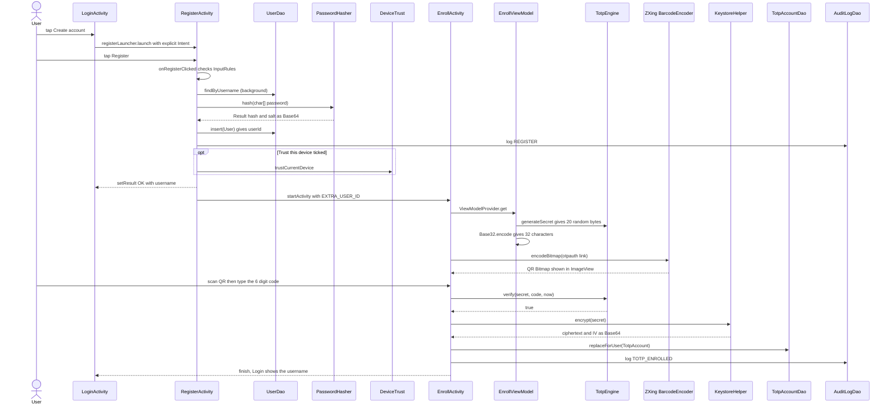

1. **`LoginActivity`** → `onCreate` wires `buttonCreateAccount` → `registerLauncher.launch(new Intent(this, RegisterActivity.class))` → opens **`RegisterActivity`**.
2. **`RegisterActivity`** → `onRegisterClicked` (UI): `InputRules.normalizeUsername` → `usernameError` / `passwordError`; the password is copied with `BaseActivity.readChars` into a `char[]`. It reads the check box `checkboxTrust.isChecked()` on the UI thread and calls `runInBackground(createAccount, onRegisterFinished)`.
3. **`RegisterActivity`** → `createAccount` (BG) → **`UserDao`** → `findByUsername(username)` → **`PasswordHasher`** → `hash(char[])` (random 16-byte salt, PBKDF2 120,000 rounds; the array is wiped) returns `Result(hash, salt)` as Base64 → `UserDao.insert(User{username, passwordHash, salt, createdAt})` returns the new `userId` (−1 if taken).
4. **`AuditLogDao`** → `log(userId, REGISTER, SUCCESS)`; if the box was ticked, **`DeviceTrust`** → `trustCurrentDevice` → `TrustedDeviceDao.insert` → `SharedPreferences` key `trusted_device_id_<userId>` → `AuditLogDao.log(DEVICE_TRUSTED)`.
5. **`RegisterActivity`** → `onRegisterFinished(userId)` (UI): `setResult(RESULT_OK, new Intent().putExtra(EXTRA_USERNAME, username))` (delivered to Login's `registerLauncher` callback, which fills the username field) → `startActivity(EnrollActivity)` with `EXTRA_USER_ID = userId` → `finish()`.
6. **`EnrollActivity`** → `onCreate` → `new ViewModelProvider(this).get(EnrollViewModel.class)` → the ViewModel constructor runs **`TotpEngine`** → `generateSecret()` (20 bytes from `SecureRandom`) and **`Base32`** → `encode(secret)` (32 characters). The secret stays in the ViewModel (and survives rotation); it is **not** in the database yet.
7. **`EnrollActivity`** → `loadQrCode` (BG) → `UserDao.getById(userId)` (for the username) → `TotpEngine.buildOtpAuthUri("SecureAuth", username, base32, 6, 30, "HmacSHA1")` returns the `otpauth://totp/...` link → ZXing `BarcodeEncoder.encodeBitmap(uri, QR_CODE, 800, 800)` → `Bitmap` → `imageQr.setImageBitmap`.
8. The user scans the QR with Google Authenticator and taps *I've scanned it*; **`EnrollActivity`** → `onConfirmClicked`: the text must match `\d{6}`; `model.copySecret()` → `TotpEngine.verify(secret, code, now, 6, 30, algo)`. Wrong → `AuditLogDao.log(ENROLL_VERIFY_FAIL, FAIL)` and an error on the field; nothing is stored.
9. Correct → `runInBackground(saveAccount, onSaveFinished)`: **`KeystoreHelper`** → `encrypt(secret)` (AES-256-GCM, key `secureauth_totp_key` inside the Android Keystore, fresh IV) returns `ciphertext` + `iv` (Base64) → `TotpAccount{userId, secretEnc, iv, issuer="SecureAuth", digits=6, period=30, algo="HmacSHA1", createdAt}` → **`TotpAccountDao`** → `replaceForUser` (transaction: delete old, insert new) → `AuditLogDao.log(TOTP_ENROLLED)`; the secret copy is wiped.
10. `onSaveFinished(true)` → toast, `setResult(RESULT_OK)`, `finish()`. The user is back on **`LoginActivity`** with the username filled in. When the screen finishes, `EnrollViewModel.onCleared` wipes the secret and `EnrollActivity.onDestroy` deletes any cached QR PNG.

*Sharing the QR image* (long-press on the QR) is a separate flow, see [5.11](#511-sharing-the-qr-image).

---

### 5.2 The full login handshake

*(password → TOTP → biometric → session → dashboard)*

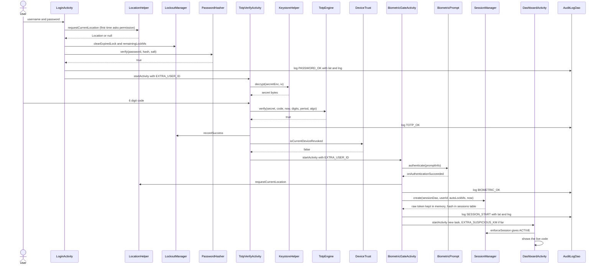

1. **`LoginActivity`** → `onLoginClicked` (UI): both fields non-empty → `ensureLocationPermission(...)` (see [5.6](#56-audit-logging-location-capture-and-the-suspicious-login-check)) → `withCurrentLocation(location -> startPasswordCheck(username, location))`.
2. `startPasswordCheck` re-reads the password (`readChars`) and calls `runInBackground(checkPassword(username, password, lat, lng), onCheckFinished)`.
3. **`LoginActivity`** → `checkPassword` (BG) → **`UserDao.findByUsername`** → (unknown user: `PasswordHasher.verify` against a dummy hash for equal timing, `BAD_CREDENTIALS`) → **`LockoutManager`** → `clearExpiredLock`, `remainingLockMs` (locked: return `LOCKED` without checking the password) → **`PasswordHasher.verify(password, user.passwordHash, user.salt)`**.
4. Correct → **`AuditLogDao.log(PASSWORD_OK, SUCCESS, lat, lng)`**; the failure counter is **not** reset yet. `onCheckFinished(OK)` (UI) → `startActivity(new Intent(this, TotpVerifyActivity.class).putExtra(EXTRA_USER_ID, userId))`. *Data: `userId` as an Intent extra.*
5. **`TotpVerifyActivity`** → `onCreate` → `loadScreenData` (BG): `UserDao.getById`, `LockoutManager.clearExpiredLock`, `TotpAccountDao.listForUser` → `onLoaded`: the account (`secretEnc`, `iv`, `digits`, `period`, `algo`) is kept; the input is limited to `digits` characters and enabled.
6. The user types 6 digits; the text watcher calls `submit(code)` → `runInBackground(checkCode, onChecked)`. **`checkCode`** (BG): re-check the lock → **`KeystoreHelper.decrypt(secretEnc, iv)`** returns the raw secret bytes → **`TotpEngine.verify(secret, code, now, digits, period, algo)`** (the secret is wiped in a `finally`).
7. Correct → **`AuditLogDao.log(TOTP_OK)`** → **`LockoutManager.recordSuccess`** (counter reset) → `Outcome.OK` → `onChecked` → `continueAfterCodeStep`.
8. `continueAfterCodeStep` (BG) → **`DeviceTrust.isCurrentDeviceRevoked`** → not revoked → `goToBiometricGate`: `startActivity(BiometricGateActivity)` with `EXTRA_USER_ID`, then `finish()` (Back cannot return). *(If revoked, see [5.8](#58-trusted-device-revoke-and-its-effect-on-the-next-login).)*
9. **`BiometricGateActivity`** → `onCreate` → `BiometricSupport.authenticators(Build.VERSION.SDK_INT)` → `new BiometricPrompt(...)` → `startAuthentication` → `BiometricManager.canAuthenticate` → `BiometricSupport.fromCanAuthenticate` → `READY` → `prompt.authenticate(promptInfo)` (the system fingerprint/PIN dialog).
10. `PromptCallback.onAuthenticationSucceeded` → `handleSuccess` (once, guarded by `flowDone`) → `withCurrentLocation` → `completeLogin(lat, lng)` (BG): `LockoutManager.recordSuccess` → `AuditLogDao.log(BIOMETRIC_OK)` → previous-login comparison (see 5.6) → **`SessionManager.getInstance().create(sessionDao, userId, autoLockMs, now)`**: deletes expired rows and the user's older sessions, makes a 32-byte token, **inserts the SHA-256 hash with `expires_at = now + autoLockMs`**, and keeps the raw token in memory → `AuditLogDao.log(SESSION_START, SUCCESS, lat, lng)`.
11. UI: `startActivity(DashboardActivity)` with flags `NEW_TASK | CLEAR_TASK` (empty back stack) and, if far from the last login, `EXTRA_SUSPICIOUS_KM`; `finish()`.
12. **`DashboardActivity`** → `onCreate` → **`BaseActivity.enforceSession`** → `SessionManager.check(sessionDao, now)` → `SessionDao.findValid(userId, hashToken(token), now)` → `ACTIVE`; `userId = SessionManager.getUserId()` (from the session, not from an extra) → the live code appears (5.3).

Any step that fails stops the flow: a wrong password, code or fingerprint never reaches the next Activity; three failures in a row (all steps share the counter) lock the account (5.4). Cancelling the fingerprint writes `BIOMETRIC_FAIL / CANCELLED` and returns to Login without a session.

---

### 5.3 Live code refresh every second on the Dashboard

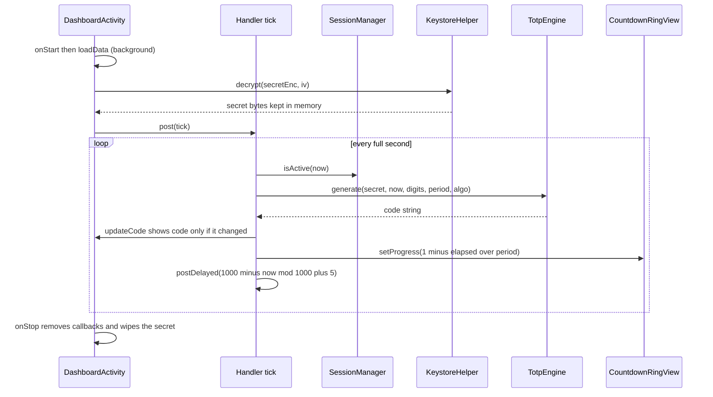

1. **`DashboardActivity`** → `onStart` → `enforceSession` → `visible = true` → `loadData` (BG): `UserDao.getById`, `TotpAccountDao.listForUser` → **`KeystoreHelper.decrypt(found.secretEnc, found.iv)`** → `Data(user, account, secret)` → `onDataLoaded` (UI): keeps `secret` and `account`, shows issuer and username, `ring.setPeriodSeconds(account.period)`, `handler.removeCallbacks(tick)`, `handler.post(tick)`.
2. **`tick.run`**: `SessionManager.isActive(now)`; if the auto-lock time ran out → `enforceSession()` (see 5.10) and stop. Otherwise → `updateCode` → then `handler.postDelayed(this, 1000 - (now % 1000) + 5)` — so it wakes just after the next whole second.
3. **`updateCode`**: `TotpEngine.generate(secret, now, digits, period, algo)` → if the string differs from `lastCode` (a new 30-second window has begun) → `binding.textCode.setText(TotpEngine.formatForDisplay(code))` (`123456` → `123 456`). Every second: `secondsLeft = TotpEngine.secondsRemaining(now, period)`; `progress = 1 − (now mod periodMs)/periodMs` → **`CountdownRingView.setProgress(progress)`** → `invalidate()` → `onDraw` (red in the last 5 s); the text "New code in N s" and the ring's content description are updated.
4. **Pull to refresh**: `swipeRefresh.setOnRefreshListener(this::loadData)` re-runs step 1 (and `setRefreshing(false)` in `onDataLoaded`).
5. **Tap to copy**: `textCode.setOnTouchListener` dims on `ACTION_DOWN`, restores on `UP/CANCEL` and returns `false`; `setOnClickListener` → `copyToClipboard(app_name, lastCode)` (sensitive flag on Android 13+, without the space) → toast.
6. **`onStop`**: `visible = false`, `handler.removeCallbacks(tick)`, `wipeSecret()` — the readable secret is not kept while the screen is hidden; returning to the screen runs `onStart` → `loadData` again.

---

### 5.4 Lockout after 3 failed attempts

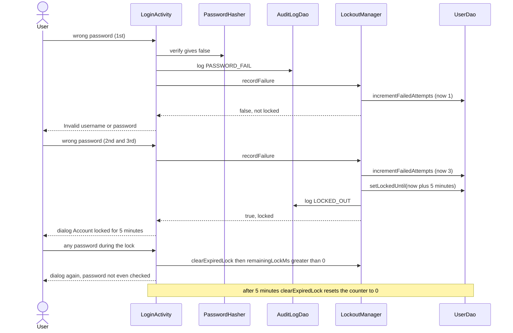

1. **`LoginActivity`** → `checkPassword` (BG) → `PasswordHasher.verify` is `false` → `AuditLogDao.log(PASSWORD_FAIL, FAIL, lat, lng)` → **`LockoutManager.recordFailure(userId, now)`** → `UserDao.incrementFailedAttempts` (an SQL `failed_attempts + 1`) → `UserDao.getById` → fewer than 3: returns `false` → `Outcome(BAD_CREDENTIALS)` → `onCheckFinished`: password cleared, toast and field error "Invalid username or password".
2. On the third failure `recordFailure` calls `UserDao.setLockedUntil(userId, now + 5 min)` and `AuditLogDao.log(LOCKED_OUT, FAIL)` and returns `true` → `Outcome(LOCKED, userId, 5 min)` → `onCheckFinished` → **`BaseActivity.showLockDialog(remainingMs, null)`** with `LockoutManager.formatRemaining` → "Try again in 5:00".
3. During the lock: `checkPassword` → `clearExpiredLock` (no effect yet) → `remainingLockMs > 0` → `LOCKED` **before** the password is even verified.
4. Once `locked_until <= now`, `clearExpiredLock` calls `UserDao.resetFailedAttempts` and `setLockedUntil(0)` → the user gets three fresh tries (without it the old count of 3 would lock again on the next mistake).
5. **The same counter is used by every step**: `TotpVerifyActivity.checkCode` (`TOTP_FAIL`), `BackupRecoveryActivity.checkCode` (`BACKUP_CODE_FAIL`) and `BiometricGateActivity.handleFailedAttempt` (`BIOMETRIC_FAIL`) all call `LockoutManager.recordFailure`; each shows `showLockDialog` and then leaves its screen. It is cleared only by `LockoutManager.recordSuccess`, called after a correct TOTP code, a correct backup code, and at the end of the biometric step (`completeLogin`). Because the counter lives in `users.failed_attempts` / `locked_until`, closing the app does not reset it.

---

### 5.5 Backup-code recovery

*(lost authenticator: spend one code to log in once, or to set up a new authenticator)*

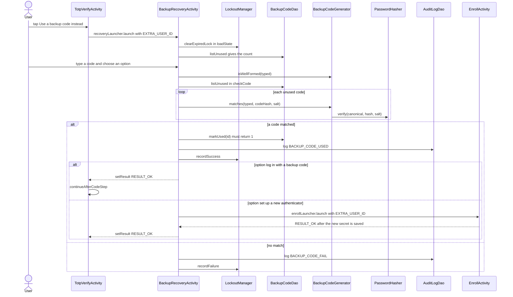

1. **`TotpVerifyActivity`** → the button `buttonBackupCode` → `recoveryLauncher.launch(new Intent(this, BackupRecoveryActivity.class).putExtra(EXTRA_USER_ID, userId))`.
2. **`BackupRecoveryActivity`** → `onCreate` → `loadState` (BG): `UserDao.getById`, `LockoutManager.clearExpiredLock`, `remainingLockMs`, `BackupCodeDao.listUnused(userId).size()` → locked: `finishLocked` (lock dialog, then `setResult(RESULT_LOCKED)`); no unused codes: shows "no unused backup codes"; else enables the field and button.
3. The user types a code (for example `K7QM-X2PD`, case and hyphen optional) and the radio choice (*log in* is the default). `onContinueClicked` → `BackupCodeGenerator.isWellFormed(typed)`: if false, only a format error is shown (**not** a failed attempt).
4. `runInBackground(checkCode(typed), onChecked)` → **`checkCode`** (BG): re-check the lock → `BackupCodeDao.listUnused(userId)` → for each unused row → **`BackupCodeGenerator.matches(typed, candidate.codeHash, candidate.salt)`** → `normalize(typed)` → **`PasswordHasher.verify(canonical.toCharArray(), hash, salt)`** (one slow hash per unused code, at most 10).
5. A match → **`BackupCodeDao.markUsed(candidate.id)`** (`UPDATE ... WHERE id = ? AND used = 0`). It must return `1`; `0` means the code was spent a moment ago and counts as wrong. Then `AuditLogDao.log(BACKUP_CODE_USED)` and `LockoutManager.recordSuccess(userId)` → `Outcome.OK`.
6. No match → `AuditLogDao.log(BACKUP_CODE_FAIL, FAIL)` → `LockoutManager.recordFailure` → either `WRONG` ("N attempts left", field cleared) or `LOCKED` (`finishLocked`).
7. `onChecked(OK)` (UI): **log-in option** → `setResult(RESULT_OK)` + `finish()` → **`TotpVerifyActivity`**'s `recoveryLauncher` callback → `continueAfterCodeStep` (revoked-phone check, then biometric — see 5.2 and 5.8). **Set-up-new-authenticator option** → `enrollLauncher.launch(EnrollActivity, EXTRA_USER_ID)` → the user scans and confirms a new secret (5.1 steps 6–10; `TotpAccountDao.replaceForUser` replaces the old authenticator) → `RESULT_OK` back to `BackupRecoveryActivity` → `setResult(RESULT_OK)` + `finish()` → the same callback in `TotpVerifyActivity`. If the user backs out of enrollment, the old authenticator stays and the result is `RESULT_CANCELED`.

#### Where the codes come from (generation, save, share)

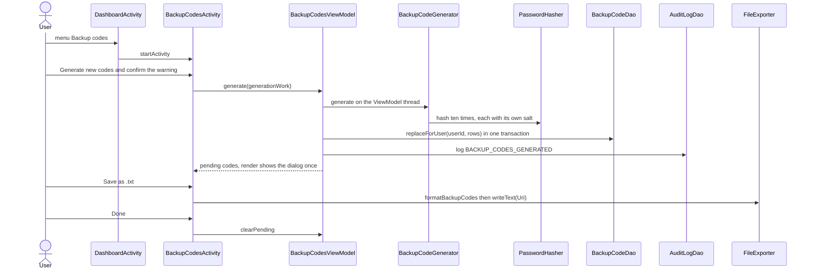

1. **`DashboardActivity`** → `onOptionsItemSelected(action_backup_codes)` → `startActivity(BackupCodesActivity)`. **`BackupCodesActivity`** → `onCreate` → `enforceSession` → `userId = SessionManager.getUserId()`.
2. *Generate new codes* → `confirmGenerate` (warning dialog) → `BackupCodesViewModel.generate(generationWork())`. The `Supplier` runs on the **ViewModel's** thread: **`BackupCodeGenerator.generate()`** (10 codes, each `PasswordHasher.hash`) → rows `BackupCode{userId, codeHash, salt}` → **`BackupCodeDao.replaceForUser`** (delete old + insert new in one transaction) → `AuditLogDao.log(BACKUP_CODES_GENERATED)` → `Generation(plainCodes, username, createdAt)`.
3. The ViewModel posts the result to the main thread; `render` → `showCodesDialog` (non-cancellable) shows the plain codes **once**. *Save as .txt* → `saveLauncher.launch("backup_codes.txt")` (system file picker, no permission) → `onSaveLocationChosen(Uri)` → `FileExporter.formatBackupCodes` → `FileExporter.writeText(contentResolver, uri, text)`. *Share* → `shareCodes` → `Intent.ACTION_SEND` (`text/plain`) in a chooser.
4. *Done* → `BackupCodesViewModel.clearPending()`; `refreshRemaining` shows "N of 10 codes remaining". Only the **hashes** are in the database; a rotation during the dialog does not lose the codes because they live in the ViewModel.

---

### 5.6 Audit logging, location capture and the suspicious-login check

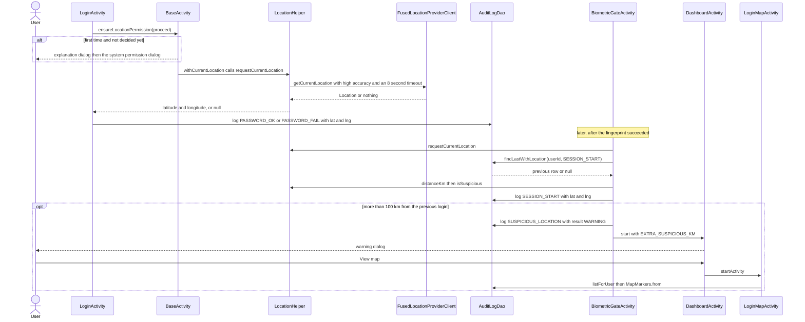

1. **Permission, once.** `LoginActivity.onLoginClicked` → **`BaseActivity.ensureLocationPermission(proceed)`**. If recording is off, permission is granted, or the user was already asked → `proceed.run()`. Otherwise a rationale dialog: *Allow* → `helper.markAsked()`, `afterLocationPermission = proceed`, `locationPermissionLauncher.launch(LocationHelper.PERMISSIONS)` → Android's dialog → `continueAfterLocationPermission` → `proceed.run()` (allowed or denied). *Not now* → `markAsked()`, `proceed.run()`.
2. **Position.** `BaseActivity.withCurrentLocation(next)` → **`LocationHelper.requestCurrentLocation(listener)`**: no permission or setting off → `listener.onLocation(null)` at once; otherwise `FusedLocationProviderClient.getCurrentLocation(PRIORITY_HIGH_ACCURACY, token)` with an 8-second `Handler` timeout — the first of *position / failure / timeout* delivers once (an `AtomicBoolean` guards it) → `next.accept(location)` only if the screen is still alive.
3. **Password rows carry the place.** `LoginActivity.startPasswordCheck` passes `Double lat, lng` (or `null`) into `checkPassword` → `AuditLogDao.log(userId, PASSWORD_OK | PASSWORD_FAIL, result, lat, lng)` — failures carry the place too, so a failed attempt from somewhere odd shows up on the map.
4. **Biometric step.** `BiometricGateActivity.handleSuccess` → `withCurrentLocation` → `completeLogin(lat, lng)` (BG). **Before** writing the new session row: if `lat/lng` are known → `AuditLogDao.findLastWithLocation(userId, SESSION_START)` → if there is a previous login → **`LocationHelper.distanceKm(prev.lat, prev.lng, lat, lng)`** (haversine) → **`LocationHelper.isSuspicious(km)`** (strictly more than 100 km) → remember `suspiciousKm`.
5. Then `SessionManager.create(...)` → `AuditLogDao.log(SESSION_START, SUCCESS, lat, lng)` → if suspicious: `AuditLogDao.log(SUSPICIOUS_LOCATION, WARNING, lat, lng)`. The Dashboard Intent carries `EXTRA_SUSPICIOUS_KM`.
6. **Warning.** `DashboardActivity.onCreate` (fresh start only) → `showSuspiciousLoginDialog(km)` → *View map* → `startActivity(LoginMapActivity)` → `onMapReady` → `runInBackground(MapMarkers.from(auditDao.listForUser(userId), timeFormat), drawMarkers)` → one marker per located entry, red for failures/`SUSPICIOUS_LOCATION`, green otherwise; camera fitted to all markers.
7. **No place?** With permission denied, setting off, a timeout or an emulator with no fix, `lat/lng` are `null`: the login proceeds, rows store `NULL`, nothing is compared, and the map simply omits them.

#### Audit event catalogue — who writes what

| Event | Result values | Written by (file → method) |
|---|---|---|
| `REGISTER` | `SUCCESS` | `RegisterActivity` → `createAccount` |
| `PASSWORD_OK` / `PASSWORD_FAIL` | `SUCCESS` / `FAIL` (+ place) | `LoginActivity` → `checkPassword` |
| `LOCKED_OUT` | `FAIL` | `LockoutManager` → `recordFailure` (3rd failure of any step) |
| `ENROLL_VERIFY_FAIL` | `FAIL` | `EnrollActivity` → `onConfirmClicked` |
| `TOTP_ENROLLED` | `SUCCESS` | `EnrollActivity` → `saveAccount` |
| `TOTP_OK` / `TOTP_FAIL` | `SUCCESS` / `FAIL` | `TotpVerifyActivity` → `checkCode` |
| `BACKUP_CODES_GENERATED` | `SUCCESS` | `BackupCodesActivity` → `generationWork` |
| `BACKUP_CODE_USED` / `BACKUP_CODE_FAIL` | `SUCCESS` / `FAIL` | `BackupRecoveryActivity` → `checkCode` |
| `BIOMETRIC_OK` | `SUCCESS` | `BiometricGateActivity` → `completeLogin` |
| `BIOMETRIC_FAIL` | `FAIL` / `CANCELLED` / `ERROR` | `BiometricGateActivity` → `handleFailedAttempt` / `handleCancelled` / `handleError` |
| `SESSION_START` | `SUCCESS` (+ place) | `BiometricGateActivity` → `completeLogin` |
| `SUSPICIOUS_LOCATION` | `WARNING` (+ place) | `BiometricGateActivity` → `completeLogin` |
| `LOGOUT` | `SUCCESS` | `DashboardActivity` → `logout` → `BaseActivity.endSession` |
| `SESSION_EXPIRED` | `SUCCESS` | `BaseActivity` → `enforceSession` → `endSession` |
| `DEVICE_TRUSTED` | `SUCCESS` | `DeviceTrust` → `trustCurrentDevice` |
| `DEVICE_RENAMED` / `DEVICE_REVOKED` | `SUCCESS` | `TrustedDevicesActivity` → `rename` / `revoke` |

All 20 constants of `AuditEvent` have a writer; the planned `AUTO_LOCK` event does not exist (see 5.10).

---

### 5.7 Login history filter, and CSV export / import

**Filter by date**

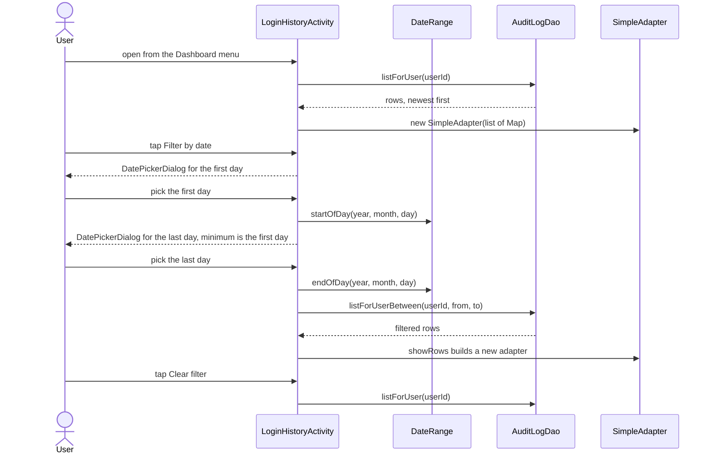

1. **`DashboardActivity`** → `onOptionsItemSelected(action_login_history)` → `startActivity(LoginHistoryActivity)`. **`LoginHistoryActivity`** → `onCreate` → `enforceSession` → `loadHistory` (BG) → **`AuditLogDao.listForUser(userId)`** → `showRows(rows)` (UI): `shown = rows`; each row becomes a `Map{icon, event, time, location}` (`HistoryFormat.isFailure`, `DateFormat`, `HistoryFormat.location`) → `new SimpleAdapter(..., R.layout.item_history, from[], to[])` + `ViewBinder` → `listHistory.setAdapter`.
2. *Filter by date* → `showFromPicker` → `DatePickerDialog` (max = `DateRange.endOfToday()`) → OK → `showToPicker(DateRange.startOfDay(y, m, d))` → second `DatePickerDialog` (min = the first day, max = end of today) → OK → `applyFilter(from, DateRange.endOfDay(y, m, d))` → `loadHistory` → **`AuditLogDao.listForUserBetween(userId, from, to)`** → `showRows` (the chip and "Showing X to Y" appear in `showFilterState`).
3. *Clear filter* chip → `clearFilter` → both bounds reset → `loadHistory` → all rows. A rotation keeps the filter through `onSaveInstanceState`.

**Export and import CSV**

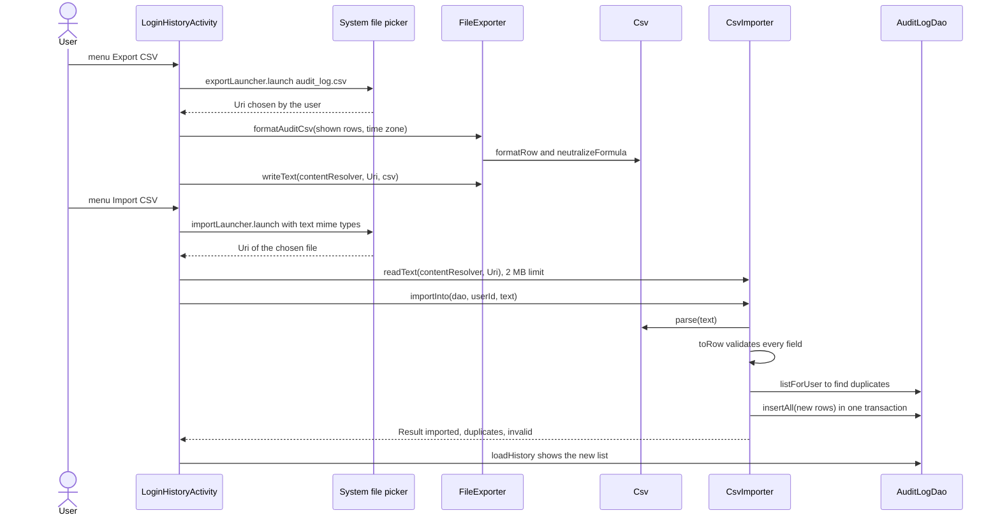

4. **Export.** `onOptionsItemSelected(action_export_csv)` → `exportLauncher.launch("audit_log.csv")` (`ActivityResultContracts.CreateDocument("text/csv")`) → user picks a place → `exportTo(Uri)` → `FileExporter.formatAuditCsv(new ArrayList<>(shown), TimeZone.getDefault())` (header `ts,datetime,event,result,lat,lng`; `Csv.formatRow`; `Csv.neutralizeFormula` on text columns) → `runInBackground(FileExporter.writeText(getContentResolver(), uri, csv))` → toast "Exported N entries". *Data: exactly the rows currently shown.*
5. **Import.** `action_import_csv` → `importLauncher.launch(new String[]{"text/*", "application/csv", ...})` (`OpenDocument`) → `importFrom(Uri)` → (BG) **`CsvImporter.readText(contentResolver, uri)`** (UTF-8, refuses over 2 MB) → **`CsvImporter.importInto(auditDao, userId, text)`** → `parse` → `Csv.parse` (quotes, line endings, BOM) → header must contain `ts` and `event` → `toRow` per record (valid time, `[A-Z][A-Z0-9_]*` event/result, both coordinates in range) → a `HashSet` of existing `"ts|event"` keys from `AuditLogDao.listForUser` skips duplicates → **`AuditLogDao.insertAll`** (one transaction; each row's `userId` is forced to the logged-in user) → `Result(imported, duplicates, invalid)` → toast "Imported N, skipped M duplicates and K invalid rows" → `loadHistory`. A bad file gives "That file could not be imported" and changes nothing.

---

### 5.8 Trusted device revoke and its effect on the next login

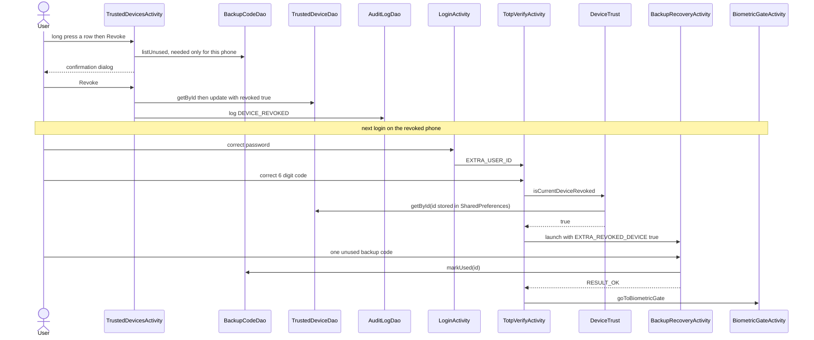

1. **Revoke.** **`TrustedDevicesActivity`** → long-press on a `ListView` row → `onCreateContextMenu` (header = device name; *Revoke* removed if already revoked) → `onContextItemSelected(action_revoke_device)` → `deviceAt(menuInfo)` → **`askToRevoke(device)`**: for *this* phone (`device.id == currentDeviceId`) → `BackupCodeDao.listUnused(userId).size()`; zero → toast "Create backup codes first"; otherwise → `showRevokeDialog` → **Revoke** → `revoke(deviceId)` (BG) → `TrustedDeviceDao.getById` (must belong to this user) → `row.revoked = true` → `TrustedDeviceDao.update` → `AuditLogDao.log(DEVICE_REVOKED)` → toast → `loadDevices` (the row now shows a red cross and "Revoked - This device").
2. **Rename** (same screen): *Rename* → `showRenameDialog` → `DeviceTrust.cleanName` + `isValidName` → `rename(id, name)` → `TrustedDeviceDao.update` → `AuditLogDao.log(DEVICE_RENAMED)`. The link to "this phone" is the id in `SharedPreferences`, so a new name changes nothing else.
3. **Next login.** Steps 1–7 of 5.2 are unchanged. At step 8, **`TotpVerifyActivity.continueAfterCodeStep`** → (BG) **`DeviceTrust.isCurrentDeviceRevoked(appContext, deviceDao, userId)`** → `currentDeviceId` (key `trusted_device_id_<userId>`) → `TrustedDeviceDao.getById(id)` → `revoked && userId matches` → `true`.
4. UI: `revokedDeviceLauncher.launch(BackupRecoveryActivity)` with `EXTRA_USER_ID` and `EXTRA_REVOKED_DEVICE = true`. In that mode the radio group is hidden and the subtitle says one more backup code is needed; `checkCode` works exactly as in 5.5 (wrong codes → `BACKUP_CODE_FAIL` and the shared lockout counter; a correct one is **spent** with `markUsed`).
5. `RESULT_OK` → `revokedDeviceLauncher` callback → `goToBiometricGate`. Anything else (Back, lock, no unused codes) → `finish()` and the login ends at Login. *A phone that was never trusted is not "revoked" and goes straight to the biometric step. If the user logged in with a backup code **instead** of the TOTP code, a revoked phone still needs a second code* (`continueAfterCodeStep` is shared).

---

### 5.9 Profile photo from camera or gallery — not implemented

There is no workflow to describe, because the Profile screen is not built (Phase 13). What exists: the Dashboard menu item `action_profile` shows a toast ("Profile is coming in a later phase"), and `users.avatar_uri` is a nullable column that nothing writes. See [4.12](#412-profile-camera-and-gallery--not-built-yet) for the real code and for what the plan intends. The nearest existing flow that stores an image on the device is the QR share in [5.11](#511-sharing-the-qr-image).

---

### 5.10 Auto-lock: session expiry (and the missing screen-off lock)

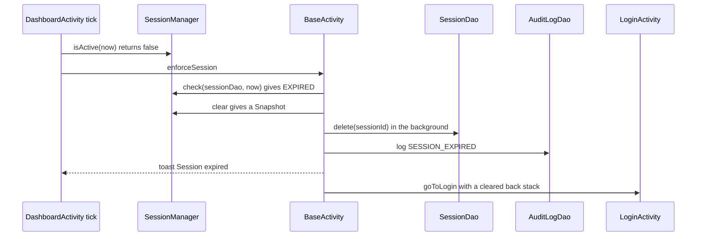

1. At login, **`SessionManager.create`** stores `expires_at = now + autoLockMs`, where `autoLockMs = SessionManager.getAutoLockMs(context)` (preference `auto_lock_ms`, default **5 minutes**, always kept within 1–30 min; there is no Settings screen to change it yet).
2. **While a protected screen is open**: `DashboardActivity.tick` runs every second → `SessionManager.isActive(now)` (no database) → when `now >= expiresAt` → `enforceSession()`. **When a protected screen comes back to the foreground**: `BaseActivity.onResume` → `enforceSession()`; protected screens also call it in `onCreate`.
3. **`BaseActivity.enforceSession`** → `SessionManager.check(sessions, now)`: `NONE` (no token, or the database row is gone) or `EXPIRED`. For both: `endSession(timedOut ? SESSION_EXPIRED : null)` → `SessionManager.clear()` returns `Snapshot(userId, sessionId)` → (BG) `SessionDao.delete(sessionId)` and `AuditLogDao.log(userId, SESSION_EXPIRED, SUCCESS)` → if it timed out, toast "Session expired. Please log in again." → `goToLogin()` (`NEW_TASK | CLEAR_TASK`, then `finish()`).
4. **Manual logout** is the same tail: `DashboardActivity.logout` → `endSession(LOGOUT)` → `goToLogin`.
5. **Not implemented:** locking when the **screen turns off**. The plan's `ScreenOffReceiver` (a `BroadcastReceiver` for `ACTION_SCREEN_OFF`) and the `AUTO_LOCK` audit event do not exist (see [4.15](#415-broadcast-receivers--not-built-yet)). Today an unlocked app that is switched to the background stays valid until the 5-minute expiry, and is then rejected at the next `onResume`.

---

### 5.11 Sharing the QR image

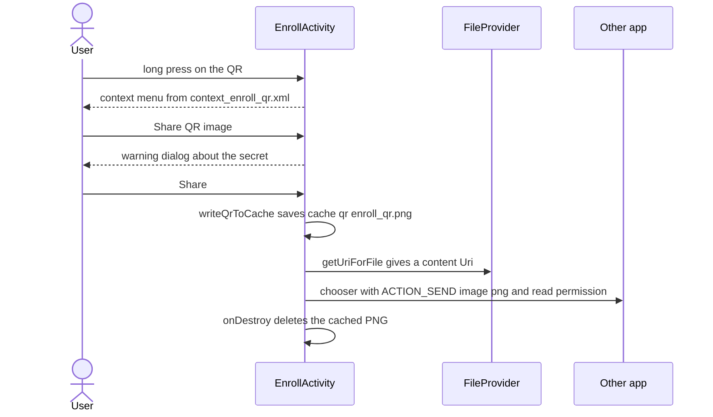

1. **`EnrollActivity`** → `onCreate` → `registerForContextMenu(binding.imageQr)`. A long-press → `onCreateContextMenu` inflates `R.menu.context_enroll_qr` → `onContextItemSelected`: *Copy secret* → `copySecret` (clipboard, sensitive, toast); *Share QR image* → `confirmShareQr` (the image contains the secret, so a dialog asks first).
2. *Share* → `shareQrImage` → `runInBackground(writeQrToCache)`: `File(getCacheDir(), "qr/enroll_qr.png")` ← `qrBitmap.compress(PNG)` → `FileProvider.getUriForFile(this, getPackageName() + ".fileprovider", file)` (allowed folder: `cache/qr/`, from `res/xml/file_paths.xml`) → `content://` `Uri`.
3. UI: `new Intent(ACTION_SEND).setType("image/png").putExtra(EXTRA_STREAM, uri).addFlags(FLAG_GRANT_READ_URI_PERMISSION)` → `Intent.createChooser(...)` → `startActivity`. This is an **implicit Intent**: the user's chosen app receives temporary read access to that one file.
4. When the Enroll screen finishes, `onDestroy` deletes `cache/qr/enroll_qr.png`, because the image *is* the secret.

---

## 6. Course policy coverage matrix

**How to read it.** ✅ = implemented and demonstrable · 🟡 = partly implemented · ❌ = not covered (the reason is given). "Where to demonstrate" names the screen and what to tap. File names are in `app/src/main/java/com/secureauth/simulator/` (`ui/`, `crypto/`, `data/`, `io/`, `location/`, `views/`) and `app/src/main/res/` unless a full path is given. The matrix follows the course items as listed in the project brief; the syllabus text itself is not in this repository.

### 6.1 Units

| Course item | Status | Where implemented (file + method) | Where to demonstrate | Reason / note |
|---|---|---|---|---|
| **Unit 1** — Android Studio setup and emulator | ✅ | `app/build.gradle.kts`, `gradle/libs.versions.toml`, `README.md`; manifest launcher filter in `AndroidManifest.xml` (`SplashActivity`) | Run the app on the Pixel emulator (PIN + fingerprint set in Extended controls) | — |
| **Unit 2** — simple controls | ✅ | `activity_login.xml`, `activity_register.xml`, `activity_totp_verify.xml` (`TextInputEditText`, `MaterialButton`, `TextView`) | Login, Register, TOTP screens | — |
| **Unit 2** — check boxes | ✅ | `activity_register.xml` (`checkbox_trust`); `RegisterActivity.onRegisterClicked` | Register → "Trust this device" | Decides whether the phone enters `trusted_devices` |
| **Unit 2** — radio buttons | ✅ | `activity_backup_recovery.xml` (`RadioGroup`); `BackupRecoveryActivity.onChecked` | TOTP screen → "Use a backup code instead" | Two options: log in / set up a new authenticator |
| **Unit 2** — screen layout | ✅ | `ConstraintLayout` (`activity_splash.xml`); `ScrollView`+`LinearLayout` (forms); `FrameLayout` (`activity_dashboard.xml` ring + overlay); `SwipeRefreshLayout` | Splash, Login, Dashboard | — |
| **Unit 2** — spinner | ❌ | — | — | The Settings screen (Phase 14) is not built; the plan puts the digits/period/algorithm spinners there |
| **Unit 2** — menus | ✅ | Options menus: `DashboardActivity.onCreateOptionsMenu`/`onOptionsItemSelected` (`menu_dashboard.xml`), `LoginHistoryActivity` (`menu_login_history.xml`). Context menus: `EnrollActivity.onCreateContextMenu` (`context_enroll_qr.xml`), `TrustedDevicesActivity.onCreateContextMenu` (`context_trusted_device.xml`) | Dashboard ⋮ menu; long-press the QR; long-press a trusted device | — |
| **Unit 2** — date picker | ✅ | `LoginHistoryActivity.showFromPicker`, `showToPicker` (`DatePickerDialog`) | Login history → Filter by date | — |
| **Unit 2** — touch listener | ✅ | `DashboardActivity.setUpTapToCopy` (`OnTouchListener`) | Dashboard → press and hold the code (dims) | — |
| **Unit 2** — graphics | ✅ | `views/CountdownRingView.onDraw`, `onMeasure` (`Canvas`, `Paint`, `drawArc`) | Dashboard ring | — |
| **Unit 2** — toasts | ✅ | `BaseActivity.showToast` (two overloads), used on all screens | Wrong password; tap the code on the Dashboard | — |
| **Unit 2** — multiscreen apps | ✅ | 12 Activities; explicit Intents e.g. `SplashActivity.onCreate`, `LoginActivity.onCheckFinished`, `TotpVerifyActivity.goToBiometricGate` | Whole login flow | — |
| **Unit 2** — pop-up dialogs | ✅ | `BaseActivity.showLockDialog`, `ensureLocationPermission`; `EnrollActivity.confirmShareQr`; `BackupCodesActivity.confirmGenerate`, `showCodesDialog`; `TrustedDevicesActivity.showRenameDialog`, `showRevokeDialog`; `DashboardActivity.showSuspiciousLoginDialog` | Three wrong passwords; Backup codes → Generate; long-press a device | — |
| **Unit 3** — displaying images | ✅ | `EnrollActivity.loadQrCode` (`ImageView` + ZXing `Bitmap`); `drawable/ic_status_ok.xml`, `ic_status_fail.xml` (vector icons in list rows) | Registration → QR screen; History rows | No photo gallery in the app; images are the QR and status icons |
| **Unit 3** — images stored on the device | 🟡 | `EnrollActivity.writeQrToCache` (PNG in `cache/qr/`, shared through `FileProvider`) | Long-press the QR → Share | The profile photo (Phase 13) that would be stored permanently is not built |
| **Unit 3** — .txt file handling | ✅ | `BackupCodesActivity.saveLauncher`, `onSaveLocationChosen`; `io/FileExporter.writeText`, `formatBackupCodes` | Backup codes → Generate → Save as .txt | Uses the Storage Access Framework (no storage permission) |
| **Unit 3** — .csv file handling | ✅ | `LoginHistoryActivity.exportTo`, `importFrom`; `io/FileExporter.formatAuditCsv`; `io/Csv`; `io/CsvImporter` | Login history ⋮ → Export CSV / Import CSV | — |
| **Unit 4** — location tracking with Google Maps | ✅ | `location/LocationHelper.requestCurrentLocation`; `LoginMapActivity.onMapReady`, `drawMarkers`; `ui/MapMarkers` | Login history ⋮ → Login map (needs `MAPS_API_KEY` to show tiles) | Without a key the map is blank but markers logic still runs |
| **Unit 5** — Flutter | ❌ (by design) | — | — | Dropped on purpose: the project rule is Java + XML only (no Flutter, Dart, Kotlin or Compose) |
| **Unit 6** — SQLite | ✅ | `data/DbHelper`, six DAOs, `LockoutManager`, `SessionManager` | Any screen; history list; trusted devices | — |
| **Unit 6** — Firebase | ❌ (by design) | — | — | Dropped on purpose: offline-only app, "SQLite only, no network backend" |
| **Unit 7** — client–server | ❌ (by design) | — | — | There is no server; everything runs on the phone |
| **Unit 7** — publishing | 🟡 | `app/build.gradle.kts` (`applicationId`, `versionCode`, `versionName`), `AndroidManifest.xml`, Material 3 theme | — | Phase 15 not done: no signed release/AAB, R8 shrinking is off, no privacy policy file, launcher icon is the template, no `FLAG_SECURE` |

### 6.2 Labs

| Lab | Status | Where implemented (file + method) | Where to demonstrate | Reason / note |
|---|---|---|---|---|
| **Lab 1** — installation | ✅ | Gradle project, `README.md` build steps | Open in Android Studio, run on the emulator | — |
| **Lab 2** — calculator-style UI | 🟡 | The same building blocks (buttons, text inputs, layouts) in `activity_login.xml`, `activity_register.xml`, `activity_totp_verify.xml` | Login/Register/TOTP screens | There is **no calculator screen**: it is not a feature of this project. The layout and control skills are shown by the forms instead |
| **Lab 3** — explicit + implicit Intents | ✅ | Explicit: `SplashActivity.onCreate`, `LoginActivity.onCheckFinished` (extra `user_id`). Implicit: `EnrollActivity.shareQrImage` and `BackupCodesActivity.shareCodes` (`ACTION_SEND` + chooser); `BiometricGateActivity.openEnrollmentSettings` (`Settings.ACTION_BIOMETRIC_ENROLL`); file pickers (`CreateDocument`, `OpenDocument`) | Long-press QR → Share; Backup codes → Share | — |
| **Lab 4** — ListView with SimpleAdapter | ✅ | `LoginHistoryActivity.showRows`; `TrustedDevicesActivity.showDevices` (+ `ViewBinder`) | Login history; Trusted devices | — |
| **Lab 5** — WebView | ❌ | — | — | Help screen (Phase 14) not built; no `assets/help.html`, no `INTERNET` permission |
| **Lab 6** — date / time pickers | 🟡 | Date: `LoginHistoryActivity.showFromPicker`, `showToPicker` | Login history → Filter by date | The **time picker** (auto-lock duration in Settings, Phase 14) is not built |
| **Lab 7** — database CRUD | ✅ | Create: `UserDao.insert`, `AuditLogDao.insertAll`. Read: `AuditLogDao.listForUserBetween`. Update: `TrustedDeviceDao.update` (rename, revoke), `BackupCodeDao.markUsed`. Delete: `SessionDao.delete` (logout), `replaceForUser` (replace old rows) | Register; Login history; Trusted devices → Rename/Revoke | The app has no "delete account" screen; `delete` DAO methods exist and are tested |
| **Lab 8** — Google Map | ✅ | `LoginMapActivity`, `MapMarkers` | Login history → Login map | Needs the Maps API key for tiles |
| **Lab 9** — camera via implicit Intent | ❌ | — | — | Profile screen (Phase 13) not built |
| **Lab 10** — broadcast receiver | ❌ | — | — | `receiver/` package is empty (Phase 14); only time-based auto-lock exists |

### 6.3 Course outcomes (CO1–CO4)

The official CO wording is in the course syllabus, which is not in the repository. The CO numbers below follow how `SECUREAUTH_PLAN.md` tags each phase.

| CO | What the plan ties to it | Evidence in the app | Status |
|---|---|---|---|
| **CO1** | Unit 2 basics: simple controls, check boxes, toasts, dialogs, multiscreen, menus, graphics, touch (Phases 5, 7) | Register, Login, TOTP verify, Dashboard, `CountdownRingView` | ✅ (spinner missing) |
| **CO2** | Unit 3: images, .txt / .csv files, radio buttons, implicit Intents, camera (Phases 6, 9, 10, 13) | Enroll QR + share, Backup codes (.txt, share, radio buttons), Login history (CSV) | 🟡 (camera / profile photo missing) |
| **CO3** | Unit 6 SQLite and Lab 7 CRUD; Unit 4 and Lab 8 Maps (Phases 2, 11) | `data/*`, `LocationHelper`, `LoginMapActivity` | ✅ |
| **CO4** | Unit 7 publishing, polish and demo (Phases 15, 16) | Material 3 theme, tests, docs | 🟡 (release build, signing, privacy policy, demo script not done) |

### 6.4 Everything that is not covered, with the reason

| Missing item | Reason |
|---|---|
| Spinner (Unit 2) | Settings screen not built (Phase 14 not started) |
| Time picker (Lab 6, second half) | Same: auto-lock time picker lives in Settings |
| WebView (Lab 5) | Help screen not built (Phase 14) |
| Camera + gallery, stored image (Lab 9, Unit 3 photo) | Profile screen not built (Phase 13) |
| Broadcast receiver (Lab 10) | Receivers not built (Phase 14) |
| Calculator (Lab 2) | Not a feature of this project; forms cover the controls |
| Flutter (Unit 5), Firebase (Unit 6), client–server (Unit 7) | Dropped by design: Java + XML, SQLite only, offline |
| Publishing steps (Unit 7) | Phase 15 not done (signing, R8, privacy policy, icon) |

---

## 7. Rubric mapping

The 40 marks are split as in `SECUREAUTH_PLAN.md`. For each criterion: the evidence in the app, the files, and what is still weak.

### 7.1 Originality and user needs — 5 marks

| Evidence | Files |
|---|---|
| An authenticator whose **TOTP engine is hand-written** (no OTP/TOTP/Base32 library) and matches Google Authenticator | `crypto/Base32`, `crypto/TotpEngine` |
| A **three-factor handshake** (password → code → fingerprint) with a lockout shared by all steps | `LoginActivity`, `TotpVerifyActivity`, `BiometricGateActivity`, `LockoutManager` |
| **Offline-only** and auditable: every step is an `audit_log` row you can filter, export to CSV and import | `AuditLogDao`, `LoginHistoryActivity`, `io/*` |
| **Suspicious-login detection**: a login more than 100 km from the previous one is flagged and shown on a map | `LocationHelper.distanceKm`, `BiometricGateActivity.completeLogin`, `LoginMapActivity` |
| User needs: recovery when the phone/authenticator is lost (backup codes), and control of which phones are trusted | `BackupCodesActivity`, `BackupRecoveryActivity`, `TrustedDevicesActivity`, `DeviceTrust` |

### 7.2 Self-learning and new concepts — 5 marks

| Concept (outside the syllabus) | Files |
|---|---|
| HMAC-based one-time passwords: RFC 4226 / 6238, dynamic truncation, Base32 (RFC 4648) | `TotpEngine`, `Base32`, tests with the RFC vectors |
| **Android Keystore** AES-256-GCM encryption | `KeystoreHelper` |
| **BiometricPrompt** (AndroidX Biometric) | `BiometricGateActivity`, `BiometricSupport` |
| **ZXing** QR generation and the `otpauth://` link | `EnrollActivity.loadQrCode`, `TotpEngine.buildOtpAuthUri` |
| **PBKDF2** salted hashing, constant-time compare | `PasswordHasher` |
| Also: `ViewModel`, Activity Result API, `FileProvider`, Storage Access Framework, Fused Location, Espresso tests | `EnrollViewModel`, `BackupCodesViewModel`, launchers in several screens, `FileExporter`, `LocationHelper`, `androidTest` |

### 7.3 Standardized workable app (Play Store + Material Design) — 10 marks

| Evidence | Files | Gap |
|---|---|---|
| Material 3 DayNight theme, navy/teal palette, text appearances, dark mode | `themes.xml`, `colors.xml`, `values-night/colors.xml` | — |
| Material Components on every screen (`TextInputLayout`, `MaterialButton`, `MaterialToolbar`, `Chip`, `MaterialAlertDialogBuilder`) | layouts, `BaseActivity` | — |
| All user text in `strings.xml`; accessibility descriptions on icons, QR and ring | `strings.xml`, `LoginHistoryActivity.showRows` (`ViewBinder`), `DashboardActivity.updateCode` | Some content descriptions are left for Phase 15 review |
| Edge-to-edge and keyboard-aware padding; rotation-safe screens | `BaseActivity.applySystemBarPadding`, `EnrollViewModel`, `BackupCodesViewModel`, `configChanges` | — |
| A large automatic test suite (about 120 unit and 207 device tests) | `src/test`, `src/androidTest` | — |
| **Release readiness (Play Store)** | `app/build.gradle.kts`, manifest | **Not done:** signed AAB, R8, privacy policy, final adaptive icon, `FLAG_SECURE`, backup rules (Phase 15) |

### 7.4 Individual contribution — 10 marks

Evidence is the **commit history** (one local commit per phase credited to its owner with `--author`) and `docs/CONTRIBUTIONS.md` (date, phase, owner, what was built, problem, solution, who helped). At the time of writing the repository has **no commits yet** (all files are untracked), so the commits that carry this evidence still have to be made; and `docs/CONTRIBUTIONS.md` has rows for Phases 0–11 but none for Phase 12 yet. The ownership used by the plan:

| Member | Phases (from the plan) | Main files |
|---|---|---|
| A | 0, 3, 4, 5, 7, part of 14 | `crypto/*`, `RegisterActivity`, `LoginActivity`, `TotpVerifyActivity`, `DashboardActivity`, `CountdownRingView`, `LockoutManager` |
| B | 6, 9, part of 10 (CSV), 13, part of 14 | `EnrollActivity`, `BackupCodesActivity`, `BackupRecoveryActivity`, `io/*` |
| C | 1, 2, 8, 10 (history, filter), 11, 12, part of 14 | `data/*` (DbHelper, DAOs), `BiometricGateActivity`, `SessionManager`, `LoginHistoryActivity`, `LocationHelper`, `LoginMapActivity`, `TrustedDevicesActivity` |

*(Section 9 re-groups the same files by the team roles asked for in this guide: A = crypto and security, B = data / files / maps / receivers / release, C = UI and lab screens.)*

### 7.5 Viva and demo — 10 marks

| Evidence | Where |
|---|---|
| `docs/VIVA_NOTES.md`: 5 plain-language bullets and 3 examiner questions per phase | `docs/VIVA_NOTES.md` |
| This guide: every method explained, 3 viva questions per component, a glossary | `docs/CODEBASE_GUIDE.md` |
| Demo path that touches every implemented feature | Section 5 workflows; plan Section 11 checklist (register → enroll → scan with Google Authenticator → logout → full login → history + filter → CSV → map → backup-code recovery) |
| Tests that prove the claims live | `./gradlew test`, `./gradlew connectedAndroidTest` |
| **Still to produce** | `docs/VIVA.md` and the 5-minute demo script (Phase 16); the airplane-mode toast, screen-off lock, profile photo, settings and help parts of the demo are not available yet |
